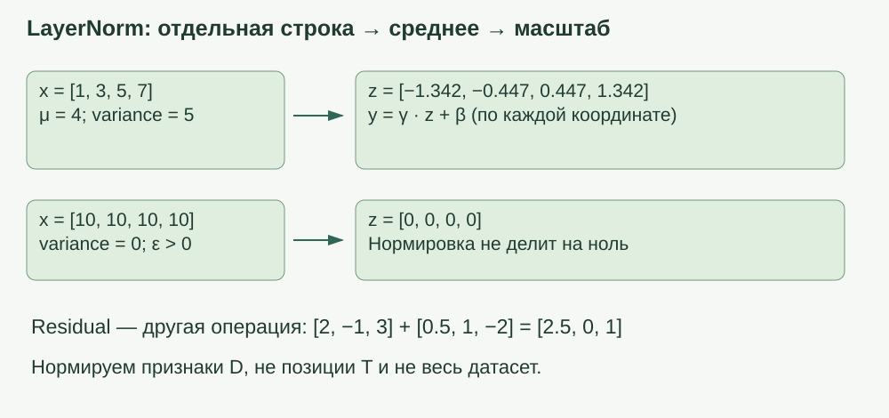

# M08-L06. Residual и LayerNorm: сохранить путь и выровнять масштаб

**Результат:** вручную нормировать одну строку признаков и объяснить, почему residual складывает тензоры одинаковой формы.

**До урока:** M07-L01, M08-L04. Этот урок проходится до M08-L05. Ориентир: 45 минут объяснения, 60 минут вычислений, 30 минут самостоятельной задачи. Это план, не измерение твоего времени.

## Объяснение

### Зачем нужен ещё один блок

Attention смешивает информацию между позициями. Но модель должна иметь возможность оставить исходное представление и добавить к нему изменение. Residual-связь делает именно это: h_new = h + F(h). Если преобразование F выдаёт нули, состояние сохраняется. Это не копирование ответа пользователя в текст: складываются скрытые числовые признаки.

Для h=[2,−1,3] и F(h)=[0.5,1,−2] сумма равна [2.5,0,1]. Обе ветки должны иметь одинаковую форму. Нельзя сложить [batch,tokens,16] и [batch,tokens,32], не добавив согласующее преобразование. PyTorch иногда разрешает broadcasting, но отсутствие исключения не доказывает правильность архитектуры. Явная проверка формы полезнее надежды на сообщение об ошибке.

У суммы есть также важное свойство для обучения. Если мыслить одним числом, производная h+F(h) по h равна 1+F′(h): остаётся прямой путь изменения. Это помогает строить глубокие сети, но не гарантирует отсутствие плохих градиентов при любых весах и шагах. Здесь достаточно понять сохранение пути; доказательство всех свойств глубоких сетей не требуется.

### Что нормирует LayerNorm

Скрытые значения могут изменять масштаб по мере прохождения слоёв. LayerNorm вычисляет среднее и дисперсию по **признакам одной позиции**. Для x=[1,3,5,7] среднее μ=4. Отклонения равны [−3,−1,1,3]; средний квадрат отклонений равен 5. Поэтому нормированный вектор примерно [−1.34164,−0.44721,0.44721,1.34164].

Формула z_i=(x_i−μ)/sqrt(v+ε). Здесь v — среднее квадратов отклонений с делением на число признаков, а ε — небольшое положительное число, защищающее деление при почти постоянной строке. Затем обучаемые γ и β масштабируют и сдвигают результат: y_i=γ_i z_i+β_i. При инициализации γ=1, β=0, но во время обучения они могут изменяться.

Не путай эту операцию с нормализацией числовых столбцов датасета из M01. LayerNorm не накапливает среднее всего train и не использует статистику соседнего объекта. Для тензора [B,T,D] с normalized_shape=D каждая пара индексов b,t нормируется отдельно по D. Если нормировать по T, представление позиции начнёт зависеть от статистики других токенов — получится другое вычисление.



## Разобранный пример

```python
import torch
from torch import nn
x = torch.tensor([[1.,3.,5.,7.], [10.,10.,10.,10.]])
mean = x.mean(dim=-1, keepdim=True)
variance = x.var(dim=-1, keepdim=True, unbiased=False)
manual = (x-mean) / torch.sqrt(variance+1e-5)
layer = nn.LayerNorm(4)
actual = layer(x)
assert torch.allclose(manual, actual, atol=1e-6)
assert torch.allclose(actual[1], torch.zeros(4))
delta = torch.tensor([[.5,1.,-2.,0.], [0.,0.,0.,0.]])
assert delta.shape == x.shape
print((x+delta).tolist())
```

Вывод residual: `[[1.5,4.0,3.0,7.0],[10.0,10.0,10.0,10.0]]`. Постоянная строка нормируется в нули, а не в NaN; это одна из причин ε. Среднее нормированной строки близко к нулю, но её дисперсия из-за ε не обязана быть математически ровно единицей.

## Практика с поддержкой

Прибавь 100 ко всем четырём числам первой строки. До запуска предскажи результат нормализации. Он практически сохранится: сдвинется и среднее. Затем умножь строку на 2; результат тоже будет близок, но при ε>0 равенство не обязано быть побитовым. Наконец поставь γ=[2,1,1,1]: почему теперь среднее выхода может перестать быть нулевым?

## Самостоятельная задача A

Для x=[0,2,4] вычисли μ, v и LayerNorm с γ=[1,2,1], β=[0,0,1], ε=0 для ручного расчёта. Отдельно вычисли residual x+[1,−1,2]. Объясни, почему это две разные операции. Реализуй численную проверку с ε=1e−5. Сохрани код и объяснение в submissions/M08-L06.

## Критерии и типичные ошибки

Критерии до открытия решения: правильная ось, деление дисперсии на 3, учёт γ/β и проверка совпадения форм. Критическая ошибка — нормировать сразу все позиции и называть это LayerNorm по признакам. Полученную помощь отметь; новый вариант после разбора решается без ключа.

## Подсказки по очереди

1. Среднее первой строки равно 2.
2. Квадраты отклонений: 4,0,4.
3. Сначала нормирование, затем γ, затем β; residual складывает исходное x и отдельную ветку.

## Новая и отложенная проверка

B: x=[2,2,2], ε=1e−5, γ=[3,2,1], β=[−1,0,1]. Получится ли нулевой итог? C через 3–7 дней: две строки [1,3] и [100,104]. Нормируй по строкам и сравни с ошибочной нормализацией всего массива. Найди тест, который отличает процедуры. Отдельные ключи находятся в [решениях модуля](../../solutions/modules/M08.md).

## Источники и углубление

[PyTorch LayerNorm](https://docs.pytorch.org/docs/2.15/generated/torch.nn.LayerNorm.html). Собственные числа объясняют операцию; документация фиксирует оси, параметры и оценку дисперсии.
