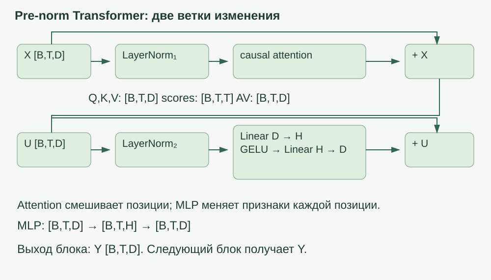
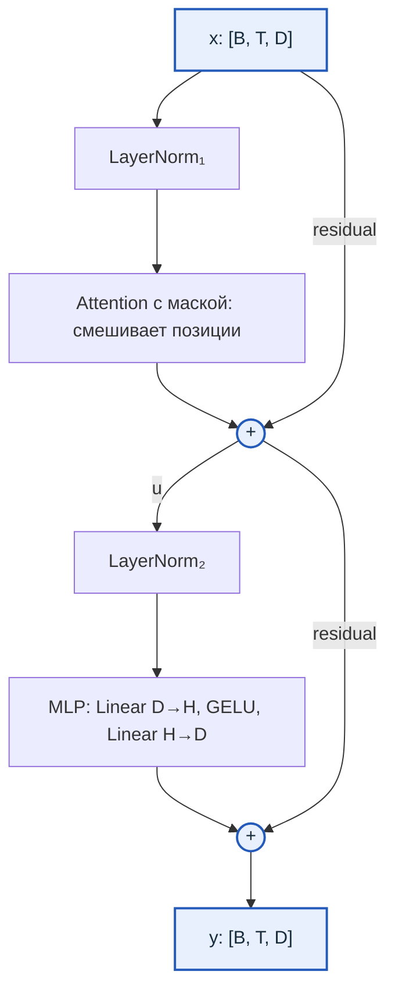

# M08-L07. Полный forward Transformer-блока

**Результат:** проследить форму и назначение каждого тензора от входных embeddings до выхода блока и найти ошибку, не вызывающую исключения.

**До урока:** M08-L06, M08-L03–L04. После этого урока переходи к M08-L05 и обучению tiny LM. Ориентир: 45 минут чтения, 90 минут лабораторной, 45 минут новой задачи.

## Объяснение

### Два преобразования внутри одного блока

В нашем маленьком Transformer используется вариант pre-norm: нормализация стоит перед преобразованием, а прямой residual-путь идёт вокруг него. Первая половина блока смешивает информацию между позициями:

`u = x + Attention(LayerNorm₁(x))`

Вторая преобразует признаки каждой позиции:

`y = u + MLP(LayerNorm₂(u))`

В обеих строках левое слагаемое — прямой residual-путь; правое — результат преобразования. Их формы должны совпадать. Это конкретный вариант архитектуры; post-norm располагает операции иначе.

Attention смешивает позиции по данным запроса и causal mask. MLP, напротив, обрабатывает признаки **каждой позиции отдельно**, используя одни и те же веса. Поэтому MLP без attention не даёт первой позиции информацию из третьей. Это полезный способ проверить, понимаешь ли ты роли блоков: одинаковая форма выхода не означает одинаковое действие.

Пусть B=1, T=3, D=4. Вход имеет форму [1,3,4]. LayerNorm сохраняет её. Q,K,V одного учебного head также имеют [1,3,4]. QKᵀ имеет [1,3,3], потому что каждая из трёх позиций сравнивается с каждой. После mask и softmax матрица весов остаётся [1,3,3]. Умножение на V возвращает [1,3,4], поэтому residual совместим.

В MLP первый Linear расширяет четыре признака до шести: [1,3,4] → [1,3,6]. Затем GELU меняет значения без изменения формы. Второй Linear возвращает четыре: [1,3,6] → [1,3,4]. Две матрицы с нелинейностью позволяют получить более сложное преобразование, чем один Linear. Без нелинейности композицию двух линейных преобразований можно свернуть в одно аффинное.

### Что делает GELU

В точном определении GELU(x)=x·Φ(x), где Φ — функция распределения стандартной нормальной случайной величины. Для понимания блока достаточно увидеть её значения: при нуле результат 0; большие положительные числа проходят почти без изменения; отрицательные подавляются плавно. В отличие от ReLU маленькое отрицательное число не всегда превращается точно в ноль. В этом уроке не требуется вывод Φ или доказательство превосходства активации: такого универсального превосходства мы не утверждаем.

Для x=[−1,0,1] PyTorch GELU даёт примерно [−0.158655,0,0.841345]. Это преобразование координат, а не нормировка вероятностей: сумма результата не обязана равняться единице.

### Как получаются несколько attention-heads

Для D=8 и двух голов ширина одной головы d_k=4. Обученные Q/K/V сначала имеют форму [B,T,8], затем представляются как [B,2,T,4]. Каждая голова считает свои scores [B,T,T]; вместе получается [B,2,T,T]. Softmax по последней оси отдельно нормирует каждую query каждой головы. Выходы [B,2,T,4] переставляются и склеиваются в [B,T,8], затем выходной Linear смешивает восемь признаков. Склеивание не является сложением: иначе ширина сократилась бы до4.

Несколько голов дают несколько обучаемых способов сопоставления, но сами по себе не гарантируют фиксированных человеческих ролей «грамматика» или «факты». Учебный trace ниже использует одну голову, чтобы числа можно было проверить руками; расширение числа голов меняет организацию вычисления, а не правило mask/softmax/AV.



## Аналогия: конвейер обработчиков в NestJS

Как похоже: в NestJS pipe нормализует вход до обработчика — pre-norm так же ставит LayerNorm перед преобразованием. Первая половина блока — этап, где каждая позиция собирает данные у других, вторая — локальная обработка каждой позиции одним и тем же кодом. Исходное значение проходит дальше, а обработчик лишь добавляет к нему изменение.

| В уроке | В аналогии |
| --- | --- |
| LayerNorm перед преобразованием | Pipe нормализации входа перед обработчиком |
| Attention | Этап, где каждая позиция собирает данные у других |
| MLP | Локальная обработка каждой позиции одним и тем же кодом |
| Residual вокруг каждой половины | Исходное значение идёт дальше, обработчик добавляет изменение |
| Несколько голов | Несколько независимых поисков, результаты склеиваются |
| Выходной Linear после склейки | Агрегатор, объединяющий результаты всех поисков |
| Совпадение форм на выходе | Контракт: обработчик возвращает объект той же схемы |

**Где аналогия ломается:** роли middleware задаёт программист. Роли голов и признаков в блоке возникают при обучении и не обязаны быть понятными людям. А «добавить изменение» здесь — поэлементное сложение векторов, а не слияние полей объекта.

## Разобранный пример — опыт и запуск

Из корня курса выполни:

```powershell
.\.venv\Scripts\python.exe labs\M08\forward_trace.py
```

В `artifacts/M08/forward-trace.json` сохранены формы и все числа каждого этапа. Пример использует три позиции и четыре признака. Проекции Q/K/V заданы тождественными, чтобы внимание было сосредоточено на пути данных; в обучаемой модели M08/demo.py проекции настоящие обучаемые Linear. Не переноси результат тождественных проекций на любую обученную сеть.

Проверь одну строку attention вручную, затем residual. Например, x₁=[1,3,5,7]. При causal mask первая позиция видит только себя, поэтому её веса [1,0,0], а attention output совпадает с нормированным x₁. Первая residual-строка примерно [−0.34164,2.55279,5.44721,8.34164]. Это проверка смысловой связи между mask, AV и суммой, а не только shapes.

## Схема



Pre-norm Transformer-блок. Выделен прямой residual-путь: x доходит до выхода через два сложения, а ветки LayerNorm → Attention и LayerNorm → MLP только добавляют изменения. Поэтому формы обеих веток совпадают с [B, T, D]. Attention смешивает позиции с учётом маски, MLP обрабатывает каждую позицию отдельно одними и теми же весами.

## Практика с поддержкой

**Предскажи до запуска.** Прежде чем запускать код или пересчитывать пример, запиши ожидаемый вывод: числа, формы массивов, порядок или текст. После запуска сравни с фактическим и объясни каждое расхождение.

Сначала отключи MLP, заменив его выход нулём. Выход блока должен стать равен первой residual-ветке. Затем измени только третью позицию **на входе MLP**, сохрани первые две. Их MLP-выходы не должны измениться. Наконец измени третий токен до attention: первые две позиции causal-блока также должны сохраниться. Эти два теста похожи результатом, но проверяют разные причины независимости.

## Самостоятельная задача A

Для B=2,T=5,D=8 и скрытой ширины MLP=12 составь таблицу shapes всех этапов. Посчитай параметры двух Linear MLP с bias. Реализуй attention с padding mask в [стартовой работе M08](../../exercises/M08/README.md): вторая последовательность содержит только три настоящих токена. Докажи, что padding не влияет на выходы доступных позиций.

## Критерии и типичные ошибки

Зачёт требует: верных форм, правильного числа параметров, causal и padding масок, теста неправильной оси softmax. Правильный размер результата без этих свойств недостаточен. Первую попытку сохраняй до ключа; объяснения AI допустимы в тренировке, но полученную помощь нужно записать.

## Подсказки по очереди

1. Первый Linear имеет 8·12 весов и 12 смещений.
2. Матрица attention имеет две оси позиций; ширина MLP относится к признакам.
3. Mask запрещает key до softmax, а не зануляет уже нормированную вероятность без пересчёта суммы.

## Новая и отложенная проверка

B: D=6, скрытая ширина=10; замени GELU на тождественную функцию и объясни, что потеряно. C через неделю: проверяющий меняет один будущий токен и один padding-токен. Предскажи, какие выходы вправе измениться, затем проверь кодом. [Ключи](../../solutions/modules/M08.md) содержат численные ответы и эталон контракта, но не доказывают твою самостоятельность.

## Карточка урока

| Поле | Содержание |
| --- | --- |
| Правило | Pre-norm блок: u = x + Attention(LayerNorm₁(x)), y = u + MLP(LayerNorm₂(u)); MLP — Linear D→H, GELU, Linear H→D |
| Смысл величин | Attention смешивает позиции с учётом маски, MLP обрабатывает каждую позицию отдельно одними весами; выходы голов склеиваются: [B, h, T, d_k] → [B, T, h·d_k], затем выходной Linear |
| Когда применять | Чтобы проследить формы и размер блока. Пример: D = 16, H = 64 — в MLP 16·64 + 64 + 64·16 + 16 = 2128 параметров; при B = 3, T = 7 формы [3, 7, 16] → [3, 7, 64] → [3, 7, 16] |
| Главная ошибка | Считать одинаковую форму выхода признаком одинакового действия блоков или складывать выходы голов вместо склеивания |

## Источники и углубление

[Transformer: исходная статья](https://arxiv.org/abs/1706.03762), [PyTorch GELU](https://docs.pytorch.org/docs/2.15/generated/torch.nn.GELU.html). Лабораторная использует учебный pre-norm-вариант, а не побитовое воспроизведение архитектуры исходной статьи.
