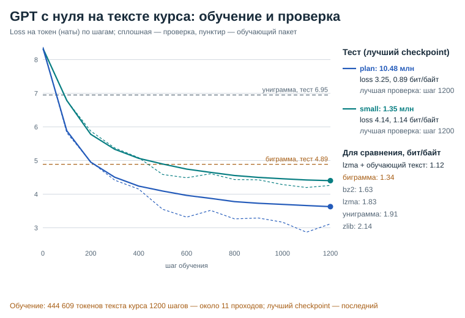
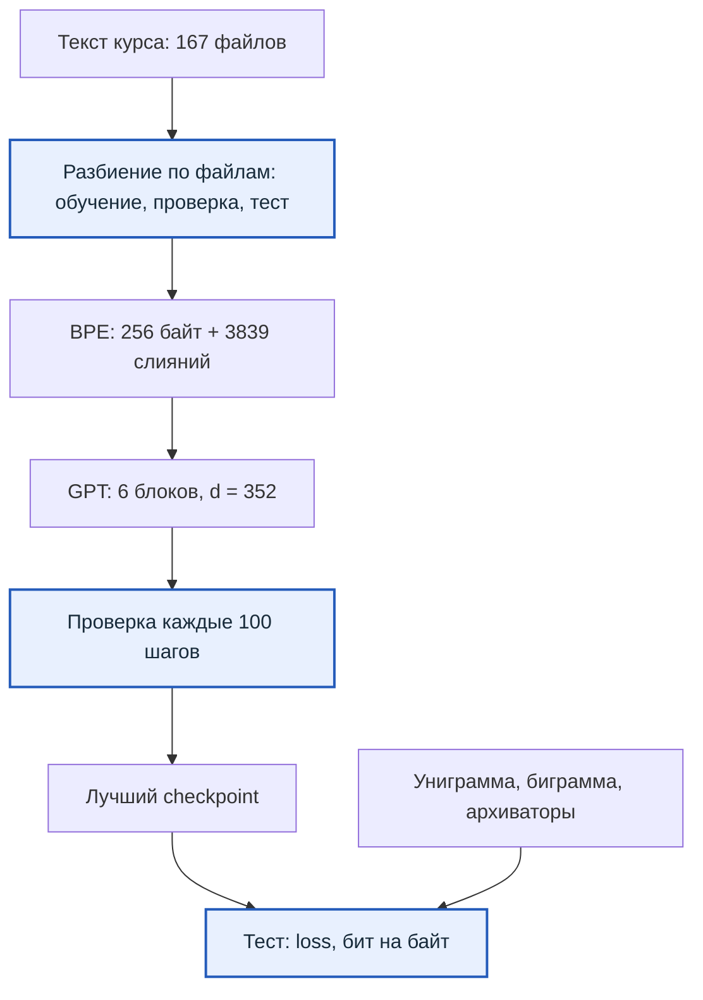

# M08-L08X. Языковая модель с нуля: BPE и GPT на 10 млн параметров

**Расширение 1.2.0.** Урок дополняет модуль, не входит в обязательный минимум 1.1.0.

**Результат:** обучить свой byte-level BPE и GPT примерно на 10 млн параметров на CPU, на тексте этого курса. Затем сравнить модель с n-граммными моделями и архиватором в битах на байт и объяснить по кривым потерь, что дали масштаб модели и объём данных.

**До урока:** M08-L05, M08-L07, M07. Нужны только пакеты курса: PyTorch и regex уже в lock-файле. Тесты и отчёт работают без обучения. Полный прогон занимает около часа на 8 потоках CPU, короткий — несколько минут. Ориентир — 180 минут чтения, прогона и задачи; это плановая гипотеза, а не измеренное время.

> **Версии и дата проверки:** Python 3.11.9, PyTorch 2.15.0+cpu, regex 2026.9.29; корпус — Markdown этого курса в коммите 57486b8 · проверено 09.11.2026 · источник: [Stanford CS336: Language Modeling from Scratch](https://cs336.stanford.edu/)

## Объяснение

### От мини-модели M08-L05 к маленькой GPT

В M08-L05 была модель размерности 16 с одним блоком внимания, а словарём служили слова искусственного корпуса. Здесь те же идеи, но в масштабе, который уже похож на настоящий:
- **Токенизатор** обучен на данных, а не задан списком слов: byte-level BPE, как в GPT-2.
- **Модель** — GPT из шести блоков, размерность 352, 8 голов внимания, около 10.5 млн параметров. Внимание написано вручную, без готового модуля PyTorch.
- **Данные** — настоящий текст: уроки, ключи, страницы модулей и инструкции лабораторных этого курса, около 2.7 МБ русского Markdown. Файлы целиком разделены по хешу пути: 85% на обучение, 7.5% на проверку, 7.5% на тест. Ни один абзац не попадает в две части.

Всё это зафиксировано в коде до первого прогона: размеры моделей, шаги, learning rate, разбиение. Сравнение с маленькой моделью на 1.35 млн параметров тоже запланировано заранее.

### BPE: словарь из частот

Byte-level BPE начинает с 256 токенов — всех значений байта. Поэтому любой текст на любом языке кодируется без неизвестных символов. Затем алгоритм повторяет одно действие: находит самую частую соседнюю пару токенов в обучающем тексте и добавляет её в словарь как новый токен. 3839 слияний дают словарь из 256 + 3839 + 1 = 4096 токенов; последний — разделитель документов `<|endoftext|>`.

Перед подсчётом пар текст режется на куски регулярным выражением в стиле GPT-2: слово вместе с пробелом перед ним, число, знаки препинания, пробелы. Пары не пересекают границы кусков, поэтому токен не склеит конец одного слова с началом другого.

Численный пример. Текст «low low low lower» режется на «low», « low», « low», « lower». Пары (l, o) и (o, w) встречаются по 4 раза. При равенстве выигрывает меньшая пара номеров байтов, поэтому первым слиянием становится «lo». Дальше (lo, w) встречается 4 раза, а (пробел, lo) — 3, и второе слияние — «low». Тест лабораторной проверяет ровно эти два шага.

Для русского языка byte-level BPE важен вдвойне: буква кириллицы занимает два байта UTF-8. В авторском прогоне первое слияние — пробел с первым байтом кириллической буквы, следующие восемь собирают буквы «е», «о», «а», «т», «и», «н», «р», «с». Только потом появляются слоги и целые слова. Самые длинные токены — « самостоятельность» и « последовательность»: слова, частые именно в тексте курса. «Индекс ускоряет чтение.» разбилось на 6 токенов: «Ин», «декс», « ускор», «яет», « чтение», «.».

### GPT блок за блоком

Модель повторяет схему M08-L07 шесть раз:
- **Вход** — эмбеддинг токена плюс обучаемая позиция, контекст 256 токенов.
- **Блок** — сначала LayerNorm, потом причинное внимание, остаток прибавляется к входу; затем снова LayerNorm, MLP с расширением в 4 раза и GELU, остаток. Так устроен pre-LN: путь остатка остаётся тождественным, и глубокая модель учится устойчивее.
- **Внимание** — q·kᵀ/√d_head, маска запрещает смотреть в будущее, softmax, умножение на v. Тест сверяет ручную реализацию с `scaled_dot_product_attention` PyTorch.
- **Выход** — LayerNorm и умножение на ту же матрицу эмбеддингов. Связанные веса экономят V·d параметров.

Число параметров считается по формуле: V·d + T·d + L·(12d² + 13d) + 2d. Здесь V — словарь, d — размерность, T — контекст, L — число блоков. В блоке на внимание приходится 4d² + 4d, на MLP — 8d² + 5d, на два LayerNorm — 4d. Для V = 4096, d = 352, T = 256 и L = 6 выходит 1 441 792 + 90 112 + 6 · 1 491 584 + 704 = 10 481 152.

Веса инициализируются нормальным распределением со стандартным отклонением 0.02. Выходные проекции внимания и MLP ещё делятся на √(2L), чтобы сумма шести блоков не раздувала масштаб.

### Обучение и как читать loss

Каждый шаг — 16 случайных окон по 256 токенов из обучающей части. Оптимизатор AdamW с β = (0.9, 0.95) и затуханием весов 0.1 только для матриц. Learning rate 100 шагов растёт до 6·10⁻⁴, затем по косинусу падает до 6·10⁻⁵. Норма градиента обрезается до 1. Каждые 100 шагов считается loss на 32 фиксированных окнах проверки, и на тестовых файлах оценивается лучший по проверке checkpoint. Оценка идёт с выключенным dropout. Тест режется на окна по 256 токенов без перекрытия: первые токены каждого окна предсказываются почти без контекста, поэтому число на тесте немного пессимистично.

- **Loss на токен** — средняя кросс-энтропия в натах. До обучения модель почти равномерна, и loss близок к ln 4096 ≈ 8.32. Проверка лабораторной это подтверждает: первый замер — 8.33.
- **Перплексия** — exp(loss): во сколько равновероятных вариантов модель в среднем «выбирает» следующий токен.
- **Биты на байт** — loss·N_токенов / (ln 2 · N_байт). Loss на токен нельзя сравнивать между разными токенизаторами: крупный токен сложнее угадать, зато токенов меньше. Биты на байт сравнимы между любыми токенизаторами и даже с архиваторами вроде gzip.

### Данные решают

По работе Chinchilla (Hoffmann и др., 2022) вычислительно оптимальной модели нужно порядка 20 токенов данных на параметр. Модели на 10 млн параметров нужно около 200 млн токенов, а в обучающей части курса 444 609. 1200 шагов по 4096 токенов — это примерно 11 проходов по одним и тем же текстам. До прогона из этого следует прогноз: большая модель быстро выучит обучающую часть, а её loss на проверке перестанет падать раньше, чем у маленькой. Прогон проверяет этот прогноз.

Настоящую модель уровня GPT-2 с нуля учат на GPU. Например, [nanochat](https://github.com/karpathy/nanochat) обучает её примерно за два часа на узле из восьми H100. В курсе это облачная ветка, она не запускалась и не проверялась.



Сопоставь рисунок с таблицей авторского прогона: где кривые проверки и обучения расходятся и какая из моделей обходит архиватор, которому показали тот же текст.

## Аналогия: языковая модель как архиватор со словарём

Backend-разработчик сжимал короткие JSON-сообщения через zstd. Обычный архиватор на маленьком сообщении почти ничего не выигрывает. Поэтому заранее обучают словарь на образцах (`zstd --train`), и новые сообщения жмутся им гораздо лучше.

| В уроке | В аналогии |
| --- | --- |
| BPE-слияния на обучающей части | Словарь zstd, обученный на образцах |
| Модель, предсказывающая следующий токен | Модель вероятностей внутри архиватора |
| Биты на байт на тестовых файлах | Степень сжатия новых сообщений, бит на исходный байт |
| Обучающая и тестовая части по целым файлам | Образцы для словаря и сообщения, которых среди них не было |
| Переобучение: обучающий loss падает быстрее проверки | Словарь подогнан под образцы и хуже жмёт новое |

Связь не только образная. Арифметическое кодирование с вероятностями модели сжимает текст почти ровно до её loss в битах. Поэтому биты на байт модели можно прямо сравнить с архиваторами.

**Где аналогия ломается:** архиватор не считает свой словарь частью сжатого файла, и модель тоже: 10 млн параметров во float32 весят около 42 МБ, а тестовый текст — 145 КБ. Выигрыш у lzma в битах на байт не делает модель практичным архиватором. И у архиватора нет генерации: модель умеет выбирать следующий токен из своего распределения, архиватор только кодирует данный текст.

## Разобранный пример

Python-блок выполняй из корня `C:\projects\ml-llm-course` в окружении курса. Обучение для него не нужно: он читает замороженный отчёт и токенизатор авторского прогона из `quality/gpt-from-scratch`. Пример разбирает предложение на токены, считает параметры по формуле, переводит loss в биты на байт и сверяет объём данных с правилом Chinchilla.

```python
import importlib.util
import json
import math
from pathlib import Path

spec = importlib.util.spec_from_file_location("gpt_from_scratch", "labs/M08/gpt_from_scratch.py")
lab = importlib.util.module_from_spec(spec)
spec.loader.exec_module(lab)
report = json.loads(Path("quality/gpt-from-scratch/report.json").read_text(encoding="utf-8"))

bpe = lab.BPE.load("quality/gpt-from-scratch/bpe.json")  # the tokenizer of the authored run
ids = bpe.encode("Индекс ускоряет чтение.")
print(len(ids), [bpe.decode([i]) for i in ids])

V, d, T, L = 4096, 352, 256, 6
params = lab.count_parameters(V, d, L, T)
print(params, f"embeddings {V * d / params:.1%}", f"float32 {params * 4 / 1e6:.0f} MB")

plan = report["models"]["plan"]
tokens, nbytes = report["corpus"]["tokens"]["test"], report["corpus"]["bytes"]["test"]
bpb = plan["test_loss"] * tokens / (math.log(2) * nbytes)
assert abs(bpb - plan["test_bits_per_byte"]) < 1e-3  # bits per byte = loss * N_tokens / (ln 2 * N_bytes)
print(f"loss {plan['test_loss']} -> perplexity {math.exp(plan['test_loss']):.1f}, {bpb:.3f} bits per byte")

train_tokens = report["corpus"]["tokens"]["train"]
seen = report["train"]["steps"] * report["train"]["batch"] * report["train"]["context"]
print(f"Chinchilla: {20 * params / 1e6:.0f}M tokens; train split {train_tokens}; seen {seen} = {seen / train_tokens:.1f} passes")
for row in lab.summary(report):
    print(f"{row['model']:16} {row['bits_per_byte']:.3f}")
```

Эмбеддинги токенов занимают 13.8% параметров большой модели, у маленькой с d = 128 — уже 38.8%. Loss 3.255 означает перплексию 25.9: модель в среднем колеблется между двумя-тремя десятками вариантов следующего токена из 4096. Правило Chinchilla просит 210 млн токенов, а у нас 444 609, то есть в 470 раз меньше. Окна выбираются случайно, и каждый токен обучающей части модель видела в среднем 11 раз. Сводка внизу — таблица авторского прогона в битах на байт.

### Авторский прогон 09.11.2026

```powershell
.\.venv\Scripts\python.exe labs\M08\gpt_from_scratch.py run
.\.venv\Scripts\python.exe labs\M08\gpt_from_scratch.py report
```

Тест — 12 файлов, 144 669 байт, 27 552 токена:

| Модель | Параметры | Loss на токен | Перплексия | Бит на байт |
| --- | --- | --- | --- | --- |
| Равномерная | — | 8.318 | 4096 | 2.285 |
| Униграмма | — | 6.948 | 1041 | 1.909 |
| Биграмма | — | 4.887 | 132.5 | 1.343 |
| GPT small | 1.35 млн | 4.140 | 62.8 | 1.137 |
| GPT plan | 10.48 млн | 3.255 | 25.9 | 0.894 |

Архиваторы на тех же байтах теста, бит на байт: zlib -9 — 2.138, bz2 -9 — 1.630, lzma -9e — 1.834. lzma, которому перед тестом показали обучающую часть, — 1.120.

Время на 8 потоках: BPE — 3.1 с, small — 12.4 минуты (6597 токенов в секунду), plan — 48 минут (1699 токенов в секунду), весь прогон — около 61 минуты.

Что показал прогон:
- **Обе модели используют контекст.** Биграмма видит один предыдущий токен, GPT — до 256. small снижает loss относительно биграммы на 0.75 ната на токен, plan — на 1.63. В битах на байт: 1.343, 1.137, 0.894.
- **Масштаб окупился.** У plan в 7.8 раза больше параметров, обучение дольше в 3.9 раза, а бит на байт на 21% меньше.
- **Честный архиватор.** Сам по себе lzma даёт 1.834 бита на байт, но сравнивать с ним нечестно: курса он не видел. Если показать ему обучающую часть, он доходит до 1.120 — почти как small с 1.137. plan обходит такой lzma на 20%.
- **Прогноз о переобучении подтвердился наполовину.** Разрыв между обучающим пакетом и проверкой к концу у plan около 0.58 ната, у small — около 0.15, почти вчетверо меньше. Но loss проверки у обеих моделей падал до последнего шага, и лучший checkpoint — шаг 1200. За 11 проходов большая модель ещё не начала ухудшаться на новых файлах. Где проверка остановится при более долгом обучении, этот прогон не показывает.
- **Тест оказался легче проверки.** У plan loss на проверке 3.63, на тесте 3.25; у small — 4.40 и 4.14. В тест попали 12 файлов, из них четыре — короткие шаблонные страницы модулей. Это вероятная причина, но по файлам она не измерялась. Модели сравниваются только на одном и том же тесте, а абсолютное число зависит от того, какие файлы туда попали.
- **Текст похож на курс, но смысла в нём нет.** plan пишет заголовки «## Разобранный пример», таблицы «| Поле | Содержание |», пути к файлам и в основном настоящие русские слова. Фразы при этом не складываются в мысль: «Индекс ускоряет вопрос по себе, но не гарантирует его». small чаще ломает слова: «приблизапуска», «Сделение». Модель выучила форму текста курса, а не его содержание.

## Схема



Путь от текста до числа на тесте. Сначала файлы целиком делятся на три части, и только потом на обучающей части учится токенизатор. Модель учится на тех же токенах, а проверка каждые 100 шагов выбирает лучший checkpoint. На тесте он оценивается один раз, рядом с n-граммными моделями и архиваторами на тех же байтах. Выделены разбиение, проверка и тест: если в них ошибиться, число на тесте ничего не значит, как бы хорошо ни была написана модель.

## Практика с поддержкой

**Предскажи до запуска.** Запиши ожидаемый вывод до запуска кода. Какой loss на проверке будет у small после 300 шагов вместо 1200? Обойдёт ли она уже биграмму с 4.89? Сколько минут займёт прогон? После запуска сравни с фактическим и объясни каждое расхождение.

1. Выполни `.\.venv\Scripts\python.exe labs\M08\gpt_from_scratch.py report` и сверь таблицу с авторским прогоном.
2. Выполни `.\.venv\Scripts\python.exe labs\M08\gpt_from_scratch.py run --config small --steps 300`. Это несколько минут на CPU. Сравни loss проверки на шаге 300 с историей small в `quality/gpt-from-scratch/report.json`. Learning rate теперь падает за 300 шагов, а не за 1200, и корпус после правок курса немного другой, поэтому точного совпадения не будет.
3. В замороженном отчёте найди `tokenizer.first_merges` и `longest_tokens`. Почему первые слияния — буквы, а самые длинные токены — слова «самостоятельность» и «последовательность»?
4. Сравни `samples` двух моделей. Что plan копирует из шаблона уроков и где у неё ломается смысл?

## Самостоятельная задача A — M08-L08X-A

Размер словаря и честная метрика. Обучи BPE на обучающей части со словарём 512, 1024, 4096 и 8192 токена. Для каждого словаря посчитай на тесте байты на токен и loss униграммы и биграммы — на токен и в битах на байт. До запуска запиши прогноз: как с ростом словаря изменятся loss на токен и биты на байт? Объясни, почему loss на токен нельзя сравнивать между словарями. Реши, какой словарь ты взял бы для GPT на 10 млн параметров, если учесть долю эмбеддингов V·d в числе параметров.

## Подсказки по очереди

1. Части корпуса даёт `lab.corpus()`, токенизатор — `lab.BPE.train(parts["train"], vocab_size=V)`, токены — `bpe.encode_documents(parts["test"])`.
2. Байты теста — `sum(len(d.encode("utf-8")) for d in parts["test"])`. n-граммные модели считает `lab.ngram_baselines(train_ids, test_ids, len(bpe.vocab))`.
3. Биты на байт — `lab.bits_per_byte(loss, len(test_ids), nbytes)`, долю эмбеддингов даёт `lab.count_parameters`.
4. Если биграмма с большим словарём хуже, посчитай, какая доля пар токенов теста ни разу не встретилась в обучающей части.

## Критерии и типичные ошибки

**Критерии до попытки:** корпус разделён по целым файлам до обучения токенизатора. Токенизатор и модель видели только обучающую часть. Лучший checkpoint выбран по проверке, тест посчитан один раз. Все модели и архиваторы оценены на одних и тех же байтах. Между разными токенизаторами сравниваются биты на байт, а не loss на токен. Рядом с моделью стоят n-граммные модели и архиватор, которому показан тот же обучающий текст. Прогноз записан до прогона, и его неподтверждённая часть названа. Для самостоятельного зачёта посчитай без кода число параметров GPT по формуле для d = 128 и L = 4 и переведи loss в биты на байт.

**Типичные ошибки:** сравнивать loss на токен моделей с разными словарями; обучать токенизатор на всём тексте вместе с тестом; делить корпус по строкам или абзацам, так что куски одного урока попадают и в обучение, и в тест; выбирать checkpoint по тесту; оценивать с включённым dropout; сравнивать модель с архиватором, который не видел обучающего текста, и объявлять победу; судить о качестве по сгенерированному тексту; считать выигрыш у lzma практичным сжатием и забывать про 42 МБ весов.

## Новая и отложенная проверка

**Повтор B:** биграмма со словарём 512 и GPT plan со словарём 4096 дали на тесте одинаковый loss — 3.255 ната на токен. В тесте 144 669 байт: это 54 897 токенов словаря 512 и 27 552 токена словаря 4096. Посчитай биты на байт обеих моделей. Какая лучше и во сколько раз? Затем посчитай по формуле число параметров small (V = 4096, d = 128, T = 256, L = 4), долю эмбеддингов токенов и число токенов данных по правилу Chinchilla. **Отложенная C:** что нужно, чтобы модель на 10 млн параметров была обучена по правилу Chinchilla на CPU автора? Сколько токенов и примерно сколько гигабайт русского текста нужно? Сколько часов займёт один проход при 1699 токенах в секунду? Откуда взять текст с подходящей лицензией? Сравни это с дообучением готовой модели из M12: что даст тренажёру собеседований каждый путь? [Ключи](../../solutions/modules/M08.md) открывай после сохранения попытки.

## Карточка урока

| Поле | Содержание |
| --- | --- |
| Правило | Токенизатор и модель учатся только на обучающей части, разбитой по целым файлам. Лучший checkpoint выбирается по проверке, тест считается один раз. Модели с разными токенизаторами и архиваторы сравниваются в битах на байт |
| Смысл величин | Loss — средняя кросс-энтропия на токен в натах, перплексия = exp(loss). Биты на байт = loss · N_токенов / (ln 2 · N_байт). Параметры GPT = V·d + T·d + L·(12d² + 13d) + 2d |
| Когда применять | При оценке любой языковой модели и токенизатора. Пример: GPT на 10.5 млн параметров дала 0.894 бита на байт против 1.343 у биграммы и 1.120 у lzma, которому показали тот же обучающий текст |
| Главная ошибка | Сравнивать loss на токен между разными токенизаторами и выбирать checkpoint по тесту |

## Источники и углубление

Курс [Stanford CS336: Language Modeling from Scratch](https://cs336.stanford.edu/) и его [первое задание](https://github.com/stanford-cs336/assignment1-basics): BPE, Transformer и обучение с нуля. Статья [Neural Machine Translation of Rare Words with Subword Units](https://arxiv.org/abs/1508.07909) (Sennrich и др., 2016) — BPE для текста. Статья [Training Compute-Optimal Large Language Models](https://arxiv.org/abs/2203.15556) (Hoffmann и др., 2022) — правило Chinchilla. Статья [Language Modeling Is Compression](https://arxiv.org/abs/2309.10668) (Delétang и др., 2024) — языковая модель как архиватор. Код [nanoGPT](https://github.com/karpathy/nanoGPT) — компактный GPT, автор объявил его устаревшим; продолжение — [nanochat](https://github.com/karpathy/nanochat), полный путь до чат-модели на GPU. В курсе: токены — M08-L01, внимание и маска — M08-L03 и M08-L04, полный блок — M08-L07, мини-модель — M08-L05, дообучение готовых моделей — M12.
