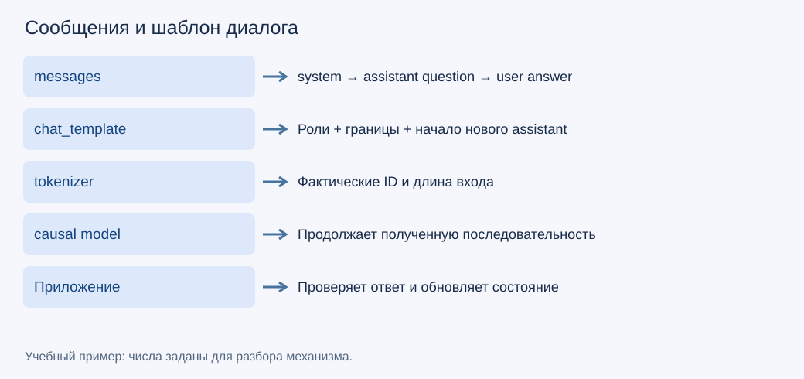

# M09-L01. Сообщения и шаблон диалога

**Результат:** Объяснить, почему один и тот же текст при разных шаблонах может давать разные результаты.

**До урока:** M08-L04. Если термины из этих уроков не удаётся объяснить своими словами, вернись к их разобранным примерам. Ориентир времени — 120 минут чтения и практики; это первоначальная оценка, а не ограничение.

## Зачем и как это работает

Чат выглядит как список сообщений с ролями, но causal language model получает последовательность токенов и продолжает её. Связь между удобным объектом messages и входом модели задаёт chat template. Он добавляет границы сообщений, обозначения ролей и маркер начала ответа. Эти элементы должны соответствовать тому формату, который использовался при адаптации конкретной модели к диалогам.

Роль system обычно содержит общую инструкцию, user — запрос пользователя, assistant — прежний ответ. Однако это соглашение интерфейса, а не отдельные физические входы нейросети. После шаблонизации роли становятся частью токенной последовательности. Разные семейства моделей используют разные маркеры. Нельзя взять шаблон одной LLM и считать его универсальным только потому, что итоговый текст выглядит понятным человеку.

Base model обучена продолжать текст. Instruct model дополнительно адаптирована к инструкциям и диалогам. Такое обучение повышает вероятность подходящего поведения, но не делает соблюдение правил абсолютным. Система приложения всё равно проверяет схему, состояние и допустимые действия. Инструкция «всегда возвращай JSON» является запросом к вероятностной модели; надёжный контракт появляется только при проверке результата и обработке нарушений.

В Transformers tokenizer.apply_chat_template преобразует messages по шаблону токенизатора. Параметр tokenize=True сразу возвращает ID, а add_generation_prompt=True добавляет ожидаемое начало очередного ответа, если это предусмотрено шаблоном. Сначала можно вызвать tokenize=False и прочитать фактическую строку, затем закодировать стандартным путём. Если вручную повторно добавлять special tokens после шаблона, возможно дублирование маркеров. Поэтому используем один проверенный путь и сохраняем его в лабораторной.

История диалога — обычные входные данные. Модель не видит все прошлые сообщения, которые лежат в базе приложения: она видит только то, что передали в текущем запросе. Если приложение забыло добавить вопрос интервьюера, ответ пользователя «да, использовал» потеряет смысл. Если оно добавило лишние ответы из другой сессии, модель может продолжить неправильный разговор. Управление историей — ответственность кода, а не свойство файла весов.

Сообщение из базы знаний или пользовательского ответа не должно незаметно превращаться в управляющую инструкцию. В RAG документы отделяются явными границами, а приложение сохраняет контроль над инструментами и состоянием. Один текстовый разделитель не гарантирует защиту от prompt injection: модель всё равно обрабатывает содержание. Позже мы ограничим разрешённые действия обычным кодом и проверками, а здесь научимся видеть фактический вход.

Для первого локального опыта используется SmolLM2-135M-Instruct с зафиксированной ревизией. Это настоящая небольшая языковая модель с обученными весами, а не шаблон ответов. Она выбрана для доступного CPU-эксперимента, а не как доказанно качественный русскоязычный интервьюер. Основные короткие тесты делаются на английском, ограничения русского проверяются отдельно. Смысл урока — воспроизводимо собрать запрос и проследить токены до генерации.

Храни вместе с результатом model_id, revision, версию tokenizer, фактические messages и настройки шаблона. Тогда изменение ответа можно связать с изменением входа или модели. Скриншот красивого диалога без этого контекста непригоден для инженерного сравнения.



## Разобранный пример

```python
from transformers import AutoTokenizer
tokenizer = AutoTokenizer.from_pretrained(
    'models/smollm2-135m-instruct', local_files_only=True)
messages = [{'role':'user','content':'What is SQL?'}]
text = tokenizer.apply_chat_template(messages, tokenize=False,
                                     add_generation_prompt=True)
ids = tokenizer.apply_chat_template(messages, tokenize=True,
                                    add_generation_prompt=True)
print(text)
print(len(ids))
```

Ожидается строка с реальными маркерами модели и ненулевой список ID. Точное число зависит от конкретного текста и зафиксированного tokenizer; не подставляй оценку по символам. Лабораторная сохраняет rendered_prompt в report.json.

## Практика с поддержкой

Сравни messages только с user и messages с system+user. Распечатай шаблоны и длины. Добавь предыдущий assistant-ответ и проверь, что он находится в правильном месте. Не меняй одновременно модель и шаблон.

## Самостоятельная работа M09-L01-A

Составь messages для двух ходов: интервьюер спрашивает о транзакции, пользователь отвечает «Это группа операций», затем нужно задать уточнение. Укажи роли и порядок. Опиши две ошибки, возникающие при передаче только последнего ответа, и поля журнала, необходимые для воспроизведения.

Первая попытка — без готового решения. Сохрани свой код, объяснение и фактический результат в `submissions/M09-L01/`. AI может пояснять термин и помогать найти ошибку; запиши полученную помощь. Прочитанное решение не означает самостоятельно выполненное задание.

## Подсказки по очереди

1. Сначала идёт общая инструкция, затем прежний assistant-вопрос и новый user-ответ.
2. Нового assistant-ответа ещё нет, его начало добавляет шаблон.
3. История в хранилище и история в запросе — разные объекты.

## Ошибки и самопроверка

Ошибка: самостоятельно приклеивать маркеры от другой модели. Ошибка: считать system отдельной гарантированно приоритетной памятью. Критерий: фактический шаблон просмотрен, роли согласованы с событиями, журнал позволяет повторить вызов.

Работа готова, когда есть ответ на все условия задачи, вычисление или наблюдение подтверждает вывод, а ты можешь объяснить каждую величину и изменить один параметр без копирования решения. Критическую ошибку сначала исправь и повтори проверку; оформление не компенсирует неверное рассуждение. Сверь свою попытку с [решением M09-L01-A](../../solutions/modules/M09.md).

## Повтор и перенос

Вариант **M09-L01-B**. Сообщения: system «Задавай один вопрос», user «Я пишу API», assistant «Как проверяешь входные данные?», user «Уточни для JSON». Для учебного шаблона каждое сообщение сериализуется как <role>text</role>, а add_generation_prompt добавляет только <assistant>. Выпиши полный prompt, роли в порядке и место следующего ответа. Не приписывай эти учебные маркеры реальному tokenizer.

Отложенный вариант **M09-L01-C**. На трёх одинаковых запросах base-модель вернула структурированный ответ в 1 случае, instruct — в 2. Эксперт проверил все три ответа instruct: два содержат неверное утверждение, один корректен. Объясни, что означает instruction tuning, какие две разные доли здесь измерены и какие гарантии эти наблюдения не дают. Весов между запросами не меняли: является ли новый system prompt дообучением?

Сначала сохрани свою попытку и полученную помощь; затем открой [ключи B/C](../../solutions/modules/M09.md). После разбора B выполняй C без открытого решения. Статус «подтверждено позже» относится только к фактически выполненной отложенной проверке; до неё не отмечай освоение заранее.

## Источники и углубление

- [SmolLM2-135M-Instruct, карточка и лицензия](https://huggingface.co/HuggingFaceTB/SmolLM2-135M-Instruct)
- [Transformers: chat templates](https://huggingface.co/docs/transformers/chat_templating)
- [Transformers: генерация](https://huggingface.co/docs/transformers/main_classes/text_generation)

Текст, численные примеры, задания и схемы этого урока созданы для данного курса. Источники нужны для проверки терминов и изучения исходного метода; они не заменяют самостоятельную практику.
