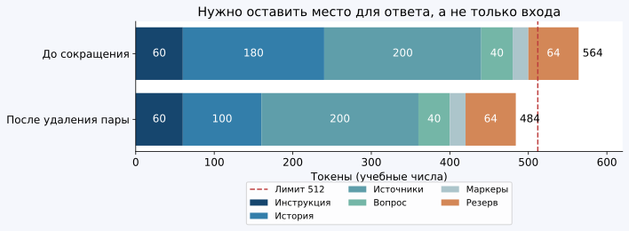

# M09-L02. Контекст и история

**Результат:** Выбрать, что удалить или сжать при превышении бюджета, сохранив назначение диалога.

**До урока:** M09-L01. Если термины из этих уроков не удаётся объяснить своими словами, вернись к их разобранным примерам. Ориентир времени — 120 минут чтения и практики; это первоначальная оценка, а не ограничение.

## Зачем и как это работает

Контекст — последовательность токенов, доступная модели в текущем вычислении. Он включает инструкции, историю, найденные документы, новый вопрос и служебные маркеры. Ограничение контекста означает максимальную поддерживаемую длину при конкретной конфигурации модели и исполнения. Это не объём памяти всех когда-либо сохранённых диалогов и не количество фактов, выученных в весах.

Веса изменяются при обучении, контекст — при каждом запросе. Добавление документа в prompt не переобучает модель: после завершения запроса параметры остаются прежними. Сохранение текста в базе тоже не делает его доступным без извлечения. Эта граница важна при выборе между prompting, RAG и fine-tuning. RAG меняет доступную информацию во входе, fine-tuning меняет параметры, а обычное хранение лишь сохраняет данные для будущего использования.

Бюджет задаётся неравенством N_prompt+N_new≤C, где C — лимит, N_prompt — фактическое количество входных токенов после шаблона, N_new — резерв генерации. Если input уже занимает весь лимит, места для ответа не остаётся. Некоторые реализации сами обрезают вход, другие возвращают ошибку, третьи позволяют выйти за проверенный диапазон с ухудшением. В нашем адаптере превышение обнаруживается до generate и даёт понятный ValueError.

Сохранение истории требует политики. Самый простой вариант — оставить system, текущий вопрос, последний ответ и несколько последних пар ходов. Старые завершённые пары удаляются целиком, чтобы не оставить ответ без вопроса. Важные структурные факты лучше хранить отдельно: цель сессии, уже заданные темы, согласованные ограничения. Сжатое резюме экономит место, но может потерять или исказить факт; его нельзя считать безошибочной памятью.

Для RAG бюджет делится между инструкцией, историей и источниками. Если в контекст помещается слишком много похожих фрагментов, они вытесняют полезный новый ответ. Нужны deduplication, выбор кандидатов и измерение качества на конкретном наборе. Более длинный контекст не гарантирует лучшего использования информации: модель может пропустить релевантный факт или спутать противоречивые версии. Увеличение лимита является ресурсным решением, а не автоматическим исправлением поиска.

Стоимость контекста состоит из нескольких частей. Prefill обрабатывает весь prompt, затем decode создаёт новые токены последовательно. KV-cache хранит ключи и значения прошлых позиций; его память растёт с длиной последовательности и числом одновременно обслуживаемых запросов. Даже если веса помещаются в RAM, слишком длинные контексты или несколько сессий могут увеличить расход. Позже измерим отдельно параметры и фактический процесс.

Резерв ответа выбирается по продуктовой задаче. Следующему вопросу интервьюера достаточно небольшого числа токенов, а итоговому отчёту может требоваться больше. Ограничение max_new_tokens не означает, что модель обязательно использует весь резерв: она может выдать EOS раньше. Если ответ обрезан по лимиту, JSON способен оказаться незавершённым; это должен заметить валидатор, а не пользователь в виде сломанного интерфейса.

Практическое правило: считать токены после окончательной сборки prompt и записывать причины каждого сокращения. Тогда неожиданно забытая тема диалога становится диагностируемым событием, а не мистическим свойством модели. Для самостоятельной работы сначала реши задачу бюджета арифметически, затем проверь фактическим tokenizer.



## Разобранный пример

Пусть C=512. Инструкция занимает 60 токенов, история 180, документы 200, новый вопрос 40, служебные маркеры 20: prompt=500. При резерве ответа 64 требуется 564, превышение 52. Удаление 80 токенов старой полной пары даст prompt420 и общий бюджет 484.

```python
parts = dict(system=60, history=180, documents=200, question=40, markers=20)
needed = sum(parts.values()) + 64
assert needed == 564
parts['history'] -= 80
assert sum(parts.values()) + 64 == 484
```

512 здесь учебный лимит для арифметики, а не утверждение о лимите SmolLM. Реальное значение лабораторная читает из конфигурации модели.

## Практика с поддержкой

Собери длинную историю и посчитай её реальным tokenizer. Определи обязательные сообщения. Удаляй самые старые полные пары, повторно применяя template и измеряя длину, пока вход и резерв не поместятся. Если обязательная часть сама слишком велика, верни явную ошибку.

## Самостоятельная работа M09-L02-A

Для C=1024 заданы: system90, history500, sources260, question70, markers30 и резерв 160. Посчитай превышение. Можно удалить старую пару 120 токенов или сократить источники на 80. Какие одиночные действия достаточны? Предложи политику, сохраняющую текущий вопрос и обязательные правила.

Первая попытка — без готового решения. Сохрани свой код, объяснение и фактический результат в `submissions/M09-L02/`. AI может пояснять термин и помогать найти ошибку; запиши полученную помощь. Прочитанное решение не означает самостоятельно выполненное задание.

## Подсказки по очереди

1. Сначала сумма входа, затем резерв.
2. Проверяй новое неравенство после каждого действия.
3. Удаление частей не должно оставлять потерянные ссылки или ответ без вопроса.

## Ошибки и самопроверка

Ошибка: забыть служебные токены. Ошибка: сокращать текст по символам и считать лимит гарантированным. Критерий: политика детерминирована, обязательные части сохранены, фактическая длина пересчитывается.

Работа готова, когда есть ответ на все условия задачи, вычисление или наблюдение подтверждает вывод, а ты можешь объяснить каждую величину и изменить один параметр без копирования решения. Критическую ошибку сначала исправь и повтори проверку; оформление не компенсирует неверное рассуждение. Сверь свою попытку с [решением M09-L02-A](../../solutions/modules/M09.md).

## Повтор и перенос

Вариант **M09-L02-B**. Лимит C=1024; system=90, history=500, sources=260, question=70, markers=30, новый резерв=256 токенов. Старые полные пары в истории имеют размеры 120,100,280, удаляются только по порядку от старой к новой. Источники сокращать нельзя. Сколько пар минимум удалить и каков итоговый бюджет? Все указанные длины уже измерены после шаблона; для этой арифметики они аддитивны.

Отложенный вариант **M09-L02-C**. Из истории сделали summary «Кандидат использует Python». Исходные ограничения: язык Python, не сохранять аудио, длительность до 10 минут. Новая обязательная часть после реального шаблона занимает 900 токенов, резерв ответа 160, C=1024; старых пар нет. Найди потерянные ограничения и опиши корректное поведение при переполнении, сохраняя текущий вопрос и обязательные правила.

Сначала сохрани свою попытку и полученную помощь; затем открой [ключи B/C](../../solutions/modules/M09.md). После разбора B выполняй C без открытого решения. Статус «подтверждено позже» относится только к фактически выполненной отложенной проверке; до неё не отмечай освоение заранее.

## Источники и углубление

- [SmolLM2-135M-Instruct, карточка и лицензия](https://huggingface.co/HuggingFaceTB/SmolLM2-135M-Instruct)
- [Transformers: chat templates](https://huggingface.co/docs/transformers/chat_templating)
- [Transformers: генерация](https://huggingface.co/docs/transformers/main_classes/text_generation)

Текст, численные примеры, задания и схемы этого урока созданы для данного курса. Источники нужны для проверки терминов и изучения исходного метода; они не заменяют самостоятельную практику.
