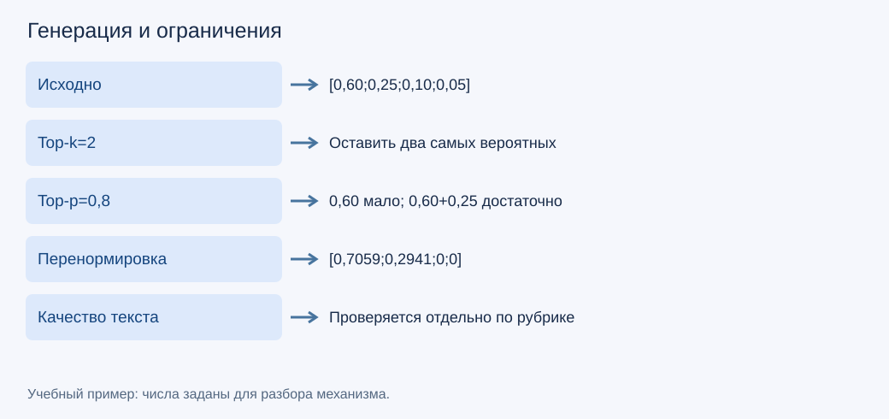

# M09-L03. Генерация и ограничения

**Результат:** Отделить наблюдаемое изменение поведения от предположения об улучшении.

**До урока:** M09-L02. Если термины из этих уроков не удаётся объяснить своими словами, вернись к их разобранным примерам. Ориентир времени — 140 минут чтения и практики; это первоначальная оценка, а не ограничение.

> **Версии и дата проверки:** Python 3.11.9, PyTorch 2.15.0+cpu, transformers 4.57.6, huggingface-hub 0.36.2; модель SmolLM2-135M-Instruct (ревизия 12fd25f) · проверено 04.11.2026 · источник: [Transformers 4.57.6: генерация](https://huggingface.co/docs/transformers/v4.57.6/main_classes/text_generation)

## Объяснение

Модель возвращает распределение следующего токена, а алгоритм декодирования выбирает конкретный ID. Поэтому поведение зависит и от весов, и от настроек генерации. Greedy decoding выбирает argmax на каждом шаге. Он прост и обычно воспроизводим при фиксированном окружении, но локально самый вероятный токен не гарантирует лучший полный ответ. Sampling выбирает случайно из распределения и даёт разнообразие ценой дополнительной вариативности.

Temperature меняет масштаб logits перед softmax: p_i∝exp(z_i/T). При T>1 распределение становится ровнее, при 0<T<1 — более концентрированным. Это не регулятор истинности. Уменьшение температуры может сделать неверный ответ более устойчивым; увеличение способно породить полезное разнообразие или лишние ошибки. Для do_sample=False в нашем обязательном запуске применяется greedy, и параметры sampling не следует интерпретировать как действующие.

Top-k оставляет k наиболее вероятных токенов, затем перенормирует их. Top-p выбирает минимальный префикс отсортированных токенов, чья суммарная вероятность достигает порога p, и перенормирует его. Размер множества top-p меняется в зависимости от уверенности распределения. Конкретная реализация также имеет правила сохранения минимального числа токенов; при сравнении записывай все параметры и версию библиотеки.

Ограничения генерации включают max_new_tokens, EOS, stop-последовательности и лимит времени. Max_new_tokens ограничивает только добавленные токены, а не весь prompt. Max_length в разных интерфейсах может включать вход; смешивание этих параметров приводит к неожиданному обрезанию. В лабораторной используем max_new_tokens и отдельно проверяем общий контекст. Окончание по лимиту следует отличать от осмысленного завершения EOS.

Repetition penalty и запрет повторных n-gram изменяют распределение ради уменьшения циклов. Они могут испортить технический текст, где повтор термина необходим, или JSON с повторяющимися ключами в разных объектах. Добавлять их надо после наблюдения конкретной проблемы и проверки побочных эффектов, а не как обязательный набор «хороших настроек». Один пример переставшего повторяться ответа не доказывает улучшение всего тренажёра.

Сравнение настроек требует фиксированных запросов и критериев. Возьми несколько технических вопросов, неоднозначный ответ, просьбу уточнить и запрос вне базы. Для sampling сделай несколько повторов с сохранёнными seed. Оцени соблюдение формата, корректность, наличие уточнения и длину раздельно. Среднее число токенов не говорит, что обратная связь стала полезнее. Меняй сначала один параметр, иначе нельзя понять источник изменения.

Seed управляет генератором случайных чисел, но не является универсальной гарантией побитовой воспроизводимости между устройствами и версиями. Записывай окружение и выводы с ограничениями. Для deterministic greedy можно сравнивать сохранённые ответы, однако даже такое поведение нужно проверять после смены библиотек или реализации attention.

В голосовом тренажёре длинные ответы ухудшают удобство диалога и увеличивают время синтеза. Поэтому задачу удобно ограничить: один вопрос или одно замечание за ход, итоговый отчёт отдельно. Это продуктовая структура, поддержанная инструкцией и проверкой длины; она надёжнее ожидания, что изменение temperature само сделает беседу естественной.



## Разобранный пример

Пусть вероятности токенов после softmax равны[0,6;0,25;0,1;0,05]. Top-k при k=2 оставит первые два, новые вероятности[0,6/0,85;0,25/0,85]≈[0,7059;0,2941]. Top-p=0,8 тоже оставит первые два, поскольку 0,6<0,8, а 0,85≥0,8. При top-p=0,95 останутся первые три.

```python
p = [.6,.25,.1,.05]
kept = p[:2]
normalized = [x/sum(kept) for x in kept]
assert abs(sum(normalized)-1)<1e-12
print([round(x,4) for x in normalized])  # [0.7059,0.2941]
```

Эта арифметика объясняет фильтрацию; она не измеряет качество реального текста.

## Практика с поддержкой

**Предскажи до запуска.** Прежде чем запускать код или пересчитывать пример, запиши ожидаемый вывод: числа, формы массивов, порядок или текст. После запуска сравни с фактическим и объясни каждое расхождение.

Запусти три фиксированных запроса greedy с max_new_tokens24. Затем отдельно сравни sampling с do_sample=True, temperature0,7, top_p0,9 и seed17,18,19. Сохрани все ответы, включая плохие. Для каждого отметь корректность и выполнение инструкции.

## Самостоятельная задача A — M09-L03-A

Даны вероятности[0,4;0,3;0,2;0,1]. Какие токены останутся при top-k2 и top-p0,85? Перенормируй оба распределения. Предложи протокол сравнения двух настроек на 5 запросах, который не выбирает только удачные генерации.

Первая попытка — без готового решения. Сохрани свой код, объяснение и фактический результат в `submissions/M09-L03/`. AI может пояснять термин и помогать найти ошибку; запиши полученную помощь. Прочитанное решение не означает самостоятельно выполненное задание.

## Подсказки по очереди

1. Для top-p суммируй по убыванию до достижения порога.
2. Удалённые вероятности становятся 0.
3. Зафиксируй число повторов до просмотра результатов.

## Критерии и типичные ошибки

Ошибка: обещать фактическую правильность при temperature0. Ошибка: сравнивать один удачный sampling с одним greedy. Критерий: правильные множества токенов, одинаковый набор запросов и полный журнал результатов.

Работа готова, когда есть ответ на все условия задачи, вычисление или наблюдение подтверждает вывод, а ты можешь объяснить каждую величину и изменить один параметр без копирования решения. Критическую ошибку сначала исправь и повтори проверку; оформление не компенсирует неверное рассуждение. Сверь свою попытку с [решением M09-L03-A](../../solutions/modules/M09.md).

## Новая и отложенная проверка

Вариант **M09-L03-B**. Уже нормированные вероятности четырёх токенов A,B,C,D равны [0,26;0,25;0,25;0,24], top-p=0,75. При равенстве вероятностей порядок B раньше C. Оставляй минимальный отсортированный префикс, сумма которого не меньше p. Найди оставленные токены и их вероятности после нормировки. Сравни с распределением [0,80;0,10;0,06;0,04] при том же top-p.

Отложенный вариант **M09-L03-C**. Декодированные куски генерации по шагам: 1 — «{», 2 — «"score"», 3 — «:», 4 — «2», 5 — «}». Лимит max_new_tokens=4. Объясни, почему JSON невалиден, хотя каждый выбранный токен допустим. Гарантирует ли повышение лимита до 5 валидность другого sampled запуска? Как должен отреагировать контракт ответа?

Сначала сохрани свою попытку и полученную помощь; затем открой [ключи B/C](../../solutions/modules/M09.md). После разбора B выполняй C без открытого решения. Статус «подтверждено позже» относится только к фактически выполненной отложенной проверке; до неё не отмечай освоение заранее.

## Источники и углубление

- [SmolLM2-135M-Instruct, карточка и лицензия](https://huggingface.co/HuggingFaceTB/SmolLM2-135M-Instruct)
- [Transformers: chat templates](https://huggingface.co/docs/transformers/chat_templating)
- [Transformers: генерация](https://huggingface.co/docs/transformers/main_classes/text_generation)

Текст, численные примеры, задания и схемы этого урока созданы для данного курса. Источники нужны для проверки терминов и изучения исходного метода; они не заменяют самостоятельную практику.
