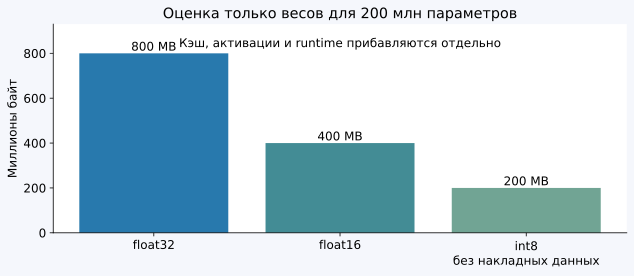

# M09-L04. Локальный инференс и память

**Результат:** Объяснить различие памяти весов, промежуточных вычислений и контекста; предложить облегчённый запуск.

**До урока:** M09-L03. Если термины из этих уроков не удаётся объяснить своими словами, вернись к их разобранным примерам. Ориентир времени — 120 минут чтения и практики; это первоначальная оценка, а не ограничение.

## Зачем и как это работает

Локальный инференс загружает веса в память компьютера и выполняет forward без обучения. Для курса обязательный вариант работает на CPU: это уменьшает зависимость от 4GBVRAM и позволяет исследовать механизм на небольшом масштабе. GPU способен ускорить некоторые вычисления, но его наличие не отменяет ограничений памяти и совместимости. Сначала измеряем рабочий CPU-путь, затем сравниваем ускорения отдельно.

Память весов оценивается как N·b, где N — число хранимых параметров, b — байт на элемент. Float32 занимает 4 байта, float16/bfloat16 —2 байта. Для условных 135 миллионов параметров получается 540MB или 270MB. Реальное число параметров читается из модели; название 135M округлено. Размер скачанного файла может отличаться от памяти загруженных тензоров, поскольку файл хранит другую точность и дополнительные данные.

Помимо весов нужны промежуточные активации, KV-cache, рабочие буферы библиотек и сам Python-процесс. Поэтому нельзя сравнить только размер файла с объёмом VRAM и гарантировать запуск. Для обычной attention-архитектуры примерная память KV-cache пропорциональна 2·L·T·H_kv·D_head·b·B, где 2 — ключи и значения, L — число слоёв, T — длина, H_kv — число KV-голов, D_head — размер головы, B — число сессий. Конкретные реализации и типы кеша меняют детали.

Квантование заменяет значения ограниченным набором чисел с меньшим числом бит. В простом симметричном примере q=round(w/s), восстановление ŵ=sq. При s=0,1 число 0,26 превращается в q=3 и ŵ=0,3, ошибка 0,04. Если диапазон целых ограничен, значения за пределами ещё и обрезаются. Масштабы, zero-point и группировка требуют дополнительных данных, поэтому «4bit» не означает ровно четырёхкратную экономию всей памяти относительно 16bit.

Квантование не равно простому приведению к float16. Int4 требует специального представления и вычислительных ядер; поддержка зависит от backend и устройства. Первая лабораторная загружает SmolLM в float32. Следующий обязательный M09-L06 сравнивает настоящий dynamic int8 с float32 на CPU. Это не int4-инференс: GGUF/llama.cpp остаётся отдельной дополнительной конфигурацией. Численный пример ниже объясняет механизм ошибки перед практическим сравнением.

Время измеряется по этапам. Cold load включает чтение файлов и создание модели. Prefill обрабатывает prompt. Decode генерирует новые токены. Полное время generate, делённое на число новых токенов, даёт среднее время на выходной токен в s/token. Обратное отношение, число новых токенов / полное время, даёт общую скорость вызова в token/s. Для 40 токенов за 10 секунд это 0,25 s/token и 4 token/s. Оба показателя включают prefill и не являются чистой decode-throughput или time-to-first-token. Без измерения момента первого токена нельзя подписывать такую метрику TTFT. Длина входа, длина ответа, число потоков и прогрев записываются рядом с результатом.

В нашем запуске закреплены repository и commit revision; файлы скачиваются один раз из официального Hugging Face Hub, затем local_files_only=True запрещает неявную сетевую загрузку. Лицензия карточки Apache2.0 сохраняется вместе с происхождением. Скачивание около 272MB относится к файлам конкретной ревизии, а не ко всем возможным весам этого семейства.

Главный результат — честный отчёт: какое оборудование и версии использованы, что фактически поместилось, сколько заняла загрузка и генерация, какие ответы получены. Даже успешный запуск не доказывает пригодность маленькой английской модели для русского голосового интервью. Качество и задержка полного продукта проверяются отдельно.



## Разобранный пример

Для условных L=12,T=512,H_kv=4,D_head=16,B=1,b=4 память кеша равна 2·12·512·4·16·4=3 145 728 байт=3MiB. Удвоение T удвоит этот кеш при неизменных остальных параметрах.

```python
kv_bytes = 2*12*512*4*16*4
assert kv_bytes == 3145728
weights = [-.26,.04,.26]
reconstructed = [round(w/.1)*.1 for w in weights]
print([round(w,2) for w in reconstructed])  # [-0.3,0.0,0.3]
```

Это учебные параметры, не конфигурация SmolLM. Реальная лабораторная записывает parameter_count и parameter_bytes из загруженных тензоров.

## Практика с поддержкой

Запусти M09/demo.py и сравни размер safetensors с parameter_bytes. Прочитай load_seconds и generation.seconds. Повтори короткий вызов после прогрева и зафиксируй оба значения. Не смешивай холодную загрузку и обычный ход диалога.

## Самостоятельная работа M09-L04-A

Для 200 миллионов параметров вычисли объём float32 и теоретический int8 в десятичных MB без накладных расходов. Для w=[−0,34;0,16;0,48] и scale0,1 вычисли q, восстановленные значения и максимальную абсолютную ошибку. Объясни, почему эти числа не гарантируют расход RAM и скорость настоящей модели.

Первая попытка — без готового решения. Сохрани свой код, объяснение и фактический результат в `submissions/M09-L04/`. AI может пояснять термин и помогать найти ошибку; запиши полученную помощь. Прочитанное решение не означает самостоятельно выполненное задание.

## Подсказки по очереди

1. Один int8-элемент занимает 1 байт, float32 —4.
2. Сначала округление до целого, потом умножение на scale.
3. Буферы, кеш и поддержка kernels не представлены в этой арифметике.

## Ошибки и самопроверка

Ошибка: называть total_tokens/total_time чистой скоростью decode. Ошибка: утверждать запуск 4bit по одному размеру файла. Критерий: единицы указаны, измерение отделено от оценки, квантование отмечено как численный опыт.

Работа готова, когда есть ответ на все условия задачи, вычисление или наблюдение подтверждает вывод, а ты можешь объяснить каждую величину и изменить один параметр без копирования решения. Критическую ошибку сначала исправь и повтори проверку; оформление не компенсирует неверное рассуждение. Сверь свою попытку с [решением M09-L04-A](../../solutions/modules/M09.md).

## Повтор и перенос

Вариант **M09-L04-B**. Для обычного multi-head KV-cache формула bytes=2·B·L·T·H·d·s, где 2 — key и value; B=1,L=12,T=128,H=8,d=64,s=2 байта. Вычисли bytes и MiB (2²⁰ байт), затем повтори при B=2,T=256. Здесь нет GQA и дополнительного allocator overhead.

Отложенный вариант **M09-L04-C**. Новый отчёт: загрузка модели 7 секунд, один generate после загрузки 2,4 секунды, сгенерировано 24 токена, время первого токена не записано. Найди token/s и s/token. Можно ли объявить TTFT=0,1 секунды? Сколько займёт этот единичный холодный запрос вместе с загрузкой при последовательном исполнении?

Сначала сохрани свою попытку и полученную помощь; затем открой [ключи B/C](../../solutions/modules/M09.md). После разбора B выполняй C без открытого решения. Статус «подтверждено позже» относится только к фактически выполненной отложенной проверке; до неё не отмечай освоение заранее.

## Источники и углубление

- [SmolLM2-135M-Instruct, карточка и лицензия](https://huggingface.co/HuggingFaceTB/SmolLM2-135M-Instruct)
- [Transformers: chat templates](https://huggingface.co/docs/transformers/chat_templating)
- [Transformers: генерация](https://huggingface.co/docs/transformers/main_classes/text_generation)
- [llama.cpp: официальный backend](https://github.com/ggml-org/llama.cpp)

Текст, численные примеры, задания и схемы этого урока созданы для данного курса. Источники нужны для проверки терминов и изучения исходного метода; они не заменяют самостоятельную практику.
