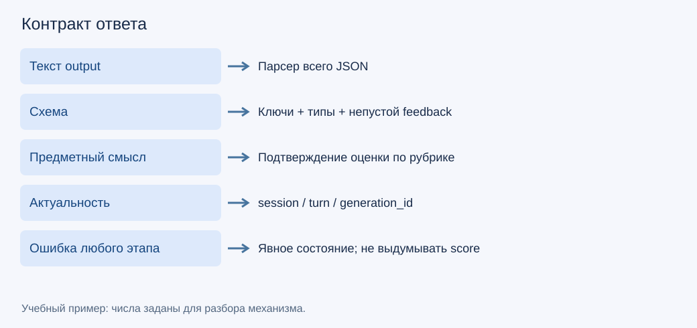

# M09-L05. Контракт ответа

**Результат:** Показать поведение приложения при пустом ответе, таймауте и нарушении формата.

**До урока:** M09-L04. Если термины из этих уроков не удаётся объяснить своими словами, вернись к их разобранным примерам. Ориентир времени — 140 минут чтения и практики; это первоначальная оценка, а не ограничение.

## Зачем и как это работает

Текст модели — недоверенный результат вычисления, пока приложение не проверило его соответствие контракту. Даже корректный JSON может содержать неверный тип, пропущенное поле или неподтверждённый вывод. Поэтому различай синтаксис, схему, смысл и допустимое действие. JSON-парсер проверяет только первый уровень. Схема проверяет ключи и типы. Предметная проверка сопоставляет ответ с рубрикой и источниками. Код приложения решает, можно ли продолжить сессию.

Для учебного интервьюера зададим ответ с полями feedback — непустая строка и score — целое число 0,1 или 2. Дополнительные поля запрещены, чтобы модель не меняла контракт самовольно. В Python bool является подклассом int, поэтому isinstance(True,int) возвращает True; если score должен быть именно целым баллом, проверяем type(score) is int. Такой маленький пример показывает, почему валидация требует понимания языка, а не только словесной инструкции.

Prompt с просьбой вернуть JSON увеличивает вероятность нужного формата, но не гарантирует его. Constrained decoding или grammar-based generation может ограничить допустимые токены и обеспечить синтаксический формат при поддержке backend. Однако даже строгая грамматика не доказывает, что score соответствует ответу кандидата. Нельзя подменять оценку качества успешной сериализацией. В обязательной лабораторной мы исследуем обычную генерацию и явно валидируем результат.

Невалидный output превращается в отдельное состояние: invalid_json, wrong_keys, empty_feedback или score_out_of_range. Система может выполнить одну ограниченную повторную попытку с указанием ошибки либо вернуть понятный fallback. Бесконечный цикл «попросить исправить» увеличивает задержку и может никогда не завершиться. Количество попыток, общий таймаут и итоговое поведение фиксируются до запуска.

Автоматическое извлечение первого фрагмента между фигурными скобками иногда скрывает проблему. Модель могла выдать два противоречивых JSON-объекта или текст с фигурными скобками внутри строки. Если допускается восстановление формата, оно должно быть отдельной документированной операцией с тестами, а не незаметным регулярным выражением. В учебном контракте принимаем только весь корректный JSON-объект, без префикса и хвоста.

При таймауте важно различать отсутствие результата и отрицательную оценку. Нельзя ставить score0 из-за сбоя модели: это смешивает качество ответа пользователя с доступностью сервиса. Fallback сообщает, что оценка не получена, и предлагает продолжить или повторить. Аналогично пустой вывод не означает слабый ответ кандидата. Пользовательская обратная связь должна отражать реальное состояние системы.

Валидация также защищает состояние диалога. Ответ может быть формально правильным, но относиться к старому generation_id после отмены. Проверка актуальности из M06 выполняется до публикации результата. Вызов инструмента, предложенный моделью, не должен автоматически исполняться только потому, что JSON распарсился; для него существует отдельный список разрешённых действий и параметров в M14.

Хороший тестовый набор контракта включает правильный объект, пустую строку, нечисловой score, boolean, выход за диапазон, лишний ключ, оборванный JSON и устаревший результат. Эти случаи можно проверить без LLM, что делает защиту воспроизводимой. Затем реальная модель показывает, как часто такая защита срабатывает на выбранных запросах. Частота на малом наборе остаётся наблюдением, а не гарантией поведения.



## Разобранный пример

```python
import json
def valid(text):
    try: x = json.loads(text)
    except json.JSONDecodeError: return False
    return (isinstance(x,dict) and set(x)=={'feedback','score'}
            and isinstance(x['feedback'],str) and bool(x['feedback'].strip())
            and type(x['score']) is int and 0<=x['score']<=2)
assert valid('{"feedback":"Explain isolation","score":1}')
assert not valid('{"feedback":"OK","score":true}')
assert not valid('{"feedback":"","score":2}')
```

Правильный формат первого объекта не доказывает, что замечание соответствует реальному ответу. Семантическое оценивание начинается в M11.

## Практика с поддержкой

Импортируй validate_feedback из M09/demo.py и составь таблицу из восьми входов. Для каждого сначала запиши ожидаемую причину отказа, затем сравни фактический результат. Отдельно сохрани настоящий output SmolLM, даже если он невалиден.

## Самостоятельная работа M09-L05-A

Определи поведение для: корректного JSON с score2, score3, scoretrue, отсутствующего feedback, текстового префикса перед JSON, таймаута и результата старого хода. Предложи максимальное число попыток и fallback без выдуманной оценки пользователя.

Первая попытка — без готового решения. Сохрани свой код, объяснение и фактический результат в `submissions/M09-L05/`. AI может пояснять термин и помогать найти ошибку; запиши полученную помощь. Прочитанное решение не означает самостоятельно выполненное задание.

## Подсказки по очереди

1. Схема, синтаксис и актуальность — разные проверки.
2. Таймаут не является score0.
3. Политика попыток должна иметь конечную границу.

## Ошибки и самопроверка

Ошибка: считать любой int-подобный объект корректным баллом. Ошибка: молча превращать ошибку генерации в отрицательную оценку. Критерий: каждый случай имеет явный результат; fallback не приписывает кандидату качество, которое не оценено.

Работа готова, когда есть ответ на все условия задачи, вычисление или наблюдение подтверждает вывод, а ты можешь объяснить каждую величину и изменить один параметр без копирования решения. Критическую ошибку сначала исправь и повтори проверку; оформление не компенсирует неверное рассуждение. Сверь свою попытку с [решением M09-L05-A](../../solutions/modules/M09.md).

## Повтор и перенос

Вариант **M09-L05-B**. Расширенная схема имеет ровно feedback (непустая строка), score (целое 0…2, не bool), evidence_ids (список уникальных строк). Допустимы IDs {sql-01,api-02}. Классифицируй четыре объекта: (1) {feedback:«Уточни»,score:1,evidence_ids:[sql-01]}; (2) такой же, но [sql-99]; (3) такой же, но [sql-01,sql-01]; (4) такой же, но score=true. Приведи причину каждого отказа и итог fallback без выдуманной оценки.

Отложенный вариант **M09-L05-C**. Объект {feedback:«Индекс ускоряет любую запись»,score:2,evidence_ids:[sql-01]} проходит схему. Документ sql-01 говорит: «Индекс может ускорять поиск, но его обновление добавляет работу при записи». Проверь подтверждение утверждения источником. Отдельно: ответ пришёл для turn_id=7, текущий ход 8 — можно ли показывать его как оценку текущего ответа?

Сначала сохрани свою попытку и полученную помощь; затем открой [ключи B/C](../../solutions/modules/M09.md). После разбора B выполняй C без открытого решения. Статус «подтверждено позже» относится только к фактически выполненной отложенной проверке; до неё не отмечай освоение заранее.

## Источники и углубление

- [SmolLM2-135M-Instruct, карточка и лицензия](https://huggingface.co/HuggingFaceTB/SmolLM2-135M-Instruct)
- [Transformers: chat templates](https://huggingface.co/docs/transformers/chat_templating)
- [Transformers: генерация](https://huggingface.co/docs/transformers/main_classes/text_generation)

Текст, численные примеры, задания и схемы этого урока созданы для данного курса. Источники нужны для проверки терминов и изучения исходного метода; они не заменяют самостоятельную практику.
