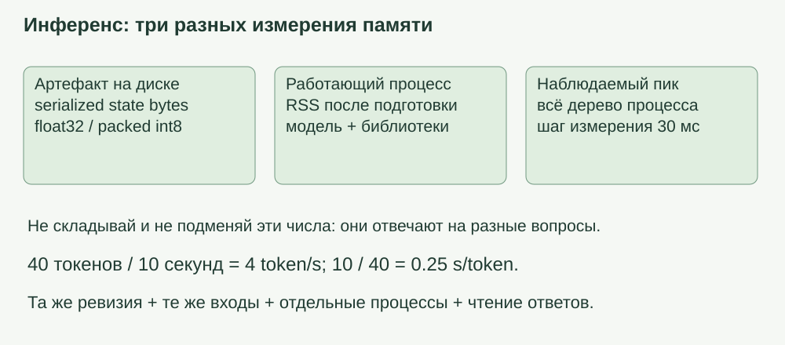

# M09-L06. Выбрать локальную конфигурацию по измерениям

**Результат:** сравнить float32 и динамическое int8 на одной небольшой модели, не перепутав размер весов, RAM, скорость и качество.

**До урока:** M09-L04–L05. Практика требует уже загруженной SmolLM2-135M-Instruct. CPU, без нового скачивания. План: 45 минут объяснения, 60–120 минут прогона и разбора, 60 минут самостоятельной проверки.

> **Версии и дата проверки:** Python 3.11.9, PyTorch 2.15.0+cpu, transformers 4.57.6, huggingface-hub 0.36.2; модель SmolLM2-135M-Instruct (ревизия 12fd25f); dynamic int8 из torch.ao, psutil 7.2.2 · проверено 04.11.2026 · источник: [PyTorch 2.15: dynamic quantization](https://docs.pytorch.org/docs/2.15/generated/torch.ao.quantization.quantize_dynamic.html)

## Почему одной формулы памяти недостаточно

Расчёт N·4 байта полезен для float32-параметров, но процесс хранит также библиотеки, токены, промежуточные тензоры и KV-cache. После удаления Python-объекта allocator может удержать память. Поэтому запускать две конфигурации по очереди в одном процессе и объявлять разницу RSS чистым эффектом квантования ненадёжно.

Мы запускаем два новых процесса. В первом модель остаётся float32. Во втором Linear-слои преобразуются динамическим квантованием PyTorch в int8. Embedding и другие части не обязаны стать int8; поэтому нельзя обещать ровно четырёхкратное уменьшение всей модели. Packed weights тоже не всегда видны в обычной сумме `parameter.numel()*element_size()`.

В лабораторной отдельно измеряются сериализованное состояние модели, RSS после подготовки и наблюдавшийся пик RSS. Сериализация использует torch.save и включает служебные данные: это размер конкретного артефакта, а не точная сумма математических весов. Пик измеряется внешним процессом каждые 30 мс; очень короткий всплеск может остаться между измерениями. Такие ограничения нужно писать рядом с числом.

## Какие условия сравнения сохранять

На Windows virtualenv может запускать маленький процесс-перенаправитель и отдельный Python-процесс. Поэтому sampler суммирует RSS дерева worker и его потомков. Общие страницы могут учитываться повторно: это наблюдаемая сумма рабочей памяти процессов, а не уникальная private memory. Проверка сравнивает пик со steady RSS самого интерпретатора, чтобы случайно не выдать несколько мегабайт launcher за потребление LLM.

Одинаковыми должны быть revision модели, tokenizer, запросы, режим greedy, лимит новых токенов, число CPU-потоков и процедура прогрева. Разная длина фактически сгенерированного ответа остаётся возможной — квантование меняет числа. Поэтому сохраняй и время, и число токенов, и сам текст.

Преобразование int8 начинается после загрузки float32. Пиковая память этого пути может быть выше ожидаемой, хотя готовое состояние компактнее. Это честный результат данной процедуры. Он не измеряет загрузку заранее подготовленного квантованного файла другим runtime.



## Запуск и наблюдаемый результат

```powershell
.\.venv\Scripts\python.exe labs\M09\benchmark.py
```

Команда последовательно создаёт процессы float32/int8 и сохраняет `artifacts/M09/benchmark/comparison.json` плюс отдельные logs. Отчёт содержит все три ответа каждой конфигурации. Нет платных API; при ошибке открывай log нужного процесса, а не подменяй отсутствующий результат теоретической оценкой.

Численный пример расчёта: если исходный процесс создал 40 токенов за 10 секунд, скорость всего вызова 4 token/s, среднее время на выходной токен 0.25 s/token. Если int8 создал 32 за 9 секунд, это 3.56 token/s. Меньшее полное время здесь не означает большую скорость токенов. Ни одна из этих величин не является time-to-first-token, поскольку первый токен отдельно не измерялся.

## Практика с поддержкой

Построй таблицу двух конфигураций: размер состояния, RSS после загрузки, пик, время подготовки, число токенов, время вызова. Затем прочитай ответы по одной и той же рубрике: фактическая корректность, завершённость и язык. Отдельно отметь русский запрос. Совпадение английского определения не подтверждает качество русского интервью.

Полезное решение может быть отрицательным: выбранный int8-runtime не ускорил работу или изменил ответ неудачно. Цель — найти причину и выбрать конфигурацию при заданном ограничении; курс не требует искусственно «выиграть» квантованием.

## Самостоятельная задача A

В отдельной копии benchmark добавь два новых запроса: длинный контекст и короткий запрос с числом/отрицанием. Сохрани исходные запросы для регрессии. До запуска зафиксируй правило выбора: например, отсутствие новой критической фактической ошибки важнее небольшой экономии RAM. Сделай минимум два повторных измерения времени каждой конфигурации и сохрани все результаты, не только лучшее.

Критерии: отдельные процессы, сопоставимые настройки, правильные единицы, реальные outputs и вывод по заранее выбранному правилу. Критическая ошибка — объявить квантование более качественным только по скорости либо использовать размер файла как измерение пика RAM.

## Подсказки

1. Пики из разных процессов можно сравнивать только при одинаковой процедуре загрузки.
2. Сначала сравни размер и длину ответа, потом время.
3. Три запроса — диагностические случаи, не статистическое доказательство общей пригодности модели.

## Повтор B и отложенная задача C

B: в одном прогоне модель отвечала 8 токенами, в другом 24. Пересчитай token/s и объясни ограничения сравнения. C через неделю: RAM уменьшилась на 20%, но русский ответ потерял отрицание. Прими решение по собственной рубрике и предложи следующий опыт. [Решение](../../solutions/modules/M09.md) содержит образец расчёта и правила, а фактические измерения бери из своего отчёта.

## Источники

[PyTorch dynamic quantization](https://docs.pytorch.org/docs/2.15/generated/torch.ao.quantization.quantize_dynamic.html), [Transformers 4.57.6 generation](https://huggingface.co/docs/transformers/v4.57.6/main_classes/text_generation). API torch.ao имеет уведомление о дальнейшем переносе развития в torchao; курс фиксирует проверенную текущую конфигурацию, а не обещает неизменность API.
