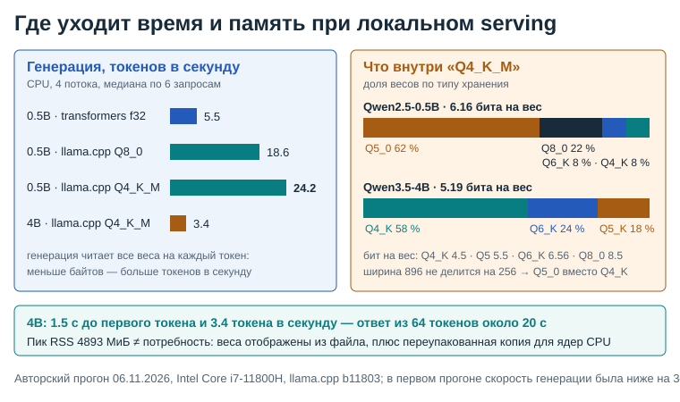
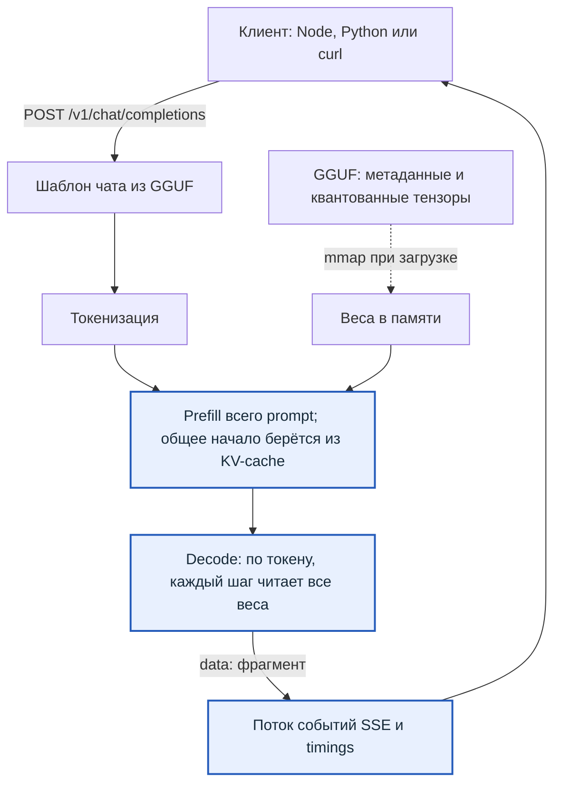

# M09-L07X. Локальный serving: llama.cpp и Ollama

**Расширение 1.2.0.** Урок дополняет модуль, не входит в обязательный минимум 1.1.0.

**Результат:** поднять локальную модель за OpenAI-совместимым HTTP API через llama.cpp и прочитать, что лежит в GGUF-файле и что значит Q4_K_M. Затем измерить на CPU время до первого токена, скорость prefill и генерации и пиковую память для моделей 0.5B и 4B и сравнить их с transformers float32.

**До урока:** M09-L04, M09-L06. Нужны бинарник llama.cpp (`labs/M09/llama_local.py fetch`, около 24 МБ) и GGUF-файлы (`tools/download_models.py --gguf`, около 3.9 ГБ, из них 2.7 ГБ — модель 4B). Без модели 4B лабораторная измерит только 0.5B. Ориентир времени — 180 минут чтения, прогона и разбора; это первоначальная оценка, а не ограничение.

> **Версии и дата проверки:** llama.cpp b11803 (CPU-сборка для Windows x64 от 21.10.2026), Python 3.11.9, PyTorch 2.15.0+cpu, transformers 4.57.6; модели Qwen2.5-0.5B-Instruct (GGUF Q4_K_M и Q8_0 от Qwen, ревизия 9217f5d; safetensors, ревизия 7ae5576), Qwen3.5-4B Q4_K_M (квантизация unsloth, ревизия e87f176) · проверено 06.11.2026 · источник: [README llama-server](https://github.com/ggml-org/llama.cpp/blob/b11803/tools/server/README.md)

## Объяснение

До сих пор модель жила внутри Python-процесса лабораторной: transformers загружал веса, и код вызывал `generate`. В приложении так делают редко. Обычно модель держит отдельный процесс-сервер, а приложение — например, сервис на NestJS — обращается к нему по HTTP. Такой сервер называют serving. Он загружает веса один раз, держит их в памяти и отвечает многим клиентам на любом языке.

llama.cpp — движок инференса на C/C++ для моделей в формате GGUF. Он оптимизирован под CPU: умножает матрицы прямо в квантованном виде, а сборка для Windows содержит варианты ядер под разные наборы инструкций процессора и выбирает подходящий при запуске. В комплекте есть `llama-server` — HTTP-сервер с OpenAI-совместимым API. Запрос `POST /v1/chat/completions` с полями `messages`, `max_tokens`, `temperature` и `stream` устроен так же, как у облачных API, у Ollama и у vLLM. Клиентский код переключается между ними сменой базового адреса. При `stream: true` ответ приходит потоком событий `data: {...}` — по фрагменту текста на событие, в конце `data: [DONE]`. Это и позволяет измерить время до первого токена.

GGUF — один файл, в котором лежат метаданные и тензоры. В метаданных записаны архитектура, число слоёв, длина контекста, токенизатор и шаблон чата, у каждого тензора свой тип хранения. Q8_0 хранит блоки по 32 веса: 32 восьмибитных числа и один масштаб float16, то есть 34 байта на 32 веса, или 8.5 бита на вес. Q4_K хранит суперблоки по 256 весов: четырёхбитные значения плюс шестибитные масштабы и минимумы для каждых 32, всего 144 байта на 256 весов, или 4.5 бита. Буква M в Q4_K_M означает смесь: часть чувствительных тензоров кладётся в Q6_K (6.56 бита). Есть и ограничение формата: блок k-квантов — 256 чисел строки. Если длина строки тензора на 256 не делится, llama.cpp при квантовании берёт запасной тип: Q5_0 вместо Q4_K и Q8_0 вместо Q6_K. Поэтому подпись Q4_K_M не обещает четыре бита на каждый вес. Средний размер узнают, прочитав сам файл; лабораторная делает это функцией `gguf_summary`.

Время ответа складывается из этапов M09-L04. Prefill обрабатывает весь prompt сразу: это умножение матрицы на матрицу, и оно хорошо распараллеливается по токенам. Decode выдаёт по одному токену, и на каждом шаге нужно прочитать из памяти все веса модели. Поэтому скорость генерации на CPU упирается в пропускную способность памяти, и квантование ускоряет её прямо пропорционально уменьшению байтов. Грубая оценка сверху: токенов в секунду ≈ пропускная способность памяти / размер весов в байтах. Время до первого токена (TTFT) — это prefill плюс первый шаг decode. llama-server умеет переиспользовать KV-cache общего начала prompt из прошлых запросов (поле `cache_prompt`): одинаковый системный prompt не пересчитывается заново.

Память — это веса, KV-cache и рабочие буферы. KV-cache выделяется под заданную длину контекста (`-c`), а не под фактический диалог. Qwen3.5-4B по умолчанию объявляет контекст 262 144 токена, и без явного `-c` сервер попытается выделить кэш под него. У Qwen3.5 полное внимание только в каждом четвёртом слое, остальные слои линейного внимания хранят состояние фиксированного размера, поэтому её кэш растёт с контекстом медленнее, чем у обычной архитектуры. Модель-специфичные поля тоже важны. Qwen3.5 по умолчанию рассуждает перед ответом в блоке `<think>`, и карточка модели предлагает выключать это полем `chat_template_kwargs: {"enable_thinking": false}`. Иначе часть токенов бюджета уйдёт на рассуждение.

Ollama — оболочка над тем же движком ggml. Она добавляет реестр моделей (`ollama pull`), Modelfile с параметрами и шаблоном, автоматическую выгрузку моделей из памяти и тот же OpenAI-совместимый API на порту 11434. Для разработки это удобно, но настройки по умолчанию — контекст, квантование, шаблон — выбирает она, и их нужно проверять так же, как здесь. В курсе Ollama разобрана обзорно: по решению автора она не устанавливалась. vLLM и SGLang — серверы для GPU, их сила в одновременном обслуживании многих запросов: память под KV-cache разбивается на страницы (PagedAttention), запросы объединяются в пакеты на лету. На CPU-пути курса они не нужны, но их API тот же. И последнее: llama-server при запуске предупреждает, что ключа API нет и CORS открыт для всех. Сервер в лабораторной слушает только 127.0.0.1; выставлять его в сеть без `--api-key` и обратного прокси нельзя.




## Аналогия: встроенная SQLite и сервер PostgreSQL

Как похоже: transformers внутри Python-процесса — как SQLite, встроенная в приложение: просто, без сети, но только для этого процесса и этого языка. llama-server — как сервер PostgreSQL: отдельный процесс держит данные в памяти и обслуживает клиентов по своему протоколу. OpenAI-совместимый API похож на протокол PostgreSQL, который поддерживают и другие базы: клиентский код не меняется, меняется адрес.

| В уроке | В аналогии |
| --- | --- |
| transformers в процессе лабораторной | SQLite, встроенная в приложение |
| llama-server на 127.0.0.1 | Сервер PostgreSQL на localhost |
| OpenAI-совместимый API у llama.cpp, Ollama, vLLM | Протокол PostgreSQL у разных совместимых баз |
| GGUF с метаданными и тензорами | Файлы базы со схемой и данными |
| Квантование Q8_0 и Q4_K_M | Сжатие страниц: меньше места, другие значения |
| cache_prompt и KV-cache префикса | Кэш планов и буферов для повторяющихся запросов |
| `-c` — длина контекста | `shared_buffers`: память выделяется заранее по настройке |

**Где аналогия ломается:** две совместимые базы на один и тот же SQL-запрос вернут одинаковые строки. Два сервера с «тем же» API — нет. Шаблон чата, параметры по умолчанию, токенизация, квантование и дополнительные поля (`cache_prompt`, `chat_template_kwargs`) у них свои, и один запрос даёт разный текст. Сжатие страниц в базе не меняет данные, а квантование меняет веса, и ответы модели расходятся уже через несколько слов.

## Разобранный пример

Q8_0: 34 байта на 32 веса — 34 · 8 / 32 = 8.5 бита. Q4_K: 144 байта на 256 весов — 4.5 бита. Если бы все 630 млн весов Qwen2.5-0.5B лежали в Q4_K, файл занял бы около 630 · 10⁶ · 4.5 / 8 ≈ 354 млн байт. Файл весит 491 млн байт, потому что строки длиной 896 на 256 не делятся, и большинство тензоров ушло в Q5_0.

KV-cache Qwen2.5-0.5B при `-c 4096` по формуле M09-L04: 2 · L · T · H_kv · D_head · b = 2 · 24 · 4096 · 2 · 64 · 2 = 50 331 648 байт, 48 МиБ во float16. Оценка скорости генерации: если 0.5B в Q4_K_M читает около 485 млн байт весов на токен и выдаёт 22 токена в секунду, эффективная пропускная способность — около 10.7 ГБ/с. Модель 4B в Q4_K_M — около 2.7 ГБ весов, то есть при той же памяти стоит ждать не больше 10.7 / 2.7 ≈ 4 токенов в секунду. Это предсказание до замера; авторский прогон ниже его проверяет.

```python
q8_0 = 34 * 8 / 32
q4_k = 144 * 8 / 256
assert q8_0 == 8.5 and q4_k == 4.5
weights = 630_000_000
assert round(weights * q4_k / 8 / 1e6) == 354
kv_bytes = 2 * 24 * 4096 * 2 * 64 * 2  # K и V, слои, токены, KV-головы, размер головы, байты float16
assert kv_bytes == 50_331_648 and kv_bytes / 2**20 == 48
bandwidth = 485e6 * 22  # байт весов на токен × токенов в секунду
print(round(bandwidth / 1e9, 1), 'ГБ/с;', round(bandwidth / 2.7e9, 1), 'токена в секунду ожидается для 4B')
```

### Авторский прогон 06.11.2026

Ноутбук с Intel Core i7-11800H (8 ядер, 16 потоков) и 32 ГБ памяти, 4 потока, шесть коротких запросов на русском и английском, жадная генерация, до 64 новых токенов, контекст 4096. Данные из `artifacts/M09/llama/report.json`; файл указан в МиБ, память — пик за прогон. Prefix cache в замерах выключен, чтобы каждый prompt считался с нуля, как в transformers.

Ниже 0.5B — Qwen2.5-0.5B-Instruct, 4B — Qwen3.5-4B. Скорость, медиана по шести запросам:

| Конфигурация | TTFT, мс | Prefill, ток/с | Генерация, ток/с |
| --- | --- | --- | --- |
| 0.5B, transformers float32 | 476 | 103 | 5.5 |
| 0.5B, llama.cpp Q8_0 | 400 | 126 | 18.6 |
| 0.5B, llama.cpp Q4_K_M | 388 | 133 | 24.2 |
| 4B, llama.cpp Q4_K_M | 1540 | 20 | 3.4 |

Файл, время старта сервера, память и совпадение ответов:

| Конфигурация | Файл, МиБ | Старт, с | Пик RSS, МиБ | Пик private, МиБ | Совпало с float32 |
| --- | --- | --- | --- | --- | --- |
| 0.5B, transformers float32 | 942 | 2.9 | 3196 | 5391 | — |
| 0.5B, llama.cpp Q8_0 | 644 | 1.6 | 642 | 205 | 0 из 6 |
| 0.5B, llama.cpp Q4_K_M | 469 | 1.3 | 544 | 234 | 0 из 6 |
| 4B, llama.cpp Q4_K_M | 2614 | 5.9 | 4893 | 2769 | — |

В первом полном прогоне той же ночью генерация была медленнее: 3.6, 14.9, 18.0 и 3.3 токена в секунду — на 3–35 %. На ноутбуке скорость зависит от температуры и фоновых задач, поэтому конфигурации сравнивают внутри одного прогона и указывают разброс. Тексты ответов в обоих прогонах совпали во всех четырёх конфигурациях: жадная генерация в одном движке воспроизводима, меняется только время.

Что лежит в файлах — по `gguf_summary`, доля весов по типу хранения:

| Файл | Средний бит на вес | Q4_K | Q5_0 или Q5_K | Q6_K | Q8_0 |
| --- | --- | --- | --- | --- | --- |
| Qwen2.5-0.5B Q4_K_M | 6.16 | 8 % | 62 % (Q5_0) | 8 % | 22 % |
| Qwen2.5-0.5B Q8_0 | 8.5 | — | — | — | 100 % |
| Qwen3.5-4B Q4_K_M | 5.19 | 58 % | 18 % (Q5_K) | 24 % | меньше 0.1 % |

Q4_K_M модели 0.5B — в основном Q5_0. Строки длиной 896 не делятся на 256, и при квантовании сработала замена Q4_K на Q5_0 из `llama-quant.cpp`. У 4B ширина 2560 делится на 256, и Q4_K там действительно основной тип. Число 5.19 бита на вес совпало с тем, что печатает сам llama.cpp при загрузке.

Что из этого следует. llama.cpp с Q4_K_M генерирует в 4.4 раза быстрее transformers float32 на той же модели (в первом прогоне — в 5 раз). Переход с Q8_0 на Q4_K_M уменьшил файл на 27 % и ускорил генерацию на 30 %. Prefill почти не изменился: он упирается в вычисления, а не в чтение весов. Предсказание разобранного примера для 4B — не больше 4 токенов в секунду — подтвердилось: 3.4. Ответ из 64 токенов у 4B занимает 1.5 + 63 / 3.4 ≈ 20 секунд. Для голосового диалога на этом процессоре это слишком медленно, для пакетной проверки ответов — приемлемо. Качество двух моделей этот урок не сравнивает, это задача T51.

Квантование меняет текст. Ни один ответ GGUF-версий 0.5B не совпал с float32 слово в слово. Общее начало в среднем — 39.5 символа у Q8_0 и 29.5 у Q4_K_M: ответы расходятся уже в первом предложении. Этот прогон не разделяет вклад квантования и другой арифметики ядер, потому что неквантованного GGUF в нём нет.

Кэш общего начала prompt работает так, как обещает README. Для нового запроса к 0.5B Q4_K_M сервер досчитал 21 токен за 191 мс, остальное взял из общего системного начала шаблона. Повтор того же запроса досчитал 1 токен за 41 мс. У 4B — 33 токена за 1475 мс и 4 токена за 504 мс при повторе. Слоям линейного внимания нужно восстановить состояние с контрольной точки, поэтому переиспользование у гибридной модели грубее.

Память читается не одним числом. RSS у llama.cpp включает страницы GGUF-файла, отображённые в память (mmap): система может их выгрузить и прочитать заново. Собственная память процесса (private) у 0.5B Q4_K_M — 234 МиБ, KV-cache на 4096 токенов из разобранного примера занимает 48 из них. У 4B в простое RSS 4198 МиБ, private 2088 МиБ. Сводка памяти llama.cpp (запуск с `-lv 4`) раскладывает это так: 1305 МиБ весов в отображённом файле, 1297 МиБ — переупакованная копия весов Q4_K для быстрых ядер CPU (`CPU_REPACK`), 178 МиБ контекста и 83 МиБ рабочих буферов. У PyTorch наоборот: private 5391 МиБ больше RSS 3196 МиБ, потому что процесс зарезервировал больше памяти, чем занял. Поэтому решение «влезет ли модель» принимают по пику под нагрузкой с запасом и по сводке самого движка, а не по размеру файла.

Режим размышлений Qwen3.5 выключился: поле `reasoning_content` во всех ответах 4B пустое.

## Схема



Путь одного запроса через llama-server. Клиент шлёт обычный OpenAI-совместимый запрос. Сервер применяет шаблон чата, записанный в самом GGUF, и токенизирует текст. Затем prefill обрабатывает prompt целиком, а общее начало с прошлыми запросами берётся из KV-cache. Decode выдаёт по токену, и каждый шаг читает все веса из памяти: поэтому квантование ускоряет именно генерацию. Ответ уходит потоком событий, последнее содержит `timings` со скоростью prefill и генерации. Выделен главный путь: prefill → decode → поток. Пунктир — веса отображаются из файла при загрузке и дальше читаются из памяти.

## Практика с поддержкой

**Предскажи до запуска.** Прежде чем запускать код или пересчитывать пример, запиши ожидаемый вывод: числа, формы массивов, порядок или текст. После запуска сравни с фактическим и объясни каждое расхождение.

Скачай бинарник и модели, затем запусти лабораторную:

```powershell
.\.venv\Scripts\python.exe labs\M09\llama_local.py fetch
.\.venv\Scripts\python.exe tools\download_models.py --gguf
.\.venv\Scripts\python.exe labs\M09\llama_serving.py
```

До запуска запиши три предсказания: во сколько раз Q4_K_M генерирует быстрее float32, сколько токенов в секунду даст 4B по оценке «пропускная способность / размер весов», совпадут ли ответы Q8_0 и float32. После запуска открой `artifacts/M09/llama/report.json` и найди у каждой конфигурации `gguf.types`, `prompt_cache` и тексты ответов. Флаг `--only` запускает выбранные конфигурации, `--threads` меняет число потоков.

Затем подними сервер вручную и пошли запрос так, как это сделает приложение:

```powershell
.\.venv\Scripts\python.exe labs\M09\llama_local.py serve qwen2.5-0.5b-instruct-q4_k_m
```

Во втором окне PowerShell:

```powershell
$body = @{ model = 'qwen2.5-0.5b-instruct-q4_k_m'; max_tokens = 40; temperature = 0; messages = @(@{ role = 'user'; content = 'Что такое идемпотентность?' }) } | ConvertTo-Json -Depth 4
Invoke-RestMethod -Uri http://127.0.0.1:18080/v1/chat/completions -Method Post -ContentType 'application/json; charset=utf-8' -Body ([Text.Encoding]::UTF8.GetBytes($body))
```

Найди в ответе поля `choices`, `usage` и `timings`. Отправь тот же запрос второй раз и сравни `timings.prompt_n`. Если сервер остался после прерванного запуска, останови его командой `Stop-Process -Name llama-server`.

## Самостоятельная задача A — M09-L07X-A

Измерь, как число потоков влияет на prefill и генерацию модели 0.5B Q4_K_M: запусти лабораторную с `--only qwen2.5-0.5b-q4_k_m-llama.cpp --threads N` при N = 1, 2, 4 и 8, каждый вариант дважды. Гипотезу запиши до запуска. Построй таблицу: медиана prefill, медиана генерации и TTFT для каждого N, разброс между двумя прогонами. Объясни, почему генерация растёт с потоками хуже, чем prefill, и выбери число потоков для сервера, на котором одновременно работает ещё и распознавание речи.

Первая попытка — без готового решения. Сохрани код, таблицу и объяснение в `submissions/M09-L07X/`. AI может пояснять термины и помогать искать ошибку; запиши полученную помощь.

## Подсказки по очереди

1. Prefill — это умножение матрицы на матрицу по всем токенам prompt, вычисления хорошо делятся между потоками.
2. Генерация читает все веса на каждый токен; когда память уже загружена полностью, новые потоки ждут её, а не считают.
3. Разница меньше разброса между двумя прогонами одного N ничего не доказывает.

## Критерии и типичные ошибки

Ошибка: сравнивать скорость конфигураций из разных прогонов или с включённым prefix cache у одной и выключенным у другой. Ошибка: считать подпись Q4_K_M обещанием четырёх бит на вес. Ошибка: судить о памяти по размеру файла или по одному RSS без private и пика. Ошибка: выставить llama-server в сеть без ключа API. Ошибка: не выключить режим размышлений у модели, которая включает его по умолчанию, и списать медленный ответ на движок. Критерий: таблица TTFT, prefill, генерации и памяти с разбросом, ссылка на состав GGUF и вывод, который не выходит за пределы машины и запросов.

После попытки сверь результат с [решением M09-L07X-A](../../solutions/modules/M09.md#m09-l07x-a).

## Новая и отложенная проверка

**B — размер и скорость по типам.** В модели 3.0 млрд весов: 70 % хранятся в Q4_K, 20 % в Q6_K, 10 % в Q8_0. Посчитай средний бит на вес и размер весов в ГБ. Сколько токенов в секунду генерации можно ожидать на машине с эффективной пропускной способностью памяти 12 ГБ/с? Что изменится, если та же модель целиком будет в Q8_0?

**C — через 7–10 дней.** Тренажёру собеседований нужен ответ из 120 токенов, а пользователь готов ждать первого слова не больше 2 секунд. На ноутбуке есть 0.5B Q4_K_M (TTFT 0.4 с, 24 токена в секунду) и 4B Q4_K_M (TTFT 1.5 с, 3.4 токена в секунду). Посчитай полное время ответа обеих моделей и реши, что выбрать для живого диалога, а что — для ночной проверки ответов. Что ещё нужно измерить до решения, кроме скорости?

Сначала сохрани собственное решение B/C, затем сверь [отдельный ключ M09-L07X-B-C](../../solutions/modules/M09.md#m09-l07x-b-c). Отметь помощь; отложенную проверку засчитывай только после фактической новой попытки.

## Карточка урока

| Поле | Содержание |
| --- | --- |
| Правило | Модель обслуживают отдельным сервером за OpenAI-совместимым API; конфигурации сравнивают в одном прогоне по TTFT, prefill, генерации и пику памяти с разбросом, состав GGUF читают из файла, а модельные поля вроде `chat_template_kwargs` задают явно |
| Смысл величин | TTFT — prefill плюс первый шаг decode; генерация ≈ пропускная способность памяти / байты весов; бит на вес: Q8_0 8.5, Q4_K 4.5, Q6_K 6.56; RSS включает отображённый файл, private — собственная память процесса; KV-cache выделяется под `-c` |
| Когда применять | Когда модель нужна приложению на CPU без облака. Пример: Qwen2.5-0.5B в Q4_K_M генерировала 24.2 токена в секунду против 5.5 у transformers float32 при пике RSS 544 против 3196 МиБ, а 4B в Q4_K_M — 3.4 токена в секунду, и ответ из 64 токенов занимал около 20 секунд |
| Главная ошибка | Выбрать квантование по подписи, сравнить скорости из разных прогонов или решить, что модель влезет, по размеру файла |

## Источники и углубление

- [README llama-server](https://github.com/ggml-org/llama.cpp/blob/b11803/tools/server/README.md) — OpenAI-совместимые маршруты, поток событий, `cache_prompt`, `chat_template_kwargs`, `timings` и ключ API (на английском)
- [Спецификация GGUF](https://github.com/ggml-org/ggml/blob/master/docs/gguf.md) — заголовок, метаданные, таблица тензоров и выравнивание (на английском)
- [llama.cpp: llama-quant.cpp](https://github.com/ggml-org/llama.cpp/blob/b11803/src/llama-quant.cpp) — правило замены типа, когда строка тензора не делится на размер блока (на английском)
- [Qwen/Qwen3.5-4B](https://huggingface.co/Qwen/Qwen3.5-4B) — карточка модели: режим размышлений по умолчанию и как его выключить (на английском)
- [unsloth/Qwen3.5-4B-GGUF](https://huggingface.co/unsloth/Qwen3.5-4B-GGUF) — квантизация сообщества, использованная в курсе (на английском)
- [Ollama: OpenAI compatibility](https://docs.ollama.com/api/openai-compatibility) — тот же API у Ollama на порту 11434 (на английском)
- [Kwon et al.: PagedAttention](https://arxiv.org/abs/2309.06180) — как vLLM управляет памятью KV-cache на GPU (на английском)

Запросы, численные наблюдения и код лабораторной созданы для курса; внешние тексты не копировались в учебные данные.
