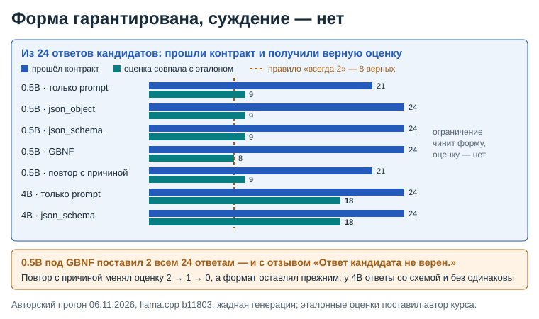
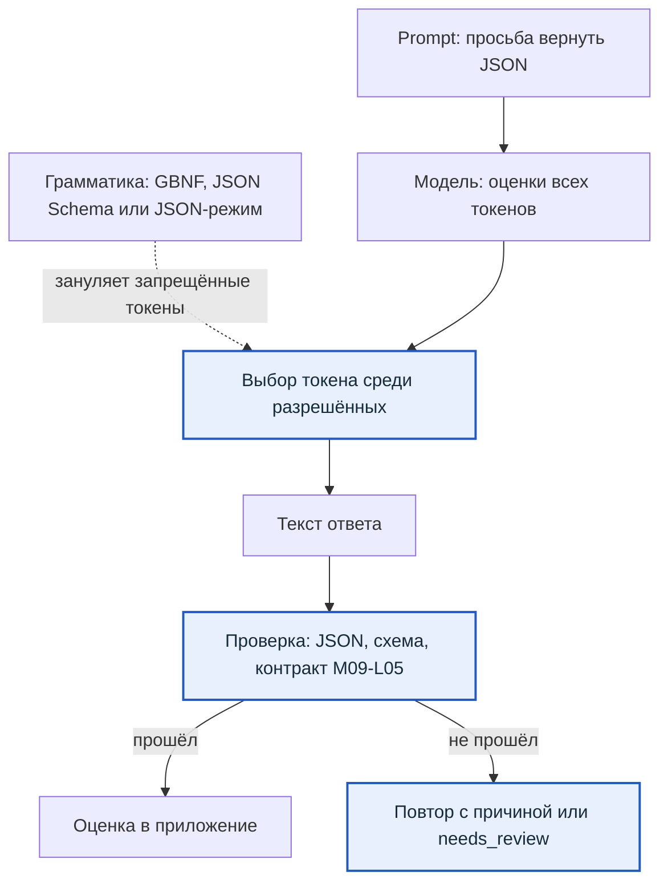

# M09-L08X. Структурированный ответ: JSON Schema и грамматики

**Расширение 1.2.0.** Урок дополняет модуль, не входит в обязательный минимум 1.1.0.

**Результат:** получить от локальной модели объект по контракту M09-L05 пятью способами: просьбой в prompt, JSON-режимом сервера, JSON Schema, грамматикой GBNF и проверкой с повтором. Затем отдельно измерить долю ответов, прошедших контракт, и долю верных оценок, и объяснить, почему ограничение формы не исправляет суждение модели.

**До урока:** M09-L05, M09-L07X. Нужны бинарник llama.cpp и GGUF из M09-L07X; новых загрузок нет. Без модели 4B лабораторная проверит только 0.5B. Ориентир времени — 150 минут чтения, прогона и разбора; это первоначальная оценка, а не ограничение.

> **Версии и дата проверки:** llama.cpp b11803, Python 3.11.9, jsonschema 4.26.0; модели Qwen2.5-0.5B-Instruct Q4_K_M (ревизия 9217f5d) и Qwen3.5-4B Q4_K_M (квантизация unsloth, ревизия e87f176) · проверено 06.11.2026 · источник: [GBNF в llama.cpp](https://github.com/ggml-org/llama.cpp/blob/b11803/grammars/README.md)

## Объяснение

В M09-L05 контракт ответа был таким: ровно два поля, `feedback` — непустая строка и `score` — целое 0, 1 или 2. Невалидный ответ превращался в состояние `needs_review` вместо выдуманной оценки. Prompt с просьбой вернуть JSON повышает вероятность нужной формы, но не гарантирует её. Этот урок добавляет способы, которые гарантируют форму на уровне генерации, и проверяет, что они дают и чего не дают.

Ограниченная генерация (constrained decoding) работает на шаге выбора токена. Модель, как обычно, выдаёт оценки всех токенов словаря. Перед выбором sampler зануляет вероятность каждого токена, который нарушил бы грамматику при уже написанном тексте, и выбирает среди оставшихся. Если по грамматике сейчас должна стоять цифра оценки, токены `true`, `3` или `"` просто недоступны. Модель не «старается» соблюсти формат — недопустимый символ она выдать не может.

В llama.cpp правила записываются на языке GBNF — варианте формы Бэкуса — Наура. Строка `score ::= [0-2]` значит «одна цифра от 0 до 2», `feedback ::= "\"" char{0,199} "\""` — «строка в кавычках длиной до 200 символов». Сервер принимает грамматику тремя способами. Поле `grammar` берёт готовый текст GBNF. `response_format` с типом `json_object` включает встроенную грамматику любого JSON. `response_format` с типом `json_schema` превращает JSON Schema в GBNF автоматически, причём поддерживается подмножество схемы — README перечисляет, что именно. Важна форма запроса: llama-server применил схему в форме OpenAI (`{"type": "json_schema", "json_schema": {"schema": ...}}`). Сокращённую форму без вложенного `json_schema` он молча принял как «любой JSON», и модель ответила `{}`. Поэтому ограничение проверяют на запросе, который без него точно дал бы другой ответ.

Чего грамматика не гарантирует. Во-первых, правильности содержания: она отвечает за форму, а оценку 2 вместо 0 пропустит, если 2 — допустимая цифра. Во-вторых, завершённости: если `max_tokens` закончится посреди строки, объект останется незакрытым, поэтому длину полей ограничивают так, чтобы объект помещался в бюджет. В-третьих, она меняет распределение: если модель «хотела» написать что-то вне формы, её заставляют выбрать среди разрешённых токенов. Это может испортить смысл — исследования ограничений формата находят у моделей и такие потери.

Проверка после ответа остаётся обязательной, и её уровни различаются. JSON Schema считает 1.0 целым числом, а контракт M09-L05 требует `type(score) is int` и отвергает 1.0. Ограничение `minLength: 1` пропускает строку из пробелов, а контракт её отвергает. Грамматику можно сделать строже схемы: в лабораторной первый символ `feedback` не может быть пробелом, а `score` — только одна цифра. Поэтому ответ проходит три вопроса: разбирается ли он как JSON, проходит ли схему, проходит ли контракт приложения.

Повтор — способ без грамматики. Ответ проверяется, и при ошибке модель получает свой ответ и причину с просьбой исправить, не больше двух раз; потом — `needs_review`. Повтор стоит лишних вызовов и не гарантирует сходимости. В Python схему и проверку часто описывают одной моделью Pydantic (`model_json_schema()` даёт JSON Schema для генерации, `model_validate_json` — проверку). В TypeScript ту же роль играет Zod с `z.toJSONSchema()`. Курс берёт уже установленный пакет `jsonschema`, чтобы не добавлять зависимость, а принцип тот же: одна схема и для ограничения, и для проверки.




## Аналогия: маска ввода в форме

Как похоже: поле телефона с маской ввода не даёт напечатать букву или лишнюю цифру — это ограниченная генерация. Плейсхолдер «+7 (___) ___-__-__» только подсказывает формат, как просьба в prompt. Сервер всё равно проверяет данные, даже если на клиенте стоит маска, и номер правильного формата может оказаться чужим.

| В уроке | В аналогии |
| --- | --- |
| Просьба вернуть JSON в prompt | Плейсхолдер с примером формата |
| GBNF или JSON Schema на сервере модели | Маска ввода: недопустимые символы не вводятся |
| JSON-режим без схемы | Маска «любой текст»: формат есть, нужных полей нет |
| Проверка контракта после ответа | Валидация на сервере при любой маске на клиенте |
| `needs_review` | Ошибка 422 с понятной причиной вместо молчаливого сохранения |
| Повтор с причиной ошибки | Подсветка поля и повторная отправка формы |
| Валидный JSON с неверной оценкой | Номер правильного формата, но чужой |

**Где аналогия ломается:** человек за маской знает, что хочет ввести, маска только отсекает опечатки. Модель под грамматикой выбирает среди разрешённых токенов и при этом может исказить смысл, а в ответ на «исправь формат» поменять содержание. Кроме того, маска не обрывает ввод на середине, а генерация может закончиться по `max_tokens` посреди объекта.

## Разобранный пример

Модель стоит на месте цифры оценки. Логиты кандидатов: `true` — 2.5, `"` — 2.0, `1` — 1.5, `2` — 1.0, `0` — 0.2. Без грамматики жадный выбор возьмёт `true`, и контракт сломается: булево значение — не целое. Грамматика оставляет только `0`, `1`, `2`, и softmax считается по ним: e^1.5 ≈ 4.482, e^1.0 ≈ 2.718, e^0.2 ≈ 1.221, сумма ≈ 8.421. Вероятности — 0.532 для `1`, 0.323 для `2` и 0.145 для `0`. Жадный выбор под грамматикой — `1`, и это допустимая форма. Верна ли эта оценка, грамматика не знает.

```python
import json
import math

logits = {'true': 2.5, '"': 2.0, '1': 1.5, '2': 1.0, '0': 0.2}
allowed = {'0', '1', '2'}
assert max(logits, key=logits.get) == 'true'  # без грамматики
masked = {t: math.exp(v) for t, v in logits.items() if t in allowed}
total = sum(masked.values())
probs = {t: round(v / total, 3) for t, v in masked.items()}
assert probs == {'1': 0.532, '2': 0.323, '0': 0.145}
value = json.loads('{"feedback": "ok", "score": 1.0}')
assert value['score'] == 1 and type(value['score']) is float  # JSON Schema сочтёт целым, контракт — нет
print(max(probs, key=probs.get), 'выбран под грамматикой')
```

### Авторский прогон 06.11.2026

24 ответа кандидатов на восемь вопросов собеседования: по восемь верных, частичных и неверных, эталонные оценки поставил автор курса до запуска модели. Жадная генерация, до 160 новых токенов, 4 потока, режимы чередуются внутри каждого случая. Данные из `artifacts/M09/structured/report.json`; в ячейках — число случаев из 24.

| Модель и режим | JSON разобран | Прошёл схему | Прошёл контракт | Верная оценка | Медиана, мс |
| --- | --- | --- | --- | --- | --- |
| 0.5B, только prompt | 21 | 21 | 21 | 9 | 1322 |
| 0.5B, json_object | 24 | 24 | 24 | 9 | 1290 |
| 0.5B, json_schema | 24 | 24 | 24 | 9 | 1277 |
| 0.5B, GBNF | 24 | 24 | 24 | 8 | 1288 |
| 0.5B, повтор с причиной | 21 | 21 | 21 | 9 | 1331 |
| 4B, только prompt | 24 | 24 | 24 | 18 | 7840 |
| 4B, json_schema | 24 | 24 | 24 | 18 | 7612 |

Ограничения сделали то, что обещают. Три ответа 0.5B без ограничения не разобрались как JSON: модель писала `feedback: "..."` и с новой строки `score: 2`, без фигурных скобок. С json_object, json_schema и GBNF все 24 ответа прошли контракт. JSON-режим и схема изменили текст ровно в этих трёх случаях, остальные 21 ответ совпали с режимом без ограничения слово в слово.

Суждение они не исправили. 0.5B ставит 2 почти всем: без ограничения — 17 из 21 разобранных ответов, со схемой — 20 из 24, с GBNF — все 24. Правило «всегда ставь 2» дало бы 8 верных из 24, и модель с любым ограничением попадает в 8–9. Под GBNF она ответила «Ответ кандидата не верен.» и поставила 2: форма безупречна, содержание противоречит само себе. Простое правило поиска слов «неверно» и «не верен» при оценке 2 нашло два таких ответа без ограничения и четыре под GBNF.

Повтор с причиной не спас ни один из трёх отказов. На сообщение «Ответ не прошёл проверку: invalid_json» модель трижды повторила тот же формат без скобок, но меняла оценку: 2, потом 1, потом 0. Повтор поменял содержание, а не форму, и все три случая закончились `needs_review`. Это честный исход, а не выдуманная оценка.

4B прошла контракт во всех 24 случаях и без ограничения, а ответы со схемой совпали с ответами без неё слово в слово. Ей ограничение не нужно, но и не мешает. Неверные ответы 4B оценила правильно во всех восьми случаях. Частичным в пяти случаях из восьми поставила 2, одному верному — 0. Итого 18 из 24 и ни одного противоречия между отзывом и оценкой. Это одна модель на 24 синтетических ответах, а не сравнение качества — его делает T51.

Время. Режимы чередуются внутри каждого случая, и медиана у 0.5B во всех режимах 1.28–1.33 с. Заметной цены у грамматики на таком коротком объекте здесь нет. В первом прогоне режимы шли блоками, и скорость генерации падала от первого блока к последнему с 23 до 12 токенов в секунду. Последним шёл повтор без всякой грамматики, так что это был нагрев процессора, а не цена ограничения. Тексты ответов в двух прогонах совпали полностью, а время — нет: 4B в первом прогоне тратила около 25 секунд на случай, во втором — 7.6–7.8.

## Схема



Где работает каждый способ получить структурированный ответ. Просьба в prompt меняет оценки модели, но не запрещает ничего. Грамматика вмешивается в выбор токена: запрещённые продолжения получают нулевую вероятность, поэтому форма гарантирована. Проверка после ответа нужна при любом ограничении. У неё три уровня — разбор JSON, схема и контракт приложения, и при ошибке ответ уходит в повтор с причиной или в `needs_review`. Выделен главный путь: выбор токена → проверка → честный исход. Ни один шаг схемы не проверяет, верна ли сама оценка: это делает только сравнение с эталоном.

## Практика с поддержкой

**Предскажи до запуска.** Прежде чем запускать код или пересчитывать пример, запиши ожидаемый вывод: числа, формы массивов, порядок или текст. После запуска сравни с фактическим и объясни каждое расхождение.

Нужны бинарник и GGUF из M09-L07X. Запусти лабораторную:

```powershell
.\.venv\Scripts\python.exe labs\M09\structured_output.py
```

До запуска запиши три предсказания: сколько ответов 0.5B пройдёт контракт без ограничения и со схемой, сколько оценок совпадёт с эталоном и поможет ли повтор. После запуска открой `artifacts/M09/structured/report.json`. Найди три ответа режима `prompt_only`, которые не прошли контракт, и посмотри поле `attempts` того же случая в режиме `retry`. Сравни `by_gold` у 0.5B и 4B. Флаг `--only-small` пропускает 4B, `--cases 6` запускает первые шесть случаев для быстрой проверки.

Проверь ограничение вручную. Подними сервер командой `.\.venv\Scripts\python.exe labs\M09\llama_local.py serve qwen2.5-0.5b-instruct-q4_k_m` и отправь запрос «Назови столицу Франции» сначала без `response_format`, затем со схемой `{"type": "object", "properties": {"zzz_color": {"type": "string", "enum": ["teal", "amber"]}}, "required": ["zzz_color"]}` в форме OpenAI. Повтори со схемой в сокращённой форме `{"type": "json_schema", "schema": ...}`. Только ответ со странным полем доказывает, что ограничение применилось.

## Самостоятельная задача A — M09-L08X-A

В копии лабораторной добавь в системный prompt три разобранных примера на вопросе, которого нет в наборе: верный ответ с оценкой 2, частичный с 1 и неверный с 0. Запусти режимы `prompt_only` и `json_schema` на 0.5B. Гипотезу запиши до запуска. Сравни с прогоном без примеров число ответов, прошедших контракт, число верных оценок, распределение `by_gold` и число противоречий. Объясни, что изменили примеры, а чего не изменили, и реши, можно ли доверить 0.5B автоматическую оценку ответов.

Первая попытка — без готового решения. Сохрани код, таблицу и объяснение в `submissions/M09-L08X/`. AI может пояснять термины и помогать искать ошибку; запиши полученную помощь.

## Подсказки по очереди

1. Примеры добавляются в конец строки `SYSTEM`; режимы и набор случаев не меняются, иначе сравнение потеряет смысл.
2. Смотри не только на число верных оценок, но и на `scores` и `by_gold`: одинаковая оценка всем ответам даёт около трети попаданий на сбалансированном наборе.
3. Валидность контракта и верность оценки — два разных столбца таблицы; улучшение одного не доказывает улучшения другого.

## Критерии и типичные ошибки

Ошибка: считать валидный JSON верным ответом и не сравнивать оценки с эталоном. Ошибка: не проверить, что ограничение применилось, и поверить ответу `{}`. Ошибка: убрать проверку контракта, потому что «грамматика же гарантирует». Ошибка: повторять без предела и без записи причин. Ошибка: сравнивать время режимов, запущенных блоками на нагревающемся ноутбуке. Критерий: таблица разбора, схемы, контракта и верных оценок по режимам, распределение оценок по эталону и вывод, который не выходит за пределы набора.

После попытки сверь результат с [решением M09-L08X-A](../../solutions/modules/M09.md#m09-l08x-a).

## Новая и отложенная проверка

**B — маска токенов.** Грамматика разрешает на текущем шаге только токены `0`, `1` и `2`. Логиты: `1` — 0.4, `2` — 1.1, `0` — −0.3, `"` — 2.2, `null` — 1.9. Какой токен выберет жадная генерация без грамматики и с ней? Посчитай вероятности разрешённых токенов после маски. Что получится, если `max_tokens` закончится сразу после `{"feedback": "Ответ`?

**C — через 7–10 дней.** Тренажёру нужен JSON-ответ модели-оценщика (M11-L04). Локальная модель работает через llama.cpp, а запасной вариант — внешний API без поддержки грамматик. Опиши путь ответа для обоих вариантов: где стоит ограничение, где проверка, что делает приложение при отказе. Какие два числа надо измерять отдельно, чтобы решить, можно ли доверить оценку модели?

Сначала сохрани собственное решение B/C, затем сверь [отдельный ключ M09-L08X-B-C](../../solutions/modules/M09.md#m09-l08x-b-c). Отметь помощь; отложенную проверку засчитывай только после фактической новой попытки.

## Карточка урока

| Поле | Содержание |
| --- | --- |
| Правило | Форму ответа гарантирует ограниченная генерация (GBNF, JSON Schema), но проверка контракта после ответа остаётся; валидность формы и верность содержания измеряют отдельно, а применение ограничения проверяют запросом, который без него дал бы другой ответ |
| Смысл величин | Грамматика зануляет вероятность запрещённых токенов на каждом шаге; JSON Schema считает 1.0 целым, контракт — нет; json_object гарантирует только синтаксис JSON; повтор стоит лишних вызовов и может менять содержание вместо формы |
| Когда применять | Когда приложению нужен объект по контракту от модели, которая без ограничения иногда ломает формат. Пример: 0.5B прошла контракт в 21 случае из 24 без ограничения и в 24 со схемой, но верную оценку дала в 9 случаях — на уровне правила «всегда 2», а 4B — в 18 |
| Главная ошибка | Принять валидный JSON за верный ответ или убрать проверку, потому что стоит грамматика |

## Источники и углубление

- [GBNF в llama.cpp](https://github.com/ggml-org/llama.cpp/blob/b11803/grammars/README.md) — синтаксис грамматик, повторы, преобразование JSON Schema (на английском)
- [README llama-server](https://github.com/ggml-org/llama.cpp/blob/b11803/tools/server/README.md) — поля `grammar`, `json_schema` и `response_format` (на английском)
- [JSON Schema: числовые типы](https://json-schema.org/understanding-json-schema/reference/numeric) — почему 1 и 1.0 оба считаются целыми (на английском)
- [Willard, Louf: Efficient Guided Generation for LLMs](https://arxiv.org/abs/2307.09702) — ограниченная генерация через конечные автоматы (на английском)
- [Tam et al.: Let Me Speak Freely?](https://arxiv.org/abs/2408.02442) — как ограничения формата влияют на качество ответов (на английском)
- [Pydantic: JSON Schema](https://docs.pydantic.dev/latest/concepts/json_schema/) — схема из модели Python для генерации и проверки (на английском)
- [Zod: JSON Schema](https://zod.dev/json-schema) — то же для TypeScript, `z.toJSONSchema()` (на английском)

Набор ответов, эталонные оценки, численные наблюдения и код лабораторной созданы для курса; внешние тексты не копировались в учебные данные.
