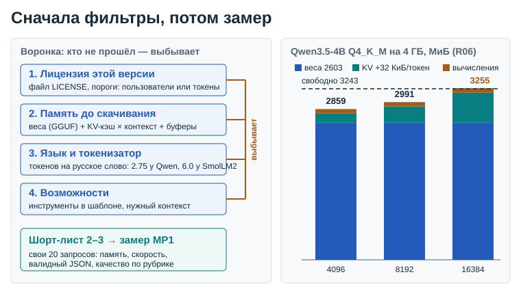
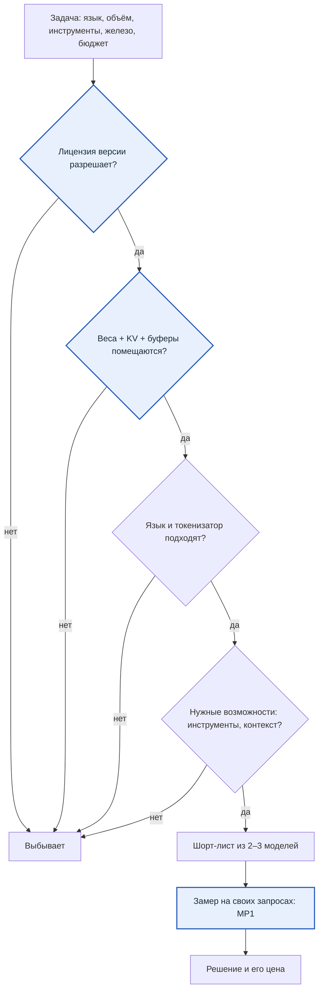

# M09-L09X. Как выбрать модель: лицензия, память, русский язык, инструменты, контекст

**Расширение 1.2.0.** Урок дополняет модуль и входит в обязательный путь маршрута 2.0: уровень 1 «Модели и запуск», до мини-проекта MP1.

**Результат:** по карточке модели и её файлам отсеять кандидатов, которых нельзя взять под задачу (лицензия, память, язык, инструменты, контекст), посчитать память оставшихся до скачивания и составить план замера, который решит выбор. Цифры на витрине модели — гипотеза, решение даёт замер на своих данных.

**До урока:** M09-L06, M09-L07X. Нужны локальные модели курса; новых загрузок нет. Ориентир времени — 120 минут чтения, лабораторной и задачи; это первоначальная оценка, а не ограничение.

> **Версии и дата проверки:** llama.cpp b11803, Python 3.11.9, transformers 4.57.6; модели Qwen2.5-0.5B-Instruct (ревизия 9217f5d), Qwen3.5-4B Q4_K_M (квантизация unsloth, ревизия e87f176), SmolLM2-135M-Instruct; лицензии и карточки Qwen3.5-4B, Qwen2.5-3B-Instruct, Llama-3.2-3B-Instruct, YandexGPT-5-Lite-8B-instruct, Gemma 3 · проверено 18.11.2026 · источник: [карточки моделей Hugging Face](https://huggingface.co/docs/hub/model-cards)

## Объяснение

Выбор модели под задачу похож не на конкурс, а на воронку. Сначала жёсткие условия, которые нельзя выиграть качеством: лицензия, память, язык, нужные возможности. Кто не прошёл, выбывает, даже если лидирует в таблице. Оставшихся двух-трёх кандидатов сравнивают замером на своих запросах: ровно это делает мини-проект MP1. Таблицы на витрине нужны, чтобы понять, кого ставить в замер, а не чтобы выбирать.

**Карточка модели** — это `README.md` репозитория. Сверху YAML-блок с метаданными (`license`, `language`, `base_model`, `pipeline_tag`, `library_name`), ниже текст: назначение и ограничения, архитектура, контекст, оценки, рекомендации по запуску. Метаданные удобны для фильтров на сайте, но их заполняет автор, и они бывают неполными. У Qwen2.5-0.5B-Instruct в метаданных `language: en`, а в тексте той же карточки — «более 29 языков, включая русский». Рядом лежат файлы, которые не врут о форме модели: `config.json` (слои, головы внимания, длина контекста) и заголовок GGUF. Поэтому карточку читают вместе с файлами.

**Лицензия** — первый фильтр, потому что её не исправить ни промптом, ни железом. Смотрят файл `LICENSE` именно той версии, которую запускают, а не «семейства». Пример, проверенный 18.11.2026: Qwen2.5-0.5B-Instruct — Apache-2.0, а Qwen2.5-3B-Instruct из той же серии — `qwen-research`, лицензия для исследований. У Llama 3.2 собственная лицензия Meta: коммерция разрешена, но нужна надпись «Built with Llama», а компании с более чем 700 млн активных пользователей в месяц должны получить отдельное разрешение. Карточка Llama 3.2 к тому же относит использование на языках вне официального списка (русского в нём нет) к случаям «вне назначения». У YandexGPT-5-Lite-8B коммерческое использование разрешено до 10 млн выходных токенов в месяц; после порога нужно в течение 30 дней договориться с Яндексом. Порог в токенах, а не в пользователях, задевает даже небольшой сервис. Gemma 3 распространяется по Gemma Terms of Use со списком запрещённых применений. Квантизация от другого автора (как наша 4B от unsloth) наследует лицензию исходной модели: её сверяют с оригиналом.

**Память** считают до скачивания. Она складывается из трёх частей: веса, KV-кэш и постоянные буферы. Веса — число параметров × бит на вес / 8. Название квантизации обманчиво. «Q4_K_M» у нашей 0.5B даёт в среднем 6.16 бита на вес, у 4B — 5.19: часть тензоров, особенно матрица эмбеддингов, хранится точнее. Поэтому размер файла GGUF — лучшая оценка весов. KV-кэш растёт линейно с контекстом. На каждый токен он хранит ключ и значение в каждом слое с полным вниманием: 2 × слои × KV-головы × размер головы × байт на число (2 для f16). У Qwen2.5-0.5B это 2 × 24 × 2 × 64 × 2 = 12 288 байт на токен, 384 МиБ на полные 32 768 токенов. Qwen3.5-4B гибридная: из 32 слоёв полное внимание только у 8, остальные — линейное внимание с состоянием фиксированного размера. Поэтому её кэш — 32 КиБ на токен, хотя модель в восемь раз больше. Формулу берут из `config.json`, а не из числа параметров.

**Русский язык.** Модель может «знать» русский и при этом тратить на него больше токенов. Это налог токенизатора: каждый лишний токен занимает контекст, память кэша и время генерации. На одном предложении базы знаний компании токенизатор Qwen2.5 тратит 2.75 токена на русское слово и 1.2 на английское. Токенизатор SmolLM2, обученный в основном на английском, — 6.0 против 1.33: тот же ответ на русском у него в 4.5 раза длиннее. Тексты поддержки клиентов в Казахстане ещё и смешивают русский, казахский и английский. Мерило одно — свой набор запросов на своём языке; общие таблицы по 29 или 201 языку его не заменяют.

**Вызов инструментов.** Модель «умеет инструменты», если её обучали на таком формате, её шаблон диалога принимает описание инструментов, а сервер разбирает вызов. Все три условия проверяются по отдельности: строка «excels in tool calling» в карточке говорит только о первом. Числа вроде BFCL-V4 50.3 у Qwen3.5-4B — оценка разработчика на его прогоне. Свои десять вызовов в агенте уровня 4 покажут больше.

**Контекст.** Есть три разных числа. Заявленный контекст: у Qwen3.5-4B — 262 144 токена, у Qwen2.5-0.5B — 32 768. Обрати внимание: в той же карточке 0.5B есть строка серии «до 128K», а для конкретной модели — 32 768. Контекст, который помещается в память: на нашей карте с 4 ГБ 4B держит 8192 токена с запасом, а 16 384 — уже без запаса (замер R06). И контекст, на котором модель ещё отвечает хорошо, — его меряют задачами «найди факт в длинном тексте». Он обычно меньше заявленного. Для оператора поддержки с базой знаний важнее второе и третье: длинный контекст заменяют поиском (уровень 3).



## Аналогия: выбор библиотеки для продакшена

Как похоже: выбирая npm-пакет для сервиса, backend-разработчик сначала смотрит лицензию и размер, совместимость с версией Node и TypeScript, нужные функции и только потом бенчмарки с сайта авторов. Финальное решение — после пробы на своём коде. С моделью так же: жёсткие фильтры, затем замер на своих запросах.

| В уроке | В аналогии |
| --- | --- |
| `LICENSE` конкретной версии модели | Поле `license` и файл LICENSE пакета, а не всей организации |
| Порог 700 млн пользователей или 10 млн токенов | Бесплатный тариф SaaS-библиотеки до N запросов |
| Веса + KV-кэш + буферы против свободной видеопамяти | Размер бандла и потребление памяти против лимита контейнера |
| Налог токенизатора на русском | Библиотека, у которой UTF-8 «работает», но в 3 раза медленнее на кириллице |
| Таблица оценок в карточке | Бенчмарк на сайте автора пакета |
| Замер в MP1 на 20 своих запросах | Нагрузочный тест на своих эндпоинтах |

**Где аналогия ломается:** библиотека детерминирована, и тест, прошедший однажды, пройдёт снова; качество модели статистическое и зависит от формулировок, поэтому замер требует набора запросов, а не одного примера. Кроме того, лицензия модели может зависеть от объёма её ответов (токены в месяц), а у пакетов так почти не бывает.

## Разобранный пример

Проверим формулу памяти на замере R06. Qwen3.5-4B: 8 слоёв с полным вниманием, 4 KV-головы, размер головы 256 (карточка модели), f16 в кэше. На токен: 2 × 8 × 4 × 256 × 2 = 32 768 байт = 32 КиБ. llama-server при запуске печатает разбивку видеопамяти: часть «context» была 178, 306 и 562 МиБ при контексте 4096, 8192 и 16 384. Прирост на 4096 токенов — 128 МиБ, то есть ровно 32 КиБ на токен. Постоянная часть — 178 − 4096 × 32 / 1024 = 50 МиБ: состояние линейных слоёв и выходные буферы. Полный бюджет при 8192: веса 2603 + контекст 306 + вычисления 82 = 2991 МиБ, свободно было 3243 — помещается с запасом 252 МиБ. Для полного заявленного контекста 262 144 одного кэша понадобилось бы 8 ГиБ: заявленное число на этой карте недостижимо.

```python
def kv_bytes_per_token(layers, kv_heads, head_dim, bytes_per_value=2):
    return 2 * layers * kv_heads * head_dim * bytes_per_value

per_token = kv_bytes_per_token(8, 4, 256)
assert per_token == 32 * 1024
measured_context_mib = {4096: 178, 8192: 306, 16384: 562}  # quality/hardware/baseline.json, R06
slope = (measured_context_mib[16384] - measured_context_mib[4096]) / (16384 - 4096)
assert slope * 2**20 == per_token  # formula = measurement
fixed = measured_context_mib[4096] - 4096 * per_token / 2**20
assert fixed == 50
assert 2603 + 306 + 82 == 2991 and 3243 - 2991 == 252
assert per_token * 262_144 / 2**30 == 8.0  # GiB of KV for the declared context
# Qwen2.5-0.5B, config.json: 24 layers, 2 KV heads, head 896 / 14 = 64
assert kv_bytes_per_token(24, 2, 64) == 12_288
assert kv_bytes_per_token(24, 2, 64) * 32_768 / 2**20 == 384
```

Налог токенизатора из лабораторной: русское предложение из 12 слов стоит 33 токена у Qwen2.5 и 72 у SmolLM2, английское из 15 слов — 18 и 20. Ответ оператора из 80 русских слов — около 220 токенов у Qwen и около 480 у SmolLM2. При 47 токенах в секунду (4B на GPU) это 4.7 против 10.2 секунды только на генерацию.

## Схема



Фильтры идут от дешёвых и необратимых к дорогим. Лицензию проверяют первой: её нарушение не исправить. Память считают по `config.json` и размеру файла до скачивания. Язык и токенизатор проверяют одним предложением своих данных. Возможности — по шаблону диалога и одному пробному вызову. Только шорт-лист получает настоящий замер. Выделены три шага, на которых чаще всего ошибаются: лицензия семейства вместо версии, контекст из рекламы вместо расчёта памяти и выбор по чужой таблице без своего замера.

## Практика с поддержкой

**Предскажи до запуска.** Прежде чем запускать код или пересчитывать пример, запиши ожидаемый вывод: числа, формы массивов, порядок или текст. После запуска сравни с фактическим и объясни каждое расхождение.

Запусти лабораторную; она работает без сети и без GPU:

```powershell
.\.venv\Scripts\python.exe labs\M09\model_card.py
```

До запуска запиши: какой язык указан в метаданных карточки Qwen2.5-0.5B, сколько байт KV-кэша на токен у SmolLM2-135M (в её `config.json` 30 слоёв, 3 KV-головы, размер головы 64), сколько бит на вес у Q8_0. После запуска сравни. Открой `models/Qwen2.5-0.5B-Instruct/README.md` и найди в тексте два разных числа контекста. Объясни, какое из них относится к этой модели и как это подтверждает `config.json`. Затем открой карточку [Qwen3.5-4B](https://huggingface.co/Qwen/Qwen3.5-4B) (если есть сеть) и найди: лицензию, заявленный контекст, режим по умолчанию (размышления), рекомендацию «держать контекст не меньше 128K». Объясни, почему мы её не выполняем на 4 ГБ и что теряем.

## Самостоятельная задача A — M09-L09X-A

Компания «Лампа и Чайник» (`data/company/`) запускает ИИ-оператора на сайте: по прогнозу 50 000 обращений в месяц, ответ в среднем 300 токенов, язык клиентов — русский. Сервер на старте — такой же, как твой ноутбук: GPU 4 ГБ, свободно около 3200 МиБ, 32 ГБ RAM. Нужен контекст 8192 токена (вопрос плюс найденные документы). Кандидаты: Qwen2.5-3B-Instruct, Llama-3.2-3B-Instruct, YandexGPT-5-Lite-8B-instruct, Qwen3.5-4B, Qwen2.5-0.5B-Instruct.

1. Для каждого кандидата открой карточку и `LICENSE` (или их копии в ключе) и проведи через воронку: лицензия, язык, память, инструменты, контекст. Для выбывших назови точную причину со ссылкой на источник.
2. Для оставшихся посчитай память при контексте 8192: веса (по размеру GGUF Q4_K_M — найди его в репозитории квантизации или оцени как параметры × 5.2 бита), KV по `config.json`, запас относительно 3200 МиБ.
3. Посчитай объём выходных токенов в месяц и сравни с порогами лицензий.
4. Напиши план замера для MP1: какие 2–3 конфигурации, какие метрики, какой результат изменит твой выбор.

Первая попытка — без готового решения. Сохрани таблицу и рассуждение в `submissions/M09-L09X/`. AI может пояснять термины лицензий; выводы и расчёт делаешь сам, помощь запиши.

## Подсказки по очереди

1. Объём выходных токенов — это обращения × длина ответа: сравни его с порогом YandexGPT-5-Lite-8B. Для Qwen2.5-3B прочитай имя лицензии в метаданных, а не только название серии.
2. В карточке Llama 3.2 найди список поддерживаемых языков и раздел «Out of Scope». Для 8B посчитай веса: при около 5 битах на вес 8 млрд параметров не помещаются в 3200 МиБ, но помещаются в RAM — что это значит для скорости (R06: 4B на CPU — 5.9 токена в секунду)?
3. У Qwen3.5-4B кэш считается только по 8 слоям с полным вниманием; у Qwen2.5-0.5B — по всем 24. Числа для 4B уже есть в разобранном примере.

## Критерии и типичные ошибки

Ошибка: брать лицензию семейства («Qwen — это Apache») вместо версии. Ошибка: считать «Q4» как ровно 4 бита на вес. Ошибка: умножать заявленный контекст на память, не проверив, помещается ли он, или наоборот, верить, что раз помещается — модель на нём хорошо работает. Ошибка: считать порог лицензии в пользователях, когда он в токенах. Ошибка: выбирать по таблице из карточки без своего замера. Критерий: каждая причина выбывания подтверждена ссылкой или расчётом; память оставшихся посчитана по частям; план замера называет метрику, которая может изменить решение.

После попытки сверь результат с [решением M09-L09X-A](../../solutions/modules/M09.md#m09-l09x-a).

## Новая и отложенная проверка

**B — новые числа.** Модель: 28 слоёв, все с полным вниманием, 4 KV-головы, размер головы 128, кэш f16. Файл весов — 4.4 ГБ. Сколько КиБ KV-кэша на токен и сколько МиБ при контексте 4096 и 32 768? Поместится ли модель целиком в 4 ГБ видеопамяти? В 32 ГБ RAM? Лицензия разрешает коммерцию до 100 млн активных пользователей в месяц — подходит ли она оператору «Лампы и Чайника»?

**C — через 7–10 дней.** Тебе предлагают заменить модель оператора на новую, у которой в карточке таблица с лучшими цифрами на трёх бенчмарках, контекст 1 млн токенов и «поддержка 100+ языков». Напиши пять вопросов, на которые нужно ответить до замены, и для каждого — где искать ответ: файл, раздел карточки, расчёт или замер.

Сначала сохрани собственное решение B/C, затем сверь [отдельный ключ M09-L09X-B-C](../../solutions/modules/M09.md#m09-l09x-b-c). Отметь помощь; отложенную проверку засчитывай только после фактической новой попытки.

## Карточка урока

| Поле | Содержание |
| --- | --- |
| Правило | Сначала жёсткие фильтры (лицензия версии, память, язык, возможности), потом замер шорт-листа на своих запросах; цифры витрины — гипотеза для замера, а не решение |
| Смысл величин | Память = веса (≈ размер GGUF) + KV-кэш (2 × слои с полным вниманием × KV-головы × размер головы × байты × токены) + постоянные буферы; налог токенизатора — токенов на слово своего языка |
| Когда применять | Перед любым скачиванием и перед заменой модели. Пример: Qwen3.5-4B при 8192 токенах — 2603 + 306 + 82 = 2991 МиБ из 3243 свободных; формула кэша 32 КиБ на токен совпала с замером |
| Главная ошибка | Взять лицензию, контекст и качество из заголовка карточки, не проверив версию, расчёт памяти и свой набор запросов |

## Источники и углубление

- [Hugging Face: Model Cards](https://huggingface.co/docs/hub/model-cards) — метаданные карточки: license, language, base_model, оценки (на английском)
- [Hugging Face: Licenses](https://huggingface.co/docs/hub/repositories-licenses) — идентификаторы лицензий в карточках (на английском)
- [Qwen3.5-4B](https://huggingface.co/Qwen/Qwen3.5-4B) — гибридное внимание, контекст 262 144, режим размышлений, вызов инструментов (на английском)
- [Qwen2.5-3B-Instruct](https://huggingface.co/Qwen/Qwen2.5-3B-Instruct) — лицензия `qwen-research` внутри серии с Apache-2.0 (на английском)
- [Llama 3.2 Community License](https://llama.meta.com/llama3_2/license) и [карточка Llama-3.2-3B-Instruct](https://huggingface.co/meta-llama/Llama-3.2-3B-Instruct) — порог 700 млн пользователей, поддерживаемые языки (на английском)
- [YandexGPT-5-Lite-8B-instruct](https://huggingface.co/yandex/YandexGPT-5-Lite-8B-instruct) — контекст 32k, лицензия с порогом 10 млн выходных токенов в месяц (файл LICENSE в репозитории)
- [Gemma Terms of Use](https://ai.google.dev/gemma/terms) — условия Gemma 1–3 и запрещённые применения (на английском)
- [Hsieh et al.: RULER](https://arxiv.org/abs/2404.06654) — реальный и заявленный контекст моделей (на английском)
- Замер железа курса: `quality/hardware/README.md` (R06)

Числа памяти и токенизации посчитаны для курса на локальных файлах; тексты лицензий и карточек не копировались, приведены только факты с датой проверки.
