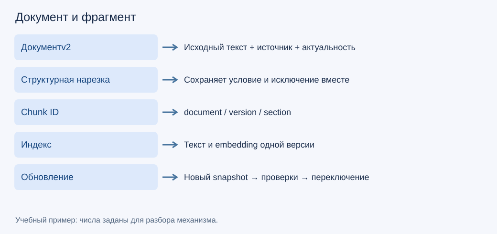

# M10-L01. Документ и фрагмент

**Результат:** Показать случай, когда граница фрагмента разрушает необходимый контекст.

**До урока:** M09-L02, M02-L05, M01-L05. Если термины из этих уроков не удаётся объяснить своими словами, вернись к их разобранным примерам. Ориентир времени — 120 минут чтения и практики; это первоначальная оценка, а не ограничение.

> **Версии и дата проверки:** Python 3.11.9, NumPy 2.4.6, scikit-learn 1.9.1, PyTorch 2.15.0+cpu, transformers 4.57.6; модели all-MiniLM-L6-v2 (ревизия 1110a24) и SmolLM2-135M-Instruct (ревизия 12fd25f) · проверено 04.11.2026 · источник: [scikit-learn: текстовые признаки](https://scikit-learn.org/stable/modules/feature_extraction.html#text-feature-extraction)

## Объяснение

RAG, retrieval-augmented generation, добавляет к запросу найденную внешнюю информацию перед генерацией ответа. Параметры генератора при обычном использовании RAG не меняются. Система состоит как минимум из подготовки базы, поиска, сборки контекста, генерации и проверки результата. Ошибка любого этапа может сделать ответ неверным; поэтому «подключить векторную базу» ещё не означает получить надёжную систему.

Документ — исходная единица содержания, а chunk — фрагмент, который система индексирует и возвращает. В технической базе документом может быть заметка о транзакциях, а фрагментом — раздел об атомарности. Фрагмент должен сохранять достаточный смысл для ответа. Если разрезать «операция не является идемпотентной» между «не» и остальной частью, поиск может вернуть противоположное утверждение. Размер чанка выбирается по структуре текста и проверочным вопросам, а не по универсальному числу.

Фиксированная нарезка по символам проста и воспроизводима, но не учитывает границы предложений, кода и таблиц. Нарезка по абзацам лучше сохраняет мысль, однако даёт переменные размеры. Структурный подход использует заголовки, списки и блоки кода. Для первой небольшой базы начни с вручную понятных разделов, затем сравни алгоритмическую нарезку на тех же вопросах. Это помогает увидеть, что именно теряет автоматизация.

Overlap повторяет часть соседнего текста в двух фрагментах. Он может сохранить связь на границе, но увеличивает размер индекса и число почти дубликатов в выдаче. При recall нельзя считать два перекрывающихся чанка независимыми подтверждениями одного факта. При сборке контекста нужно удалять дублирование, иначе резерв расходуется на повтор одной мысли. Избыточный overlap иногда маскирует плохую структуру исходного документа.

Каждый chunk получает устойчивый идентификатор, document_id, version, заголовок, диапазон исходного текста и дату актуальности. Ссылка на документ без версии недостаточна, если инструкция изменилась. Хеш содержимого помогает обнаружить изменение, но не заменяет предметную проверку. Если документ содержит внешнюю информацию, сохраняй источник и условия использования; в лабораторной база составлена из коротких собственных учебных заметок.

Обновление базы должно согласовать текст, embeddings и поисковый индекс. Если текст новой версии отображается рядом с embedding старого, ранжирование и цитаты перестают соответствовать. Удалённый документ должен исчезнуть из выдачи, а не только из интерфейса. Для маленькой базы удобно пересобрать весь индекс и атомарно переключить manifest. На большом масштабе применяют инкрементальные операции, но логические требования те же.

Доступность документа и его применимость — разные вопросы. Заметка может быть устаревшей, относиться к другой версии API или объяснять частный случай. Метаданные позволяют фильтровать язык, продукт и версию до поиска либо при ранжировании. Если в базе есть противоречащие инструкции, генератор не обязан сам правильно выбрать актуальную. Правило приоритета версии лучше задать в подготовке данных и явно показать в контексте.

Для интервьюера техническая база поддерживает объяснение, но не должна превращать любую найденную фразу в оценку человека. Сначала формулируется проверяемое техническое утверждение, затем ищется основание. HR-ясность и конкретность оцениваются другой рубрикой; технический RAG не измеряет личность или профессиональную ценность кандидата. Уже на уровне документов разделяй эти задачи.



### Расширение 1.2.0: контекст для фрагмента

**Расширение 1.2.0.** Раздел дополняет урок и не входит в обязательный минимум 1.1.0.

Вырезанный абзац теряет часть смысла: фраза «он не бесплатен» в середине документа об индексе ничего не говорит поиску, если слова «индекс» в ней нет. Contextual retrieval (Anthropic, сентябрь 2024) решает это до индексации. Языковая модель получает весь документ и один фрагмент и пишет одно-два предложения, которые помещают фрагмент в контекст документа. Это предложение дописывается перед фрагментом и для BM25, и для эмбеддингов. В статье Anthropic метрика — 1 − Recall@20, доля вопросов, у которых нужный фрагмент не попал в первые 20. Контекст для эмбеддингов снизил её на 35 % (с 5.7 % до 3.7 %), вместе с контекстным BM25 — на 49 %, с reranking — на 67 %. Курс с 1.1.0 делает дешёвую версию того же: пишет заголовок документа перед каждым абзацем.

Лабораторная `labs\M10\contextual_retrieval.py` проверяет обе идеи на корпусе и вопросах M10-L07X. В ней пять представлений фрагмента: только абзац; заголовок и абзац; контекст от Qwen2.5-0.5B и абзац; контекст от Qwen3.5-4B и абзац; заголовок, контекст 4B и абзац. Поиск — тремя способами: BM25, USER-bge-m3 и их RRF. Контексты пишет llama-server из M09-L07X, жадно, до 80 токенов. В prompt сначала идёт документ, потом фрагмент: у фрагментов одного документа общее начало, и сервер может взять его KV-cache из прошлого запроса.

Авторский прогон 06.11.2026 — сколько из 24 перефразированных вопросов M10-L07X получили нужный документ первым, и то же для 12 вопросов 1.1.0 при плотном поиске:

| Представление | BM25 | USER-bge-m3 | RRF | 1.1.0, USER-bge-m3 |
| --- | --- | --- | --- | --- |
| Только абзац | 10 | 19 | 17 | 12 из 12 |
| Заголовок и абзац | 8 | 19 | 18 | 12 из 12 |
| Контекст 0.5B и абзац | 11 | 20 | 19 | 10 из 12 |
| Контекст 4B и абзац | 13 | 19 | 19 | 9 из 12 |
| Заголовок, контекст 4B и абзац | 13 | 20 | 19 | 9 из 12 |

Контекст помог прежде всего BM25: 10 → 13 из 24, потому что модель пересказывает абзац другими словами и приносит синонимы, которых не было в тексте. RRF контекстного BM25 и эмбеддингов поставил нужный документ в первую тройку в 22 вопросах из 24 против 20 без контекста. Плотный поиск на перефразированных вопросах почти не изменился, а на вопросах 1.1.0 потерял первое место в трёх случаях. Контексты 4B начинаются похоже: «фрагмент» встречается в 55 контекстах из 72, «описывает» — в 39. Такие общие слова BM25 почти не учитывает, а эмбеддинги они сближают. Заголовок перефразированным вопросам не помог по построению: они намеренно обходят слово из заголовка. Recall@20 на 24 документах почти везде равен 1 и ничего не различает, поэтому таблица использует Recall@1.

Цена — генерация на каждый фрагмент. 0.5B писала 72 контекста 3 минуты. Благодаря общему началу сервер вычислил 16 217 токенов prompt из 30 878: первый фрагмент документа — около 410, следующие — около 130. 4B писала 17 минут, 14 секунд на фрагмент, и кэш у неё не сработал: все 24 626 токенов prompt вычислены заново. Гибридной модели llama.cpp не смог продолжить состояние слоёв линейного внимания с середины prompt. При такой скорости 100 000 фрагментов заняли бы больше двух недель работы одного CPU, поэтому контексты для большой базы готовят заранее, на более сильной машине или через API.

Контекст — новый текст в индексе, и его нужно проверять так же, как фрагмент. 0.5B иногда писала не контекст, а «Вот несколько коротких предложений…» со списком. Грубый признак — доля слов контекста, которых нет в документе: 0.32 у 0.5B и 0.56 у 4B. У 4B он выше не из-за выдумок: она чаще пересказывает своими словами, поэтому признак ловит перефразирование, а не ложь. Контекст хранят вместе с версией фрагмента и пересоздают, когда меняется документ, как в M10-L05. Вывод для своего корпуса делают по своим вопросам: на этих коротких синтетических заметках выигрыш есть у лексического поиска, а у плотного — нет.

## Аналогия: статья базы знаний и записи поискового индекса

Как похоже: статью в CMS правят авторы, а поиск работает по записям индекса Elasticsearch, на которые её разложили. У каждой записи свой `_id`, ссылка на статью и номер версии. Новую версию индексируют в свежий индекс и атомарно переключают alias, чтобы пользователь не увидел смесь старого и нового. Удаление статьи из CMS без удаления из индекса оставляет её в выдаче.

| В уроке | В аналогии |
| --- | --- |
| Документ | Статья в CMS — исходник, который правят авторы |
| Chunk | Запись поискового индекса, которую возвращает поиск |
| Граница посреди условия | Строка, обрезанная по лимиту колонки: хвост с условием пропал |
| Overlap | Повтор хвоста предыдущей записи: связь сохранена, но индекс растёт, а в выдаче почти дубли |
| id, document_id, version | Первичный ключ, ссылка на статью и номер версии записи |
| Пересобрать индекс и атомарно переключить manifest | Новый индекс Elasticsearch и атомарное переключение alias |
| Удалённый документ остался в выдаче | Удаление только в интерфейсе: в индексе запись жива |

**Где аналогия ломается:** запись индекса состоит из типизированных полей, и разбиение по полям не меняет значения поля. Chunk — кусок рассуждения: граница между «не» и остальной частью меняет смысл на противоположный, и схема индекса этого не поймает — нужна проверка на вопросах. И в CMS правило актуальности обычно одно — показывать последнюю версию, а в RAG старая версия бывает нужна, чтобы воспроизвести прошлый отчёт.

## Разобранный пример

Текст: «GET обычно читают без изменения ресурса. Повторный PUT с тем же представлением должен иметь тот же предполагаемый эффект». Если chunk1 заканчивается на «Повторный PUT», а chunk2 начинается с «с тем же представлением», каждый фрагмент теряет важное условие. Структурная нарезка сохраняет второе предложение целиком.

```python
chunk = {
 'id':'http-v1-02', 'document_id':'http', 'version':1,
 'title':'Повтор PUT',
 'text':'Повтор PUT с тем же представлением имеет тот же предполагаемый эффект.',
 'source':'course-authored', 'section':2,
}
assert chunk['id'].startswith(chunk['document_id'])
```

Это учебная формулировка для исследования поиска. Точные HTTP-семантики нужно сверять с соответствующим стандартом, когда строится полноценная техническая рубрика.

## Практика с поддержкой

**Предскажи до запуска.** Прежде чем запускать код или пересчитывать пример, запиши ожидаемый вывод: числа, формы массивов, порядок или текст. После запуска сравни с фактическим и объясни каждое расхождение.

Возьми две собственные заметки по Python и SQL, каждая по три абзаца. Разрежь фиксированным окном и по абзацам. Для двух вопросов выдели минимальный подтверждающий фрагмент и проверь, сохранился ли он целиком.

**Расширение 1.2.0.** Запусти `.\.venv\Scripts\python.exe labs\M10\contextual_retrieval.py` — нужны llama.cpp и GGUF из M09-L07X. Флаг `--no-4b` оставляет только 0.5B, `--reuse-contexts` повторяет поиск по уже сохранённым контекстам без генерации. До запуска предскажи, какому способу поиска контекст поможет больше, BM25 или эмбеддингам. Затем открой `artifacts/M10/contextual/contexts-4b.json` и прочитай пять контекстов. Найди в `first_ranks` отчёта вопрос, который контекст поднял, и вопрос, который опустил, и объясни оба по тексту. Самопроверка: в документе три фрагмента; prompt — документ на 300 токенов, фрагмент на 50 и инструкция на 40. Сколько токенов prompt вычислит сервер на трёх запросах без кэша и с кэшем общего начала? Почему документ ставят перед фрагментом, а не после? Сверь с [ключом](../../solutions/modules/M10.md#m10-l01-ctx).

## Самостоятельная задача A — M10-L01-A

Есть документ v1: «Индекс ускоряет чтение, но замедляет некоторые записи». Новая v2 добавляет «выигрыш зависит от запроса и селективности». Составь два chunk-объекта с происхождением и версиями. Опиши обновление индекса и вопрос, на котором старая версия даёт неполное объяснение.

Первая попытка — без готового решения. Сохрани свой код, объяснение и фактический результат в `submissions/M10-L01/`. AI может пояснять термин и помогать найти ошибку; запиши полученную помощь. Прочитанное решение не означает самостоятельно выполненное задание.

## Подсказки по очереди

1. ID должен различать версии.
2. Embedding пересчитывается для изменившегося текста.
3. Устаревшее объяснение не обязательно полностью ложное, но может быть недостаточным.

## Критерии и типичные ошибки

Ошибка: индексировать новый текст старым вектором. Ошибка: считать число дубликатов числом независимых источников. Критерий: есть версия, текст, источник и правило актуальности; задан диагностический вопрос.

После попытки сверь результат с [решением M10-L01-A](../../solutions/modules/M10.md).

## Новая и отложенная проверка

**B — удаление и воспроизводимость.** Документ `sql:v1` содержал фрагменты `sql:v1:read` и `sql:v1:write`. В `sql:v2` раздел write удалён; старый отчёт явно ссылается на `sql:v1:write`. Задай два разных режима: актуальный поиск только по v2 и воспроизведение отчёта по v1. Выпиши, какие ID доступны в каждом, какие файлы сохраняются и какой ответ получает актуальный запрос о write, если других источников нет. Нельзя молча заменить историческую цитату новым текстом.

**C — через 7–10 дней, без ключа.** Документ: «На тестовой таблице индекс ускорил Q1. Это верно только при выборке менее 1% строк. Для Q2 ускорения не наблюдали». Нарезка вернула только первое предложение. Для вопросов «Всегда ли индекс ускоряет Q1?» и «Помог ли индекс Q2?» предложи минимальные подтверждающие фрагменты и одно проверяемое правило границ. Сохрани важное условие и явный контрпример.

Сначала сохрани собственное решение B/C, затем сверь [отдельный ключ M10-L01-B-C](../../solutions/modules/M10.md#m10-l01-b-c). Отметь помощь; отложенную проверку засчитывай только после фактической новой попытки.

## Карточка урока

| Поле | Содержание |
| --- | --- |
| Правило | Chunk — единица индекса и выдачи: целая смысловая часть (предложение, абзац, раздел) с id, document_id, version, источником и диапазоном; изменился текст — пересчитай embedding и атомарно переключи индекс; удалённый документ исчезает из выдачи |
| Смысл величин | Документ — исходник, chunk — фрагмент для поиска; overlap — повтор соседнего текста: сохраняет связь на границе, но растит индекс и даёт почти дубли, которые не являются независимыми подтверждениями; хеш содержимого ловит изменение, но не проверяет смысл |
| Когда применять | При подготовке и обновлении базы RAG. Пример: документ из 500 слов, окно 200 и overlap 50 (шаг 150) — фрагменты [0, 200), [150, 350), [300, 500); в индексе 600 слов вместо 500, на 20% больше, и каждая граница повторена дважды |
| Главная ошибка | Резать посреди условия («не» и остальная часть в разных фрагментах) или индексировать новый текст со старым embedding |

## Источники и углубление

- [RAG, исходная статья](https://arxiv.org/abs/2005.11401)
- [Scikit-learn: текстовые признаки](https://scikit-learn.org/stable/modules/feature_extraction.html#text-feature-extraction)
- [Sentence Transformers: semantic search](https://sbert.net/examples/sentence_transformer/applications/semantic-search/README.html)
- [Anthropic: Introducing Contextual Retrieval](https://www.anthropic.com/news/contextual-retrieval) — почему фрагмент, вырезанный из документа, теряет контекст, и как к нему добавляют пояснение перед индексацией (на английском)
- [Pinecone: Chunking Strategies for LLM Applications](https://www.pinecone.io/learn/chunking-strategies/) — нарезка фиксированным окном, по предложениям, рекурсивная и по структуре документа, выбор размера по своим данным (на английском)
