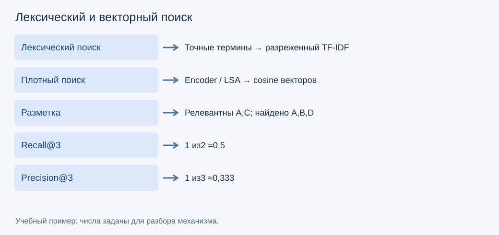

# M10-L02. Лексический и векторный поиск

**Результат:** Объяснить промах по словам и промах по смысловой близости на конкретных примерах.

**До урока:** M10-L01. Если термины из этих уроков не удаётся объяснить своими словами, вернись к их разобранным примерам. Ориентир времени — 90 минут чтения и практики; это первоначальная оценка, а не ограничение.

## Зачем и как это работает

Лексический поиск сравнивает запрос и документы по словам или их фрагментам. TF-IDF увеличивает вес термина, частого в конкретном документе и относительно редкого во всём корпусе. Вектор получается разреженным: большинство координат, соответствующих словарю, равны нулю. Совпадение редкого технического идентификатора может быть очень полезным, поэтому лексический поиск остаётся сильным baseline даже при наличии нейросетей.

TF означает частоту термина, IDF — поправку на распространённость по документам. Конкретная формула зависит от реализации. В sklearn со smoothing IDF(t)=ln((1+n)/(1+df_t))+1, где n — число документов, df_t — число документов с термином. После взвешивания векторы обычно нормируются. Это не вероятность релевантности и не универсальная шкала качества: score интерпретируется относительно данного корпуса и запроса.

Лексический метод может промахнуться на синонимах, опечатках и изменении формы слова. Символьные n-grams помогают с частью морфологии и опечаток, но могут создавать ложные совпадения. Для русского языка важно проверить реальные формы запросов. Простое слово «транзакция» и «транзакции» могут вести себя по-разному в word-tokenizer. Изменение анализатора оценивается на фиксированных запросах, а не выбирается только по одному удачному примеру.

Векторный поиск кодирует запрос и документ в плотные представления и сравнивает их, например cosine. Представление может быть получено LSA из матрицыTF-IDF или нейросетевым encoder. LSA строит низкоранговое приближение через SVD и улавливает статистические связи данного корпуса; это полезный учебный плотный baseline, но не эквивалент современной pretrained sentence-embedding модели. В уроке эти варианты названы раздельно.

Нейросетевой encoder, обученный на парах текстов, способен сближать формулировки без точного совпадения слов. Однако он тоже ошибается: похожая тема не означает ответ на вопрос, отрицание может изменить смысл, а редкий код ошибки может потеряться. Для некоторых моделей query и document требуют разных префиксов или методов encode_query/encode_document. Нужно следовать карточке конкретной модели и сохранять её revision вместе с индексом.

На маленькой базе достаточно точного cosine по всем векторам. Approximate nearest neighbors нужны, когда полный перебор дорог; они добавляют собственный компромисс recall/latency. Векторная база не обязательна для понимания RAG: матрица NumPy и устойчивые ID уже позволяют проверить поиск. Сначала измеряй качество представления, затем выбирай хранение и масштабирование.

Разметка поиска связывает query_id с набором релевантныхchunk_id. Recall@k=число найденных релевантных среди top-k, делённое на число всех релевантных в разметке. Precision@k=число релевантных вtop-k, делённое наk. Если разметка неполная, найденный полезный документ может ошибочно считаться нерелевантным; это ограничение набора, которое нужно исследовать вручную.

Поиск сравнивается до генерации, иначе хороший ответ модели скроет плохой retriever, а слабая маленькая LLM испортит впечатление от хорошего поиска. Сохраняй top-k, scores и версии. Для неизвестного вопроса нужны случаи без релевантного источника; retrieval почти всегда может вернуть ближайший вектор, но «ближайший» не означает «достаточно подходящий».



## Разобранный пример

В корпусе4документа, термин есть в одном: IDF=ln(5/2)+1≈1,9163. Если термин есть во всех, IDF=ln(5/5)+1=1. Пусть релевантны{A,C}, аtop3=[A,B,D]. Recall@3=1/2=0,5, precision@3=1/3≈0,333.

```python
relevant = {'A','C'}
found = ['A','B','D']
hits = len(relevant & set(found))
assert hits/len(relevant) == .5
assert round(hits/len(found),3) == .333
```

Повтор одногоchunkID нельзя засчитать дважды. При отсутствии релевантных документов recall требует отдельного соглашения, а не деления на ноль.

## Практика с поддержкой

Запусти M10/demo.py. Сравни ранжирование TF-IDF, плотногоLSA и доступного pretrainedencoder на одинаковых query_id. Найди запрос с точным термином и перефразированный запрос; для каждого посмотри сами текстыtop3.

## Самостоятельная работа M10-L02-A

Для трёх запросов релевантные множества{A,B},{C},{D,E}. Выдачиtop2: [A,C],[B,C],[F,A]. Посчитай recall@2 для каждого и macro-average; затем precision@2. Объясни различие между близостью темы и наличием подтверждения конкретного ответа.

Первая попытка — без готового решения. Сохрани свой код, объяснение и фактический результат в `submissions/M10-L02/`. AI может пояснять термин и помогать найти ошибку; запиши полученную помощь. Прочитанное решение не означает самостоятельно выполненное задание.

## Подсказки по очереди

1. Пересечение считается по уникальным ID.
2. Macro-average даёт каждому запросу одинаковый вес.
3. Документ оSQL вообще может не отвечать на вопрос обизоляции.

## Ошибки и самопроверка

Ошибка: назвать cosine вероятностью правильного ответа. Ошибка: считать LSA pretrainedсемантическоймоделью. Критерий: метрики по запросам верны, а каждый промах рассмотрен по тексту.

Работа готова, когда есть ответ на все условия задачи, вычисление или наблюдение подтверждает вывод, а ты можешь объяснить каждую величину и изменить один параметр без копирования решения. Критическую ошибку сначала исправь и повтори проверку; оформление не компенсирует неверное рассуждение. Сверь свою попытку с [решением M10-L02-A](../../solutions/modules/M10.md).

## Повтор и перенос

Повтор: добавь вtop3 недостающийC и пересчитай метрики. Через неделю создай два запроса, где lexical выигрывает уdense, и два обратных случая; не предполагая заранее, что один метод всегда лучше.

После проверки сохрани статус «самостоятельно» либо «с поддержкой», конкретную ошибку и дату следующей попытки. Через 7–10 дней повтори изменённый пример без открытого решения; только эта проверка позволяет отметить «подтверждено позже». Если результата пока нет, оставь «не проверено».

## Источники и углубление

- [RAG, исходная статья](https://arxiv.org/abs/2005.11401)
- [Scikit-learn: текстовые признаки](https://scikit-learn.org/stable/modules/feature_extraction.html#text-feature-extraction)
- [Sentence Transformers: semantic search](https://sbert.net/examples/sentence_transformer/applications/semantic-search/README.html)

Текст, численные примеры, задания и схемы этого урока созданы для данного курса. Источники нужны для проверки терминов и изучения исходного метода; они не заменяют самостоятельную практику.
