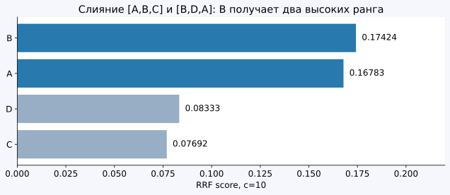

# M10-L03. Гибридный поиск и reranking

**Результат:** Указать, на каких запросах этап помог, а на каких увеличил стоимость без пользы.

**До урока:** M10-L02. Если термины из этих уроков не удаётся объяснить своими словами, вернись к их разобранным примерам. Ориентир времени — 90 минут чтения и практики; это первоначальная оценка, а не ограничение.

## Зачем и как это работает

Гибридный поиск объединяет кандидатов разных методов. Лексический retriever хорошо сохраняет точные термины, а плотный может находить перефразирование. Их ошибки частично различаются, поэтому объединение способно повысить покрытие. Но новый этап не гарантирует улучшения: растут число кандидатов, вычисления и сложность диагностики. Проверяй, какие конкретно запросы выиграли и какие ухудшились.

Прямое сложение scores опасно, потому что шкалы методов несопоставимы. TF-IDF cosine и нейросетевой encoder могут иметь разные распределения полезных значений. Даже одинаковый диапазон не означает одинаковую калибровку. Один способ избежать настройки шкал — Reciprocal Rank Fusion, RRF: score(d)=Σ_r 1/(c+rank_r(d)). Здесь rank начинается с единицы, c — положительная константа, а отсутствующий в списке документ не получает вклад.

RRF использует порядок, а не величину сходства. Документ, умеренно высоко стоящий в обоих списках, может обойти лидера только одного. Константа c управляет чувствительностью к верхним позициям. Нельзя выбирать её по финальному test после множества попыток без признания, что набор стал development. Для маленькой базы фиксируем c и показываем расчёт вручную. При равных результатах задаём устойчивое правило разрешения ничьей по идентификатору.

Reranking пересматривает порядок ограниченного списка кандидатов более дорогим или точным методом. Cross-encoder получает query и document вместе и вычисляет score их совместного соответствия. В отличие от bi-encoder он не позволяет заранее вычислить полный результат для документа независимо от запроса. Поэтому его обычно применяют к top-N, а не ко всему огромному корпусу. Результат cross-encoder тоже не является доказательством истинности источника: он оценивает соответствие пары в пределах своей обучающей задачи.

В обязательной лёгкой лабораторной используется прозрачный reranker по покрытию терминов запроса после RRF. Он обозначен как эвристика, а не обученный cross-encoder. Его задача — показать архитектуру второй стадии и необходимость отдельного измерения. Нейросетевой reranker можно подключить тем же контрактом, сравнив качество и время. Простая формула полезна именно потому, что её можно полностью объяснить; неверное сложное название не делает метод сильнее.

Главное ограничение reranking: он не создаёт отсутствующих кандидатов. Если нужный chunk не попал в top-N первой стадии, вторая не сможет поднять его на первое место. Поэтому измеряем candidate Recall@N до reranking и финальный MRR после. MRR усредняет обратный ранг первого релевантного результата: единица для первого, половина для второго и ноль, если он не найден. Метрика не учитывает все релевантные документы, что важно для вопросов с несколькими источниками.

Увеличение N повышает шанс получить нужный источник, но увеличивает время второй стадии и может добавить шум. В голосовом диалоге поиск входит в общий бюджет задержки. Выбор N обосновывается измерениями, а не максимальным доступным числом. Если качество двух вариантов одинаково в пределах неопределённости, более простой и быстрый путь может быть предпочтительнее.

Дубликаты и версии фильтруются до окончательного контекста. Одинаковый фрагмент под разными ID способен получить лишний вес в объединении и занять несколько мест. Привязка к document_id и version помогает сохранить разнообразие оснований. В отчёте сохраняются исходные результаты, объединённые кандидаты и финальный порядок. Такая трасса позволяет увидеть, какой этап потерял нужную информацию, и проверить локальное исправление.



## Разобранный пример

Списки lexical=[A,B,C], dense=[B,D,A]. При c=10 получаем A=1/11+1/13≈0,16783; B=1/12+1/11≈0,17424; C=1/13≈0,07692; D=1/12≈0,08333. Итог [B,A,D,C].

```python
from collections import defaultdict
score = defaultdict(float)
for ranking in [['A','B','C'], ['B','D','A']]:
    for rank, doc in enumerate(ranking,1):
        score[doc] += 1/(10+rank)
assert sorted(score,key=score.get,reverse=True) == ['B','A','D','C']
```

Если релевантен C, он сохранился в объединении, но top-2 его не содержит. Reranking только этих двух кандидатов не исправит проблему.

## Практика с поддержкой

В лабораторной сравни top-3 до и после эвристического rerank. Найди запрос с изменившимся порядком и объясни, какой термин вызвал изменение. Затем сравни candidate Recall при N=2 и N=4.

## Самостоятельная работа M10-L03-A

Списки L=[X,Y,Z], D=[Z,X,W], c=5. Посчитай RRF и порядок. Если релевантен W, а reranker получает top-2, может ли он исправить выдачу? Посчитай MRR для трёх запросов, где первый релевантный результат стоит на местах 1, 3 и отсутствует.

Первая попытка — без готового решения. Сохрани свой код, объяснение и фактический результат в `submissions/M10-L03/`. AI может пояснять термин и помогать найти ошибку; запиши полученную помощь. Прочитанное решение не означает самостоятельно выполненное задание.

## Подсказки по очереди

1. Ранги начинаются с единицы.
2. Отсутствующий документ получает нулевой вклад, а не ранг ноль.
3. MRR усредняет обратные ранги.

## Ошибки и самопроверка

Ошибка: считать candidate Recall финальной точностью. Ошибка: ожидать восстановления отсутствующего chunk перестановкой двух других. Критерий: арифметика верна и ограничение кандидатов явно объяснено.

Работа готова, когда есть ответ на все условия задачи, вычисление или наблюдение подтверждает вывод, а ты можешь объяснить каждую величину и изменить один параметр без копирования решения. Критическую ошибку сначала исправь и повтори проверку; оформление не компенсирует неверное рассуждение. Сверь свою попытку с [решением M10-L03-A](../../solutions/modules/M10.md).

## Повтор и перенос

Повтор: включи W в кандидаты, поставив последним, и проверь возможность поднять его второй стадией. Через неделю объясни разницу bi-encoder и cross-encoder через возможность заранее вычислить векторы документов.

После проверки сохрани статус «самостоятельно» либо «с поддержкой», конкретную ошибку и дату следующей попытки. Через 7–10 дней повтори изменённый пример без открытого решения; только эта проверка позволяет отметить «подтверждено позже». Если результата пока нет, оставь «не проверено».

## Источники и углубление

- [RAG, исходная статья](https://arxiv.org/abs/2005.11401)
- [Scikit-learn: текстовые признаки](https://scikit-learn.org/stable/modules/feature_extraction.html#text-feature-extraction)
- [Sentence Transformers: semantic search](https://sbert.net/examples/sentence_transformer/applications/semantic-search/README.html)

Текст, численные примеры, задания и схемы этого урока созданы для данного курса. Источники нужны для проверки терминов и изучения исходного метода; они не заменяют самостоятельную практику.
