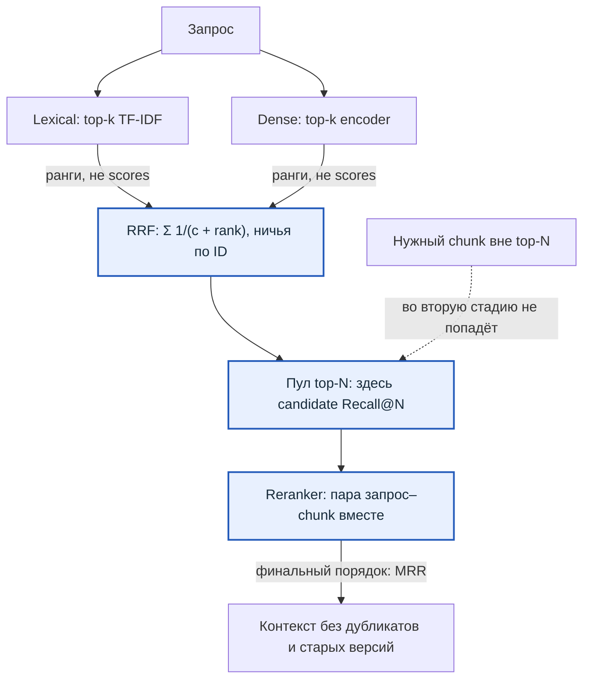

# M10-L03. Гибридный поиск и reranking

**Результат:** Указать, на каких запросах этап помог, а на каких увеличил стоимость без пользы.

**До урока:** M10-L02. Если термины из этих уроков не удаётся объяснить своими словами, вернись к их разобранным примерам. Ориентир времени — 140 минут чтения и практики; это первоначальная оценка, а не ограничение.

> **Версии и дата проверки:** Python 3.11.9, NumPy 2.4.6, scikit-learn 1.9.1, PyTorch 2.15.0+cpu, transformers 4.57.6; модели all-MiniLM-L6-v2 (ревизия 1110a24) и SmolLM2-135M-Instruct (ревизия 12fd25f) · проверено 04.11.2026 · источник: [scikit-learn: текстовые признаки](https://scikit-learn.org/stable/modules/feature_extraction.html#text-feature-extraction)

## Объяснение

Гибридный поиск объединяет кандидатов разных методов. Лексический retriever хорошо сохраняет точные термины, а плотный может находить перефразирование. Их ошибки частично различаются, поэтому объединение способно повысить покрытие. Но новый этап не гарантирует улучшения: растут число кандидатов, вычисления и сложность диагностики. Проверяй, какие конкретно запросы выиграли и какие ухудшились.

Прямое сложение scores опасно, потому что шкалы методов несопоставимы. TF-IDF cosine и нейросетевой encoder могут иметь разные распределения полезных значений. Даже одинаковый диапазон не означает одинаковую калибровку. Один способ избежать настройки шкал — Reciprocal Rank Fusion, RRF: score(d)=Σ_r 1/(c+rank_r(d)). Здесь rank начинается с единицы, c — положительная константа, а отсутствующий в списке документ не получает вклад.

RRF использует порядок, а не величину сходства. Документ, умеренно высоко стоящий в обоих списках, может обойти лидера только одного. Константа c управляет чувствительностью к верхним позициям. Нельзя выбирать её по финальному test после множества попыток без признания, что набор стал development. Для маленькой базы фиксируем c и показываем расчёт вручную. При равных результатах задаём устойчивое правило разрешения ничьей по идентификатору.

Reranking пересматривает порядок ограниченного списка кандидатов более дорогим или точным методом. Cross-encoder получает query и document вместе и вычисляет score их совместного соответствия. В отличие от bi-encoder он не позволяет заранее вычислить полный результат для документа независимо от запроса. Поэтому его обычно применяют к top-N, а не ко всему огромному корпусу. Результат cross-encoder тоже не является доказательством истинности источника: он оценивает соответствие пары в пределах своей обучающей задачи.

В обязательной лёгкой лабораторной используется прозрачный reranker по покрытию терминов запроса после RRF. Он обозначен как эвристика, а не обученный cross-encoder. Его задача — показать архитектуру второй стадии и необходимость отдельного измерения. Нейросетевой reranker можно подключить тем же контрактом, сравнив качество и время. Простая формула полезна именно потому, что её можно полностью объяснить; неверное сложное название не делает метод сильнее.

Главное ограничение reranking: он не создаёт отсутствующих кандидатов. Если нужный chunk не попал в top-N первой стадии, вторая не сможет поднять его на первое место. Поэтому измеряем candidate Recall@N до reranking и финальный MRR после. MRR усредняет обратный ранг первого релевантного результата: единица для первого, половина для второго и ноль, если он не найден. Метрика не учитывает все релевантные документы, что важно для вопросов с несколькими источниками.

Увеличение N повышает шанс получить нужный источник, но увеличивает время второй стадии и может добавить шум. В голосовом диалоге поиск входит в общий бюджет задержки. Выбор N обосновывается измерениями, а не максимальным доступным числом. Если качество двух вариантов одинаково в пределах неопределённости, более простой и быстрый путь может быть предпочтительнее.

Дубликаты и версии фильтруются до окончательного контекста. Одинаковый фрагмент под разными ID способен получить лишний вес в объединении и занять несколько мест. Привязка к document_id и version помогает сохранить разнообразие оснований. В отчёте сохраняются исходные результаты, объединённые кандидаты и финальный порядок. Такая трасса позволяет увидеть, какой этап потерял нужную информацию, и проверить локальное исправление.


## Аналогия: два рекрутера и техническое интервью

Как похоже: два рекрутера независимо составляют шорт-листы на одну вакансию — один ищет по ключевым навыкам в резюме, другой по похожему опыту. Их оценки в разных шкалах, поэтому сравнивают места в списках. Кандидат, которого оба поставили высоко, обходит фаворита только одного из них. Дорогое техническое интервью проводят лишь для первых N — и нанять того, кого нет ни в одном шорт-листе, интервьюер не может.

| В уроке | В аналогии |
| --- | --- |
| Lexical и dense retriever | Два рекрутера с независимыми шорт-листами |
| Прямое сложение scores | Сложить «8 из 10» одного рекрутера и «4 звезды» другого: шкалы разные |
| RRF: 1/(c + rank) | Учитывать только место кандидата в каждом шорт-листе |
| Документ высоко в обоих списках | Кандидат в первой тройке у обоих обходит фаворита одного |
| Cross-encoder на top-N | Техническое интервью только для первых N: каждое стоит часа интервьюера |
| Нужный chunk вне top-N | Нельзя нанять того, кого нет в шорт-листе |
| Дубликат под разными ID | Одно резюме, присланное дважды, занимает два места в шорт-листе |

**Где аналогия ломается:** RRF не знает, насколько уверен рекрутер: первое место с большим отрывом и первое место «на волоске» дают одинаковый вклад. А интервью оценивает самого человека, тогда как cross-encoder оценивает только соответствие пары текстов в пределах своей обучающей задачи: высокий score не доказывает, что источник истинен.

## Разобранный пример

Списки lexical=[A,B,C], dense=[B,D,A]. При c=10 получаем A=1/11+1/13≈0,16783; B=1/12+1/11≈0,17424; C=1/13≈0,07692; D=1/12≈0,08333. Итог [B,A,D,C].

```python
from collections import defaultdict
score = defaultdict(float)
for ranking in [['A','B','C'], ['B','D','A']]:
    for rank, doc in enumerate(ranking,1):
        score[doc] += 1/(10+rank)
assert sorted(score,key=score.get,reverse=True) == ['B','A','D','C']
```

Если релевантен C, он сохранился в объединении, но top-2 его не содержит. Reranking только этих двух кандидатов не исправит проблему.

## Схема



Гибридный поиск с reranking. Оба retriever отдают ранги, а не scores: RRF складывает 1/(c + rank) и не сравнивает несопоставимые шкалы. Вторая стадия видит только top-N объединённого списка, поэтому candidate Recall@N меряют до reranking, а MRR — после него. Выделен главный путь: объединение по рангам → пул top-N → reranker. Пунктир — ограничение этапа: chunk, не попавший в пул, reranker не поднимет, как бы точно он ни оценивал пары.

## Практика с поддержкой

**Предскажи до запуска.** Прежде чем запускать код или пересчитывать пример, запиши ожидаемый вывод: числа, формы массивов, порядок или текст. После запуска сравни с фактическим и объясни каждое расхождение.

В лабораторной сравни top-3 до и после эвристического rerank. Найди запрос с изменившимся порядком и объясни, какой термин вызвал изменение. Затем сравни candidate Recall при N=2 и N=4.

## Самостоятельная задача A — M10-L03-A

Списки L=[X,Y,Z], D=[Z,X,W], c=5. Посчитай RRF и порядок. Если релевантен W, а reranker получает top-2, может ли он исправить выдачу? Посчитай MRR для трёх запросов, где первый релевантный результат стоит на местах 1, 3 и отсутствует.

Первая попытка — без готового решения. Сохрани свой код, объяснение и фактический результат в `submissions/M10-L03/`. AI может пояснять термин и помогать найти ошибку; запиши полученную помощь. Прочитанное решение не означает самостоятельно выполненное задание.

## Подсказки по очереди

1. Ранги начинаются с единицы.
2. Отсутствующий документ получает нулевой вклад, а не ранг ноль.
3. MRR усредняет обратные ранги.

## Критерии и типичные ошибки

Ошибка: считать candidate Recall финальной точностью. Ошибка: ожидать восстановления отсутствующего chunk перестановкой двух других. Критерий: арифметика верна и ограничение кандидатов явно объяснено.

После попытки сверь результат с [решением M10-L03-A](../../solutions/modules/M10.md).

## Новая и отложенная проверка

**B — новая конфигурация RRF.** L=[A,B,C], D=[C,B,D], c=2. Вычисли сумму 1/(c+rank) для каждого ID и порядок; при равенстве используй алфавитный ID. Единственный релевантный документ D. Может ли reranker, получающий только top-2 объединённого списка, исправить отсутствие D? Укажи минимальное изменение пула кандидатов, позволяющее это проверить.

**C — через неделю.** Reranker получил [A,B,C] и вернул [C,A,B], gold={B}. Найди recall@3 и reciprocal rank. Затем замени gold на {D}, оставив вход reranker прежним: чего теперь нельзя исправить второй стадией? Для 10 запросов и 20 кандидатов на запрос укажи число пар query-document, которые оценит cross-encoder, и объясни, почему оценку пары нельзя заменить заранее сохранённым независимым вектором документа.

Сначала сохрани собственное решение B/C, затем сверь [отдельный ключ M10-L03-B-C](../../solutions/modules/M10.md#m10-l03-b-c). Отметь помощь; отложенную проверку засчитывай только после фактической новой попытки.

## Источники и углубление

- [RAG, исходная статья](https://arxiv.org/abs/2005.11401)
- [Scikit-learn: текстовые признаки](https://scikit-learn.org/stable/modules/feature_extraction.html#text-feature-extraction)
- [Sentence Transformers: semantic search](https://sbert.net/examples/sentence_transformer/applications/semantic-search/README.html)
