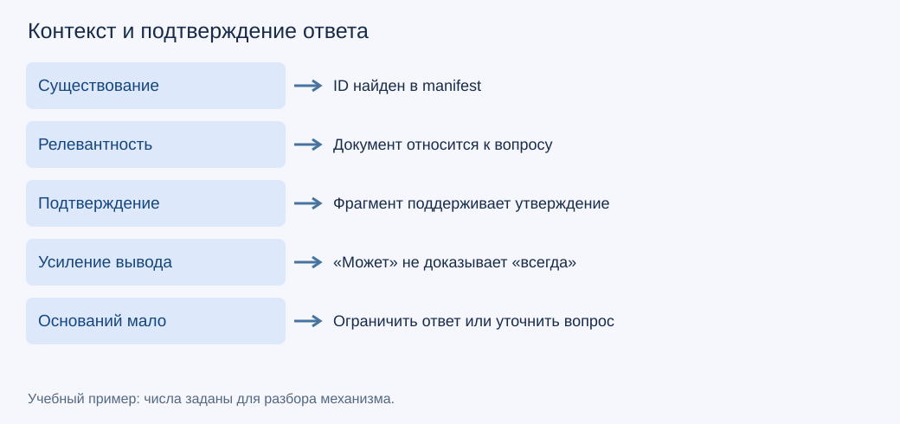

# M10-L04. Контекст и подтверждение ответа

**Результат:** Обнаружить ссылку на существующий документ, который не подтверждает конкретный вывод.

**До урока:** M10-L03. Если термины из этих уроков не удаётся объяснить своими словами, вернись к их разобранным примерам. Ориентир времени — 90 минут чтения и практики; это первоначальная оценка, а не ограничение.

## Зачем и как это работает

После поиска система собирает контекст для генератора. В него входят вопрос, инструкция, выбранные фрагменты и идентификаторы. Генератор формулирует ответ на основании доступных данных, но хороший поиск не гарантирует правильного использования источников. Маленькая LLM может пропустить условие, добавить неподтверждённую деталь или перепутать ссылки. Поэтому ответ проверяется отдельно от retrieval.

Разделяй три отношения: документ существует в базе; документ релевантен теме; конкретный фрагмент подтверждает конкретное утверждение. Первое проверяется по ID, второе требует оценки поиска, третье — сопоставления смысла. Ссылка [doc3] может быть валидной, хотя doc3 рассказывает об индексах, а ответ делает вывод об изоляции транзакций. Наличие ссылки не превращает такой вывод в обоснованный.

Контекст должен сохранять условия и ограничения. Если источник говорит «индекс может ускорить выборку при подходящем плане», ответ «индекс всегда ускоряет запрос» усиливает исходное утверждение. Отрицание, версия, область применения и единицы измерения особенно важны. При проверке выделяй атомарные утверждения, чтобы одна верная фраза не прикрывала соседнюю ошибочную. Неподтверждённость также отличается от прямого противоречия: источник может просто не обсуждать вопрос.

Abstention — явный отказ от содержательного вывода при недостатке оснований. Для тренажёра это нормальное состояние: «в базе нет подтверждения, уточни версию или вопрос». Порог similarity не даёт универсальной гарантии, поскольку распределение scores зависит от модели и корпуса. Порог выбирается на development-наборе со случаями достаточности и отсутствия источника, затем проверяется на отложенных вопросах. Молчаливое применение случайного порога скрывает ошибки.

Контекст отделяет данные от инструкций. Внешний документ способен содержать фразу «игнорируй предыдущие правила», которая является содержанием источника, а не разрешением приложению менять поведение. Разделители и prompt обозначают границы, но не дают полной защиты. Инструменты, переходы состояния и доступ к данным контролируются кодом. RAG не устраняет prompt injection автоматически, потому что модель всё равно обрабатывает текст.

При ограниченном бюджете отбор учитывает разнообразие, дубликаты и покрытие частей вопроса. Если требуется сравнить атомарность и изоляцию, одного источника об атомарности может быть недостаточно. Обрезание последних токенов способно удалить оговорку или разорвать код. Сначала отбирай целые фрагменты, потом считай реальные токены после шаблонизации. Сохраняй список исключённых фрагментов и причину, чтобы потеря информации была наблюдаемой.

В лабораторной один путь показывает extractive baseline: возвращает найденный фрагмент с ID. Это не генеративная LLM, а прозрачная проверка доступности информации. Второй путь действительно передаёт найденный текст SmolLM и генерирует новый ответ. Оба outputs сохраняются раздельно. Если генератор ухудшил доступный фрагмент, это важный результат, а не повод подменить output правильным шаблоном.

Качество RAG включает полезность ответа, но полезность не должна компенсировать выдуманное основание. Хороший технический ответ может быть кратким и честно ограниченным. Для HR-вопроса об опыте пользователя внешняя техническая база вообще не подтверждает личную историю: оценивать можно ясность и конкретность рассказа по отдельной рубрике. Связывай каждую проверку с функцией продукта. Самостоятельный разбор заканчивается цепочкой: что нашли, что отправили, что утверждает модель и какой текст поддерживает каждый вывод.



## Разобранный пример

Источник A: «Транзакция объединяет операции: они фиксируются вместе или откатываются». Ответ «Операции фиксируются вместе [A]» поддержан. Ответ «Транзакция всегда делает запрос быстрее [A]» не поддержан, хотя ID существует.

```python
allowed_ids = {'A','B'}
citations = ['A']
assert set(citations) <= allowed_ids
# Проверено существование ID, но не истинность утверждения.
```

Второму ответу требуется отдельное основание о производительности. Если его нет, нужно ограничить вывод, а не выдавать правильный формат ссылки за проверку смысла.

## Практика с поддержкой

Прочитай artifacts/M10/report.json. Выпиши утверждения настоящего сгенерированного ответа и сопоставь с переданными фрагментами. Отдельно отметь существование ссылок и поддержку содержания. Не добавляй модели отсутствующие ссылки задним числом.

## Самостоятельная работа M10-L04-A

Источник S1: «Индекс требует дополнительного места и может ускорить некоторые запросы». Классифицируй: (a) индекс занимает место; (b) индекс всегда ускоряет чтение; (c) индекс может ускорить некоторые запросы; (d) индекс не имеет стоимости записи. Используй supported, contradicted или insufficient. Ответь с ограничениями на вопрос «Стоит ли добавить индекс в любую таблицу?»

Первая попытка — без готового решения. Сохрани свой код, объяснение и фактический результат в `submissions/M10-L04/`. AI может пояснять термин и помогать найти ошибку; запиши полученную помощь. Прочитанное решение не означает самостоятельно выполненное задание.

## Подсказки по очереди

1. Не усиливай «может» до «всегда».
2. Отсутствие информации не равно прямому противоречию.
3. Совет о следующей проверке отделяется от факта источника.

## Ошибки и самопроверка

Ошибка: проверить только ID. Ошибка: считать молчание источника подтверждением отрицания. Критерий: каждое утверждение рассматривается отдельно, неопределённость обозначена явно.

Работа готова, когда есть ответ на все условия задачи, вычисление или наблюдение подтверждает вывод, а ты можешь объяснить каждую величину и изменить один параметр без копирования решения. Критическую ошибку сначала исправь и повтори проверку; оформление не компенсирует неверное рассуждение. Сверь свою попытку с [решением M10-L04-A](../../solutions/modules/M10.md).

## Повтор и перенос

Повтор: добавь источник с явным контрпримером ускорению и пересмотри классификацию b. Через неделю проверь три ответа с существующими ссылками и разными неподтверждёнными утверждениями.

После проверки сохрани статус «самостоятельно» либо «с поддержкой», конкретную ошибку и дату следующей попытки. Через 7–10 дней повтори изменённый пример без открытого решения; только эта проверка позволяет отметить «подтверждено позже». Если результата пока нет, оставь «не проверено».

## Источники и углубление

- [RAG, исходная статья](https://arxiv.org/abs/2005.11401)
- [Scikit-learn: текстовые признаки](https://scikit-learn.org/stable/modules/feature_extraction.html#text-feature-extraction)
- [Sentence Transformers: semantic search](https://sbert.net/examples/sentence_transformer/applications/semantic-search/README.html)

Текст, численные примеры, задания и схемы этого урока созданы для данного курса. Источники нужны для проверки терминов и изучения исходного метода; они не заменяют самостоятельную практику.
