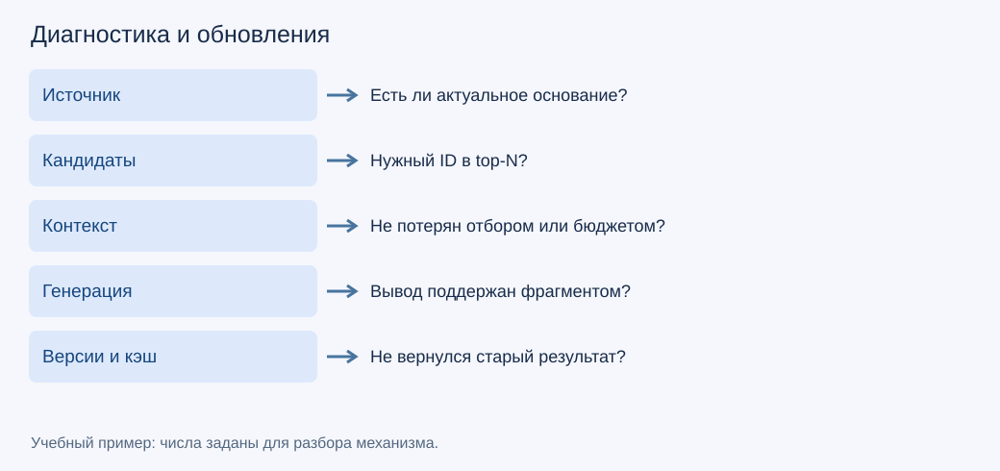

# M10-L05. Диагностика и обновления

**Результат:** Предложить изменение в правильном компоненте и способ проверить его эффект.

**До урока:** M10-L04. Если термины из этих уроков не удаётся объяснить своими словами, вернись к их разобранным примерам. Ориентир времени — 140 минут чтения и практики; это первоначальная оценка, а не ограничение.

> **Версии и дата проверки:** Python 3.11.9, NumPy 2.4.6, scikit-learn 1.9.1, PyTorch 2.15.0+cpu, transformers 4.57.6; модели all-MiniLM-L6-v2 (ревизия 1110a24) и SmolLM2-135M-Instruct (ревизия 12fd25f) · проверено 04.11.2026 · источник: [карточка all-MiniLM-L6-v2](https://huggingface.co/sentence-transformers/all-MiniLM-L6-v2)

## Объяснение

Диагностика RAG проходит по наблюдаемым этапам. Сначала проверь, существует ли актуальный источник, который вообще отвечает на вопрос. Если его нет, увеличение k и замена генератора не гарантируют ответа на основании этой базы. Затем проверь, сохранила ли нарезка нужное условие. После этого — попал ли фрагмент в кандидаты, прошёл ли reranking, вошёл ли в контекст и использовала ли его модель.

Такой порядок не означает, что ошибка всегда одна. Источник может устареть, а модель одновременно исказить его смысл. Полезно выделять самый ранний достаточный дефект и дополнительные проблемы. Исправление первого этапа меняет последующие outputs, поэтому вся цепочка повторно проверяется на фиксированном наборе. Отчёт должен сохранять исходный сбой, а не только удачный результат после изменений.

Oracle context — диагностический опыт с ручной подстановкой правильного фрагмента. Если ответ становится корректным, это указывает на проблему доставки информации, хотя не доказывает единственность причины. Если правильный контекст не помогает, исследуй инструкцию, сборку, возможности генератора и рубрику. Такой опыт не измеряет автоматический поиск: нужный источник выбран с использованием знания ответа. Нельзя записывать oracle-метрику как качество реального RAG.

Версия RAG включает корпус, нарезку, encoder, индекс, параметры поиска, reranker, генератор, template и рубрику. Изменение одного элемента фиксируется отдельно. Иначе нельзя понять, почему ответ улучшился: благодаря новому документу, другому top-k или удачной инструкции. Слишком много компонентов без журнала версий делает эксперимент невоспроизводимым даже при хорошем исходном коде.

После смены encoder нужна переиндексация. Векторы запроса и документов должны принадлежать согласованному пространству. Даже при одинаковой размерности координаты разных моделей могут иметь другое значение. Возможность выполнить матричное умножение не доказывает совместимость. Manifest индекса проверяет model_id и revision до обработки запроса. Неправильную пару нужно отклонять понятной ошибкой, а не возвращать случайно похожие документы.

Кэшированный ответ зависит от версии корпуса и модели. Если ключ содержит только вопрос, после исправления источника система может продолжать отдавать старый результат. Инвалидация либо версия в ключе являются частью обновления. Для маленькой учебной базы проще пересобрать snapshot и связать производные результаты с его ID, чем внедрять сложное выборочное обновление без достаточных тестов.

Регрессионный набор включает обычные вопросы, перефразирования, точные идентификаторы, несколько необходимых источников, отсутствие ответа и устаревшую инструкцию. Исправленная старая ошибка становится частью development-набора. Новый отложенный набор нужен для проверки переноса. Постоянная подгонка под одни двадцать вопросов превращает их в данные настройки, даже если файл называется final_test. Разделение определяется использованием, а не названием.

Важна стоимость изменения. Если проблема в границе одного абзаца, переход на большую LLM может не решить её и увеличить задержку. Если релевантный текст уже в контексте, новый векторный индекс может не изменить ответ. Выбирай компонент по доказательствам из трассы. Сохраняй query_id, ожидаемое основание, кандидатов, финальный prompt, output, тип сбоя и проверяемую гипотезу исправления. Это превращает общий совет «улучшить RAG» в конкретный воспроизводимый эксперимент и готовит систему к регрессионной оценке M11.



## Аналогия: разбор инцидента по распределённой трассе

Как похоже: при инциденте инженер открывает трассу запроса в OpenTelemetry и ищет первый span, где данные уже неверны, — дальше ошибка лишь распространяется. Чтобы проверить гипотезу, зависимость подменяют заглушкой с заведомо верным ответом. Исправление закрепляют регрессионным тестом, а после деплоя помнят про кэш: если в ключе нет версии сборки, пользователь увидит старый ответ.

| В уроке | В аналогии |
| --- | --- |
| Трасса query_id: корпус → кандидаты → контекст → ответ | Распределённая трасса: span каждого сервиса |
| Самый ранний достаточный дефект | Первый span с неверными данными: дальше ошибка лишь распространяется |
| Oracle context | Заглушка зависимости с заведомо верным ответом |
| Oracle-метрика не равна качеству RAG | Тест с заглушкой не измеряет настоящую зависимость |
| Смена encoder без переиндексации | Старые данные, прочитанные новым сериализатором: байты те же, смысл полей другой |
| Проверка model_id и revision по manifest | Проверка версии схемы при старте: несовместимую отклонить с понятной ошибкой |
| Ключ кэша только по вопросу | Ключ кэша без версии сборки: после деплоя отдаётся старый ответ |
| Исправленный сбой в регрессионном наборе | Регрессионный тест на каждый исправленный баг |

**Где аналогия ломается:** сервис в трассе обычно детерминирован: повтор запроса с тем же входом даёт тот же span, и баг воспроизводится. Генератор чувствителен к мелким изменениям контекста и настроек sampling: ошибка может появиться на одном запросе и исчезнуть на перефразированном, а правильность ответа — оценка по рубрике, а не сравнение байтов. Поэтому исправление проверяют на фиксированном наборе запросов, а не по одному удачному повтору.

## Разобранный пример

Нужный D есть в корпусе. Lexical top-5=[A,D,B,C,E], объединённые кандидаты=[A,B,D], финальный контекст=[A,B]. Источник потерян при последнем отборе. Простое увеличение доступного лимита LLM не добавит его, пока политика выбора остаётся прежней.

```python
trace = {'corpus':{'A','B','C','D','E'},
         'candidates':['A','B','D'], 'context':['A','B']}
assert 'D' in trace['corpus'] and 'D' in trace['candidates']
assert 'D' not in trace['context']
```

Следующий диагностический опыт — передать D как oracle context, затем исследовать критерий отбора.

## Практика с поддержкой

**Предскажи до запуска.** Прежде чем запускать код или пересчитывать пример, запиши ожидаемый вывод: числа, формы массивов, порядок или текст. После запуска сравни с фактическим и объясни каждое расхождение.

В копии лабораторной удали нужный документ, затем верни его со старой версией. Сохрани отдельную трассу для каждого случая. Добавь проверку, которая отклоняет запрос с revision encoder, отличающейся от manifest индекса.

## Самостоятельная задача A — M10-L05-A

Разбери четыре сценария: документа нет; документ есть, но отсутствует в top-10; источник в контексте, но модель усиливает «иногда» до «всегда»; новый документ проиндексирован, но возвращается старый кэш. Для каждого предложи одно изменение и одну проверку. Укажи, где полезен oracle context.

Первая попытка — без готового решения. Сохрани свой код, объяснение и фактический результат в `submissions/M10-L05/`. AI может пояснять термин и помогать найти ошибку; запиши полученную помощь. Прочитанное решение не означает самостоятельно выполненное задание.

## Подсказки по очереди

1. Сначала установи доступность информации.
2. Кэш является частью системы.
3. Oracle снимает автоматический выбор источника только для диагностики.

## Критерии и типичные ошибки

Ошибка: менять все этапы одновременно. Ошибка: объявить ручной подбор источника качеством автоматического поиска. Критерий: изменение связано с конкретным наблюдаемым дефектом и имеет различающий тест.

После попытки сверь результат с [решением M10-L05-A](../../solutions/modules/M10.md).

## Новая и отложенная проверка

**B — одинаковая форма, разные пространства.** Старый encoder E1 и новый E2 возвращают векторы длины 2. В индексе E1: d1=(1,0), d2=(0,1). Для запроса о d1 E1(q)=(1,0), а E2(q)=(0,1). Посчитай cosine ранжирование при смешивании E2-запроса и старого индекса. Что проверять в manifest кроме dimension и что пересоздавать при переходе на E2?

**C — через неделю.** Трасса запроса: active_manifest=v2, corpus=[D:v2,E:v2], candidates=[D:v2,E:v2], context=[D:v2]; cache key содержит только query и возвращает answer_version=v1. Определи первый этап расхождения версий, предложи одно изменение ключа и минимальный повторный опыт. Oracle context здесь заменяет исправление кэша или служит другой диагностике?

Сначала сохрани собственное решение B/C, затем сверь [отдельный ключ M10-L05-B-C](../../solutions/modules/M10.md#m10-l05-b-c). Отметь помощь; отложенную проверку засчитывай только после фактической новой попытки.

## Источники и углубление

- [RAG, исходная статья](https://arxiv.org/abs/2005.11401)
- [Scikit-learn: текстовые признаки](https://scikit-learn.org/stable/modules/feature_extraction.html#text-feature-extraction)
- [Sentence Transformers: semantic search](https://sbert.net/examples/sentence_transformer/applications/semantic-search/README.html)
