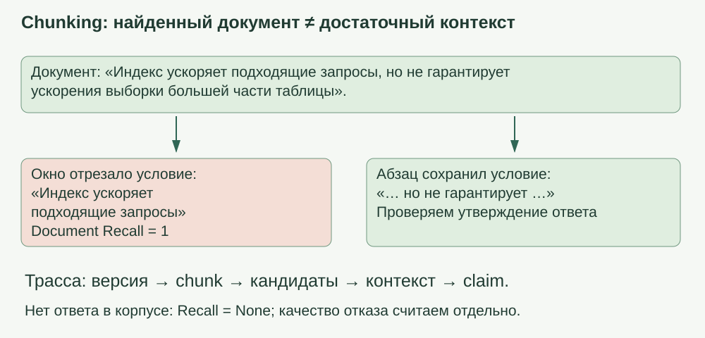

# M10-L06. Диагностировать русский RAG по трассе ошибки

**Результат:** отличить потерю нужного документа, потерю условия при разбиении, устаревшую версию и вопрос без ответа; выбрать исправление по наблюдению.

**До урока:** M10-L01–L05. План: 60 минут чтения и ручного разбора, 120 минут эксперимента, 90 минут самостоятельной работы. Модели уже подготовлены в M09/M10; новый платный сервис не нужен.

> **Версии и дата проверки:** Python 3.11.9, NumPy 2.4.6, scikit-learn 1.9.1 (TF-IDF); для сравнения — PyTorch 2.15.0+cpu, transformers 4.57.6 и all-MiniLM-L6-v2 (ревизия 1110a24) · проверено 04.11.2026 · источник: [карточка all-MiniLM-L6-v2](https://huggingface.co/sentence-transformers/all-MiniLM-L6-v2)

## Почему хороший Recall может скрывать плохой контекст

Допустим, документ говорит: «Индекс может ускорить запрос. Он **не гарантирует** ускорения выборки почти всей таблицы». Поиск нашёл нужный документ — recall по document_id равен единице. Но в переданный генератору фрагмент попало только первое предложение. Генератор потерял условие, хотя документная метрика этого не заметила.

Значит, нужны разные единицы наблюдения. Документ — исходный материал; chunk — конкретный фрагмент; утверждение — то, что нужно подтвердить. В лабораторной отдельно сохраняются ранги уникальных документов и три реально выбранных chunks. Повторные chunks одного документа схлопываются для документной метрики, но остаются видны в контексте: именно они занимают его бюджет.

Вторая ловушка — версионность. Правильный по теме фрагмент старой политики может противоречить текущей. Простая перестановка результатов не решает вопрос актуальности. До индексации выбирается действующая версия, а версия корпуса входит в ключ кэша. Старый snapshot сохраняется для воспроизведения прошлого ответа, но не должен незаметно участвовать в актуальном поиске.

## Набор, в котором можно ошибиться

`diagnostic_ru.py` содержит 48 авторских документов: 24 темы по две версии. Старые версии специально содержат устаревшие или неверные учебные положения и помечены как obsolete; это материал для диагностики, не рекомендации. Актуальные документы состоят из нескольких абзацев: ввод, содержательное условие и проверка. Среди тем — индексы, атомарность, таймаут, асинхронность, очередь, права, память диалога и хранение аудио.

14 запросов разделены на development и check. Есть точные термины, перефразирования, отрицания, вопрос с двумя источниками и два вопроса, на которые корпус не отвечает. Полный независимый экзамен потребует новых запросов после изучения ключа; check в этом опыте — отложенная часть эксперимента, а не секретный тест человека.

Сравниваются разбиение окнами по 18 слов и разбиение по абзацам. Окно может разрезать отрицание или условие. Абзац сохраняет связь, но длинные абзацы тоже могут содержать лишнее и выйти за предел encoder. Мы не объявляем одну стратегию универсально лучшей: смотрим, какая ошибка возникает на конкретных запросах.



## Запуск и разобранное наблюдение

```powershell
.\.venv\Scripts\python.exe labs\M10\diagnostic_ru.py
```

Отчёт: `artifacts/M10/ru/report.json`. Без encoder можно запустить `--lexical-only`. Полный обязательный сравнительный опыт включает и существующий MiniLM. Он обучен для английского; русский корпус специально проверяет ограничение переноса. Хорошее английское имя модели не делает её подходящей русскому языку.

В авторском прогоне лексический поиск на check дал document Recall@3=1 для обоих способов chunking. Но подтверждающая фраза сохранилась в top-3 chunks в 4 случаях для окон и в 6 для абзацев. Значит, одна документная метрика скрыла потерю условия. Английский MiniLM на русском check дал Recall@3=0.5 при абзацах; RRF — около 0.667. Добавление второго метода здесь ухудшило итог относительно лексического baseline. Это содержательный результат, а не неудача отчёта.

Проверка присутствия фразы является учебным proxy: фраза может существовать в тексте, но вывод модели всё равно быть неверным. Для итоговой обратной связи продолжай проверку claim → source → основание из M11. Автоматическая строковая проверка не заменяет её.

## Вопрос без ответа — другой знаменатель

Если relevant=[], Recall не равен нулю: он **не определён**. Нулём мы ошибочно наказали бы систему за отсутствие источника, которого в корпусе нет. Возвращаем None и считаем отдельно, отказалась ли система отвечать. В лабораторной простое правило отказа использует фиксированный lexical threshold0.12. Это baseline, а не доказанная вероятность корректности. Порог задан до просмотра check; настройка по check превращает его в development.

Для двух answerable-вопросов с recall1 и 0 и одного unanswerable правильное среднее recall=0.5 по двум, а не 1/3 по трём. Отдельно укажи 1/1 правильных отказов или 0/1. Обязательно показывай знаменатели.

## Практика с поддержкой

Открой запрос про текущую политику хранения аудио. Сравни retention-v1 и retention-v2. Затем выбери запрос, где lexical и MiniLM дают разные top-3. Не меняя генератор, объясни, какое основание недоступно. Для вопроса с двумя источниками проверь каждый relevant document отдельно: MRR первого найденного не гарантирует полноту ответа.

## Самостоятельная задача A

Реализуй контракт метрик в [exercises/M10](../../exercises/M10/README.md). Затем добавь в копию корпуса две новые технические темы и шесть заранее размеченных запросов: точный, перефразирование, отрицание, два источника, устаревшая политика и отсутствие ответа. Сохрани старый check как регрессионный набор. Сравни две chunking, lexical, encoder и RRF; зафиксируй хотя бы одно ограничение или специально внесённый отказ.

Критерии: метрики с правильными знаменателями, все выдачи сохранены, версия документа прослеживается, выбранное исправление относится к найденной причине. Критические ошибки — усреднить None как 0, скрыть старую версию или выдать близость векторов за доказательство утверждения.

## Подсказки, повтор B и проверка C

Сначала найди правильный source в корпусе, затем в кандидатах, затем в контексте. Если он отсутствует уже на первом шаге, настройка temperature не поможет. B: оставь ranking прежним, но удали условие из нужного chunk — какая метрика не изменится? C через неделю: поменяй актуальную версию документа, сохрани старый кэш и найди минимальный тест этой регрессии. [Ключи](../../solutions/modules/M10.md) содержат отдельные разборы.

## Источники

[Исходная статья RAG](https://arxiv.org/abs/2005.11401), [Sentence Transformers: semantic search](https://sbert.net/examples/sentence_transformer/applications/semantic-search/README.html). Корпус и численные наблюдения созданы для данного курса; внешние документы не копировались в учебные данные.
