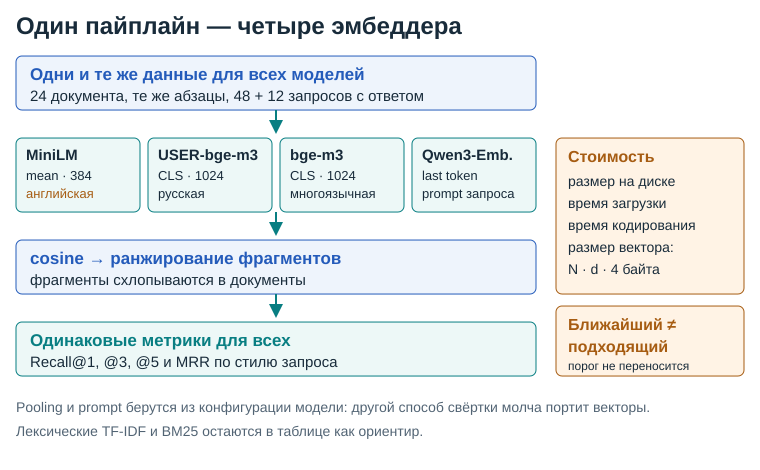

# M10-L07X. Эмбеддеры для русского языка

**Расширение 1.2.0.** Урок дополняет модуль, не входит в обязательный минимум 1.1.0.

**Результат:** сравнить несколько эмбеддеров на одном русском пайплайне по Recall@N и MRR и обосновать выбор с учётом стоимости и границ данных.

**До урока:** M10-L02, M10-L03, M10-L06. Нужны все три модели из `tools/download_models.py --embedders` — около 4.9 ГБ, загрузка один раз; без них лабораторная покажет только TF-IDF, BM25 и MiniLM. Ориентир времени — 180 минут чтения, прогона и разбора; это первоначальная оценка, а не ограничение.

> **Версии и дата проверки:** Python 3.11.9, PyTorch 2.15.0+cpu, transformers 4.57.6; модели all-MiniLM-L6-v2 (ревизия 1110a24), USER-bge-m3 (ревизия 0cc6cfe), bge-m3 (ревизия 5617a9f), Qwen3-Embedding-0.6B (ревизия 97b0c61) · проверено 05.11.2026 · источник: [карточка USER-bge-m3](https://huggingface.co/deepvk/USER-bge-m3)

## Объяснение

В M10-L06 английский MiniLM на русском корпусе проиграл лексическому поиску, и его RRF с TF-IDF оказался хуже самого TF-IDF. Это не приговор плотному поиску вообще: эмбеддер переносит смысл только для языка и типа текстов, на которых его учили. Модель для английских пар разбивает русские слова на много мелких токенов и сближает тексты по случайным совпадениям. Поэтому следующий вопрос инженера — не «нужен ли векторный поиск», а «какой эмбеддер выдерживает мои данные и сколько он стоит».

Урок сравнивает три открытые модели с английским baseline. USER-bge-m3 от deepvk — модель на основе bge-m3, дообученная для русского; веса занимают 1.44 ГБ во float32, это около 359 млн параметров. bge-m3 от BAAI — многоязычная модель на 568 млн параметров (2.27 ГБ); кроме плотных векторов она умеет разреженные и многовекторные представления, но здесь используются только плотные. Qwen3-Embedding-0.6B — эмбеддер на основе языковой модели Qwen3: около 0.6 млрд параметров, веса хранятся в bfloat16 (1.19 ГБ), а в памяти при float32 занимают вдвое больше.

Способ свёртки токенов в один вектор — часть контракта модели, а не настройка по вкусу. MiniLM усредняет векторы токенов с учётом маски, обе bge-модели берут вектор служебного токена CLS, а Qwen3-Embedding — вектор последнего токена, поэтому его токенизатор дополняет пакет слева. Запросы для Qwen3-Embedding начинаются с инструкции из конфигурации модели, документы кодируются без неё. Лабораторная читает pooling и prompt из `1_Pooling/config.json` и `config_sentence_transformers.json` рядом с весами. Если взять чужую свёртку, код отработает без ошибок, а векторы станут хуже — такой сбой видно только по метрикам.

Честное сравнение требует одного пайплайна. Те же 24 актуальных документа корпуса M10-L06, та же нарезка по абзацам, тот же предел 512 токенов, те же запросы и одна функция метрик. Набор запросов `ru-embed-1` написан для этого урока и зафиксирован до запуска новых моделей: на каждую из 24 тем один перефразированный вопрос без ключевого слова темы и один вопрос с термином, плюс четыре вопроса, на которые корпус не отвечает. Отдельно считаются 12 запросов с ответом из M10-L06, чтобы сравнение продолжало прежнюю таблицу. Ничего не обучается и не подбирается по результатам.

Метрики те же, что в M10-L02 и M10-L03: Recall@N — доля релевантных документов среди первых N, MRR — средний обратный ранг первого релевантного. В каждой группе по одному релевантному документу на запрос, поэтому Recall@1 здесь равен доле запросов, где нужный документ оказался первым. Один запрос из 24 меняет долю на 1/24 ≈ 0.04 — разница меньше этого шага ничего не значит, а несколько шагов на синтетическом наборе — повод проверить на своих данных, а не готовый вывод.

Стоимость складывается из нескольких величин. Размер весов определяет загрузку и память процесса, время кодирования — задержку индексации и запроса на CPU, размерность d — размер индекса: N фрагментов занимают N · d · 4 байта во float32. Миллион фрагментов при d = 384 — около 1.5 ГБ, при d = 1024 — около 4.1 ГБ. Смена модели требует перекодировать весь корпус: векторы разных моделей лежат в разных пространствах, как и в M10-L05.

Последнее предупреждение касается отказа. Сходство ближайшего фрагмента не откалибровано: у модели, обученной на другом языке, вопрос без ответа может получить такой же высокий cosine, как вопрос с ответом. Лабораторная поэтому сохраняет медиану top-1 сходства отдельно для вопросов с ответом и без. Порог отказа, подобранный для одной модели, на другую не переносится.




## Аналогия: языковая конфигурация полнотекстового поиска

Как похоже: в PostgreSQL полнотекстовый поиск строится через конфигурацию языка. Если индексировать русские тексты конфигурацией english, слова не приведутся к основе, стоп-слова окажутся чужими, и поиск будет промахиваться без единой ошибки в логах. Эмбеддер — такая же языковая часть поиска: модель, обученная на английском, честно вернёт векторы для русского текста, только плохие. Сменить конфигурацию — значит перестроить индекс.

| В уроке | В аналогии |
| --- | --- |
| Эмбеддер | Языковая конфигурация полнотекстового поиска |
| MiniLM на русском корпусе | Конфигурация english для русских текстов: ошибок нет, качество хуже |
| Pooling и prompt из конфигурации модели | Параметры анализатора: без них индекс строится, но ищет хуже |
| Один пайплайн и один набор запросов | Одни тестовые запросы для сравнения конфигураций поиска |
| Размерность d и N · d · 4 байта | Размер индекса на диске и в памяти |
| Перекодировать корпус при смене модели | Перестроить индекс после смены конфигурации |
| Порог сходства не переносится | Порог ts_rank одной конфигурации не годится для другой |

**Где аналогия ломается:** языковая конфигурация PostgreSQL — набор явных правил: словарь, стемминг, стоп-слова; их можно прочитать и предсказать результат. Эмбеддер — обученная модель, и почему он сблизил два текста, по правилам не видно; качество проверяют только на размеченных запросах. И правила конфигурации не зависят от темы текстов, а эмбеддер может хорошо работать на общих вопросах и хуже — на узкой терминологии.

## Разобранный пример

Две модели на трёх запросах с одним релевантным документом. У модели A первый релевантный документ стоит на местах 1, 3 и не найден, у модели B — на местах 2, 1 и 4. Recall@3 у обеих 2/3, а MRR различается: (1 + 1/3 + 0)/3 ≈ 0.444 против (1/2 + 1 + 1/4)/3 ≈ 0.583. Одна метрика скрывает то, что показывает другая. Размер индекса для 20 000 фрагментов: при d = 1024 это 20 000 · 1024 · 4 = 81 920 000 байт, около 78 МиБ, при d = 384 — 30 720 000 байт.

```python
def first_ranks_to_metrics(ranks, n=3):
    recall = sum(r is not None and r <= n for r in ranks) / len(ranks)
    mrr = sum(0 if r is None else 1 / r for r in ranks) / len(ranks)
    return round(recall, 3), round(mrr, 3)
assert first_ranks_to_metrics([1, 3, None]) == (0.667, 0.444)
assert first_ranks_to_metrics([2, 1, 4]) == (0.667, 0.583)
assert 20_000 * 1024 * 4 == 81_920_000 and 20_000 * 384 * 4 == 30_720_000
print(round(81_920_000 / 2**20, 1), 'MiB')
```

Пример не про конкретные модели: он показывает, почему в таблице лабораторной стоят и Recall@N, и MRR.

### Авторский прогон 05.11.2026

Корпус — 72 фрагмента 24 документов, CPU, 4 потока; время кодирования включает 72 фрагмента и 60 запросов и не включает загрузку файлов с диска. Таблица из `artifacts/M10/embedders/report.json`, в ячейках R@1 / R@3 / MRR:

| Метод | Перефразирование, 24 | С термином, 24 | Запросы 1.1.0, 12: R@3 / MRR | Кодирование |
| --- | --- | --- | --- | --- |
| Символьный TF-IDF | 0.62 / 0.88 / 0.77 | 1.00 / 1.00 / 1.00 | 1.00 / 0.92 | меньше 0.1 с |
| BM25 | 0.33 / 0.62 / 0.51 | 0.96 / 1.00 / 0.98 | 0.96 / 0.88 | меньше 0.1 с |
| all-MiniLM-L6-v2 | 0.17 / 0.25 / 0.27 | 0.54 / 0.79 / 0.68 | 0.54 / 0.55 | 4 с |
| USER-bge-m3 | 0.79 / 0.96 / 0.86 | 1.00 / 1.00 / 1.00 | 1.00 / 1.00 | 20 с |
| bge-m3 | 0.83 / 0.96 / 0.90 | 1.00 / 1.00 / 1.00 | 1.00 / 0.96 | 20 с |
| Qwen3-Embedding-0.6B | 0.71 / 0.88 / 0.81 | 0.92 / 1.00 / 0.96 | 0.96 / 1.00 | 45 с |

На перефразированных вопросах английский MiniLM ставит нужный документ первым в 4 случаях из 24, русскоязычные модели — в 17–20, символьный TF-IDF — в 15. На вопросах с термином эмбеддеры догоняют лексику, а MiniLM остаётся на 13 из 24. bge-m3 и USER-bge-m3 различаются на один запрос — это шаг 1/24, и вывод о том, какая из них лучше, этот набор не даёт; USER-bge-m3 при этом занимает 1.44 ГБ против 2.27 ГБ. Qwen3-Embedding-0.6B здесь на два-три запроса ниже и кодирует на CPU вдвое дольше.

Медиана top-1 сходства у вопросов без ответа: у MiniLM 0.667 при 0.655 у вопросов с ответом — модель их не различает; у трёх новых моделей 0.29–0.34 против 0.63–0.65. Вопросов без ответа всего четыре, поэтому порог отказа из этого прогона выбирать нельзя.

Общие ошибки разных методов полезно читать по тексту. Перефразированный вопрос о пороге отсечения все методы, включая TF-IDF, отнесли к документу об утечке через test: темы действительно соседние, и разметка с одним релевантным документом здесь спорна. Вопрос о повторной оплате модели отнесли к очереди или повтору запроса, а не к идемпотентности. Такие случаи — материал для уточнения набора, а не повод подгонять модель под него.

## Практика с поддержкой

**Предскажи до запуска.** Прежде чем запускать код или пересчитывать пример, запиши ожидаемый вывод: числа, формы массивов, порядок или текст. После запуска сравни с фактическим и объясни каждое расхождение.

Скачай модели и запусти лабораторную:

```powershell
.\.venv\Scripts\python.exe tools\download_models.py --embedders
.\.venv\Scripts\python.exe labs\M10\ru_embedders.py
```

До запуска запиши, какой метод, по-твоему, выиграет на перефразированных вопросах, а какой — на вопросах с термином. После запуска открой `artifacts/M10/embedders/report.json`. Найди в `per_query` перефразированный вопрос, где MiniLM ошибся, а русскоязычная модель нашла документ первым, и вопрос с термином, где лексический метод оказался не хуже эмбеддеров. Сравни медианы top-1 сходства для вопросов с ответом и без у MiniLM и у лучшей модели. Флаг `--only USER-bge-m3` запускает одну модель, `--no-minilm` пропускает baseline.

## Самостоятельная задача A — M10-L07X-A

В копии лабораторной добавь шесть своих вопросов к темам корпуса: три перефразированных без ключевого слова темы и три с термином. Зафиксируй их до запуска. Сравни MiniLM и две русскоязычные модели на старом и расширенном наборе. Посчитай, на сколько запросов отличаются лучшие модели по Recall@1 на перефразированных вопросах, и реши, достаточно ли этого для выбора. Дай рекомендацию для сервиса с ограничением 8 ГБ RAM и 50 000 фрагментов, указав размер индекса.

Первая попытка — без готового решения. Сохрани код, вопросы, таблицу и объяснение в `submissions/M10-L07X/`. AI может пояснять термины и помогать искать ошибку; запиши полученную помощь.

## Подсказки по очереди

1. Новые вопросы не должны повторять слова заголовка темы, иначе это не перефразирование.
2. Один запрос из 24 — шаг 1/24 ≈ 0.04: сравни разницу моделей с этим шагом.
3. Размер индекса — 50 000 · d · 4 байта; к нему прибавь веса модели в памяти процесса.

## Критерии и типичные ошибки

Ошибка: сравнивать модели на разных нарезках или с разной длиной входа. Ошибка: взять pooling «как у всех» вместо конфигурации модели. Ошибка: подобрать вопросы после просмотра результатов и назвать набор независимым. Критерий: таблица по стилям запросов, стоимость каждой модели и вывод, который не выходит за пределы набора.

После попытки сверь результат с [решением M10-L07X-A](../../solutions/modules/M10.md#m10-l07x-a).

## Новая и отложенная проверка

**B — одинаковый Recall, разный порядок.** На 4 запросах первые релевантные документы стоят: у модели X на местах 1, 1, 5 и не найден, у модели Y — на местах 2, 2, 2, 2. Посчитай Recall@1, Recall@3 и MRR обеих. Какую выбрать для подсказок, где пользователь видит только первый результат, а какую — для RAG с контекстом из трёх фрагментов?

**C — через 7–10 дней.** Сервис хранит 200 000 фрагментов и работает на машине с 16 ГБ RAM; модель A весит 1.2 ГБ во float32 и выдаёт векторы d = 1024, модель B — 0.4 ГБ и d = 384. На вашем наборе A лучше B на 3 запроса из 60. Посчитай размер индекса обеих моделей, опиши, что ещё нужно измерить до выбора, и объясни, что произойдёт с уже построенным индексом при переходе с B на A.

Сначала сохрани собственное решение B/C, затем сверь [отдельный ключ M10-L07X-B-C](../../solutions/modules/M10.md#m10-l07x-b-c). Отметь помощь; отложенную проверку засчитывай только после фактической новой попытки.

## Карточка урока

| Поле | Содержание |
| --- | --- |
| Правило | Эмбеддеры сравнивают на одном пайплайне: те же фрагменты, предел токенов, запросы и метрики, зафиксированные до запуска; pooling и prompt берут из конфигурации модели; решение учитывает качество по стилям запросов и стоимость — веса, время кодирования и размер индекса N · d · 4 байта |
| Смысл величин | Recall@N — доля релевантных среди первых N, MRR — средний 1/ранг первого релевантного; один запрос из 24 — шаг 1/24 ≈ 0.04; CLS, mean и last token — разные свёртки, и чужая свёртка портит векторы без ошибки; сходство ближайшего не откалибровано, порог между моделями не переносится |
| Когда применять | При выборе эмбеддера для русского RAG. Пример: 100 000 фрагментов при d = 1024 занимают 100 000 · 1024 · 4 = 409 600 000 байт, около 391 МиБ, при d = 384 — около 146 МиБ; разница моделей в два запроса из 24 (≈ 0.08) на синтетическом наборе — повод проверить на своих данных, а не готовый вывод |
| Главная ошибка | Выбрать модель по названию или одному удачному запросу либо оставить старый индекс после смены эмбеддера |

## Источники и углубление

- [deepvk/USER-bge-m3](https://huggingface.co/deepvk/USER-bge-m3) — карточка русского эмбеддера на основе bge-m3 (на английском)
- [Chen et al.: M3-Embedding](https://arxiv.org/abs/2402.03216) — bge-m3: многоязычные плотные, разреженные и многовекторные представления (на английском)
- [Zhang et al.: Qwen3 Embedding](https://arxiv.org/abs/2506.05176) — эмбеддеры на основе Qwen3 и их обучение (на английском)
- [Muennighoff et al.: MTEB](https://arxiv.org/abs/2210.07316) — бенчмарк эмбеддеров на многих задачах и языках (на английском)
- [RusBEIR](https://arxiv.org/abs/2504.12879) — русские наборы для сравнения лексических и нейросетевых моделей поиска (на английском)

Корпус, набор запросов `ru-embed-1` и численные наблюдения созданы для курса; внешние тексты не копировались в учебные данные.
