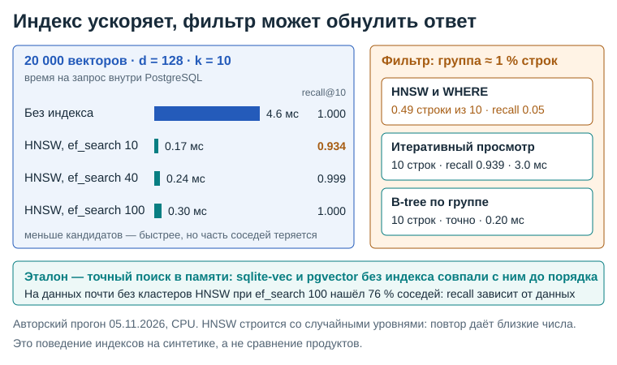
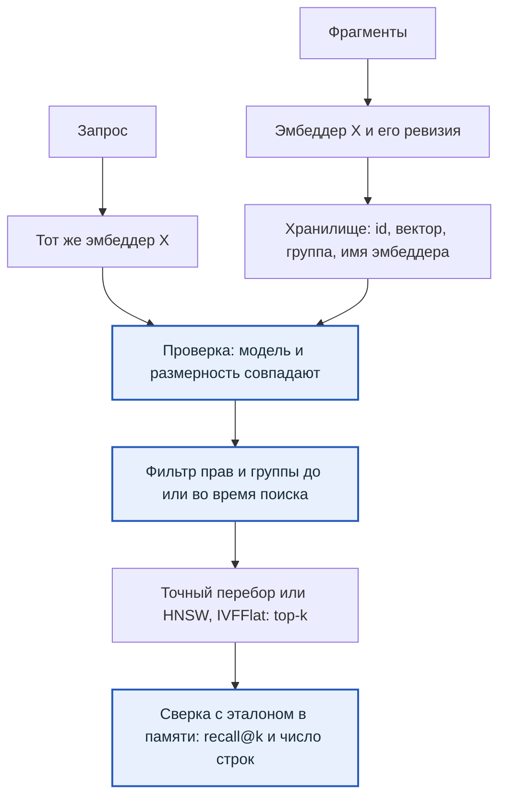

# M10-L08X. Векторное хранилище

**Расширение 1.2.0.** Урок дополняет модуль, не входит в обязательный минимум 1.1.0.

**Результат:** сохранить векторы фрагментов в хранилище вместе с метаданными и именем эмбеддера, проверить его поиск против точного эталона в памяти по recall@k и выбрать между точным перебором, HNSW и IVFFlat с учётом фильтров, памяти и задержки.

**До урока:** M10-L02, M10-L05, M10-L07X. Лабораторная берёт векторы USER-bge-m3 из M10-L07X, а без него — MiniLM из M10-L02. Путь без сервера требует только пакет sqlite-vec из `requirements-optional.in`. Путь с pgvector требует PostgreSQL 18 и компилятор C++ из Visual Studio либо сервер, где pgvector уже установлен. Ориентир времени — 180 минут чтения, прогона и разбора; это первоначальная оценка, а не ограничение.

> **Версии и дата проверки:** Python 3.11.9, sqlite-vec 0.1.9 (SQLite 3.45.1), pgvector 0.8.7 в PostgreSQL 18.3, сборка MSVC из Visual Studio 2026; эмбеддер USER-bge-m3 (ревизия 0cc6cfe) · проверено 05.11.2026 · источник: [README pgvector 0.8.7](https://github.com/pgvector/pgvector/blob/v0.8.7/README.md)

## Объяснение

До сих пор курс держал векторы в массиве NumPy и искал перебором: `scores = q @ V.T`, затем сортировка. Для 72 фрагментов это правильное решение: 72 · 1024 · 4 = 294 912 байт и меньше миллисекунды на запрос. Хранилище нужно, когда появляется хотя бы одно из четырёх требований. Векторы должны пережить перезапуск процесса: USER-bge-m3 загружается и кодирует 72 фрагмента и 64 запроса за 17 секунд на CPU, а миллион фрагментов — за часы. Вместе со сходством нужно фильтровать по правам, клиенту или версии документа. Данные меняются, и вставка или удаление не должны перестраивать всё. Наконец, полный перебор становится слишком медленным, и нужен приблизительный индекс. По сути хранилище — таблица «id, вектор, метаданные, текст или ссылка на него» и одна операция: найти k ближайших векторов.

Расстояние задаётся явно. В pgvector три основных оператора: `<->` — евклидово расстояние, `<#>` — скалярное произведение со знаком минус, `<=>` — косинусное расстояние, то есть 1 − cos. Для векторов единичной длины порядок у всех трёх одинаковый, потому что ‖a − b‖² = 2 − 2 · cos. Индекс строится под один оператор: класс `vector_cosine_ops` обслуживает только `<=>`, и запрос с другим оператором этот индекс не использует. В sqlite-vec метрика объявляется при создании таблицы: `distance_metric=cosine`.

Точный поиск сравнивает запрос с каждой строкой и возвращает настоящие k ближайших; его цена растёт как N · d умножений на запрос. Приблизительные индексы, ANN, отвечают быстрее, но иногда пропускают настоящих соседей. HNSW строит многослойный граф: на каждом слое у вектора до m связей с близкими (по умолчанию 16), а при построении индекс просматривает ef_construction кандидатов (по умолчанию 64). Поиск идёт по графу жадно и держит список из ef_search лучших кандидатов, по умолчанию 40: больше кандидатов — выше точность и дольше запрос. IVFFlat разбивает векторы на lists кластеров алгоритмом k-means по уже загруженным данным, и запрос просматривает probes ближайших кластеров, по умолчанию один. README pgvector советует начинать с lists = rows / 1000 до миллиона строк и probes ≈ √lists, а индекс строить после загрузки данных. Качество приблизительного индекса меряют recall@k: какая доля строк точного top-k попала в ответ индекса.

Главная ловушка — фильтр. Запрос `WHERE grp = $2 ORDER BY embedding <=> $1 LIMIT 10` с HNSW работает так: индекс отдаёт ef_search кандидатов по сходству, и только потом WHERE отбрасывает чужие строки. Если группа занимает 1 % таблицы, из 40 кандидатов в среднем останется 0.4 строки, и запрос вернёт меньше строк, чем LIMIT, без всякой ошибки. pgvector 0.8 добавил итеративный просмотр индекса: `hnsw.iterative_scan` продолжает обход, пока не наберёт нужное число строк или не дойдёт до `hnsw.max_scan_tuples`. Для очень избирательных фильтров проще обычный B-tree по колонке фильтра и точный перебор немногих подходящих строк; при немногих значениях фильтра README предлагает частичные индексы, а при многих и для изоляции клиентов — секционирование таблицы. В sqlite-vec колонки метаданных проверяются во время перебора, поэтому k строк вернутся, если в группе они есть. Права доступа проверяют до поиска или во время него, но не после: иначе пользователь получит пустой ответ или, хуже, чужие фрагменты, если фильтр забыли.

Хранилище должно помнить модель. Векторы разных моделей лежат в разных пространствах, это было в M10-L05 и M10-L07X. Чужую размерность хранилище поймает само: колонка `vector(1024)` в PostgreSQL не примет вектор длины 384, а sqlite-vec ответит ошибкой `Dimension mismatch`. Но у USER-bge-m3, bge-m3 и Qwen3-Embedding-0.6B размерность одинаковая — 1024, и векторы любой из них лягут в одно хранилище молча. Поэтому рядом с векторами хранят имя и ревизию эмбеддера и отказываются принимать запросы от другой модели. Это та же версия RAG из M10-L05, только записанная в самом хранилище.

Основной путь для того, кто уже работает с PostgreSQL, — pgvector. Векторы лежат рядом с остальными данными сервиса, и для них действуют те же транзакции, JOIN с таблицами прав, резервные копии и миграции. Путь без сервера — sqlite-vec: расширение SQLite, которое работает внутри процесса и хранит всё в одном файле. Стабильная версия 0.1.9 умеет только точный перебор с фильтром по метаданным; ANN-индексы есть в альфа-версиях 0.1.10. Эталоном в тестах остаётся точный поиск в памяти: на одних и тех же векторах любое хранилище обязано вернуть тот же top-k.

Чтобы попробовать pgvector без прав администратора и не трогая установленный сервер, лабораторная собирает pgvector 0.8.7 из исходников в папку проекта. Затем она поднимает отдельный учебный кластер PostgreSQL 18 на 127.0.0.1:55433. Параметры PostgreSQL 18 `extension_control_path` и `dynamic_library_path` позволяют подключить расширение из любой папки. Учебный кластер пускает локальные подключения без пароля — только для синтетических данных курса и никогда для настоящих.




## Аналогия: индекс в PostgreSQL

Как похоже: векторное хранилище — таблица с индексом. Без индекса запрос `ORDER BY embedding <=> $1 LIMIT 10` читает всю таблицу и сортирует, как Seq Scan с сортировкой по любой колонке. HNSW ускоряет его так же, как B-tree ускоряет `ORDER BY created_at LIMIT 10`. Планировщик сам решает, брать ли индекс, а EXPLAIN показывает решение: на таблице из 72 строк он честно выберет Seq Scan.

| В уроке | В аналогии |
| --- | --- |
| Точный перебор | Seq Scan с сортировкой |
| HNSW или IVFFlat | Индекс под ORDER BY с LIMIT |
| ef_search и probes | Параметры сессии через SET, которые меняют работу плана |
| Колонка метаданных и фильтр | WHERE рядом с ORDER BY |
| Имя и ревизия эмбеддера в хранилище | Версия схемы в таблице миграций |
| Эталон в памяти | Тестовый запрос с заранее известным ответом |
| recall@k | Доля правильных строк в ответе запроса |

**Где аналогия ломается:** B-tree возвращает ровно те строки, что и Seq Scan: индекс меняет скорость, но не ответ. HNSW и IVFFlat приблизительны — с индексом ответ может отличаться от точного, и EXPLAIN этого не покажет; заметить можно только сверкой с эталоном. С фильтром разница ещё резче: B-tree вместе с WHERE отдаёт все подходящие строки, а HNSW вместе с WHERE может вернуть меньше строк, чем LIMIT, или ни одной.

## Разобранный пример

Косинусное расстояние между a = [1, 0, 0] и b = [0.9, 0.1, 0]: cos = 0.9 / √0.82 ≈ 0.993884, расстояние 1 − cos ≈ 0.006116. Ровно это число вернули и `'[1,0,0]'::vector <=> '[0.9,0.1,0]'::vector` в pgvector, и KNN-запрос sqlite-vec.

Recall@k = |top-k индекса ∩ top-k эталона| / k. Если индекс вернул 10 строк и 9 из них есть в точном top-10, recall@10 = 9 / 10 = 0.9. Если с фильтром он вернул одну строку и она верная, recall@10 = 1 / 10 = 0.1, хотя «ошибочных» строк в ответе нет.

Размер: 72 вектора по 1024 числа float32 — 294 912 байт. Файл sqlite-vec с ними занял 4 280 320 байт: таблица vec0 выделяет место блоками по `chunk_size` = 1024 векторов, и один блок — 1024 · 1024 · 4 = 4 194 304 байт. Миллион векторов d = 1024 во float32 занимает 4 096 000 000 байт, около 3.8 ГиБ, без учёта индекса. Ожидаемое число строк с фильтром: ef_search · доля группы = 40 · 0.01 = 0.4.

```python
import numpy as np

a, b = np.array([1.0, 0, 0]), np.array([0.9, 0.1, 0])
distance = 1 - a @ b / (np.linalg.norm(a) * np.linalg.norm(b))
assert round(float(distance), 6) == 0.006116
reference, index = set(range(10)), set(range(9)) | {42}
assert len(reference & index) / 10 == 0.9
assert 72 * 1024 * 4 == 294_912 and 1024 * 1024 * 4 == 4_194_304
assert 1_000_000 * 1024 * 4 == 4_096_000_000
print(round(40 * 0.01, 2), 'строки из 10 ожидается после фильтра')
```

Тот же поиск в SQL — для того, кто знает PostgreSQL, это обычная таблица и обычный индекс:

```sql
create extension if not exists vector;
create table chunks (id int primary key, grp text not null, embedding vector(1024) not null);
create index on chunks using hnsw (embedding vector_cosine_ops);
set hnsw.ef_search = 100;
select id, embedding <=> $1 as distance from chunks where grp = $2 order by embedding <=> $1 limit 5;
```

### Авторский прогон 05.11.2026

CPU, данные из `artifacts/M10/vector_store/report.json`. Время pgvector измерено внутри сервера функцией PL/pgSQL, время sqlite-vec — вызовом из Python; это поведение хранилищ и индексов, а не сравнение продуктов.

Курс: 72 фрагмента 24 документов, векторы USER-bge-m3 (d = 1024), 64 запроса из M10-L07X, k = 5.

| Хранилище | Совпадение с эталоном | Медиана на запрос | Размер |
| --- | --- | --- | --- |
| sqlite-vec после закрытия и открытия файла | recall@5 = 1.000, порядок совпал в 64 из 64 | 4.7 мс | файл 4 280 320 байт |
| pgvector без индекса | recall@5 = 1.000, порядок 64 из 64 | 0.22 мс | — |
| pgvector с индексом HNSW | recall@5 = 1.000; план Seq Scan — для 72 строк планировщик индекс не взял | 0.23 мс | — |

Расхождение расстояний с эталоном не больше 8 · 10⁻⁷ — это точность float32. Запрос вектором длины 512 sqlite-vec отклонил: «Expected 1024 dimensions but received 512». Запросы двух других моделей той же размерности хранилище отклонило по записанному имени эмбеддера. Затем лабораторная посчитала, что вернул бы поиск без этой проверки:

| Векторы запросов | Перефразирование, 24 | С термином, 24 | Запросы 1.1.0, 12 |
| --- | --- | --- | --- |
| USER-bge-m3, как у хранилища | 19 | 24 | 12 |
| bge-m3 — исходная модель USER-bge-m3 | 20 | 24 | 12 |
| Qwen3-Embedding-0.6B — неродственная модель | 2 | 1 | 0 |

Неожиданное наблюдение: запросы bge-m3 к векторам USER-bge-m3 нашли нужный документ не хуже своих, потому что USER-bge-m3 дообучен из bge-m3 и пространство почти не сдвинулось. Это не делает смену модели безопасной: неродственная модель той же размерности дала 2 попадания из 24, почти случайный уровень, и ни одной ошибки.

Синтетика: 20 000 векторов d = 128 вокруг 64 центров, 200 запросов, k = 10, группа фильтра — около 1 % строк.

| Вариант | recall@10 | Строк в ответе | Медиана, мс | План |
| --- | --- | --- | --- | --- |
| NumPy, точный перебор пакетом | 1.000 | 10 | 1.77 | — |
| sqlite-vec, точный перебор | 1.000 | 10 | 10.4 | — |
| sqlite-vec, фильтр по группе | 1.000 | 10 | 8.7 | — |
| pgvector без индекса | 1.000 | 10 | 4.58 | Seq Scan |
| HNSW, ef_search = 10 | 0.934 | 10 | 0.17 | Index Scan |
| HNSW, ef_search = 40, по умолчанию | 0.999 | 10 | 0.24 | Index Scan |
| HNSW, ef_search = 100 | 1.000 | 10 | 0.30 | Index Scan |
| HNSW, ef_search = 200 | 1.000 | 10 | 0.42 | Index Scan |
| IVFFlat, lists = 20, probes = 1 | 1.000 | 10 | 0.31 | — |
| IVFFlat, probes = 4 | 1.000 | 10 | 1.06 | — |
| IVFFlat, probes = 20 | 1.000 | 10 | 4.19 | — |
| Фильтр 1 %: HNSW с настройками по умолчанию | 0.050 | 0.49 | 0.25 | Index Scan |
| Фильтр 1 %: HNSW и iterative_scan = relaxed_order | 0.939 | 10 | 3.0 | Index Scan |
| Фильтр 1 %: B-tree по группе | 1.000 | 10 | 0.20 | Bitmap Index Scan |
| Почти без кластеров: HNSW, ef_search = 10, 40, 100 | 0.244, 0.536, 0.764 | 10 | 0.27–1.02 | — |

Прочерк в колонке плана значит, что для этого варианта план не записывался. HNSW с настройками по умолчанию нашёл 99.9 % настоящих соседей в 19 раз быстрее полного перебора. При ef_search = 10 он потерял около 7 % строк. Индекс HNSW занял 16 654 336 байт — больше самой таблицы (11 829 248 байт) — и строился 1.3 секунды; IVFFlat занял 11 051 008 байт и строился 0.24 секунды. IVFFlat нашёл всех соседей уже с одним probe, потому что у данных 64 чётких кластера. На почти бесструктурных данных тот же HNSW при ef_search = 100 вернул только 76 % строк. Recall зависит от данных, поэтому его меряют на своих векторах.

Главный результат — фильтр. При существующем HNSW планировщик сам выбрал его для запроса с WHERE и вернул в среднем 0.49 строки вместо 10, без ошибки и предупреждения. Итеративный просмотр вернул 10 строк за 3 мс. B-tree по группе дал точный ответ за 0.2 мс: в группе около 200 строк, и перебрать их дешевле, чем идти по графу. HNSW строится со случайными уровнями, поэтому повторный прогон даёт близкие, но не те же числа: в двух авторских прогонах recall при ef_search = 10 был 0.933 и 0.941.

### Какое хранилище выбрать

| Хранилище | Как запускается | Индекс | Фильтр | Когда брать |
| --- | --- | --- | --- | --- |
| pgvector, лицензия PostgreSQL | Расширение PostgreSQL, работает в сервере базы | Точный перебор, HNSW, IVFFlat | Обычный WHERE; с ANN — iterative scan, B-tree или частичный индекс | Данные сервиса уже в PostgreSQL, нужны транзакции, JOIN с правами и общие резервные копии |
| sqlite-vec, MIT или Apache-2.0 | Расширение SQLite внутри процесса, один файл | Точный перебор в 0.1.9; ANN — в альфа-версиях 0.1.10 | Колонки метаданных и partition key проверяются во время перебора | Локальное приложение, тесты, учебные данные без сервера |
| Qdrant, Apache-2.0 | Отдельный сервер в Docker или облаке; в Python-клиенте есть локальный режим без сервера для разработки и тестов | HNSW — единственный индекс плотных векторов | Payload-индексы по полям; по ним планировщик оценивает строгость фильтра и выбирает стратегию поиска | Отдельный векторный сервис с фильтрами под нагрузкой |
| LanceDB, Apache-2.0 | Встраиваемая библиотека в процессе, данные на диске или в объектном хранилище; есть серверная Enterprise-версия | Без индекса — точный перебор; IVF, в том числе с квантованием, и IVF_HNSW | Prefilter по умолчанию; postfilter может вернуть меньше limit строк | Колоночные и мультимодальные данные без отдельного сервера |
| Chroma, Apache-2.0 | В процессе через PersistentClient, сервер через `chroma run` или Docker, облако | HNSW | where по метаданным | Быстрый прототип RAG; функция эмбеддингов по умолчанию — английская all-MiniLM-L6-v2, её файлы скачиваются автоматически, поэтому для русского текста и работы без сети задают свою |

Таблица описывает способ запуска и возможности по официальной документации на 05.11.2026, а не скорость: Qdrant, LanceDB и Chroma в курсе не запускались, и обязательных зависимостей для них нет. Перед выбором любое хранилище проверяют тем же способом, что в лабораторной: эталон в памяти, recall@k, число строк с фильтром, план или его аналог.

## Схема



Путь запроса к векторному хранилищу. Фрагменты и запрос кодирует одна и та же модель, а хранилище записывает её имя рядом с векторами. Выделены три проверки, которых нет у массива в памяти. Первая — совпадение модели: одинаковая размерность ещё не гарантирует одно пространство. Вторая — фильтр до или во время поиска, а не после него: иначе ANN-индекс вернёт меньше строк, чем просили. Третья — сверка с точным эталоном по recall@k и числу строк, без которой приблизительный индекс выглядит точным.

## Практика с поддержкой

**Предскажи до запуска.** Прежде чем запускать код или пересчитывать пример, запиши ожидаемый вывод: числа, формы массивов, порядок или текст. После запуска сравни с фактическим и объясни каждое расхождение.

Путь без сервера — установи пакет в `.venv` и запусти лабораторную без PostgreSQL:

```powershell
.\.venv\Scripts\python.exe -m pip install -r requirements-optional.in
.\.venv\Scripts\python.exe labs\M10\vector_store.py --no-pg
```

Путь с pgvector — собери расширение, подними учебный кластер, запусти лабораторную и останови кластер:

```powershell
.\.venv\Scripts\python.exe labs\M10\pg_local.py build
.\.venv\Scripts\python.exe labs\M10\pg_local.py init
.\.venv\Scripts\python.exe labs\M10\pg_local.py start
.\.venv\Scripts\python.exe labs\M10\vector_store.py
.\.venv\Scripts\python.exe labs\M10\pg_local.py stop
```

`build` один раз скачивает исходники pgvector 0.8.7 (около 220 КБ, контрольная сумма проверяется) и компилирует их компилятором из Visual Studio с компонентом «Разработка классических приложений на C++». `init` требует PostgreSQL 18; файлы кластера лежат в `artifacts/M10/pgdata`. Если pgvector уже установлен в твоём сервере, передай `--pg-conninfo "host=localhost port=5432 user=... dbname=..."` без пароля: пароль libpq берёт из файла pgpass. Лабораторная работает только в схеме `m10_l08x` и пересоздаёт там свои таблицы.

До запуска запиши три предсказания: сколько строк вернёт HNSW с фильтром на 1 % строк, каким будет recall@10 при ef_search = 10 и сколько байт займёт файл sqlite-vec с 72 векторами. После запуска открой отчёт и найди поле `plan` у каждого варианта: где планировщик выбрал Seq Scan и почему. Подключись к учебному кластеру через `psql "host=127.0.0.1 port=55433 user=course dbname=postgres"` и выполни EXPLAIN для запроса с фильтром сначала с индексом HNSW, затем после `drop index`.

## Самостоятельная задача A — M10-L08X-A

В копии лабораторной добавь в синтетическую часть HNSW с m = 8 и m = 32 при ef_construction = 64. Для каждого m измерь recall@10 и медиану времени при ef_search = 10 и 40, размер индекса и время построения. Гипотезу запиши до запуска. Выбери настройку для сервиса, которому нужен recall@10 не ниже 0.99 при минимальной задержке, и объясни, почему этот выбор нельзя перенести на свои векторы без проверки. Если PostgreSQL недоступен, выполни офлайн-вариант на sqlite-vec. Сравни колонку метаданных `grp` и `grp text partition key` на 20 000 векторах: время с фильтром и без, совпадение с эталоном и размер файла.

Первая попытка — без готового решения. Сохрани код, таблицу и объяснение в `submissions/M10-L08X/`. AI может пояснять термины и помогать искать ошибку; запиши полученную помощь.

## Подсказки по очереди

1. Для каждого m удаляй прежний индекс и создавай новый: `create index ... using hnsw (embedding vector_cosine_ops) with (m = 8, ef_construction = 64)`.
2. Recall считай против `exact_topk` из лабораторной — точного эталона в памяти, а не против другого индекса.
3. Время построения и recall меряй хотя бы дважды: HNSW строится со случайными уровнями, и разница меньше разброса между прогонами ничего не доказывает.

## Критерии и типичные ошибки

Ошибка: считать HNSW точным и проверять хранилище на пяти удачных запросах. Ошибка: сравнивать время sqlite-vec из Python со временем внутри PostgreSQL как одну величину. Ошибка: фильтровать после ANN-поиска и не проверять число строк в ответе. Ошибка: запустить кластер без пароля с настоящими данными. Ошибка: сменить эмбеддер и оставить старые векторы, потому что размерность совпала. Критерий: таблица recall@k, числа строк, задержки и размера, план EXPLAIN и вывод, который не выходит за пределы данных.

После попытки сверь результат с [решением M10-L08X-A](../../solutions/modules/M10.md#m10-l08x-a).

## Новая и отложенная проверка

**B — фильтр и LIMIT.** В таблице 2 000 000 фрагментов 400 клиентов, у каждого поровну, строки клиентов перемешаны. Есть HNSW-индекс, ef_search = 40, запрос `WHERE tenant = $2 ORDER BY embedding <=> $1 LIMIT 10`. Сколько строк в среднем вернёт запрос без итеративного просмотра? Назови три способа исправить ответ и цену каждого.

**C — через 7–10 дней.** Сервис хранит 300 000 фрагментов и переходит с модели d = 768 на модель d = 1024. Посчитай размер векторов во float32 до и после. Объясни, что произойдёт с колонкой `vector(768)` и HNSW-индексом и как проверить новый индекс до переключения. Почему проверка размерности не защищает при переходе на другую модель с той же размерностью?

Сначала сохрани собственное решение B/C, затем сверь [отдельный ключ M10-L08X-B-C](../../solutions/modules/M10.md#m10-l08x-b-c). Отметь помощь; отложенную проверку засчитывай только после фактической новой попытки.

## Карточка урока

| Поле | Содержание |
| --- | --- |
| Правило | Хранилище — таблица с id, вектором, метаданными и именем эмбеддера; любой его поиск сверяют с точным эталоном в памяти по recall@k на зафиксированных запросах; приблизительный индекс выбирают по recall, задержке и памяти, а фильтр проверяют по числу возвращённых строк |
| Смысл величин | recall@k — доля строк точного top-k в ответе индекса; ef_search — число кандидатов HNSW, по умолчанию 40; probes — число просмотренных кластеров IVFFlat, по умолчанию 1; оператор `<=>` — косинусное расстояние 1 − cos; векторы занимают N · d · 4 байта во float32 |
| Когда применять | Когда векторы должны пережить перезапуск, фильтроваться по правам и обновляться. Пример: 20 000 векторов d = 128 — 10 240 000 байт; точный перебор в PostgreSQL — 4.6 мс, HNSW при ef_search = 40 — 0.24 мс и recall@10 = 0.999, но с фильтром на 1 % строк тот же HNSW вернул в среднем 0.49 строки вместо 10 |
| Главная ошибка | Считать ANN-индекс точным: не сверять его с эталоном, фильтровать после поиска без проверки числа строк или оставить векторы старой модели при смене эмбеддера той же размерности |

## Источники и углубление

- [README pgvector 0.8.7](https://github.com/pgvector/pgvector/blob/v0.8.7/README.md) — операторы расстояния, HNSW, IVFFlat, итеративный просмотр индекса и фильтрация (на английском)
- [Malkov, Yashunin: Efficient and robust approximate nearest neighbor search using HNSW graphs](https://arxiv.org/abs/1603.09320) — статья об иерархических графах HNSW (на английском)
- [PostgreSQL 18: extension_control_path](https://www.postgresql.org/docs/18/runtime-config-client.html#GUC-EXTENSION-CONTROL-PATH) — расширения из каталога вне установки сервера (на английском)
- [sqlite-vec: метаданные в таблицах vec0](https://alexgarcia.xyz/sqlite-vec/features/vec0.html) — колонки метаданных, partition key и KNN-запросы (на английском)
- [Qdrant: индексация](https://qdrant.tech/documentation/concepts/indexing/) — HNSW, payload-индексы и filterable HNSW (на английском)
- [LanceDB: фильтрация](https://lancedb.com/docs/search/filtering/) — prefilter и postfilter и почему postfilter возвращает меньше строк (на английском)
- [Chroma: функции эмбеддингов](https://docs.trychroma.com/docs/embeddings/embedding-functions) — функция по умолчанию all-MiniLM-L6-v2 и автоматическая загрузка её файлов (на английском)

Синтетические данные, численные наблюдения и код лабораторной созданы для курса; внешние тексты не копировались в учебные данные. Размер блока vec0 по умолчанию (1024 вектора) взят из исходного кода sqlite-vec 0.1.9.
