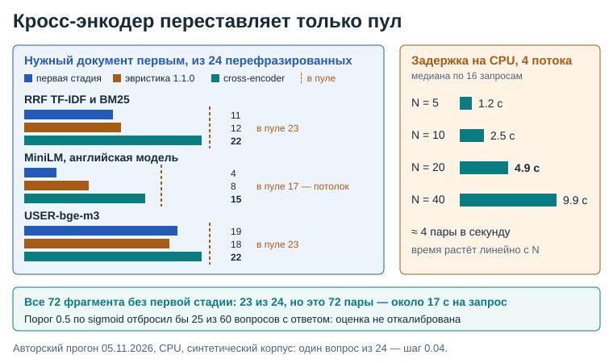
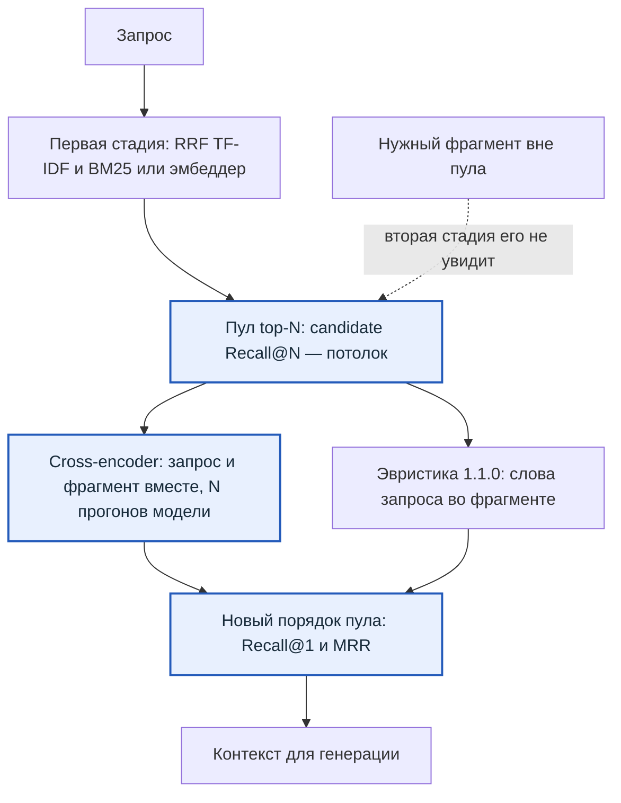

# M10-L09X. Кросс-энкодер для reranking

**Расширение 1.2.0.** Урок дополняет модуль, не входит в обязательный минимум 1.1.0.

**Результат:** подключить обученный cross-encoder вторым этапом поверх первой стадии и сравнить его с эвристикой 1.1.0 и порядком первой стадии на одном пуле кандидатов по Recall@1 и MRR. Нужно учесть candidate Recall@N как потолок любого reranker и задержку на CPU в зависимости от N.

**До урока:** M10-L03, M10-L07X. Нужна модель bge-reranker-v2-m3 из `tools/download_models.py --rerankers` — около 2.3 ГБ, загрузка один раз; без неё лабораторная покажет только первые стадии и эвристику. USER-bge-m3 из M10-L07X нужен для третьей первой стадии, без него она пропускается. Ориентир времени — 150 минут чтения, прогона и разбора; это первоначальная оценка, а не ограничение.

> **Версии и дата проверки:** Python 3.11.9, PyTorch 2.15.0+cpu, transformers 4.57.6; модели bge-reranker-v2-m3 (ревизия 953dc6f), USER-bge-m3 (ревизия 0cc6cfe), all-MiniLM-L6-v2 (ревизия 1110a24) · проверено 05.11.2026 · источник: [карточка bge-reranker-v2-m3](https://huggingface.co/BAAI/bge-reranker-v2-m3)

## Объяснение

В M10-L03 вторая стадия была прозрачной эвристикой: кандидаты после RRF переупорядочивались по числу слов запроса, найденных во фрагменте. Урок прямо говорил, что нейросетевой reranker подключается тем же контрактом — с отдельным измерением качества и времени. Этот урок делает именно это и оставляет эвристику рядом как baseline.

Эмбеддер из M10-L07X — bi-encoder: запрос и фрагмент кодируются отдельно, векторы фрагментов считаются заранее, а поиск сводится к одному скалярному произведению на фрагмент. Cross-encoder читает запрос и фрагмент одной последовательностью `[CLS] запрос [SEP] фрагмент [SEP]`. Внимание связывает каждое слово запроса с каждым словом фрагмента, поэтому модель лучше отличает текст «на ту же тему» от текста, который отвечает на вопрос. Цена в том, что заранее посчитать ничего нельзя: N кандидатов — это N полных прогонов большой модели на каждый запрос.

bge-reranker-v2-m3 от BAAI построен на bge-m3: архитектура XLM-RoBERTa, 24 слоя, скрытый размер 1024, около 568 млн параметров, веса 2.27 ГБ во float32, лицензия Apache-2.0. Вход ограничен 512 токенами на пару. На выходе — одно число, логит релевантности: чем больше, тем релевантнее. Карточка модели предлагает переводить его в шкалу от 0 до 1 функцией sigmoid, σ(x) = 1 / (1 + e^(−x)). Это монотонное преобразование, порядок оно не меняет, а вероятностью правильного ответа число от этого не становится. Порог отказа по такой оценке нужно измерять на своих вопросах с ответом и без. Другой класс — reranker на основе языковой модели, например Qwen3-Reranker-0.6B: он спрашивает модель «подходит ли документ, да или нет» и берёт вероятность «да». В курсе запускается одна модель, bge-reranker-v2-m3, по решению автора; вторая упоминается как альтернатива.

Контракт двух стадий тот же, что в M10-L03. Первая стадия дешёво отдаёт пул из top-N фрагментов, вторая переставляет только их. Candidate Recall@N — доля вопросов, у которых нужный документ попал в пул; это потолок любого reranker, потому что вторая стадия не видит фрагментов вне пула. Больше N — выше потолок, но задержка растёт примерно линейно с числом пар. Поэтому N выбирают по двум измерениям сразу: потолку candidate Recall@N и времени второй стадии.

Чтобы сравнение было честным, лабораторная берёт корпус и запросы из M10-L07X: 72 абзаца 24 документов, 24 перефразированных вопроса без ключевого слова темы, 24 вопроса с термином и 12 вопросов с ответом из 1.1.0. Первых стадий три: RRF символьного TF-IDF и BM25 без моделей, английский MiniLM и USER-bge-m3. Пул каждой — 20 фрагментов, вторые этапы — порядок первой стадии, эвристика 1.1.0, перенесённая на русские слова, и cross-encoder. Размер пула, стоп-слова эвристики, предел 512 токенов и набор запросов зафиксированы до запуска модели; ничего не подбирается по результатам. Метрики документные, как в M10-L07X: фрагменты одного документа схлопываются в один.




## Аналогия: Bitmap Index Scan и Recheck Cond

Как похоже: в PostgreSQL полнотекстовый или GIN-индекс часто работает в две стадии. Bitmap Index Scan дёшево находит кандидатов — страницы, где условие может выполняться, а Bitmap Heap Scan читает эти строки и проверяет условие заново: в EXPLAIN это строка Recheck Cond. Дорогая проверка идёт только по кандидатам, и её цена растёт с их числом. Строку, которую индекс не отдал, перепроверка не найдёт.

| В уроке | В аналогии |
| --- | --- |
| Первая стадия: BM25, TF-IDF или эмбеддер | Bitmap Index Scan по индексу |
| Пул top-N кандидатов | Набор страниц из битовой карты |
| Cross-encoder читает пару целиком | Recheck Cond проверяет условие на самой строке |
| Задержка растёт с N | Время Heap Scan растёт с числом кандидатов |
| Candidate Recall@N — потолок | Строку вне битовой карты перепроверка не вернёт |
| Эвристика 1.1.0 | Простое условие, которое легко прочитать в плане |

**Где аналогия ломается:** Recheck Cond вычисляет то же условие точно, и ответ после перепроверки правильный. Cross-encoder — обученная модель: он тоже ошибается и может опустить нужный фрагмент ниже, чем поставила первая стадия. Кроме того, перепроверка только отсеивает строки, а reranker переставляет весь пул, и качество нового порядка видно лишь на размеченных запросах.

## Разобранный пример

Пул из трёх фрагментов, нужный — B. Первая стадия дала порядок [A, B, C], логиты cross-encoder — A = −1.2, B = 2.3, C = −3.0. Новый порядок [B, A, C]: обратный ранг нужного вырос с 1/2 до 1. Sigmoid переводит логиты в 0.231, 0.909 и 0.047 — порядок тот же. Если бы B не попал в пул первой стадии, никакие логиты не подняли бы его: candidate Recall@N для этого вопроса равен нулю. Задержка: если 20 пар идут 400 мс, то 40 пар — около 800 мс, а 5 пар — около 100 мс, плюс постоянные расходы на вызов.

```python
import math

logits = {'A': -1.2, 'B': 2.3, 'C': -3.0}
first_stage = ['A', 'B', 'C']
position = {chunk: rank for rank, chunk in enumerate(first_stage)}
reranked = sorted(first_stage, key=lambda c: (-logits[c], position[c]))
assert reranked == ['B', 'A', 'C']
assert 1 / (first_stage.index('B') + 1) == 0.5 and 1 / (reranked.index('B') + 1) == 1.0
probabilities = {c: round(1 / (1 + math.exp(-x)), 3) for c, x in logits.items()}
assert probabilities == {'A': 0.231, 'B': 0.909, 'C': 0.047}
pairs_per_second = 20 / 0.4
print(pairs_per_second, 'пар в секунду;', 40 / pairs_per_second, 'с на 40 пар')
```

### Авторский прогон 05.11.2026

CPU, 4 потока, данные из `artifacts/M10/rerank/report.json`. Прогон занял около 25 минут, и почти всё это время ушло на 4608 пар cross-encoder: 64 запроса × 72 фрагмента. Пул — 20 фрагментов. В таблице — сколько из 24 перефразированных вопросов получили нужный документ первым; в скобках MRR.

| Первая стадия | Порядок первой стадии | Эвристика 1.1.0 | Cross-encoder | Нужный документ в пуле |
| --- | --- | --- | --- | --- |
| RRF TF-IDF и BM25 | 11 (0.64) | 12 (0.65) | 22 (0.94) | 23 |
| MiniLM | 4 (0.25) | 8 (0.41) | 15 (0.67) | 17 |
| USER-bge-m3 | 19 (0.86) | 18 (0.82) | 22 (0.94) | 23 |

На вопросах с термином cross-encoder даёт 24 из 24 после любой первой стадии; MiniLM без второго этапа — 13, с эвристикой — 24. На 12 вопросах 1.1.0 лексическая стадия даёт 10, с эвристикой 11, с cross-encoder 12. MiniLM на них — 5, 10 и 11 при 11 вопросах с документом в пуле, USER-bge-m3 — 12 с любым вторым этапом. По всем 60 вопросам с ответом cross-encoder поднял нужный документ после лексической стадии в 14 запросах и не опустил ни разу. После MiniLM — 30 подъёмов без единого ухудшения, после USER-bge-m3 — 4 подъёма и одно ухудшение. Эвристика после USER-bge-m3 подняла документ в 2 запросах и опустила в 4.

Без первой стадии, по всем 72 фрагментам, cross-encoder ставит нужный документ первым в 23 перефразированных вопросах из 24. Это верхняя граница метода, но она стоит 72 пары на запрос — около 17 секунд на этой машине. Задержка второго этапа (медиана по 16 запросам): 5 пар — 1.2 с, 10 — 2.5 с, 20 — 4.9 с, 40 — 9.9 с, то есть около 4 пар в секунду, линейно по N.

Что из этого следует. Сильный второй этап выровнял первые стадии: лексика без моделей и USER-bge-m3 с cross-encoder дали одинаковые 22 из 24, потому что пул обеих содержал нужный документ в 23 вопросах. Потолок виден на MiniLM: нужный документ был в её пуле только в 17 вопросах, cross-encoder нашёл 15 из них, а оставшиеся 7 ему недоступны. Документ о согласованном релизе он поднял из пула MiniLM с 18-го места на первое — при N = 10 этого документа в пуле не было бы. Эвристика помогает там, где первая стадия игнорирует точные слова, как MiniLM на вопросах с термином. Сильной плотной стадии она вредит: она только считает слова. Модель тоже ошибается. Единственное ухудшение после USER-bge-m3 — вопрос «Два параллельных изменения видят данные друг друга не так, как ожидалось»: cross-encoder поставил первым документ о score классификатора.

Цена здесь главное ограничение. Около 5 секунд на пул из 20 фрагментов на этом процессоре — слишком медленно для интерактивного ответа. N = 5 стоит 1.2 секунды, но уже срезает потолок. Сократить время можно меньшим N, более мощным процессором или GPU, меньшей либо квантованной моделью, но каждый вариант меняет и качество и требует нового замера. В курсе эти варианты не измерялись.

Оценки тоже требуют осторожности. Sigmoid от лучшего логита у четырёх вопросов без ответа не выше 0.001, у вопросов с ответом медиана 0.80, но 25 из 60 вопросов с ответом получили меньше 0.5. Порог 0.5 отказал бы в 42 % вопросов, на которые корпус отвечает. Шесть вопросов с ответом получили меньше 0.01, а самый низкий — 0.0006, ниже, чем у одного из вопросов без ответа (0.0008): даже на этом наборе нет порога, который разделил бы их без ошибок. Вопросов без ответа всего четыре, поэтому выбирать порог по этому прогону нельзя.

## Схема



Две стадии поиска с обученным reranker. Первая стадия дёшево отдаёт пул из N фрагментов, и candidate Recall@N меряют на этом шаге: он задаёт потолок, выше которого вторая стадия не поднимется. Cross-encoder читает каждую пару «запрос — фрагмент» целиком, поэтому его время растёт с N. Эвристика 1.1.0 стоит рядом как прозрачный baseline на том же пуле. Выделен главный путь: пул → cross-encoder → новый порядок. Пунктир — фрагмент вне пула: его не вернёт ни один reranker.

## Практика с поддержкой

**Предскажи до запуска.** Прежде чем запускать код или пересчитывать пример, запиши ожидаемый вывод: числа, формы массивов, порядок или текст. После запуска сравни с фактическим и объясни каждое расхождение.

Скачай модель и запусти лабораторную:

```powershell
.\.venv\Scripts\python.exe tools\download_models.py --rerankers
.\.venv\Scripts\python.exe labs\M10\rerank.py
```

До запуска запиши три предсказания: какой первой стадии cross-encoder поможет больше всего, изменится ли доля вопросов, у которых нужный документ в пуле, и сколько миллисекунд займут 20 пар на твоём процессоре. После запуска открой `artifacts/M10/rerank/report.json`. В `rank_changes` найди число запросов, где второй этап поднял нужный документ и где опустил. В `per_query` выбери один перефразированный вопрос, где cross-encoder поднял документ, и один, где опустил, и прочитай тексты фрагментов. Флаги: `--no-reranker` — только первые стадии и эвристика, `--no-dense` — без USER-bge-m3, `--no-minilm` — без MiniLM.

## Самостоятельная задача A — M10-L09X-A

В копии лабораторной измени размер пула: N = 5, 10 и 40 вместо 20, для первых стадий `lexical_rrf` и `minilm`. Для каждого N запиши candidate Recall@N, Recall@1 и MRR на перефразированных вопросах до и после cross-encoder и медиану задержки из поля `latency`. Гипотезу запиши до запуска. Выбери N для сервиса, у которого на вторую стадию отведено 300 мс на запрос на твоём процессоре, и объясни, что ограничивает качество при малом N, а что — при большом.

Первая попытка — без готового решения. Сохрани код, таблицу и объяснение в `submissions/M10-L09X/`. AI может пояснять термины и помогать искать ошибку; запиши полученную помощь.

## Подсказки по очереди

1. Лабораторная и так считает логиты cross-encoder для всех 72 фрагментов каждого запроса (`all_scores` в `run`): при другом N меняется только пул, а задержку для N = 5, 10, 20 и 40 она уже меряет отдельно.
2. Candidate Recall@N — поле `in_pool` в таблице: при малом N оно и есть потолок для Recall@1 после reranking.
3. Задержка растёт с числом пар почти линейно; сравни её с бюджетом, а не с задержкой первой стадии.

## Критерии и типичные ошибки

Ошибка: сравнивать reranker на разных пулах или без порядка первой стадии в той же таблице. Ошибка: считать sigmoid от логита вероятностью правильного ответа и ставить порог отказа без вопросов без ответа. Ошибка: ждать, что вторая стадия найдёт документ, которого нет в пуле. Ошибка: выбирать N по одному качеству без задержки. Критерий: таблица по первой стадии и второму этапу, потолок candidate Recall@N, задержка от N и вывод, который не выходит за пределы набора.

После попытки сверь результат с [решением M10-L09X-A](../../solutions/modules/M10.md#m10-l09x-a).

## Новая и отложенная проверка

**B — пул и логиты.** Первая стадия отдала пул [A, B, C, D], нужный фрагмент — C. Логиты cross-encoder: A = 0.4, B = −1.1, C = 1.6, D = 2.7. Найди порядок после reranking и обратный ранг C до и после. Посчитай σ(C) и σ(D). Что изменится, если первая стадия отдаст только top-2? Можно ли по значению σ(D) решить, что D отвечает на вопрос?

**C — через 7–10 дней.** Первая стадия сервиса отдаёт top-50 за 30 мс, cross-encoder на его сервере обрабатывает 40 пар в секунду, а на весь поиск отведено 800 мс. Посчитай задержку поиска при N = 50, 20 и 10 и выбери N. Объясни, что нужно измерить на размеченных вопросах, чтобы убедиться, что выбранный N не теряет нужные документы.

Сначала сохрани собственное решение B/C, затем сверь [отдельный ключ M10-L09X-B-C](../../solutions/modules/M10.md#m10-l09x-b-c). Отметь помощь; отложенную проверку засчитывай только после фактической новой попытки.

## Карточка урока

| Поле | Содержание |
| --- | --- |
| Правило | Cross-encoder ставят вторым этапом на пул первой стадии и сравнивают с порядком первой стадии и простым baseline на том же пуле; candidate Recall@N меряют до reranking как потолок, а N выбирают по потолку и задержке вместе |
| Смысл величин | Логит — оценка релевантности пары «запрос — фрагмент»; sigmoid переводит его в шкалу 0–1 без калибровки; candidate Recall@N — доля вопросов с нужным документом в пуле; задержка второго этапа ≈ N / (пар в секунду) |
| Когда применять | Когда первая стадия находит нужное в пуле, но ставит не первым. Пример: RRF TF-IDF и BM25 поставили нужный документ первым в 11 перефразированных вопросах из 24, cross-encoder на пуле из 20 — в 22 при потолке 23, но на этом CPU пул из 20 стоил 5 секунд на запрос |
| Главная ошибка | Ждать от reranker документа, которого нет в пуле, считать sigmoid вероятностью правильного ответа или выбрать N без замера задержки |

## Источники и углубление

- [BAAI/bge-reranker-v2-m3](https://huggingface.co/BAAI/bge-reranker-v2-m3) — карточка модели: использование через transformers, sigmoid для шкалы 0–1 (на английском)
- [Nogueira, Cho: Passage Re-ranking with BERT](https://arxiv.org/abs/1901.04085) — cross-encoder как второй этап поиска (на английском)
- [Reimers, Gurevych: Sentence-BERT](https://arxiv.org/abs/1908.10084) — bi-encoder против cross-encoder: точность и цена (на английском)
- [Zhang et al.: Qwen3 Embedding](https://arxiv.org/abs/2506.05176) — эмбеддеры и reranker на основе языковой модели Qwen3 (на английском)
- [RusBEIR](https://arxiv.org/abs/2504.12879) — русские наборы для поиска, связка bge-m3 и reranker (на английском)
- [PostgreSQL: Using EXPLAIN](https://www.postgresql.org/docs/current/using-explain.html) — двухшаговый план Bitmap Index Scan и Bitmap Heap Scan с Recheck Cond (на английском)

Корпус, набор запросов и численные наблюдения созданы для курса; внешние тексты не копировались в учебные данные.
