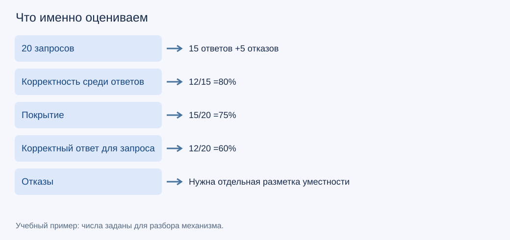

# M11-L01. Что именно оцениваем

**Результат:** Выбрать критерии для конкретной функции тренажёра и объяснить исключённые критерии.

**До урока:** M10-L05, M04-L04. Если термины из этих уроков не удаётся объяснить своими словами, вернись к их разобранным примерам. Ориентир времени — 120 минут чтения и практики; это первоначальная оценка, а не ограничение.

> **Версии и дата проверки:** Python 3.11.9, NumPy 2.4.6, scikit-learn 1.9.1 · проверено 04.11.2026 · источник: [scikit-learn: оценка моделей](https://scikit-learn.org/stable/modules/model_evaluation.html)

## Зачем и как это работает

Оценивание начинается с решения, которое нужно принять. Мы выбираем модель, проверяем изменение prompt, допускаем выпуск или выясняем причину ошибки? Разные решения требуют разных данных. Один красивый диалог полезен для демонстрации, но не даёт надёжного сравнения версий. Один общий балл тоже недостаточен, если он смешивает фактическую корректность, приятный стиль и работу интерфейса.

Для тренажёра разделим объекты оценки. Ответ пользователя проверяется по учебной рубрике. Обратная связь системы проверяется на соответствие этому ответу. Следующий вопрос оценивается по уместности и отсутствию повторов. Поиск оценивается по доставке оснований, голос — по распознаванию, задержке и управлению ходом. Неверно использовать правильность ASR как доказательство правильности технической оценки: это разные звенья.

Для текста полезны отдельные измерения: корректность фактов, подтверждённость источниками, полезность следующего шага, соблюдение формата и уместность отказа. Корректный факт может не подтверждаться переданным контекстом; подтверждённый фрагмент может быть неуместен вопросу. Грамотная формулировка может скрывать неверный вывод. Поэтому рубрика объясняет, какое свойство наблюдается и какие ошибки являются критическими.

Метрика — правило свёртки наблюдений. Доля прошедших схему измеряет валидность формата, но не содержание. Доля корректных технических утверждений требует разметки утверждений. Средний балл полезности зависит от смысла шкалы. Прежде чем усреднять числа 0,1,2, реши, интерпретируются ли шаги шкалы как равные. Для небольшого учебного набора безопасно показывать распределение оценок и примеры, а среднее использовать только как условный агрегат.

Критическая ошибка не должна компенсироваться стилем. Если объяснение утверждает, что транзакция автоматически делает любые операции безопасными при любой изоляции, хорошая структура текста не исправляет фактический дефект. Можно ввести release gate: отсутствие заранее определённых критических регрессий на контрольном наборе. Это требование относится к набору, а не гарантирует нулевую вероятность ошибки в реальном мире.

Разделяй качество и покрытие. Система может отвечать корректно только на лёгкие вопросы и отказываться на остальных. Высокая accuracy среди принятых ответов тогда сопровождается низкой coverage. Для случаев с ответом и без ответа нужны отдельные denominators: сколько вопросов система обработала, сколько отказов были уместны и сколько правильных ответов потеряно. Иначе простая стратегия «всегда отказываться» выглядит безопасной, но бесполезной.

Оценочный набор должен представлять предполагаемое использование: HR и backend отдельно, обычные и трудные ответы, краткие и длинные, отсутствие данных, противоречие и запрос уточнения. Если в наборе только идеально сформулированные ответы, итоговая метрика не описывает живую тренировку. При этом размер набора и способ отбора ограничивают уверенность: двадцать авторских примеров — проверка механики и конкретных случаев, а не исследование всего рынка.

Практический результат урока — таблица «функция → наблюдаемое свойство → способ проверки → действие». Такая таблица делает эксперимент управляемым. При изменении только формата JSON в первую очередь проверяется контракт, но критические содержательные случаи также остаются в регрессии. При изменении RAG отдельно проверяется поиск и генерация, чтобы улучшение одного компонента не скрыло ухудшение другого.



## Разобранный пример

Из 20 запросов система ответила на 15, из них 12 ответов корректны. Accuracy среди отвеченных =12/15=0,8. Coverage=15/20=0,75. Доля запросов с корректным ответом =12/20=0,6. Это три разных свойства.

```python
total, answered, correct = 20,15,12
assert correct/answered == .8
assert answered/total == .75
assert correct/total == .6
```

Чтобы оценить пять отказов, нужно знать, на какие вопросы ответ вообще имелся в базе. Без такой разметки нельзя назвать отказы уместными.

## Практика с поддержкой

Для трёх outputs заполни отдельные колонки: формат, факты, основания, полезный следующий шаг. Пример1 — правильный JSON с ложным фактом; пример2 — корректный факт без ссылки; пример3 — понятный отказ при отсутствии источника. Не своди их сразу в один балл.

## Самостоятельная работа M11-L01-A

На 40 запросах получено 32 ответа, 24 из них корректны. Из 8 отказов 6 уместны. Посчитай coverage, correctness среди ответов, долю корректных ответов от всех запросов и долю уместных отказов. Предложи два критических gate для технического тренажёра и объясни предел их гарантии.

Первая попытка — без готового решения. Сохрани свой код, объяснение и фактический результат в `submissions/M11-L01/`. AI может пояснять термин и помогать найти ошибку; запиши полученную помощь. Прочитанное решение не означает самостоятельно выполненное задание.

## Подсказки по очереди

1. Для каждой доли сначала запиши событие и знаменатель.
2. Уместный отказ — отдельный правильный исход.
3. Gate проверяет фиксированные случаи, не все возможные вопросы.

## Ошибки и самопроверка

Ошибка: объединять правильные ответы и отказы без определения успеха. Ошибка: выдавать валидность JSON за техническую точность. Критерий: четыре доли подписаны и критические случаи имеют проверяемое поведение.

Работа готова, когда есть ответ на все условия задачи, вычисление или наблюдение подтверждает вывод, а ты можешь объяснить каждую величину и изменить один параметр без копирования решения. Критическую ошибку сначала исправь и повтори проверку; оформление не компенсирует неверное рассуждение. Сверь свою попытку с [решением M11-L01-A](../../solutions/modules/M11.md).

## Повтор и отложенная проверка

**Вариант B после разбора:** 10 запросов: 6 ответов, из них 4 правильных; из 4 отказов 3 уместны. Найди coverage, correct/answered, correct/total и успех с учётом уместных отказов.

**Вариант C через 7–10 дней:** Система отказала на все 10 запросов. Чему равны coverage и correctness среди ответов?

Запиши расчёт и объяснение до открытия ключа. [Ответы B/C](../../solutions/modules/M11.md) находятся отдельно. После содержательной помощи самостоятельность проверяется другим вариантом.

## Источники и углубление

- [Scikit-learn: метрики](https://scikit-learn.org/stable/modules/model_evaluation.html)
- [Judging LLM-as-a-Judge with MT-Bench and Chatbot Arena](https://arxiv.org/abs/2306.05685)

Текст, численные примеры, задания и схемы этого урока созданы для данного курса. Источники нужны для проверки терминов и изучения исходного метода; они не заменяют самостоятельную практику.
