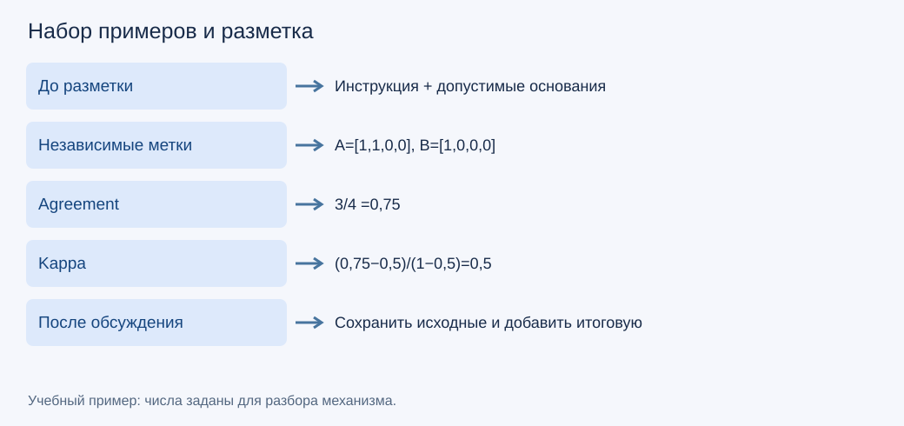

# M11-L02. Набор примеров и разметка

**Результат:** Объяснить, как набор отделён от примеров настройки.

**До урока:** M11-L01. Если термины из этих уроков не удаётся объяснить своими словами, вернись к их разобранным примерам. Ориентир времени — 120 минут чтения и практики; это первоначальная оценка, а не ограничение.

> **Версии и дата проверки:** Python 3.11.9, NumPy 2.4.6, scikit-learn 1.9.1 · проверено 04.11.2026 · источник: [scikit-learn: оценка моделей](https://scikit-learn.org/stable/modules/model_evaluation.html)

## Зачем и как это работает

Оценочный набор — версия данных с явным назначением, а не случайная папка интересных примеров. Каждая запись содержит ID, вход, ожидаемые свойства ответа, рубрику, источники и необходимые метаданные. Эталон необязательно является единственной правильной фразой: для открытого ответа полезнее список допустимых фактов, обязательных оговорок и недопустимых утверждений. Это позволяет принять разные корректные формулировки.

Разметка начинается с инструкции. Оценщик должен понимать, какой объект оценивается, какие источники допустимы и когда следует выбрать «недостаточно информации». Если один человек оценивает техническую полноту, а другой стиль, их разногласие не исправляется усреднением баллов. Сначала нужно согласовать смысл критериев на нескольких примерах, затем провести независимую разметку новых случаев.

Development-набор используется для настройки prompt, поиска и порогов. Test-набор хранится для проверки выбранного решения. Если разработчик многократно просматривает test и меняет систему по его ошибкам, набор становится частью разработки. Сохранение старого названия не восстанавливает независимость. Для обучения можно иметь открытый ключ всех заданий, но профессиональная оценка проекта должна включать новые незнакомые примеры.

Дубликаты и группы требуют внимания. Несколько перефразированных ответов одного сценария могут оказаться почти одинаковыми по сути. Если часть попала в настройку, а часть в test, оценка переноса будет завышена. Сохраняй scenario_id или topic_group и разделяй по группам. В техническом интервью одинаковый вопрос с заменой имени переменной не является полностью новым испытанием знания.

Покрытие проектируется матрицей. По строкам можно разместить темы Python, SQL, API, архитектура; по столбцам — правильный краткий ответ, частично правильный, уверенно неверный, неоднозначный и вне базы. Не обязательно сразу заполнять большую матрицу сотнями примеров. Важнее явно знать пустые клетки и не делать выводов о них. Для HR создаётся отдельная матрица ясности, конкретности и аргументации, без технических фактов как универсального критерия.

Согласие оценщиков измеряется после независимой разметки. Простая доля совпадений понятна, но зависит от распределения классов: если почти всё имеет метку0, два оценщика могут часто совпадать по умолчанию. Cohen's kappa сравнивает наблюдаемое согласие p_o с ожидаемым по маргинальным частотам p_e: κ=(p_o−p_e)/(1−p_e). Kappa тоже не является абсолютной истиной и чувствительна к распространённости классов и размеру выборки.

Разногласия рассматриваются по содержанию. Возможно, инструкция неоднозначна, источник устарел или оба ответа допустимы. После обсуждения создаётся adjudicated label с объяснением; исходные независимые метки сохраняются. Нельзя задним числом объявить согласие100%, заменив обе колонки итоговой меткой. Версия рубрики меняется, если изменилось правило, и затронутые примеры переоцениваются явно.

В лабораторной наборы авторские и синтетические. Они показывают механику оценивания, но не являются данными реальных собеседований и не подтверждают пригодность системы для найма. Самостоятельная работа добавляет новые случаи с объяснением происхождения. Такое разделение защищает выводы от случайного преувеличения: мы знаем, что именно измерено и какие группы ещё не проверены.



## Разобранный пример

Два оценщика дали метки A=[1,1,0,0], B=[1,0,0,0]. Совпадений3/4=0,75. Доли единиц: A0,5, B0,25. Случайное ожидаемое согласие по маргиналам p_e=0,5·0,25+0,5·0,75=0,5. Kappa=(0,75−0,5)/(1−0,5)=0,5.

```python
from sklearn.metrics import cohen_kappa_score
assert cohen_kappa_score([1,1,0,0],[1,0,0,0]) == .5
```

Четыре случая слишком малы для сильного вывода. Разобрать единственное разногласие полезнее, чем объявить рубрику универсально надёжной.

## Практика с поддержкой

Создай JSONL из шести случаев с case_id, scenario_id, track, answer, rubric_version и expected_properties. Два случая должны быть перефразированиями одного сценария. Проверь, что split не разделяет эту пару между development и test.

## Самостоятельная работа M11-L02-A

Оценщики A=[1,1,1,0,0,0], B=[1,1,0,0,0,1]. Посчитай agreement и kappa. Предложи поля записи разногласия и правило, которое не позволяет потерять исходные оценки после обсуждения.

Первая попытка — без готового решения. Сохрани свой код, объяснение и фактический результат в `submissions/M11-L02/`. AI может пояснять термин и помогать найти ошибку; запиши полученную помощь. Прочитанное решение не означает самостоятельно выполненное задание.

## Подсказки по очереди

1. Обе колонки содержат по три единицы.
2. Ожидаемое согласие рассчитывается из маргинальных частот.
3. Итоговая метка — новое поле, а не перезапись двух исходных.

## Ошибки и самопроверка

Ошибка: оценить согласие после совместного обсуждения как независимое. Ошибка: считать перефразирования независимыми объектами. Критерий: расчёт верен, provenance и rubric_version сохранены.

Работа готова, когда есть ответ на все условия задачи, вычисление или наблюдение подтверждает вывод, а ты можешь объяснить каждую величину и изменить один параметр без копирования решения. Критическую ошибку сначала исправь и повтори проверку; оформление не компенсирует неверное рассуждение. Сверь свою попытку с [решением M11-L02-A](../../solutions/modules/M11.md).

## Повтор и отложенная проверка

**Вариант B после разбора:** Две разметки: A=[1,1,0,0], B=[1,0,0,0]. Найди agreement и kappa.

**Вариант C через 7–10 дней:** Оба оценщика поставили всем четырём случаям 1. Можно ли получить обычную kappa?

Запиши расчёт и объяснение до открытия ключа. [Ответы B/C](../../solutions/modules/M11.md) находятся отдельно. После содержательной помощи самостоятельность проверяется другим вариантом.

## Источники и углубление

- [Scikit-learn: метрики](https://scikit-learn.org/stable/modules/model_evaluation.html)
- [Judging LLM-as-a-Judge with MT-Bench and Chatbot Arena](https://arxiv.org/abs/2306.05685)

Текст, численные примеры, задания и схемы этого урока созданы для данного курса. Источники нужны для проверки терминов и изучения исходного метода; они не заменяют самостоятельную практику.
