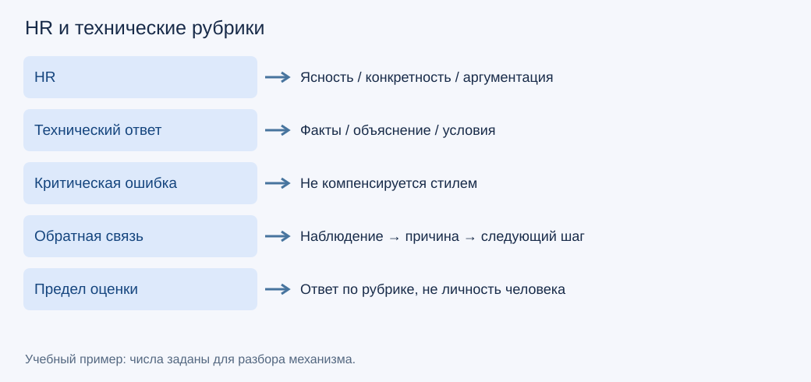

# M11-L03. HR и технические рубрики

**Результат:** Оценить два разных хороших ответа без требования одной дословной формулировки.

**До урока:** M11-L02. Если термины из этих уроков не удаётся объяснить своими словами, вернись к их разобранным примерам. Ориентир времени — 140 минут чтения и практики; это первоначальная оценка, а не ограничение.

> **Версии и дата проверки:** Python 3.11.9, NumPy 2.4.6, scikit-learn 1.9.1 · проверено 04.11.2026 · источник: [scikit-learn: оценка моделей](https://scikit-learn.org/stable/modules/model_evaluation.html)

## Объяснение

Рубрика переводит общее впечатление в наблюдаемые критерии. Она нужна, чтобы два разных хороших ответа могли получить справедливую оценку без совпадения с одной заученной формулировкой. В нашем проекте HR и техническое интервью имеют разные цели. HR-тренировка проверяет ясность рассказа, конкретность действий и связь решения с результатом. Техническая проверка рассматривает факты, условия применимости и объяснение механизма.

Для HR зададим три независимых измерения по шкале0–2. Ясность:0 — трудно понять основную мысль,1 — мысль понятна с пробелами,2 — последовательное объяснение. Конкретность:0 — общие заявления,1 — указан случай без достаточных деталей,2 — описаны собственные действия и контекст. Аргументация:0 — вывод без оснований,1 — частичная связь действий и результата,2 — объяснены причины выбора и наблюдаемый результат. Шкала оценивает текст ответа, а не личность.

Отсутствие численного результата не делает HR-ответ автоматически плохим. В некоторых задачах результат качественный: сняли блокировку команды, выявили неверное требование, согласовали интерфейс. Важно, чтобы утверждение было конкретным и соразмерным имеющимся данным. Также нельзя выводить честность, интеллект, характер или пригодность к работе по голосу, акценту либо краткости ответа. Тренажёр должен давать обратную связь по явной учебной задаче.

Для технического ответа полезны корректность, объяснение и границы. Корректность0 означает существенную фактическую ошибку,1 — частично верный ответ с пропуском,2 — основные факты верны. Объяснение оценивает причинную связь или пример. Границы оценивают необходимые условия и ограничения. Краткий правильный ответ может получить высокую корректность и низкую полноту, если вопрос явно просил подробный механизм. Это следует из формулировки вопроса, а не из предпочтения длинных текстов.

Критические заблуждения фиксируются отдельно. Если вопрос об атомарности, утверждение «часть транзакции всегда сохраняется после rollback» является существенным дефектом. Хороший стиль не компенсирует его. Однако список критических ошибок должен быть конкретным и связанным с вопросом; нельзя пометить любой пропуск термина как критический. Рубрика различает отсутствие доказательства знания и доказанную неверную мысль.

Обратная связь строится как наблюдение → объяснение → следующий шаг. Например: «Ты назвал транзакцию группой операций, но не объяснил поведение при ошибке. Добавь пример, где один шаг не удался, и опиши commit/rollback». Здесь нет выдуманного вывода о компетентности человека. Если ответ неоднозначен, сначала задаётся уточнение, а не категоричная отрицательная оценка.

Эталонные ответы должны представлять разнообразие форм. Один человек объяснит атомарность через банковский перевод, другой — через набор изменений заказа. Оба могут быть корректны. Рубрика ищет смысловые свойства, а не наличие конкретных слов. Простая проверка ключевых слов полезна как диагностический baseline, но фраза «rollback не отменяет изменения» содержит нужный термин и противоположный смысл.

При самопроверке сначала оцени каждый критерий независимо и приведи цитату короткого наблюдаемого фрагмента собственного примера. Затем проверь критические ошибки и только после этого формулируй общий вывод. Если критерий невозможно применить без догадки, запиши недостаток информации. Такая дисциплина подготавливает честное сравнение ручной оценки и LLM-оценщика.

## Разобранный пример

HR-ответ: «В API часто повторялись запросы. Я добавил idempotency key и тест повторной доставки. После релиза число дублей в нашем журнале за неделю снизилось с12 до1; другие причины тоже могли повлиять». Ясность2, конкретность2, аргументация2: контекст, действие и измеренный результат связаны, причинная уверенность ограничена.

Технический ответ: «Транзакция объединяет операции; либо фиксируются все её изменения, либо при откате они не сохраняются». Для вопроса об атомарности корректность2. Для вопроса о всех свойствахACID полнота ограничена, потому что остальные свойства не раскрыты. Оценка зависит от задания, а не только от текста.

## Практика с поддержкой

Напиши два HR-ответа о реальном или явно вымышленном проекте: общий и конкретный. Оцени по трём критериям без вывода о личности. Затем составь два разных корректных объяснения атомарности и проверь, что рубрика принимает оба.

## Самостоятельная задача A — M11-L03-A

Оцени HR-ответ «Я хороший командный игрок, всегда делаю качественно» по трём шкалам. Оцени техническую фразу «Индекс всегда ускоряет любые запросы и не влияет на запись». Напиши обратную связь в формате наблюдение → причина → новая задача, не приписывая человеку общую неспособность.

Первая попытка — без готового решения. Сохрани свой код, объяснение и фактический результат в `submissions/M11-L03/`. AI может пояснять термин и помогать найти ошибку; запиши полученную помощь. Прочитанное решение не означает самостоятельно выполненное задание.

## Подсказки по очереди

1. Понятная фраза может быть неконкретной.
2. Универсальные «всегда» и «любые» требуют проверки.
3. Следующая задача должна проверять исправление, а не только повторять замечание.

## Критерии и типичные ошибки

Ошибка: смешивать уверенность речи с фактической корректностью. Ошибка: требовать дословный эталон. Критерий: оценены свойства ответа, приведены основания, новая задача проверяет конкретный пробел.

Работа готова, когда есть ответ на все условия задачи, вычисление или наблюдение подтверждает вывод, а ты можешь объяснить каждую величину и изменить один параметр без копирования решения. Критическую ошибку сначала исправь и повтори проверку; оформление не компенсирует неверное рассуждение. Сверь свою попытку с [решением M11-L03-A](../../solutions/modules/M11.md).

## Новая и отложенная проверка

**Вариант B после разбора:** Ответ HR: «Я предложил план, но результат ещё не измерял». Отзыв: «Ты доказал улучшение производительности». Разметь наблюдение и ошибку.

**Вариант C через 7–10 дней:** Технический ответ краткий, но правильно говорит, что индекс не ускоряет каждый запрос. Допустимо ли снизить фактологическую правильность только из-за краткости?

Запиши расчёт и объяснение до открытия ключа. [Ответы B/C](../../solutions/modules/M11.md) находятся отдельно. После содержательной помощи самостоятельность проверяется другим вариантом.

## Источники и углубление

- [Scikit-learn: метрики](https://scikit-learn.org/stable/modules/model_evaluation.html)
- [Judging LLM-as-a-Judge with MT-Bench and Chatbot Arena](https://arxiv.org/abs/2306.05685)

Текст, численные примеры, задания и схемы этого урока созданы для данного курса. Источники нужны для проверки терминов и изучения исходного метода; они не заменяют самостоятельную практику.
