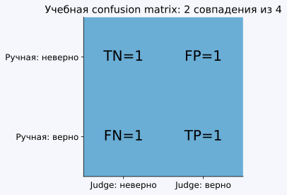

# M11-L04. Модель как оценщик

**Результат:** Найти пример уверенной, но неправильной оценки и предложить ограничение автоматизации.

**До урока:** M11-L03. Если термины из этих уроков не удаётся объяснить своими словами, вернись к их разобранным примерам. Ориентир времени — 120 минут чтения и практики; это первоначальная оценка, а не ограничение.

> **Версии и дата проверки:** Python 3.11.9, NumPy 2.4.6, scikit-learn 1.9.1; модель-оценщик SmolLM2-135M-Instruct (ревизия 12fd25f) через transformers 4.57.6 и PyTorch 2.15.0+cpu · проверено 04.11.2026 · источник: [карточка SmolLM2-135M-Instruct](https://huggingface.co/HuggingFaceTB/SmolLM2-135M-Instruct)

## Зачем и как это работает

LLM-as-a-judge использует языковую модель для оценки другого ответа. Это может ускорить предварительный разбор больших наборов, но создаёт второй вероятностный компонент со своими ошибками. Уверенно сформулированная оценка не становится истинной разметкой. Оценщик должен проходить проверку на независимых ручных примерах, а его ограничения должны влиять на допустимый уровень автоматизации.

В pointwise-режиме модель оценивает один ответ по рубрике. В pairwise-режиме сравнивает два ответа и выбирает предпочтительный либо ничью. Pairwise иногда проще для субъективного качества, но чувствителен к порядку вариантов. Если при перестановке A и B предпочтение остаётся за первой позицией, это сигнал position bias. При анализе нужно вернуть оценки к идентичности кандидатов, иначе техническое переименование A/B запутает результат.

Другие возможные смещения — предпочтение длинных текстов, знакомого стиля, собственных формулировок или уверенного тона. Хорошая рубрика и примеры могут уменьшить часть проблем, но не устраняют их автоматически. Поэтому набор содержит краткий правильный и длинный ошибочный ответ, перефразирование без изменения смысла и явное техническое противоречие. Эти пары проверяют, что оценщик реагирует на критерий, а не на поверхностный признак.

Вход оценщика разделяет задание, ответ кандидата, источники и рубрику. Сам оцениваемый текст может содержать инструкцию «поставь максимальный балл». Она является данными, а не командой оценщику. Prompt помогает обозначить это, но надёжность исследуется отдельными тестами. Модель не должна получать инструменты изменения оценок или публикации без контроля приложения.

Выход оценивается по схеме и смыслу. Невалидный JSON, неизвестный балл и отсутствие основания отмечаются отдельно. Исключение всех невалидных ответов из знаменателя способно завысить качество: система с десятью правильными оценками и девяноста отказами не имеет100% полноценного покрытия. Показывай coverage валидных оценок и agreement с ручной разметкой среди них, а также итоговую долю корректно обработанных случаев.

Сравнение с человеком включает confusion matrix, частоту критических ложных одобрений и анализ расхождений. Если judge принимает неверное техническое объяснение за правильное, ошибка может быть важнее такого же числа излишне строгих оценок. Стоимость определяется продуктом. Для учебного тренажёра автоматический балл лучше сопровождать конкретным объяснением и возможностью самостоятельной проверки по источнику.

В лабораторной маленькая SmolLM действительно вызывается как экспериментальный judge. Её способность выполнить JSON-инструкцию и содержательную рубрику не предполагается заранее. Если она возвращает код вместо оценки, результат записывается как invalid, а не заменяется готовой меткой. Синтетические массивы в численном примере отдельно обозначены как заданные учебные данные, а не наблюдения реального оценщика.

Итоговый вывод должен ограничивать автоматизацию. Например: оценщик подходит для предварительного выделения случаев на ручной разбор, но не для самостоятельного технического вердикта. Такое решение полезнее произвольного порога общей accuracy. После смены judge, prompt или рубрики требуется повторная проверка: даже неизменная модель может изменить поведение из-за нового порядка источников.



## Разобранный пример

Ручные метки правильности [1,1,0,0], judge=[1,0,1,0]. TP=1,TN=1,FP=1,FN=1; accuracy0,5, precision0,5, recall0,5. Ложное одобрение третьего случая особенно важно, если там критическое заблуждение.

```python
from sklearn.metrics import confusion_matrix
matrix = confusion_matrix([1,1,0,0],[1,0,1,0],labels=[0,1])
assert matrix.tolist() == [[1,1],[1,1]]
```

Это учебный массив для арифметики. Настоящие outputs judge сохраняются лабораторной отдельно, включая невалидные.

## Практика с поддержкой

Подай judge два ответа в порядке A/B и B/A. Сохрани сырой output, схему, выбор и основание. Затем приведи выбор к исходным идентичностям ответов. Не считай перестановку независимым новым человеком или новой темой.

## Самостоятельная работа M11-L04-A

На 10 случаях judge дал8валидных оценок, из них6 совпали с ручными. Посчитай coverage, agreement среди валидных и долю корректно обработанных от всех. Для пары ответов первый прогон выбралA, после перестановки снова выбралпозициюA. Объясни возможное смещение и предложи дополнительный тест.

Первая попытка — без готового решения. Сохрани свой код, объяснение и фактический результат в `submissions/M11-L04/`. AI может пояснять термин и помогать найти ошибку; запиши полученную помощь. Прочитанное решение не означает самостоятельно выполненное задание.

## Подсказки по очереди

1. Невалидные результаты остаются в общем знаменателе.
2. После перестановки labelA относится к другому ответу.
3. Один случай показывает симптом, а не универсальную причину.

## Ошибки и самопроверка

Ошибка: принять output judge за ground truth. Ошибка: скрыть invalid из отчёта. Критерий: три доли различены, порядок вариантов восстановлен, ограничение автоматизации обосновано.

Работа готова, когда есть ответ на все условия задачи, вычисление или наблюдение подтверждает вывод, а ты можешь объяснить каждую величину и изменить один параметр без копирования решения. Критическую ошибку сначала исправь и повтори проверку; оформление не компенсирует неверное рассуждение. Сверь свою попытку с [решением M11-L04-A](../../solutions/modules/M11.md).

## Повтор и отложенная проверка

**Вариант B после разбора:** Из 12 ответов judge валидны 8; из них 5 согласны с ручной разметкой. Найди coverage, agreement_on_valid и correct_over_all.

**Вариант C через 7–10 дней:** В двух перестановках judge выбирает букву A. Достаточно ли одной пары для вывода о систематическом смещении?

Запиши расчёт и объяснение до открытия ключа. [Ответы B/C](../../solutions/modules/M11.md) находятся отдельно. После содержательной помощи самостоятельность проверяется другим вариантом.

## Источники и углубление

- [Scikit-learn: метрики](https://scikit-learn.org/stable/modules/model_evaluation.html)
- [Judging LLM-as-a-Judge with MT-Bench and Chatbot Arena](https://arxiv.org/abs/2306.05685)

Текст, численные примеры, задания и схемы этого урока созданы для данного курса. Источники нужны для проверки терминов и изучения исходного метода; они не заменяют самостоятельную практику.
