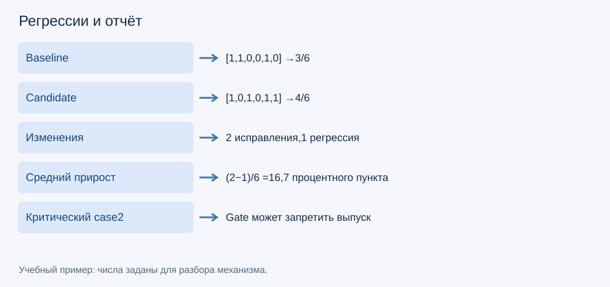

# M11-L05. Регрессии и отчёт

**Результат:** Сформулировать решение о выпуске с явными ограничениями данных.

**До урока:** M11-L04. Если термины из этих уроков не удаётся объяснить своими словами, вернись к их разобранным примерам. Ориентир времени — 120 минут чтения и практики; это первоначальная оценка, а не ограничение.

## Зачем и как это работает

Регрессионная оценка отвечает, что изменилось между двумя версиями на одном и том же наборе. Сначала фиксируются данные, рубрика, конфигурации и правило принятия решения. Затем обе версии проходят одинаковые случаи. Если наборы разные, изменение среднего может объясняться сложностью вопросов, а не качеством системы. Парное сравнение сохраняет связь между результатами одного случая.

Для каждого case_id отмечаем: обе версии правильны, обе ошиблись, кандидат исправил ошибку baseline или испортил прежний правильный ответ. Чистый прирост определяется разностью исправлений и регрессий. Два кандидата с одинаковым средним могут иметь совершенно разные критические ошибки. Поэтому отчёт включает список ухудшений и их последствия, а не только итоговый процент.

Пусть на20случаях кандидат исправил5ошибок и создал2новые. Прирост accuracy=(5−2)/20=0,15. Но если одна из двух регрессий нарушает критическое правило, выпуск может быть отклонён несмотря на положительное среднее. Правило gate задаётся до просмотра результатов; иначе удобно объявить любое неудобное ухудшение «некритическим» задним числом.

Неопределённость особенно важна на малых наборах. Парный bootstrap многократно выбирает с возвращением case_id и пересчитывает среднюю разницу, сохраняя пару результатов вместе. Полученное распределение помогает оценить разброс для данной выборки. Оно не исправляет нерепрезентативность данных, зависимость случаев или ошибки разметки. Если десять перефразирований одного сценария зависимы, единицей пересэмплирования должна быть группа, а не каждая строка как независимая.

Интервал нельзя интерпретировать как вероятность, что конкретная версия истинно лучше, без выбранной статистической модели. В практическом отчёте достаточно ясно указать метод, единицу выборки, число повторов, seed и границы. Если интервал включает ноль, данных может быть недостаточно для уверенного вывода о среднем преимуществе. Это не доказывает равенство систем; можно собрать больше независимых примеров или принять решение по стоимости и критическим ограничениям.

Проверка после многократной настройки требует новой независимой части. Если пятьдесят вариантов prompt сравнивались на одних примерах, лучший результат частично выбран по шуму. Открыто обозначай development-роль набора и используй новые случаи для финальной защиты. В самообучении доступные решения полезны для освоения, но они не заменяют неизвестный экзаменационный вариант.

Отчёт о выпуске содержит цель изменения, версии компонентов, состав набора, результаты по разрезам, ошибки, неопределённость, ресурсы и решение. Полезны строки «что данные показывают» и «чего они не показывают». Например, английский учебный набор не подтверждает русскоязычное голосовое качество. Успешные CPU-тесты не доказывают задержку при десяти одновременных пользователях.

Решение может быть положительным с ограничением области: выпуск только текстовой технической тренировки для одного пользователя. Может быть отрицательным из-за критической регрессии. Может требовать дополнительной разметки. Все три варианта являются корректным инженерным результатом, если следуют заранее заданным критериям и наблюдаемым данным. Завершение отчёта не присваивает ученику карьерный грейд: оно показывает конкретный освоенный способ проверки системы.



## Разобранный пример

Baseline=[1,1,0,0,1,0], candidate=[1,0,1,0,1,1]. Кандидат исправил случаи3и6, испортил2. Accuracy baseline=3/6=0,5, candidate=4/6≈0,667; разница1/6≈0,167.

```python
import numpy as np
a=np.array([1,1,0,0,1,0]); b=np.array([1,0,1,0,1,1])
delta=b-a
assert (delta==1).sum()==2 and (delta==-1).sum()==1
assert np.isclose(delta.mean(),1/6)
```

Если case2 критический, кандидат не проходит заранее заданный gate. Среднее улучшение не отменяет это правило.

## Практика с поддержкой

Запусти M11/demo.py. Прочитай список улучшений и ухудшений до агрегата. Посмотри парный bootstrap и число случаев. Затем объясни, почему синтетические метки лабораторной не являются реальным пользовательским пилотом.

## Самостоятельная работа M11-L05-A

Baseline=[1,0,1,0,1,1,0,0], candidate=[1,1,0,1,1,1,0,1]. Посчитай обе accuracy, число исправлений, регрессий и прирост. Case3 — критический. Прими решение по правилу «никаких новых критических ошибок». Опиши корректный bootstrap и одну угрозу валидности, которую он не устранит.

Первая попытка — без готового решения. Сохрани свой код, объяснение и фактический результат в `submissions/M11-L05/`. AI может пояснять термин и помогать найти ошибку; запиши полученную помощь. Прочитанное решение не означает самостоятельно выполненное задание.

## Подсказки по очереди

1. Сравнивай одинаковые индексы.
2. Критический gate применяется независимо от суммы.
3. В bootstrap один индекс выбирает одновременно обе версии.

## Ошибки и самопроверка

Ошибка: независимо перемешивать результаты A иB при парном сравнении. Ошибка: скрывать критическую регрессию за средним. Критерий: решение соответствует заранее заданному правилу и ограничения данных указаны.

Работа готова, когда есть ответ на все условия задачи, вычисление или наблюдение подтверждает вывод, а ты можешь объяснить каждую величину и изменить один параметр без копирования решения. Критическую ошибку сначала исправь и повтори проверку; оформление не компенсирует неверное рассуждение. Сверь свою попытку с [решением M11-L05-A](../../solutions/modules/M11.md).

## Повтор и перенос

Повтор: сделай ухудшение некритическим, но увеличь задержку вдвое; прими решение с явным требованием ресурса. Через неделю оцени новый кандидат на незнакомых примерах, сохранив историю рубрики.

После проверки сохрани статус «самостоятельно» либо «с поддержкой», конкретную ошибку и дату следующей попытки. Через 7–10 дней повтори изменённый пример без открытого решения; только эта проверка позволяет отметить «подтверждено позже». Если результата пока нет, оставь «не проверено».

## Источники и углубление

- [Scikit-learn: метрики](https://scikit-learn.org/stable/modules/model_evaluation.html)
- [Judging LLM-as-a-Judge with MT-Bench and Chatbot Arena](https://arxiv.org/abs/2306.05685)

Текст, численные примеры, задания и схемы этого урока созданы для данного курса. Источники нужны для проверки терминов и изучения исходного метода; они не заменяют самостоятельную практику.
