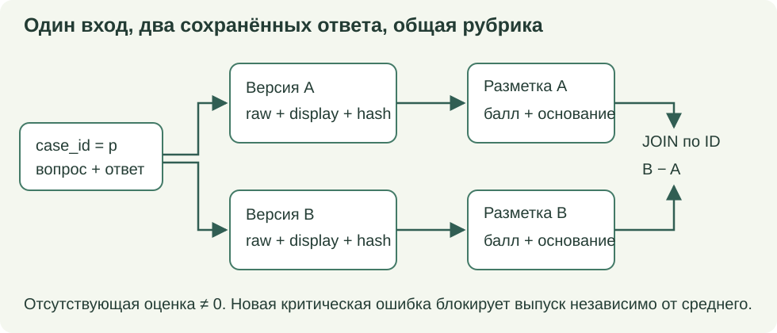

# M11-L06. От реальных ответов двух версий к решению о выпуске

**Результат:** провести один полный парный эксперимент: сохранить реальные ответы, независимо от генерации разметить их, вычислить сравнение и объяснить решение. **До урока:** M11-L02, M11-L03, M11-L05, M09-L05. Ориентир: 60 минут объяснения и арифметики, 60–120 минут сбора и разметки; фактическое время генерации зависит от ноутбука.

> **Версии и дата проверки:** Python 3.11.9, NumPy 2.4.6, scikit-learn 1.9.1; ответы тренажёра — Qwen2.5-0.5B-Instruct (ревизия 7ae5576) через transformers 4.57.6 и PyTorch 2.15.0+cpu · проверено 04.11.2026 · источник: [карточка Qwen2.5-0.5B-Instruct](https://huggingface.co/Qwen/Qwen2.5-0.5B-Instruct)

## Почему отдельные метрики ещё не являются оцениванием системы

В предыдущих уроках массивы правильности позволяли проверить формулы. Но число 0.75 в массиве не рассказывает, какой ответ дал интервьюер, какая версия его сформировала и кто решил, что ответ полезен. Оценивание связывает эти сведения. Основной объект здесь — не «средняя оценка», а проверяемая запись одного опыта.

У случая есть устойчивый `case_id`, сценарий, режим HR/backend, вопрос и ответ кандидата. Обе версии получают одинаковый вход. В выходе сохраняются исходный текст модели, показанный пользователю текст, статус проверки, использование fallback и время. Эти тексты могут различаться: приложение вправе отклонить непроверяемую генерацию и показать явно обозначенный запасной вопрос. Нельзя приписывать успешное поведение запасного правила самой LLM.

У оценки есть другая роль. Оценщик читает показанный ответ, исходный ответ кандидата и рубрику. Он фиксирует основание, объясняет решение и указывает себя. Генератор не получает ожидаемые оценки. Если программа сама заполнила «ручную разметку» желаемыми метками, цикл перестал проверять качество модели. Автоматическая проверка точного вхождения цитаты полезна, но не доказывает, что цитата относится к выбранному критерию или подтверждает вывод.

## Две версии и две оси качества

`baseline` — свободный краткий отзыв старой конфигурации. Первая попытка исправления, `candidate_json`, просила модель скопировать цитату в JSON; в реальном опыте все восемь ответов были отклонены из-за схемы, кодов или оформления. Она сохранена как неудачный вариант, а не скрыта.

Актуальная `candidate` разбивает исходный ответ на несколько фрагментов. LLM действительно выбирает `evidence_id`, критерий и следующий вопрос; ограничение допустимых токенов позволяет завершить только один из разрешённых JSON-вариантов. Затем приложение подставляет точную цитату по выбранному ID и показывает фиксированный вопрос. Это **ограниченный выбор моделью плюс программное оформление**, а не свободный отзыв и не автоматическая проверка истинности. Неподходящий критерий остаётся возможной ошибкой, которую выявляет разметка. Для слишком короткого ответа или сбоя предусмотрен явный отказ от оценки.

Такой опыт сравнивает две политики системы целиком. Он не доказывает отдельный причинный эффект одного изменения prompt, поскольку меняются также формат и способ отображения. Для изоляции одного фактора потребовались бы дополнительные конфигурации.

Для отзыва используем две отдельные шкалы. **Grounded:** 0 — есть существенное придуманное или противоречащее ответу утверждение; 1 — прямого вымысла нет, но основание неясно; 2 — показанный текст не приписывает неподтверждённых фактов и явно различает наблюдение и вопрос. **Useful:** 0 — вводит в заблуждение либо не даёт применимого следующего действия; 1 — вопрос относится к задаче, но общий; 2 — конкретное полезное действие учитывает содержание ответа. Эти баллы относятся к обратной связи тренажёра, а не к личности или уровню кандидата.

Критическая ошибка отмечается отдельно: выдуманный опыт, подтверждение существенного технического заблуждения или вывод о личности. Средний балл не компенсирует её. Две шкалы порядковые; среднее здесь — заранее выбранная описательная сводка курса, а не физически измеренная величина «пользы». В отчёте сохраняем сами случаи и распределение исходов.



## Разобранный пример без модели

Пусть оценки полезности A: `p=2,q=0,r=1`, B: `r=0,p=2,q=2`. Порядок строк поменялся. После соединения по ID изменения равны p:0, q:+2, r:−1; среднее +1/3. Но если в p появился выдуманный факт, выпуск блокируется, несмотря на рост среднего и неизменный числовой балл p. Именно поэтому идентификатор и критическая метка являются отдельными полями.

```python
a = {'p': 2, 'q': 0, 'r': 1}
b = {'r': 0, 'p': 2, 'q': 2}
assert set(a) == set(b)
delta = {key: b[key] - a[key] for key in a}
assert delta == {'p': 0, 'q': 2, 'r': -1}
assert abs(sum(delta.values()) / len(delta) - 1/3) < 1e-12
critical_new = ['p']
release = not critical_new
assert release is False
```

Если в B нет q, не удаляем q из A и не считаем отсутствующий балл нулём. Это неполный эксперимент. Отдельно фиксируем отказ генерации, пропуск оценки или потерю файла и доводим протокол до согласованного состояния. Для отказа приложения можно оценить реально показанное сообщение, но нельзя выдумать текст, которого пользователь не видел.

## Полный локальный опыт

Из корня курса выполни команды ниже. Новый запуск получает **новую папку**: сборщик намеренно запрещает молча перезаписывать уже полученные outputs.

```powershell
.\.venv\Scripts\python.exe labs\M11\evaluate.py collect --out artifacts\M11-my-first-run
```

Сохранятся `run.json`, `outputs.jsonl` и пустой бланк `annotations-template.jsonl`. В `run.json` есть снимок случаев, hash кода и ревизия модели. Чередуется порядок запуска A/B: иначе первая версия всегда получила бы холодную загрузку. Один замер на случай всё равно не является надёжным performance benchmark.

Скопируй бланк в `annotations.jsonl`. Прочитай каждый показанный текст и заполни grounded/useful, критическую ошибку, точную цитату `evidence`, объяснение `reason` и `rater`, например `learner-self-review`. Не меняй hash ответа. Если использован AI-разбор, обозначь это в rater и журнале; независимым человеческим оцениванием это не становится.

```powershell
.\.venv\Scripts\python.exe labs\M11\evaluate.py score --run artifacts\M11-my-first-run --annotations artifacts\M11-my-first-run\annotations.jsonl
```

Сравнение выдаёт HR и backend отдельно, также разделяет development/check. Порог допуска выбран до запуска: нет критических ошибок, средний grounded не ниже 1.5, доля хотя бы частично полезных отзывов не ниже 0.75 и не более половины fallback. Это учебная политика; её можно изменить для иной цели **до нового опыта**, сохранив прежний результат.

Bootstrap пересэмплирует сценарии. Если один сценарий имеет несколько перефразировок, сначала считается его среднее изменение; каждый сценарий получает одинаковый вес. Два сценария в подгруппе дают крайне слабое основание для обобщения: вычисляемый интервал помогает увидеть механизм, но не доказывает пользу продукта для всех кандидатов. Увеличивать число перефразировок одного сценария вместо независимых сценариев недостаточно.

## Практика с поддержкой

Сначала реализуй `compare_pairs` в [стартере](../../exercises/M11/starter.py) и выполни [проверку](../../exercises/M11/README.md). Затем найди в настоящем опыте один случай, где raw и display отличаются. Объясни, что сделала модель, что проверил код и какая часть вывода остаётся человеческим суждением.

Подсказки: сначала построй словари по ID; затем проверь равенство множеств; только после этого вычисляй разности. Проверку critical делай независимо от знака численного изменения.

## Самостоятельная работа M11-L06-A

На четырёх новых случаях — по два HR/backend — сравни две зафиксированные конфигурации. В одном случае ответ кандидата должен явно содержать отсутствие измеренного результата. Сохрани реальные outputs, собственную разметку и отчёт. Объясни один спорный балл и какое уточнение рубрики разрешило бы спор. Код, сохраняющий responses, не должен читать expected labels.

**Критерии до попытки:** одинаковые case_id и входы для A/B; нет пропущенных либо повторённых оценок; все оценки связаны с неизменным output; критическая ошибка не скрыта средним; границы малого набора и источник разметки указаны. Для самостоятельного зачёта объясни соединение по ID без открытого кода и выполни новый численный вариант без подсказки.

**Повтор B:** A=[u:1,v:2], B=[v:0,u:2], новая критическая ошибка в u. **Отложенная C:** одна версия вернула явный отказ, а оценка второй потеряна; покажи, какие данные можно оценить, а какие нужно восстановить. [Ключи и полный опыт](../../solutions/modules/M11.md) открывай после сохранения попытки.

## Источники

Процедура bootstrap: [официальная документация SciPy](https://docs.scipy.org/doc/scipy/reference/generated/scipy.stats.bootstrap.html). Здесь используется прозрачный percentile-вариант для обучения; малый или зависимый набор требует осторожности. Реализация, шкалы, пороги и примеры этого урока авторские и доступны локально.


Полный измеренный цикл с неудачной первой попыткой и новым контрольным набором: [разбор обратной связи](../feedback-case-study.md). Формат и точная цитата не гарантируют полезность; контрольные пороги эталона не пройдены.
