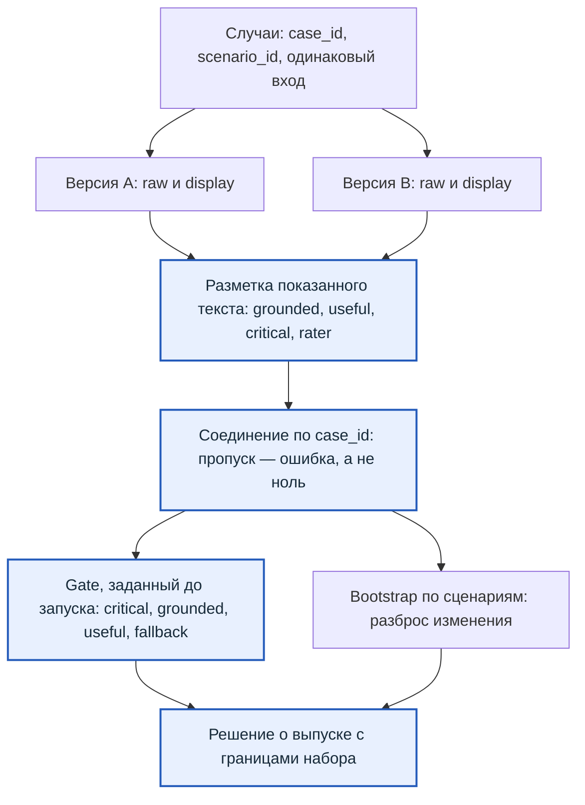

# M11-L06. От реальных ответов двух версий к решению о выпуске

**Результат:** провести один полный парный эксперимент: сохранить реальные ответы, независимо от генерации разметить их, вычислить сравнение и объяснить решение. **До урока:** M11-L02, M11-L03, M11-L05, M09-L05. Ориентир: 60 минут объяснения и арифметики, 60–120 минут сбора и разметки; фактическое время генерации зависит от ноутбука.

> **Версии и дата проверки:** Python 3.11.9, NumPy 2.4.6, scikit-learn 1.9.1; ответы тренажёра — Qwen2.5-0.5B-Instruct (ревизия 7ae5576) через transformers 4.57.6 и PyTorch 2.15.0+cpu · проверено 04.11.2026 · источник: [карточка Qwen2.5-0.5B-Instruct](https://huggingface.co/Qwen/Qwen2.5-0.5B-Instruct)

## Объяснение

### Почему отдельные метрики ещё не являются оцениванием системы

В предыдущих уроках массивы правильности позволяли проверить формулы. Но число 0.75 в массиве не рассказывает, какой ответ дал интервьюер, какая версия его сформировала и кто решил, что ответ полезен. Оценивание связывает эти сведения. Основной объект здесь — не «средняя оценка», а проверяемая запись одного опыта.

У случая есть устойчивый `case_id`, сценарий, режим HR/backend, вопрос и ответ кандидата. Обе версии получают одинаковый вход. В выходе сохраняются исходный текст модели, показанный пользователю текст, статус проверки, использование fallback и время. Эти тексты могут различаться: приложение вправе отклонить непроверяемую генерацию и показать явно обозначенный запасной вопрос. Нельзя приписывать успешное поведение запасного правила самой LLM.

У оценки есть другая роль. Оценщик читает показанный ответ, исходный ответ кандидата и рубрику. Он фиксирует основание, объясняет решение и указывает себя. Генератор не получает ожидаемые оценки. Если программа сама заполнила «ручную разметку» желаемыми метками, цикл перестал проверять качество модели. Автоматическая проверка точного вхождения цитаты полезна, но не доказывает, что цитата относится к выбранному критерию или подтверждает вывод.

### Две версии и две оси качества

`baseline` — свободный краткий отзыв старой конфигурации. Первая попытка исправления, `candidate_json`, просила модель скопировать цитату в JSON; в реальном опыте все восемь ответов были отклонены из-за схемы, кодов или оформления. Она сохранена как неудачный вариант, а не скрыта.

Актуальная `candidate` разбивает исходный ответ на несколько фрагментов. LLM действительно выбирает `evidence_id`, критерий и следующий вопрос; ограничение допустимых токенов позволяет завершить только один из разрешённых JSON-вариантов. Затем приложение подставляет точную цитату по выбранному ID и показывает фиксированный вопрос. Это **ограниченный выбор моделью плюс программное оформление**, а не свободный отзыв и не автоматическая проверка истинности. Неподходящий критерий остаётся возможной ошибкой, которую выявляет разметка. Для слишком короткого ответа или сбоя предусмотрен явный отказ от оценки.

Такой опыт сравнивает две политики системы целиком. Он не доказывает отдельный причинный эффект одного изменения prompt, поскольку меняются также формат и способ отображения. Для изоляции одного фактора потребовались бы дополнительные конфигурации.

Для отзыва используем две отдельные шкалы. **Grounded:** 0 — есть существенное придуманное или противоречащее ответу утверждение; 1 — прямого вымысла нет, но основание неясно; 2 — показанный текст не приписывает неподтверждённых фактов и явно различает наблюдение и вопрос. **Useful:** 0 — вводит в заблуждение либо не даёт применимого следующего действия; 1 — вопрос относится к задаче, но общий; 2 — конкретное полезное действие учитывает содержание ответа. Эти баллы относятся к обратной связи тренажёра, а не к личности или уровню кандидата.

Критическая ошибка отмечается отдельно: выдуманный опыт, подтверждение существенного технического заблуждения или вывод о личности. Средний балл не компенсирует её. Две шкалы порядковые; среднее здесь — заранее выбранная описательная сводка курса, а не физически измеренная величина «пользы». В отчёте сохраняем сами случаи и распределение исходов.


## Аналогия: эксперимент с логами по request_id

Как похоже: чтобы сравнить две версии сервиса, логи соединяют по request_id, а не по номеру строки. В лог пишут и ответ upstream-сервиса, и то, что фронтенд показал пользователю после fallback из кэша, — успех кэша не заслуга upstream. Оценка привязана к конкретной версии ответа, как ETag. Артефакты прошлых запусков не перезаписывают, а потерянное событие — дыра в данных, а не ноль.

| В уроке | В аналогии |
| --- | --- |
| case_id | request_id, по которому соединяют логи двух версий |
| Соединение по ID, а не по порядку строк | JOIN по ключу, а не n-я строка одного лога к n-й строке другого |
| raw и display text | Ответ upstream и то, что фронтенд показал после fallback |
| Fallback | Ответ из кэша при отказе upstream: его успех не заслуга сервиса |
| output_sha256 в разметке | ETag: оценка относится к конкретной версии ответа |
| Новая папка на каждый запуск | Неизменяемые артефакты сборки: прошлый результат не перезаписывают |
| Пропущенная оценка | Потерянное событие в логе: не ноль, а дыра, которую нужно восстановить |
| Bootstrap по сценариям | Агрегация по пользователям, а не по событиям: активный пользователь не перевешивает остальных |

**Где аналогия ломается:** в A/B-тесте метрику — клик или оплату — записывает система, и она не зависит от мнения. Здесь качество отзыва размечает человек по рубрике, и эта разметка — отдельный источник ошибок со своим rater. И A/B-тест обычно меняет одну вещь, а две версии здесь различаются prompt, форматом и способом показа: сравнивается политика целиком, а не эффект одного изменения.

## Разобранный пример — без модели

Пусть оценки полезности A: `p=2,q=0,r=1`, B: `r=0,p=2,q=2`. Порядок строк поменялся. После соединения по ID изменения равны p:0, q:+2, r:−1; среднее +1/3. Но если в p появился выдуманный факт, выпуск блокируется, несмотря на рост среднего и неизменный числовой балл p. Именно поэтому идентификатор и критическая метка являются отдельными полями.

```python
a = {'p': 2, 'q': 0, 'r': 1}
b = {'r': 0, 'p': 2, 'q': 2}
assert set(a) == set(b)
delta = {key: b[key] - a[key] for key in a}
assert delta == {'p': 0, 'q': 2, 'r': -1}
assert abs(sum(delta.values()) / len(delta) - 1/3) < 1e-12
critical_new = ['p']
release = not critical_new
assert release is False
```

Если в B нет q, не удаляем q из A и не считаем отсутствующий балл нулём. Это неполный эксперимент. Отдельно фиксируем отказ генерации, пропуск оценки или потерю файла и доводим протокол до согласованного состояния. Для отказа приложения можно оценить реально показанное сообщение, но нельзя выдумать текст, которого пользователь не видел.

### Полный локальный опыт

Из корня курса выполни команды ниже. Новый запуск получает **новую папку**: сборщик намеренно запрещает молча перезаписывать уже полученные outputs.

```powershell
.\.venv\Scripts\python.exe labs\M11\evaluate.py collect --out artifacts\M11-my-first-run
```

Сохранятся `run.json`, `outputs.jsonl` и пустой бланк `annotations-template.jsonl`. В `run.json` есть снимок случаев, hash кода и ревизия модели. Чередуется порядок запуска A/B: иначе первая версия всегда получила бы холодную загрузку. Один замер на случай всё равно не является надёжным performance benchmark.

Скопируй бланк в `annotations.jsonl`. Прочитай каждый показанный текст и заполни grounded/useful, критическую ошибку, точную цитату `evidence`, объяснение `reason` и `rater`, например `learner-self-review`. Не меняй hash ответа. Если использован AI-разбор, обозначь это в rater и журнале; независимым человеческим оцениванием это не становится.

```powershell
.\.venv\Scripts\python.exe labs\M11\evaluate.py score --run artifacts\M11-my-first-run --annotations artifacts\M11-my-first-run\annotations.jsonl
```

Сравнение выдаёт HR и backend отдельно, также разделяет development/check. Порог допуска выбран до запуска: нет критических ошибок, средний grounded не ниже 1.5, доля хотя бы частично полезных отзывов не ниже 0.75 и не более половины fallback. Это учебная политика; её можно изменить для иной цели **до нового опыта**, сохранив прежний результат.

Bootstrap пересэмплирует сценарии. Если один сценарий имеет несколько перефразировок, сначала считается его среднее изменение; каждый сценарий получает одинаковый вес. Два сценария в подгруппе дают крайне слабое основание для обобщения: вычисляемый интервал помогает увидеть механизм, но не доказывает пользу продукта для всех кандидатов. Увеличивать число перефразировок одного сценария вместо независимых сценариев недостаточно.

### Расширение 1.2.0: тот же набор в promptfoo

**Расширение 1.2.0.** Раздел дополняет урок и не входит в обязательный минимум 1.1.0. Нужны Node.js 22.22 или новее и модели GGUF из M09-L07X.

> **Версии и дата проверки:** promptfoo 0.124.1 через npx, Node.js 24.15.0, llama.cpp b11803, Qwen2.5-0.5B-Instruct и Qwen3.5-4B в Q4_K_M · проверено 06.11.2026 · источник: [документация promptfoo](https://www.promptfoo.dev/docs/intro/)

Собственный harness курса написан на Python. Он знает контракт ответа M09-L05, хранит ответы и разметку и применяет правило выпуска. promptfoo — открытый инструмент на Node.js для автоматической части того же цикла. В YAML перечисляют prompts, providers (модели) и tests (переменные и проверки, assertions). promptfoo прогоняет каждый тест на каждой модели и показывает матрицу «случай × модель». Отчёт пишется в JSON, HTML, CSV или JUnit XML. Если хоть одна проверка не прошла, процесс завершается с кодом 100. По этому коду CI остановит изменение prompt, пока набор не станет зелёным.

Для backend-разработчика это Jest для prompt: набор случаев — `describe`, assertion — `expect`, профиль модели — окружение прогона. Аналогия ломается на детерминизме. Результат обычного теста зависит только от кода. Ответ модели зависит ещё от весов, квантования, шаблона чата и параметров генерации, поэтому зелёный прогон на одной модели ничего не говорит о другой.

Набор взят из M09-L08X: 24 ответа на собеседовании с эталонной оценкой. Профили — две модели того урока, у каждой свой llama-server: tiny (Qwen2.5-0.5B) на порту 18080 и strong (Qwen3.5-4B) на 18081. Запрос тот же, что в режиме prompt_only: температура 0, не больше 160 токенов, seed 17, без кэша prompt. У strong выключено мышление. Поля, которых нет среди настроек promptfoo, передаёт `passthrough`. На каждый случай три проверки:
- `is-json` со схемой `feedback.schema.json` (метрика schema);
- контракт M09-L05 из `checks.js` (contract);
- совпадение оценки с эталоном (score).

С Python нужно держать в согласии две вещи. Первая — сам набор. `prompt.json`, `cases.jsonl` и `feedback.schema.json` генерирует из `labs/M09/structured_output.py` команда `promptfoo_eval.py sync`, а тест падает, если файлы разошлись с Python. Вторая — контракт. promptfoo его не знает, поэтому он написан ещё раз на JavaScript, и у одного правила стало две реализации. Очевидный перенос (`JSON.parse`, `Number.isInteger`, `trim()`) расходится с `demo.validate_feedback` в 5 строках из 20 краевых:
- `JSON.parse` превращает `1.0` и `1e0` в целое 1, а Python оставляет float, и контракт его отклоняет;
- `trim()` и метод Python `strip()` убирают разные пробельные символы, это ещё три строки.

Поэтому `checks.js` читает исходный текст числа и повторяет набор пробелов Python. `tests/test_promptfoo_eval.py` гоняет обе реализации в настоящем Node на одних и тех же строках.

Перед запуском три настройки приватности. Телеметрия promptfoo включена по умолчанию, её выключает `PROMPTFOO_DISABLE_TELEMETRY=1`. `PROMPTFOO_CONFIG_DIR` держит базу результатов и логи в `artifacts`. `useDefaultApiKey: false` в конфиге не даёт отправить локальному серверу `OPENAI_API_KEY` из окружения. Обёртка выставляет всё это сама:

```powershell
.\.venv\Scripts\python.exe labs\M11\promptfoo_eval.py run
```

Она поднимает оба сервера и запускает `npx --yes promptfoo@0.124.1 eval`. Глобально ничего не ставится. Первый запуск скачивает пакет со всеми зависимостями в кэш npm (`%LOCALAPPDATA%\npm-cache\_npx`): у автора это заняло 2 мин 42 с и 1.4 ГБ на диске. Затем обёртка пересчитывает каждую проверку на Python: схему через jsonschema, контракт через `demo.validate_feedback`, оценку против эталона. Итог и все расхождения пишутся в `artifacts/M11/promptfoo/comparison.json`.

Без обёртки серверы запускают в двух окнах PowerShell, а promptfoo — в третьем:

```powershell
.\.venv\Scripts\python.exe labs\M09\llama_local.py serve qwen2.5-0.5b-instruct-q4_k_m
.\.venv\Scripts\python.exe labs\M09\llama_local.py serve qwen3.5-4b-q4_k_m --port 18081
$env:PROMPTFOO_DISABLE_TELEMETRY = '1'
$env:PROMPTFOO_DISABLE_UPDATE = '1'
$env:PROMPTFOO_CONFIG_DIR = "$PWD\artifacts\M11\promptfoo\home"
npx --yes promptfoo@0.124.1 eval -c labs\M11\promptfoo\promptfooconfig.yaml --no-cache --no-share
npx --yes promptfoo@0.124.1 view
```

`view` открывает локальный веб-интерфейс с той же матрицей.

Авторский прогон 06.11.2026, 24 случая на профиль, по одному запросу за раз:

| Показатель | tiny | strong |
| --- | --- | --- |
| Прошли схему JSON | 21 | 24 |
| Прошли контракт M09-L05 | 21 | 24 |
| Оценка совпала с эталоном | 9 | 18 |
| Расхождений promptfoo и Python | 0 | 0 |
| Текст как в M09-L08X | 24 | 24 |
| Время ответа, медиана | 1.0 с | 9.3 с |

Весь прогон занял 4 мин 4 с. promptfoo насчитал 27 пройденных тестов из 48 и вышел с кодом 100. Все 48 ответов побайтно совпали с режимом prompt_only из M09-L08X. Prompt после подстановки переменных тоже совпал во всех 48. Значит, promptfoo отправил тот же запрос, и числа таблицы — числа того урока.

На 144 вердиктах (48 ответов × 3 проверки) JS и Python согласны. Но в настоящих ответах нет ни `1.0`, ни редких пробелов. Поэтому согласие на этом наборе не доказывает, что реализации равны: это проверяет тест на краевых строках.

Матрица показывает то, что скрывает одно число. strong держит формат и узнаёт все 8 неверных ответов, но 5 из 8 частичных оценивает на 2. tiny ставит 2 за 5 из 8 неверных. promptfoo удобен для быстрой регрессии: поменял prompt, прогнал набор на обоих профилях, увидел, где стало хуже, и повторил только упавшие случаи (`--filter-failing`). Ручная разметка, сравнение по сценариям с bootstrap и правило выпуска с критическими ошибками остаются в собственном harness. promptfoo о выпуске не решает.

## Схема



Полный парный эксперимент. Обе версии получают одинаковые случаи; сохраняются и сырой ответ модели, и показанный пользователю текст, поэтому успех fallback не засчитывается модели. Разметка читает показанный текст, а генератор ожидаемых оценок не видит. Результаты соединяют по case_id: пропущенная оценка останавливает сравнение, а не превращается в ноль. Решение принимает gate, заданный до запуска: критическая ошибка блокирует выпуск при любом среднем. Bootstrap по сценариям показывает разброс изменения на этом малом наборе, но не доказывает пользу для всех кандидатов. Выделен путь от разметки к решению.

## Практика с поддержкой

**Предскажи до запуска.** Прежде чем запускать код или пересчитывать пример, запиши ожидаемый вывод: числа, формы массивов, порядок или текст. После запуска сравни с фактическим и объясни каждое расхождение.

Сначала реализуй `compare_pairs` в [стартере](../../exercises/M11/starter.py) и выполни [проверку](../../exercises/M11/README.md). Затем найди в настоящем опыте один случай, где raw и display отличаются. Объясни, что сделала модель, что проверил код и какая часть вывода остаётся человеческим суждением.

Подсказки: сначала построй словари по ID; затем проверь равенство множеств; только после этого вычисляй разности. Проверку critical делай независимо от знака численного изменения.

**Расширение 1.2.0.** Перенеси в promptfoo эвристику противоречия из M09-L08X: оценка 2, а в ответе «неверно» или «не верен» (функция `contradicts` в `labs/M09/structured_output.py`). Добавь в `checks.js` функцию с метрикой consistency и подключи её в `promptfooconfig.yaml`. Посчитай то же на Python по сохранённым ответам из `artifacts/M11/promptfoo/results.json`. До запуска предскажи число срабатываний для tiny и strong. Если JS и Python разошлись, ищи причину в регулярном выражении, а не в модели. Сверь с [ключом](../../solutions/modules/M11.md#m11-l06-pf).

## Самостоятельная задача A — M11-L06-A

На четырёх новых случаях — по два HR/backend — сравни две зафиксированные конфигурации. В одном случае ответ кандидата должен явно содержать отсутствие измеренного результата. Сохрани реальные outputs, собственную разметку и отчёт. Объясни один спорный балл и какое уточнение рубрики разрешило бы спор. Код, сохраняющий responses, не должен читать expected labels.

## Критерии и типичные ошибки

**Критерии до попытки:** одинаковые case_id и входы для A/B; нет пропущенных либо повторённых оценок; все оценки связаны с неизменным output; критическая ошибка не скрыта средним; границы малого набора и источник разметки указаны. Для самостоятельного зачёта объясни соединение по ID без открытого кода и выполни новый численный вариант без подсказки.

## Новая и отложенная проверка

**Повтор B:** A=[u:1,v:2], B=[v:0,u:2], новая критическая ошибка в u. **Отложенная C:** одна версия вернула явный отказ, а оценка второй потеряна; покажи, какие данные можно оценить, а какие нужно восстановить. [Ключи и полный опыт](../../solutions/modules/M11.md) открывай после сохранения попытки.

## Карточка урока

| Поле | Содержание |
| --- | --- |
| Правило | Обе версии получают одинаковый вход; сохраняют raw и display; разметку делают по показанному тексту без ожидаемых меток у генератора; соединяют по case_id, пропуск — ошибка, а не ноль; gate курса: нет критических ошибок, средний grounded ≥ 1.5, доля useful ≥ 1 не ниже 0.75, fallback не больше половины |
| Смысл величин | Grounded — нет ли придуманного и различены ли наблюдение и вопрос; useful — применимость следующего действия; шкалы порядковые, среднее — заранее выбранная сводка; fallback — запасной ответ приложения, его успех не засчитывают модели; bootstrap по сценариям даёт каждому сценарию одинаковый вес |
| Когда применять | При сравнении двух конфигураций тренажёра на реальных ответах. Пример: у сценария S1 два случая с изменением useful +2 и 0, у S2 один случай с −1 — среднее по сценариям (1 + (−1))/2 = 0, а по случаям (2 + 0 − 1)/3 ≈ 0.333: перефразирования одного сценария не должны перевешивать |
| Главная ошибка | Соединять результаты по порядку строк, считать пропущенную оценку нулём или засчитывать модели успех fallback |

## Источники и углубление

Процедура bootstrap: [официальная документация SciPy](https://docs.scipy.org/doc/scipy/reference/generated/scipy.stats.bootstrap.html). Здесь используется прозрачный percentile-вариант для обучения; малый или зависимый набор требует осторожности. Реализация, шкалы, пороги и примеры этого урока авторские и доступны локально.


Полный измеренный цикл с неудачной первой попыткой и новым контрольным набором: [разбор обратной связи](../feedback-case-study.md). Формат и точная цитата не гарантируют полезность; контрольные пороги эталона не пройдены.

Для углубления: [Miller: Adding Error Bars to Evals](https://arxiv.org/abs/2411.00640) — вопросы оценки как выборка из большой совокупности, формулы для разницы двух моделей на одних вопросах и поправка на сгруппированные вопросы — тот же довод, что bootstrap по сценариям, а не по строкам (на английском).

promptfoo (расширение 1.2.0): [проверки assertions](https://www.promptfoo.dev/docs/configuration/expected-outputs/), [OpenAI-совместимый провайдер](https://www.promptfoo.dev/docs/providers/openai/), [телеметрия и её отключение](https://www.promptfoo.dev/docs/configuration/telemetry/).
