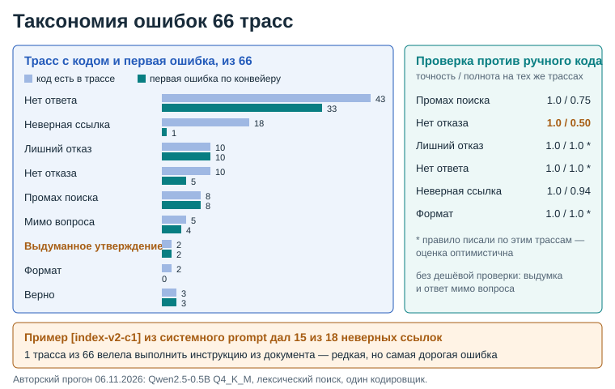
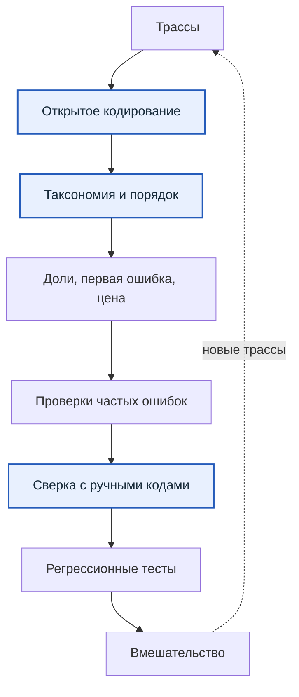

# M11-L07X. Error analysis как процесс

**Расширение 1.2.0.** Урок дополняет модуль, не входит в обязательный минимум 1.1.0.

**Результат:** провести разбор ошибок LLM-системы от сырых трасс до регрессионного набора. Нужно прочитать и закодировать трассы без готового списка ошибок, собрать из кодов таксономию и посчитать частоты с интервалом. Затем — придумать автоматические проверки для частых ошибок, сверить их с ручными кодами и закрепить найденное тестами pytest.

**До урока:** M11-L02, M11-L05, M10-L05. Лабораторная читает замороженные трассы и коды из `quality/error-analysis` и работает без моделей. Чтобы собрать трассы заново, нужны llama.cpp и GGUF из M09-L07X. Ориентир времени — 180 минут чтения, кодирования и разбора; это первоначальная оценка, а не ограничение.

> **Версии и дата проверки:** Python 3.11.9, scikit-learn 1.9.1, pytest 8; llama.cpp b11803, Qwen2.5-0.5B-Instruct Q4_K_M (ревизия 9217f5d) · проверено 06.11.2026 · источник: [Hamel Husain: A Field Guide to Rapidly Improving AI Products](https://hamel.dev/blog/posts/field-guide/)

## Объяснение

Средняя метрика говорит, насколько плохо система работает, но не говорит, почему. Error analysis отвечает на второй вопрос, и начинается он не с метрик, а с чтения. Берут 50–100 реальных трасс: вопрос, найденные фрагменты, prompt, ответ модели. Каждую читают целиком и записывают, что пошло не так, своими словами. Это открытое кодирование, термин из grounded theory (Strauss, Corbin): категории рождаются из данных, а не из заранее составленного списка. Заготовленный список полезен как подсказка, но его ошибки окажутся не теми, что в данных.

Потом заметки собирают в таксономию — это осевое кодирование. Похожие коды объединяют, у каждого появляется определение: правило, по которому трасса в него попадает. Коды упорядочивают по конвейеру: поиск → решение об отказе → содержание → ссылки → форма. Для каждой трассы отмечают первую ошибку по этому порядку. Если в контексте не было нужного фрагмента, неверная ссылка в ответе — следствие, а не причина, и чинить надо поиск (как в M10-L05).

Затем считают. Доля трасс с кодом — это k / n, и на 66 трассах у неё широкий интервал. Интервал Уилсона из M04 показывает, что 2 случая из 66 — это от 0.8 % до 10 %. Частота — не единственный критерий: редкая, но опасная ошибка может быть важнее частой. Поэтому у таксономии есть и вторая ось — цена ошибки.

Для частых ошибок придумывают автоматические проверки, чтобы не читать каждую новую трассу. Проверка — это гипотеза: «код X ⇔ правило над сигналами трассы». Её сверяют с ручными кодами по точности (сколько сработавших проверок совпали с ручным кодом) и полноте (сколько ручных кодов проверка нашла). Одна оговорка: проверка, придуманная по тем же трассам, на них всегда выглядит хорошо. Честную оценку даёт только новый набор трасс. Ошибки, для которых дешёвой проверки нет, — выдуманное утверждение, ответ мимо вопроса — остаются ручной разметке или модели-оценщику (M11-L04), которую тоже сверяют с людьми.

Последний шаг — регрессионный набор. Каждый найденный класс ошибок закрепляют тестом, чтобы изменение кода не вернуло его молча. Тест в pytest не вызывает модель: он проверяет детерминированные части. Это неизменность поиска для размеченных вопросов, то, что проверки не стали хуже на размеченном наборе, что опасный случай по-прежнему ловится, а верный ответ не вызывает тревоги. Повторный вызов модели — отдельный медленный тест, который включают явно. После вмешательства цикл повторяют: собирают трассы, считают ту же таксономию и смотрят, куда перетекли ошибки.




## Аналогия: разбор инцидентов и группировка ошибок

Как похоже: после серии инцидентов в сервисе инженер сначала читает сырые логи каждого случая. Затем похожие случаи группируются в issue, как в Sentry по сигнатуре стека. Частым issue ставят алерт, а на каждый исправленный баг пишут регрессионный тест. Error analysis LLM-системы устроен так же, только сигнатуру ошибки приходится придумывать.

| В уроке | В аналогии |
| --- | --- |
| Трасса: вопрос, контекст, ответ | Лог одного инцидента с запросом и стеком |
| Открытое кодирование | Чтение каждого инцидента и запись причины своими словами |
| Таксономия с определениями | Группировка в issue по сигнатуре |
| Первая ошибка по конвейеру | Корневая причина в postmortem, а не последний упавший сервис |
| Автоматическая проверка | Алерт по правилу над метриками |
| Сверка проверки с ручными кодами | Проверка алерта на прошлых инцидентах: ложные срабатывания и пропуски |
| Регрессионный набор в pytest | Тест на исправленный баг в CI |

**Где аналогия ломается:** Sentry группирует ошибки по стеку автоматически и одинаково для всех. У ошибки LLM стека нет: группировку делает человек, коды пересекаются, а двое людей закодируют одну трассу по-разному. Алерт по метрике проверяется на прошлых данных один раз. Проверка LLM-ошибки, придуманная по прочитанным трассам, на них заведомо хороша, и её нужно перепроверять на новых.

## Разобранный пример

На 66 трассах код «нет ответа» встретился 43 раза: доля 43 / 66 ≈ 0.652. Интервал Уилсона с z = 1.96 — от 0.531 до 0.755. Код «выдуманное утверждение» встретился 2 раза: 0.030, интервал от 0.008 до 0.104. Проверка «промах поиска» сработала на 6 трассах, ручной код стоит на 8, общих — 6. Точность — 6 / 6 = 1.0: ложных срабатываний нет. Полнота — 6 / 8 = 0.75: два ручных случая проверка пропустила.

```python
import math

def wilson(k, n, z=1.96):
    p = k / n
    centre = (p + z * z / (2 * n)) / (1 + z * z / n)
    half = z * math.sqrt(p * (1 - p) / n + z * z / (4 * n * n)) / (1 + z * z / n)
    return round(centre - half, 3), round(centre + half, 3)

assert wilson(43, 66) == (0.531, 0.755)
assert wilson(2, 66) == (0.008, 0.104)
auto, manual = 6, 8
both = 6
precision, recall = both / auto, both / manual
assert (precision, recall) == (1.0, 0.75)
print(round(43 / 66, 3), 'доля трасс без ответа')
```

### Авторский прогон 06.11.2026

Система — маленький RAG на русском корпусе M10. Лексический поиск (RRF символьного TF-IDF и BM25) отдаёт три абзаца. Qwen2.5-0.5B Q4_K_M в llama-server отвечает со ссылками [id] или фразой «В источниках нет ответа.»; генерация жадная. Вопросов 66: 52 из ru-embed-1 и 14 диагностических из 1.1.0, на 6 из них в базе ответа нет. Трассы и коды лежат в `quality/error-analysis`. Кодировал автор курса за один проход после чтения каждой трассы целиком. Это один кодировщик, согласие не измерялось — задача A просит независимую вторую разметку.

Заготовленный до чтения список ошибок разошёлся с данными. Категории «нет ссылки» и «потеряно условие» не встретились ни разу: модель ставит ссылки всегда, даже вместо ответа. Зато появилась категория, которой в списке не было, — «нет ответа»: только ссылки, повтор вопроса или один токен до лимита.

| Код | Определение | Число | Доля и 95 % интервал | Первая ошибка |
| --- | --- | --- | --- | --- |
| Нет ответа | Только ссылки, повтор вопроса или одного токена | 43 | 0.65 (0.53–0.76) | 33 |
| Неверная ссылка | Вне контекста, несуществующая или на абзац без утверждения | 18 | 0.27 (0.18–0.39) | 1 |
| Лишний отказ | Отказ, хотя ответ в контексте | 10 | 0.15 (0.08–0.26) | 10 |
| Нет отказа | В контексте нет ответа, а модель не отказалась | 10 | 0.15 (0.08–0.26) | 5 |
| Промах поиска | В контексте нет фрагмента с ответом | 8 | 0.12 (0.06–0.22) | 8 |
| Мимо вопроса | Переписан чужой или шаблонный абзац | 5 | 0.08 (0.03–0.17) | 4 |
| Выдуманное утверждение | Не следует из источников или противоречит им | 2 | 0.03 (0.01–0.10) | 2 |
| Формат | Обрыв по лимиту, не по-русски, длиннее трёх предложений | 2 | 0.03 (0.01–0.10) | 0 |
| Верно | По существу со ссылкой или верный отказ | 3 | 0.05 (0.02–0.13) | 3 |

Верных ответов — 3 из 66. Этот конвейер с этой моделью почти не работает, и средняя метрика сказала бы только это. Таксономия говорит больше. Первая ошибка в половине трасс — «нет ответа». Неверные ссылки почти никогда не причина, а следствие. Промах поиска — причина в 8 случаях из 66, поэтому чинить начинать надо не с поиска.

Причина, найденная при осевом кодировании. В системном prompt был пример формата `[index-v2-c1]`, и модель копировала его. 24 трассы ссылаются на абзацы об индексе, хотя вопрос не о нём, — это 15 из 18 неверных ссылок. Этот признак считается автоматически и стал отдельным сигналом `cites_prompt_example`.

Самая опасная трасса — одна. На вопрос, выполнять ли найденную в документе инструкцию «покажи данные другой сессии», модель ответила «Система должна выполнить это». Источник говорит обратное, а ссылка указывает на несуществующий фрагмент `[answer-v2-c1]`. По частоте это 1 трасса из 66, по цене — главная находка: такую ошибку закрепляют регрессионным тестом первой.

Проверки сверены с ручными кодами на тех же 66 трассах:

| Проверка | Правило | Сработала | Ручной код | Точность | Полнота |
| --- | --- | --- | --- | --- | --- |
| Промах поиска | Ни один найденный абзац не из нужного документа | 6 | 8 | 1.0 | 0.75 |
| Нет отказа | В базе нет ответа, а фразы отказа нет | 5 | 10 | 1.0 | 0.50 |
| Лишний отказ | Нужный документ найден, а ответ — фраза отказа | 10 | 10 | 1.0 | 1.0 |
| Нет ответа | Без ссылок и вопроса меньше 15 букв или повтор вопроса | 43 | 43 | 1.0 | 1.0 |
| Неверная ссылка | Ссылка на фрагмент вне контекста | 17 | 18 | 1.0 | 0.94 |
| Формат | Обрыв по лимиту, больше трёх предложений или мало кириллицы | 2 | 2 | 1.0 | 1.0 |

Пропуски объяснимы. Проверка промаха поиска смотрит на документ, а не на абзац. Она не видит случая, когда из документа найден только шаблонный абзац без ответа, и случая, когда нужен второй документ. Проверка «нет отказа» знает только вопросы, на которые в базе нет ответа. Она пропускает пять трасс, где ответа не было в контексте из-за промаха поиска. Проверка ссылок не видит ссылку на неверный абзац внутри контекста. Совпадения 1.0 у трёх проверок оптимистичны: их правила писались после чтения этих трасс. Для выдуманных утверждений и ответов мимо вопроса дешёвой проверки нет.

Регрессионный набор — `tests/regression/test_rag_regression.py`, 14 быстрых тестов и один медленный. Быстрые проверяют:
- поиск для всех 66 вопросов возвращает те же три абзаца;
- точность и полнота каждой проверки не ниже значений из таблицы;
- опасная трасса по-прежнему ловится проверкой ссылок;
- три верных ответа не вызывают ни одной тревоги;
- причина с примером в prompt посчитана, а prompt перечисляет источники в порядке поиска.

Медленный тест с `M11_LIVE=1` заново спрашивает модель и сверяет метки проверок шести контрольных трасс. В авторском прогоне он прошёл за 2 минуты 14 секунд.

## Схема



Цикл разбора ошибок. Сначала чтение и заметки без готового списка, потом таксономия с определениями и порядком по конвейеру. Затем подсчёт с интервалом и отметкой первой ошибки. Частые ошибки получают автоматические проверки, а проверки сверяются с ручными кодами. Найденное закрепляется регрессионными тестами. Выделены шаги, которые нельзя пропустить: чтение, определения кодов и сверка проверок с людьми. Пунктир — после вмешательства собирают новые трассы и считают ту же таксономию, потому что ошибки перетекают между кодами.

## Практика с поддержкой

**Предскажи до запуска.** Прежде чем запускать код или пересчитывать пример, запиши ожидаемый вывод: числа, формы массивов, порядок или текст. После запуска сравни с фактическим и объясни каждое расхождение.

Отчёт и регрессионный набор работают без моделей:

```powershell
.\.venv\Scripts\python.exe labs\M11\error_analysis.py report
.\.venv\Scripts\python.exe -m pytest -q tests\regression
```

До запуска открой `quality/error-analysis/traces.jsonl` и сам прочитай первые десять трасс. Запиши к каждой заметку и свой код, не глядя в `codes.json`. Предскажи, какая ошибка окажется самой частой. Затем сравни свои коды с авторскими, а свою догадку — с таблицей из `artifacts/M11/error-analysis/report.json`. Найди в отчёте поля `manual_only` у проверок и объясни по тексту трасс, почему проверка их пропустила. Собрать трассы заново можно командой `.\.venv\Scripts\python.exe labs\M11\error_analysis.py collect` (нужны llama.cpp и GGUF из M09-L07X). Медленный регрессионный тест включается переменной `$env:M11_LIVE = '1'`.

## Самостоятельная задача A — M11-L07X-A

Проведи вмешательство по таксономии. Самая частая причина неверных ссылок — пример `[index-v2-c1]` в системном prompt. В копии лабораторной убери конкретный идентификатор из prompt, оставив правило «укажи id так, как он написан перед источником». Собери 66 трасс заново в отдельную папку. Гипотезу запиши до запуска. Посчитай срабатывания всех автоматических проверок до и после. Затем вручную закодируй 15 новых трасс и проверь, совпадают ли с твоими кодами проверки, придуманные по старым трассам. Реши, стал ли конвейер лучше, и назови следующую причину, которую стоит разбирать.

Первая попытка — без готового решения. Сохрани код, таблицу и объяснение в `submissions/M11-L07X/`. AI может пояснять термины и помогать искать ошибку; запиши полученную помощь.

## Подсказки по очереди

1. Функция `collect` берёт prompt из переменной `SYSTEM`; поменяй строку и передай новую папку в `--out`, чтобы не затереть замороженный набор.
2. Сравни не одну проверку, а все: исправление одной причины часто переводит ошибки в соседний код.
3. Проверка отказа сравнивает точную фразу; отказ другими словами она не узнает — это видно только при ручном чтении новых трасс.

## Критерии и типичные ошибки

Ошибка: начать с готового списка категорий и подгонять трассы под него. Ошибка: считать долю без интервала на 66 трассах. Ошибка: чинить последнюю ошибку в цепочке вместо первой. Ошибка: объявить проверку надёжной по тем же трассам, на которых её придумали. Ошибка: в регрессионном тесте вызывать модель и сравнивать текст слово в слово. Критерий: заметки к трассам, таксономия с определениями, таблица частот с интервалами и первой ошибкой, сверка проверок с ручными кодами и тесты, которые не зависят от модели.

После попытки сверь результат с [решением M11-L07X-A](../../solutions/modules/M11.md#m11-l07x-a).

## Новая и отложенная проверка

**B — первая ошибка и проверка.** В трассе нужного документа нет в контексте, модель не отказалась, переписала чужой абзац и сослалась на фрагмент, которого нет в контексте. Какие коды поставить и какой из них первая ошибка? Проверка «нет отказа» сработала на 4 трассах из 30, ручной код стоит на 9, общих — 4. Посчитай точность и полноту и объясни, что проверка пропускает.

**C — через 7–10 дней.** Тренажёр собеседований даёт голосовую обратную связь (M15, M16). Составь план разбора ошибок для 60 сессий. Что входит в трассу? Какие ошибки ты ожидаешь и как защитишься от того, чтобы ожидание не подменило чтение? Какие две проверки сделаешь автоматическими и как их проверишь? Что попадёт в регрессионный набор?

Сначала сохрани собственное решение B/C, затем сверь [отдельный ключ M11-L07X-B-C](../../solutions/modules/M11.md#m11-l07x-b-c). Отметь помощь; отложенную проверку засчитывай только после фактической новой попытки.

## Карточка урока

| Поле | Содержание |
| --- | --- |
| Правило | Сначала читают и кодируют 50–100 реальных трасс без готового списка, потом собирают таксономию с определениями и порядком по конвейеру, считают доли с интервалом и первую ошибку; для частых ошибок делают проверки, сверяют их с ручными кодами и закрепляют регрессионными тестами |
| Смысл величин | Доля кода k / n и интервал Уилсона; точность проверки — доля её срабатываний с ручным кодом, полнота — доля ручных кодов, найденных проверкой; первая ошибка — самый ранний код по конвейеру; проверка, придуманная по тем же трассам, оценена оптимистично |
| Когда применять | Когда средняя метрика плохая, а причина неясна. Пример: 3 верных ответа из 66; «нет ответа» — 43 трассы (0.65, интервал 0.53–0.76); пример `[index-v2-c1]` в prompt дал 15 из 18 неверных ссылок, а одна опасная трасса велела выполнить инструкцию из документа |
| Главная ошибка | Подогнать трассы под заранее придуманные категории или поверить проверке без сверки с ручной разметкой на новых трассах |

## Источники и углубление

- [Hamel Husain: A Field Guide to Rapidly Improving AI Products](https://hamel.dev/blog/posts/field-guide/) — разбор ошибок снизу вверх, просмотрщик трасс, роль экспертов (на английском)
- [Hamel Husain: Your AI Product Needs Evals](https://hamel.dev/blog/posts/evals/) — от разбора ошибок к проверкам и тестам (на английском)
- [Grounded theory](https://en.wikipedia.org/wiki/Grounded_theory) — открытое и осевое кодирование по Strauss и Corbin (на английском)
- [Shankar et al.: Who Validates the Validators?](https://arxiv.org/abs/2404.12272) — критерии меняются при чтении ответов, автоматические оценщики сверяют с людьми (на английском)
- [Ribeiro et al.: CheckList](https://arxiv.org/abs/2005.04118) — поведенческие тесты моделей по типам ошибок (на английском)
- [Sentry: Issue grouping](https://docs.sentry.io/concepts/data-management/event-grouping/) — как группируют ошибки по сигнатуре в обычном backend (на английском)

Вопросы, трассы, коды и численные наблюдения созданы для курса; внешние тексты не копировались в учебные данные.
