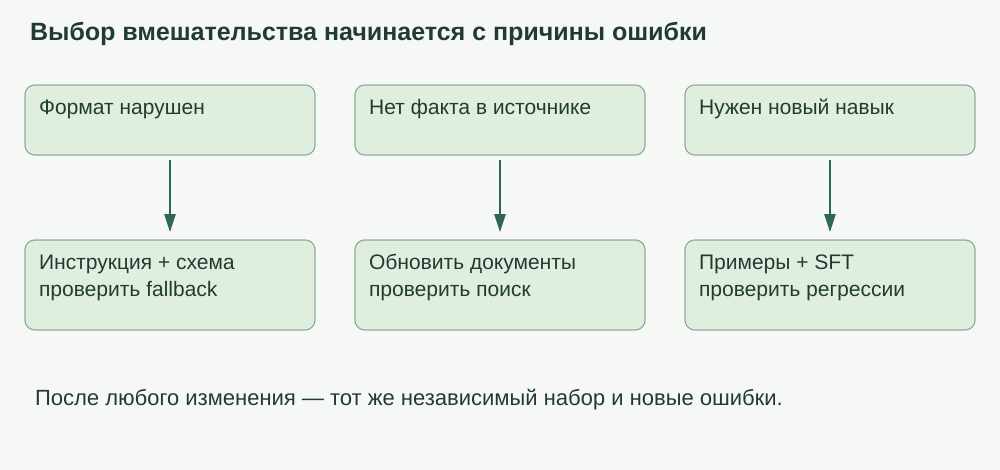

# M12-L01. Выбор вмешательства

Версия материала: 1.0.0. Это самостоятельный урок: внешняя проверка наставником необязательна.

## Результат и входные знания

После урока ты сможешь: **Различить ошибку инструкции, отсутствие фактов и недостаток обученного поведения; выбрать проверяемое вмешательство.** Перед началом нужны M07, M09 и M11: градиент, инференс и независимое оценивание. Если термин из этого списка неясен, вернись к соответствующему уроку и воспроизведи его маленький пример. Продолжение по календарю не заменяет понимание зависимости.

## Объяснение

Модель получает последовательность токенов и вычисляет распределение следующего токена. На выход влияют параметры, входной контекст и способ выбора токена. Поэтому одинаковый неверный ответ может иметь разные причины. Если вопрос двусмысленен, дополнительное обучение иногда закрепляет произвольную трактовку. Если отсутствует свежая информация, хорошая инструкция не создаёт её из ничего. Если правильная информация уже присутствует, но формат постоянно нарушается, поиск дополнительных документов может увеличить шум.

Prompting меняет инструкцию и примеры во входе. Это быстрый способ задать формат, роль и правило использования предоставленного источника. Изменяются входные токены, а сохранённые веса остаются прежними. Стоимость такого решения проявляется в длине контекста, времени обработки и нестабильности соблюдения инструкции. Один удачный ответ ещё не показывает устойчивое поведение.

RAG сначала находит внешние фрагменты, затем добавляет их к запросу. Он полезен, когда ответ должен зависеть от управляемых документов: например, от актуальной версии справочника SQL. Обновить документ и индекс обычно проще, чем переобучать модель ради нового факта. Но найденный фрагмент может оказаться нерелевантным или устаревшим. RAG требует отдельной проверки поиска и использования найденного текста. Он не гарантирует истинность ответа автоматически.

SFT, supervised fine-tuning, изменяет параметры по примерам желаемого поведения. У модели возникает статистическая склонность продолжать похожие входы похожим способом. Это может помочь формату и стилю при достаточном числе качественных примеров. Изменение весов не превращает обучающую таблицу в точную базу данных. Редкий факт может не усвоиться, а известное прежде поведение — ухудшиться. Адаптер уменьшает число изменяемых параметров, но не отменяет эту проблему.

Начинай выбор с наблюдаемой ошибки. Запиши вход, ожидаемый результат, фактический ответ и причину расхождения. Затем предложи минимальный эксперимент, различающий причины. Если модель правильно отвечает при вручную подставленном документе, проблема вероятнее находится в поиске или комплектовании контекста. Если ответ неверен даже с коротким однозначным источником, проверь понимание инструкции, способности модели и рубрику.

В тренажёре интервью эти вмешательства могут сочетаться. Сценарий беседы задаёт код, формулировку уточняющего вопроса предлагает модель, технические объяснения опираются на источники. Такое разделение позволяет измерить изменение каждого компонента. Не называй решение лучшим только потому, что в нём присутствует обучение: сложность должна окупаться измеримым результатом.



Схема показывает отношения между понятиями этого урока, а не измеренную производительность. Найди в объяснении смысл каждого блока. Затем закрой подписи и воспроизведи связи своими словами: что поступает на вход, что изменяется и по какому наблюдению можно проверить результат.

## Разобранный пример

Python-блок выполняй из корня `C:\projects\ml-llm-course` в окружении курса (например, в ячейке Jupyter). Для примеров M15 сначала создай `question.wav` запуском лабораторной.

На учебном наборе из двадцати одинаковых запросов базовая система возвращает корректный JSON в 12 случаях, инструкция с примером — в 18, адаптированная версия — в 19. Доли равны 0,60; 0,90; 0,95. Разница между последними вариантами составляет один ответ. Это полезное наблюдение, но недостаточная основа для уверенного общего вывода. Сначала изучи именно этот ответ, повтори генерацию и проверь новые запросы.

```python
counts = {'base': 12, 'prompt': 18, 'adapted': 19}
print({name: n / 20 for name, n in counts.items()})
```

Если задача содержит меняющийся номер версии API, измерь также свежесть факта. Высокая доля JSON не компенсирует устаревшее содержание.

## Практика с поддержкой

Возьми один неудачный технический ответ. Сначала сохрани исходный запрос. Затем добавь ровно одно изменение: краткий релевантный источник. Сравни ответ по заранее выбранным критериям; не меняй одновременно температуру, модель и рубрику. Объясни, какой результат поддержал бы гипотезу об отсутствии информации.

Для технической практики используй [лабораторную M12](../../labs/M12/README.md). Полный код находится отдельно от твоего решения. Сначала предскажи результат одного контрольного случая, затем запусти пример и объясни расхождение, если оно появилось. Запиши команду, версию окружения и фактический вывод, чтобы позже повторить опыт.

## Самостоятельная задача

Разбери три случая: модель нарушает JSON в восьми из двадцати ответов; правильно цитирует старый документ вместо нового; выдаёт одинаково общую обратную связь для разных ответов кандидатов. Для каждого предложи первый эксперимент, метрику и основание перейти к более дорогому вмешательству. Не используй название технологии вместо объяснения причины.

Сохрани собственную попытку в `submissions/M12-L01.md` и приложи код или данные, если они нужны. В отчёте должны быть исходное условие, ход проверки, результат и границы вывода. Не заменяй объяснение скриншотом успешного запуска: другой человек должен понять, почему результат отвечает на поставленный вопрос.

## Подсказки по порядку

1. Сначала раздели три наблюдения: нарушение формата, устаревший факт и общая формулировка. У них разные возможные причины.
2. Для старого факта вручную подставь новый документ: это отделит проблему поиска от использования контекста.
3. Переход к SFT обоснуй устойчивым недостатком поведения после проверки входов и инструкции, а не самим желанием обучать.

## Самопроверка и типичные ошибки

За объяснение механизма, корректность проверки, воспроизводимость и ограничения поставь по 0–2 балла: 0 — отсутствует или неверно, 1 — частично с помощью, 2 — самостоятельно и обоснованно. Для перехода нужны минимум 6 из 8 и отсутствие критических ошибок. Критические ошибки: подмена реального измерения выдуманным, использование ответа из решения как собственной первой попытки, вывод о качестве за пределами проверенных данных, нарушение явно заданного ограничения задачи. Исправление должно сопровождаться новым примером, а не только заменой текста отчёта.

Первая самостоятельная попытка выполняется без готового решения. После неё разрешены объяснения AI, подсказки и [полный разбор](../../solutions/modules/M12.md#m12-l01). Отметь полученную помощь. Если решение стало понятно только после разбора, состояние навыка — «с поддержкой»; для самостоятельности реши новый вариант.

## Новая и отложенная проверка

Через неделю получи задачу с ежедневно меняющимся расписанием. Объясни, почему прежнее решение для стабильного JSON нельзя переносить без проверки.

Запиши дату следующей проверки и конкретное условие. Состояние «подтверждено позже» появляется после её фактического выполнения, а не автоматически после чтения.

## Источники и углубление

- [Официальная документация по теме](https://huggingface.co/docs/peft/main/en/conceptual_guides/lora) — сверяй контракт и определения, не копируй внешний пример вместо самостоятельной работы.
- [Исполняемый пример модуля](../../labs/M12/demo.py) — авторский код курса с явно указанными ограничениями.

[Оглавление модуля](../modules/M12.md)
