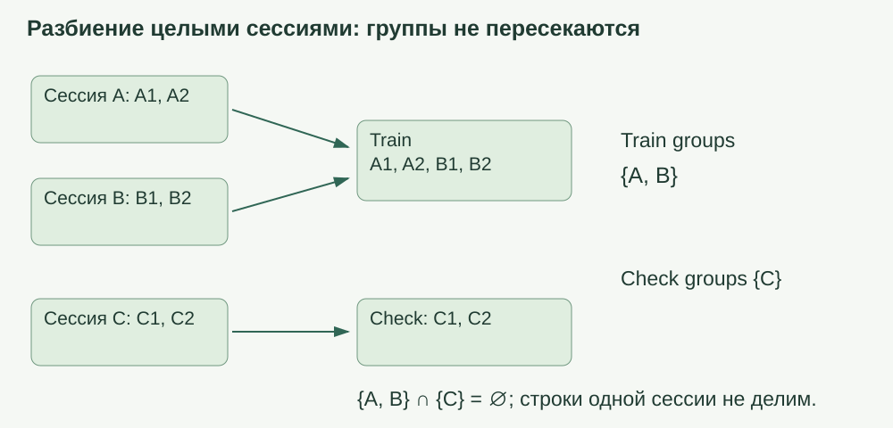

# M12-L02. Данные для адаптации

Версия материала: 1.0.0. Это самостоятельный урок: внешняя проверка наставником необязательна.

## Результат и входные знания

После урока ты сможешь: **Подготовить примеры с происхождением, группами и независимым разделением.** Перед началом нужны M12-L01: предыдущий шаг модуля. Если термин из этого списка неясен, вернись к соответствующему уроку и воспроизведи его маленький пример. Продолжение по календарю не заменяет понимание зависимости.

## Объяснение

Обучающий пример для диалоговой модели — не просто красивый текст ответа. В нём задаётся условие, при котором этот ответ должен появиться. Если в инструкции требуется оценка конкретного кандидата, но ответ кандидата удалён, модель вынуждена угадывать по косвенным признакам. Такая таблица может обучить убедительно звучащей выдумке. Сначала проверь соответствие входа и целевого действия.

Полезная запись содержит идентификатор, происхождение, дату, задачу, входные сообщения, целевой ответ, группу и пояснение проверяющего. Группа объединяет связанные примеры: одну сессию интервью, исходную задачу, документ или автора. Если две перефразировки одного ответа попали в train и test, независимость проверки нарушена, даже когда строки различаются. Разделение нужно выполнять до генерации вариантов и до подбора гиперпараметров.

Train используется для изменения параметров. Validation помогает выбрать настройки и момент остановки. Test применяется после принятия этих решений. Если ты многократно сравниваешь версии на test и выбираешь победителя, этот набор фактически становится частью разработки. Для итогового вывода понадобится новая проверка. Это организационное правило не менее важно, чем правильная функция потерь.

Для SFT роль сообщений определяет, на каких токенах считать ошибку. Часто обучают предсказывать ответ ассистента, маскируя инструкцию и сообщения пользователя. Маска потерь не удаляет вход из контекста: модель всё ещё использует его при вычислении ответа. Ошибка заключается в смешении доступности входа и участия позиции в целевой функции. В маленькой лабораторной модели задача проще: каждый символ обучает предсказывать следующий символ.

Проверь баланс не только по числу строк. Сто коротких примеров и один огромный диалог дают разное число токенов и могут по-разному влиять на оптимизацию. Дубликаты увеличивают вес конкретного поведения. Длинная часть переписки может обрезаться, и в обучение попадёт ответ без необходимого вопроса. Поэтому сохрани статистику длины, долю обрезанных записей и несколько результатов после токенизации.

Происхождение нужно для исправления ошибок и понимания разрешённого использования. В обязательной лабораторной применяются синтетические строки, созданные кодом курса. Они не содержат персональных данных и не представляют реальный язык. Для собственного корпуса интервью используй придуманные ответы либо согласованные обезличенные материалы. Не объявляй синтетический набор репрезентативным для всех кандидатов: в нём обычно меньше шума, противоречий и разнообразия.



Схема показывает отношения между понятиями этого урока, а не измеренную производительность. Найди в объяснении смысл каждого блока. Затем закрой подписи и воспроизведи связи своими словами: что поступает на вход, что изменяется и по какому наблюдению можно проверить результат.

## Разобранный пример

Python-блок выполняй из корня `C:\projects\ml-llm-course` в окружении курса (например, в ячейке Jupyter). Для примеров M15 сначала создай `question.wav` запуском лабораторной.

Пусть есть шесть записей: A1, A2 относятся к сессии A; B1, B2 — к B; C1, C2 — к C. Разделение A1/B1/C1 против A2/B2/C2 даёт три общие группы. Вариант train=A+B, test=C не имеет пересечения групп, хотя проверяет лишь одну независимую сессию.

```python
train_groups = {'A', 'B'}
test_groups = {'C'}
assert train_groups.isdisjoint(test_groups)
```

Эта проверка обнаруживает пересечение известных групп. Она не доказывает отсутствие смысловых дубликатов: неверно заданные group_id могут скрыть утечку.

## Практика с поддержкой

Выпиши три строки в обычную таблицу и прочитай только их входы, закрыв ответы. Для каждого входа установи, достаточно ли информации для целевого действия. Затем проверь ответы и отметь места, где целевой текст требует недоступного знания. Это более полезная первая проверка, чем автоматический подсчёт строк.

Для технической практики используй [лабораторную M12](../../labs/M12/README.md). Полный код находится отдельно от твоего решения. Сначала предскажи результат одного контрольного случая, затем запусти пример и объясни расхождение, если оно появилось. Запиши команду, версию окружения и фактический вывод, чтобы позже повторить опыт.

## Самостоятельная задача

Создай восемь синтетических записей по четырём исходным вопросам, по две перефразировки каждого. Сохрани source_question_id и session_id. Раздели по исходным вопросам, затем найди и исправь запись, в которой ответ содержит факт, отсутствующий во входе. Объясни, что изменится, если цель — перенос на нового автора при знакомых вопросах.

Сохрани собственную попытку в `submissions/M12-L02.md` и приложи код или данные, если они нужны. В отчёте должны быть исходное условие, ход проверки, результат и границы вывода. Не заменяй объяснение скриншотом успешного запуска: другой человек должен понять, почему результат отвечает на поставленный вопрос.

## Подсказки по порядку

1. Единицей разделения служит исходный вопрос: две перефразировки нельзя разнести по train и test.
2. Для четырёх групп выбери две обучающие, одну валидационную и одну тестовую; проверь пересечение group_id.
3. Если проверяется новый автор, добавь связь автора с вопросом. Случайное разделение строк не гарантирует независимость по обоим признакам.

## Самопроверка и типичные ошибки

За объяснение механизма, корректность проверки, воспроизводимость и ограничения поставь по 0–2 балла: 0 — отсутствует или неверно, 1 — частично с помощью, 2 — самостоятельно и обоснованно. Для перехода нужны минимум 6 из 8 и отсутствие критических ошибок. Критические ошибки: подмена реального измерения выдуманным, использование ответа из решения как собственной первой попытки, вывод о качестве за пределами проверенных данных, нарушение явно заданного ограничения задачи. Исправление должно сопровождаться новым примером, а не только заменой текста отчёта.

Первая самостоятельная попытка выполняется без готового решения. После неё разрешены объяснения AI, подсказки и [полный разбор](../../solutions/modules/M12.md#m12-l02). Отметь полученную помощь. Если решение стало понятно только после разбора, состояние навыка — «с поддержкой»; для самостоятельности реши новый вариант.

## Новая и отложенная проверка

Через семь дней добавь перефразировку тестового вопроса в train. Объясни, почему новый идентификатор строки не делает её независимой.

Запиши дату следующей проверки и конкретное условие. Состояние «подтверждено позже» появляется после её фактического выполнения, а не автоматически после чтения.

## Источники и углубление

- [Официальная документация по теме](https://docs.pytorch.org/docs/stable/data.html) — сверяй контракт и определения, не копируй внешний пример вместо самостоятельной работы.
- [Исполняемый пример модуля](../../labs/M12/demo.py) — авторский код курса с явно указанными ограничениями.

[Оглавление модуля](../modules/M12.md)
