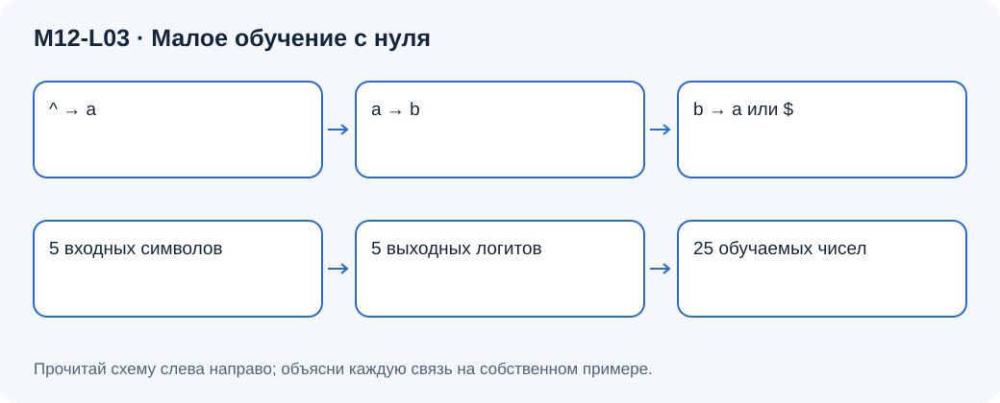

# M12-L03. Малое обучение с нуля

Версия материала: 1.1.0.

> **Версии и дата проверки:** Python 3.11.9, PyTorch 2.15.0+cpu; предобученные модели не используются — учебная биграммная модель курса · проверено 04.11.2026 · источник: [PyTorch 2.15: torch.nn](https://docs.pytorch.org/docs/2.15/nn.html)

## Результат и входные знания

После урока ты сможешь: **Обучить настоящую небольшую языковую модель и объяснить границы результата.** Перед началом нужны M12-L02: предыдущий шаг модуля. Если термин из этого списка неясен, вернись к соответствующему уроку и воспроизведи его маленький пример. Продолжение по календарю не заменяет понимание зависимости.

## Объяснение

Языковая модель оценивает вероятность последовательности через вероятности следующих токенов. Полная современная модель учитывает длинный контекст, но для изучения механизма достаточно биграммной: следующий символ зависит только от предыдущего. Такая модель действительно обучается предсказывать токены; одновременно она не понимает инструкции, не ведёт интервью и не обладает памятью о длинном диалоге. Малый масштаб делает все параметры доступными для проверки.

В лабораторной алфавит состоит из пяти символов: начало, a, b, c и конец. Матрица размером пять на пять содержит логиты переходов. Строка выбирается предыдущим символом, а softmax преобразует пять значений в вероятности следующего. Изначально все логиты нулевые, поэтому каждый символ имеет вероятность 0,2. Модель содержит двадцать пять обучаемых чисел. Это не список заранее заданных правил: вероятности меняются по градиенту ошибки на примерах.

Обучающие строки имеют вид ab, повторённого несколько раз. Добавление маркеров начала и конца даёт модели возможность учиться запускать и завершать последовательность. Для строки ^abab$ получаются пары ^→a, a→b, b→a, a→b, b→$. Последний переход конфликтует с частым b→a, поэтому даже хорошая биграммная модель не должна иметь нулевую ошибку: она не знает, сколько повторов уже произошло.

Cross entropy для правильного следующего символа равна минус логарифму назначенной ему вероятности. При вероятности 0,2 ошибка составляет примерно 1,609 натуральных единиц. Увеличение правильной вероятности до 0,8 уменьшает ошибку примерно до 0,223. Ошибки усредняются по всем переходам, поэтому длинные строки дают больший вклад. В этом эксперименте это принято явно; в другой задаче может потребоваться усреднение по диалогам.

Цикл обучения очищает старые градиенты, вычисляет предсказания, считает потерю, запускает backward и обновляет параметры. Проверка выполняется без изменения весов на новых полных строках большей длины. Это проверка переноса внутри искусственной грамматики, а не доказательство понимания русского языка. Сам факт различия полных строк не делает токенные переходы новыми: именно повторяющиеся переходы модель и должна обобщить.

Сохраняй алфавит вместе с весами. Перестановка индексов символов при загрузке сохранит форму матрицы, но изменит смысл каждой строки и столбца. Воспроизводимость требует не только seed, но и одинаковой кодировки данных, порядка обработки и версии библиотеки. Незначительные расхождения float допустимы; отсутствие уменьшения независимой ошибки требует расследования.




## Разобранный пример

Python-блок выполняй из корня `C:\projects\ml-llm-course` в окружении курса (например, в ячейке Jupyter).

Запусти лабораторную M12 из корня репозитория. На проверенном CPU запуске с seed=17 первоначальная ошибка старой грамматики равна 1,60944, после обучения — 0,16638. Это измеренный результат конкретной версии, а не обязательное точное равенство для каждого компьютера.

```python
import torch
from torch import nn
torch.set_num_threads(1)
base = nn.Embedding(5, 5)
with torch.no_grad():
    base.weight.zero_()
x = torch.tensor([1])  # предыдущий символ a
y = torch.tensor([2])  # следующий символ b
criterion = nn.CrossEntropyLoss()
optimizer = torch.optim.SGD(base.parameters(), lr=0.1)
before = float(criterion(base(x), y).detach())
optimizer.zero_grad()
criterion(base(x), y).backward()
optimizer.step()
after = float(criterion(base(x), y).detach())
print(round(before, 6), round(after, 6))
assert after < before
```

Тензор y содержит индексы правильных символов, а не one-hot векторы. Подмена логитов вероятностями перед CrossEntropyLoss меняет вычисление и обычно является ошибкой.

## Практика с поддержкой

Проследи один переход a→b вручную. Найди индекс a, выбери соответствующую строку весов, вычисли softmax и вероятность b. Затем объясни направление изменения: градиент должен повышать относительный логит b, но не обязан монотонно улучшать каждый отдельный пример на каждом шаге.

Практический запуск: [лабораторная M12](../../labs/M12/README.md).

## Самостоятельная задача

Скопируй лабораторную в свою рабочую папку и замени базовую грамматику ab на abc. Сохрани пять символов алфавита. До запуска выпиши допустимые переходы и объясни, почему переход c→конец конфликтует с c→a. Затем измерь heldout loss и проверь сохранение и загрузку весов.

Сохрани расчёт и объяснение в `submissions/M12-L03.md`.

## Подсказки по порядку

1. Выпиши переходы в строке ^abcabc$: их количество на один меньше числа символов.
2. Размер алфавита остался пять, поэтому таблица логитов по-прежнему имеет форму 5×5.
3. Сравни контекст перед c→a и c→$: предыдущий символ одинаков, значит длина строки недоступна биграммной модели.

## Самопроверка и типичные ошибки

Сопоставь входной контекст, цели и наблюдаемые переходы; сравни loss на независимых строках и после загрузки весов. Критическая ошибка — обещать точный счёт повторов модели, которая видит только один предыдущий символ.

[Ключ A](../../solutions/modules/M12.md#m12-l03-a) открывай после попытки. Запиши помощь и выполни новый вариант B без копирования решения.

## Новая и отложенная проверка

**B — неустранимая неоднозначность bigram.** Обучающая последовательность abcabcabcabc затем EOS. Модель видит только предыдущий символ. Выпиши число переходов c→a и c→EOS, оптимальные эмпирические вероятности и минимальную среднюю cross-entropy только на четырёх позициях после c (натуральный логарифм). Почему дальнейшее обучение не сделает все четыре решения детерминированно правильными?

**C — через 7–10 дней.** Модель должна генерировать ровно десять повторов ab. Из состояния b она выбирает a с вероятностью 0.9 и EOS с 0.1, a→b детерминированно; генерация начинается с a. Найди вероятность закончить ровно после десятой b. Предложи, какое дополнительное состояние позволяет задать точную длину, и объясни отличие greedy от sampling в данном примере.

Сначала сохрани собственное решение B/C, затем сверь [отдельный ключ M12-L03-B-C](../../solutions/modules/M12.md#m12-l03-b-c). Отметь помощь; отложенную проверку засчитывай только после фактической новой попытки.

## Источники и углубление

- [Официальная документация по теме](https://docs.pytorch.org/tutorials/beginner/basics/optimization_tutorial.html) — сверяй контракт и определения, не копируй внешний пример вместо самостоятельной работы.
- [Исполняемый пример модуля](../../labs/M12/demo.py) — авторский код курса с явно указанными ограничениями.

[Оглавление модуля](../modules/M12.md)
