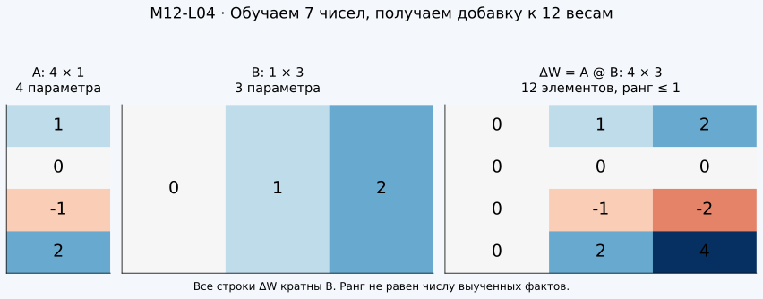

# M12-L04. Дообучение и адаптеры

Версия материала: 1.0.0. Это самостоятельный урок: внешняя проверка наставником необязательна.

## Результат и входные знания

После урока ты сможешь: **Реализовать изменение низкого ранга и доказать, какие параметры обучались.** Перед началом нужны M12-L03: предыдущий шаг модуля. Если термин из этого списка неясен, вернись к соответствующему уроку и воспроизведи его маленький пример. Продолжение по календарю не заменяет понимание зависимости.

## Объяснение

При полном дообучении градиент обновляет выбранные исходные веса модели. Для матрицы W размера d×k это до d·k обучаемых чисел. Адаптация низкого ранга представляет добавку как произведение A·B, где A имеет размер d×r, а B — r×k. Получается W эфф=W+A·B. Здесь r — ранг адаптера, обычно заметно меньше d и k. Обучаются r(d+k) чисел, а исходная W остаётся замороженной.

Ранг ограничивает число независимых направлений изменения матрицы. Это не количество новых фактов и не число тем, которые модель может выучить. Нельзя переводить rank=8 в восемь навыков. Ограничение может работать как полезное сокращение пространства поиска, но также мешать нужному изменению. Выбор ранга проверяют экспериментом на задаче, а не по внешнему сходству примеров.

В нашей модели W содержит двадцать пять чисел. При rank=1 A содержит пять чисел и B ещё пять: всего десять обучаемых параметров. Это сорок процентов от исходной матрицы. На таком малом примере экономия не впечатляет; при больших матрицах отношение может быть существенно меньше. Считать нужно реальные формы, а не автоматически обещать «почти бесплатное» обучение.

Если обе матрицы A и B инициализированы нулями, их произведение равно нулю, но и градиент по каждой зависит от другой нулевой матрицы. Обучение может застрять в нуле. Поэтому лабораторная использует небольшие случайные значения A и нулевую B. Начальная добавка всё ещё нулевая, но первый градиент может изменить B. Это удобный пример того, как математическая запись объясняет практическое правило инициализации.

Замороженные параметры не получают обновлений оптимизатора, однако вычисление через базовую модель всё равно требуется. В большой нейросети остаются затраты на прямой проход, хранение активаций и часть обратного прохода. Уменьшение числа обучаемых весов не означает пропорциональное уменьшение всей памяти. Квантование весов и адаптеры решают связанные, но разные задачи; обязательная лабораторная не требует QLoRA или GPU.

После адаптации проверяй две вещи отдельно: исходная W действительно не изменилась и итоговое поведение стало подходящим. Заморозка базы не защищает от ухудшения ответов при включённом адаптере. Суммарная матрица W эфф способна сильно отличаться от W. Возможность отключить адаптер даёт технический путь возврата, но не доказательство отсутствия регрессии.



Схема показывает отношения между понятиями этого урока, а не измеренную производительность. Найди в объяснении смысл каждого блока. Затем закрой подписи и воспроизведи связи своими словами: что поступает на вход, что изменяется и по какому наблюдению можно проверить результат.

## Разобранный пример

Python-блок выполняй из корня `C:\projects\ml-llm-course` в окружении курса (например, в ячейке Jupyter). Для примеров M15 сначала создай `question.wav` запуском лабораторной.

Для d=4, k=3, r=1 полная матрица содержит 12 чисел, адаптер —7. Пусть A=[1,0,−1,2]ᵀ, B=[0,1,2]. Тогда добавка по строкам равна [0,1,2], [0,0,0], [0,−1,−2], [0,2,4]. Все ненулевые строки пропорциональны, поэтому ранг не превышает 1.

```python
import torch
W = torch.zeros(4, 3, requires_grad=False)
W_before = W.clone()
A = torch.tensor([[1.0], [0.0], [-1.0], [2.0]])
B = torch.tensor([[0.0, 1.0, 2.0]])
delta = A @ B
effective = W + delta
print(delta)
print('full:', W.numel(), 'adapter:', A.numel() + B.numel())
assert delta.shape == (4, 3)
assert A.numel() + B.numel() == 7
assert torch.equal(W, W_before)
```

Сравнение `W` с сохранённой копией `W_before` даёт точное равенство: это проверяет последний `assert`. Сравнение эффективной матрицы `effective` с исходной `W`, наоборот, показывает изменение. В полной лабораторной та же проверка выполняется для `base.weight`.

## Практика с поддержкой

Перед чтением кода нарисуй формы A и B. Проверь, какие внутренние размерности должны совпасть. Затем выпиши параметры, переданные оптимизатору: наличие requires_grad=False полезно, но итоговую проверку дополни сравнением сохранённых тензоров после обучения.

Для технической практики используй [лабораторную M12](../../labs/M12/README.md). Полный код находится отдельно от твоего решения. Сначала предскажи результат одного контрольного случая, затем запусти пример и объясни расхождение, если оно появилось. Запиши команду, версию окружения и фактический вывод, чтобы позже повторить опыт.

## Самостоятельная задача

Для матрицы 16×24 посчитай число параметров полного обучения и адаптеров ранга 2 и 4. Найди максимальный целый ранг, при котором адаптер содержит меньше половины числа параметров полной матрицы. Объясни, почему замороженная база не гарантирует сохранение качества старой задачи.

Сохрани собственную попытку в `submissions/M12-L04.md` и приложи код или данные, если они нужны. В отчёте должны быть исходное условие, ход проверки, результат и границы вывода. Не заменяй объяснение скриншотом успешного запуска: другой человек должен понять, почему результат отвечает на поставленный вопрос.

## Подсказки по порядку

1. Полная матрица имеет 16·24 параметра. Для адаптера используй r·(16+24).
2. Половина полного числа равна 192. Неравенство строгое:40r<192.
3. Проверь целые ранги 4 и 5. Заморожена W, но инференс использует W+A·B, поэтому поведение может измениться.

## Самопроверка и типичные ошибки

За объяснение механизма, корректность проверки, воспроизводимость и ограничения поставь по 0–2 балла: 0 — отсутствует или неверно, 1 — частично с помощью, 2 — самостоятельно и обоснованно. Для перехода нужны минимум 6 из 8 и отсутствие критических ошибок. Критические ошибки: подмена реального измерения выдуманным, использование ответа из решения как собственной первой попытки, вывод о качестве за пределами проверенных данных, нарушение явно заданного ограничения задачи. Исправление должно сопровождаться новым примером, а не только заменой текста отчёта.

Первая самостоятельная попытка выполняется без готового решения. После неё разрешены объяснения AI, подсказки и [полный разбор](../../solutions/modules/M12.md#m12-l04). Отметь полученную помощь. Если решение стало понятно только после разбора, состояние навыка — «с поддержкой»; для самостоятельности реши новый вариант.

## Новая и отложенная проверка

Через семь дней поменяй форму базовой матрицы на 8×8 и объясни, при каком ранге адаптер уже перестаёт экономить число параметров.

Запиши дату следующей проверки и конкретное условие. Состояние «подтверждено позже» появляется после её фактического выполнения, а не автоматически после чтения.

## Источники и углубление

- [Официальная документация по теме](https://huggingface.co/docs/peft/main/en/conceptual_guides/lora) — сверяй контракт и определения, не копируй внешний пример вместо самостоятельной работы.
- [Исполняемый пример модуля](../../labs/M12/demo.py) — авторский код курса с явно указанными ограничениями.

[Оглавление модуля](../modules/M12.md)
