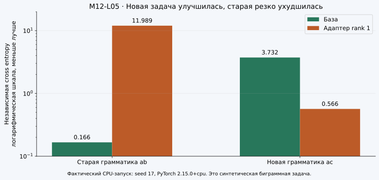

# M12-L05. Сравнение до и после

Версия материала: 1.1.0.

> **Версии и дата проверки:** Python 3.11.9, PyTorch 2.15.0+cpu; предобученные модели не используются — учебная биграммная модель курса · проверено 04.11.2026 · источник: [PyTorch 2.15: torch.nn](https://docs.pytorch.org/docs/2.15/nn.html)

## Результат и входные знания

После урока ты сможешь: **Принять решение по независимому качеству, регрессиям и стоимости эксперимента.** Перед началом нужны M12-L04: предыдущий шаг модуля. Если термин из этого списка неясен, вернись к соответствующему уроку и воспроизведи его маленький пример. Продолжение по календарю не заменяет понимание зависимости.

## Объяснение

Обучение закончено, когда выполнен критерий остановки вычислений. Инженерный эксперимент закончен позже: когда получен ответ на исходный вопрос. Снижение loss на тренировочных данных говорит, что оптимизатор приспосабливает параметры к этим данным. Оно не доказывает пользу для пользователя. Поэтому до запуска запиши основную метрику, защитные проверки и допустимую стоимость.

Основная метрика связана с целью изменения. Для адаптации формата это может быть доля корректных структурированных ответов при сохранении смысла. Защитная метрика проверяет важное прежнее поведение. Для интервьюера это, например, отсутствие выдуманного опыта кандидата, корректность технических объяснений и возможность закончить сессию. Эти проверки нельзя незаметно заменить после получения неудачного результата.

Сравниваемые версии должны видеть одинаковые независимые входы и одинаково доступные источники. Если адаптированной модели передали полный ответ в контексте, а базовой только вопрос, сравнение смешало два фактора. Полезно отдельно сравнить базовую модель, улучшенную инструкцию, поиск и адаптацию, однако не все варианты применимы к каждой модели. Биграммная модель лабораторной не умеет понимать естественные инструкции и документы. Для неё нельзя честно объявить эксперимент с prompting или RAG: выбор этих альтернатив обсуждается на уровне системы и проверяется в соответствующих модулях.

Сохраняй пары ответов, а не только средние значения. Среднее может улучшиться за счёт простых случаев при ухудшении сложных. Разбей проверку по заранее значимым группам: HR и технические вопросы, короткие и длинные ответы, известные и незнакомые темы. Малые группы дают нестабильные оценки, поэтому показывай числитель и знаменатель. Ноль ошибок на трёх примерах не означает нулевую вероятность отказа.

Время и память также измеряются в конкретном окружении. Укажи CPU, версии, размер данных, число шагов и повторов. Не сравнивай холодный запуск одной модели с прогретым запуском другой. Для адаптера полезно различать время подготовки, обучения, загрузки и применения. Дополнительная сложность сопровождения может превышать выигрыш одного удачного ответа.

Решение «не выпускать» является полноценным результатом. Оно показывает, что эксперимент обнаружил ограничение до воздействия на пользователей. Запиши, какой компонент можно оставить: подготовленные данные, тестовый набор, диагностику конкретной ошибки. Следующий шаг должен проверять новую гипотезу, например совместное обучение на старой и новой грамматике, а не бессрочно увеличивать число эпох.




## Аналогия: guardrail-метрики при выкатке оптимизации

Как похоже: оптимизацию кэша выкатывают ради задержки нового эндпоинта, но заранее ставят guardrail-метрики на старые эндпоинты. Обе сборки сравнивают на одинаковом профиле нагрузки и не сравнивают холодный первый запрос с прогретым. Ошибки смотрят по каждому эндпоинту, а не средним по сервису. И откат канарейки — нормальный итог проверки, а не провал команды.

| В уроке | В аналогии |
| --- | --- |
| Основная метрика | Метрика, ради которой делали оптимизацию: задержка нового эндпоинта |
| Защитная метрика | Guardrail: ошибки и задержка старых эндпоинтов не хуже порога |
| Новая задача 3,73 → 0,57, старая 0,17 → 11,99 | Новый эндпоинт ускорился, старый начал падать |
| Одинаковые входы для версий | Одинаковый профиль нагрузки для обеих сборок |
| Холодный против прогретого запуска | Первый запрос после деплоя против прогретого кэша |
| Числитель и знаменатель по группам | Ошибки по каждому эндпоинту, а не среднее по сервису |
| «Не выпускать» | Откат канарейки — нормальный итог проверки |

**Где аналогия ломается:** эндпоинты сервиса — отдельный код, и регрессию старого можно починить, не трогая новый. У модели старое и новое поведение живут в одних весах: улучшение новой задачи само сдвигает старую, поэтому защитный набор нужен в каждом опыте. И guardrail сервиса меряют на живом трафике, а здесь — на маленьком авторском наборе, где ноль ошибок на трёх примерах ничего не гарантирует.

## Разобранный пример

Python-блок выполняй из корня `C:\projects\ml-llm-course` в окружении курса (например, в ячейке Jupyter).

Локальный контрольный запуск дал: новая грамматика до адаптации 3,73176, после 0,56625; старая до 0,16638, после 11,98950. Новая потеря уменьшилась примерно на 84,8%, но старая выросла примерно в 72 раза. Параметры базы сохранились; включённый адаптер всё равно вызвал сильную регрессию.

```python
new_gain = 1 - 0.56625 / 3.73176
old_ratio = 11.98950 / 0.16638
print(round(new_gain, 3), round(old_ratio, 1))
```

Если обе грамматики обязательны, выпуск отклоняется. Если новая задача полностью заменяет старую, решение может быть другим, но это изменение требований должно быть явным.

## Практика с поддержкой

**Предскажи до запуска.** Прежде чем запускать код или пересчитывать пример, запиши ожидаемый вывод: числа, формы массивов, порядок или текст. После запуска сравни с фактическим и объясни каждое расхождение.

Возьми две ошибки адаптированной версии и сопоставь вход, целевой ответ и вывод базы. Найди конкретное поведение, которое изменилось. После этого сформулируй гипотезу для следующего запуска и заранее запиши, какой результат её опровергнет. Это защищает от подбора объяснения задним числом.

Практический запуск: [лабораторная M12](../../labs/M12/README.md).

## Самостоятельная задача A

Напиши решение по эксперименту: базовая версия решает 18/20 новых задач и 19/20 старых; адаптированная 19/20 новых и 14/20 старых; latency выросла с 80 до 110 мс. Требование: не менее 18/20 в каждой группе. Укажи, что уже известно, чего эти данные не доказывают и какой следующий эксперимент проведёшь.

Сохрани расчёт и объяснение в `submissions/M12-L05.md`.

## Подсказки по очереди

1. Применяй порог 18/20 к каждой группе отдельно; средняя доля не скрывает провал старой задачи.
2. Относительное изменение задержки считай как(110−80)/80, а не как разность миллисекунд.
3. Следующий эксперимент выбирается по validation; многократный подбор по тем же двадцати test-примерам лишает их независимости.

## Критерии и типичные ошибки

Применяй все заранее заданные gates к одной и той же версии. Отдельно покажи новую задачу, старую задачу и стоимость. Критические ошибки — скрыть регрессию средним показателем либо перенастроить порог по увиденному check, сохранив заявление о независимости.

[Ключ A](../../solutions/modules/M12.md#m12-l05-a) открывай после попытки. Запиши помощь и выполни новый вариант B без копирования решения.

## Новая и отложенная проверка

**B — второй обязательный порог.** Base: new=18/20, old=19/20, latency=80 мс. Candidate: new=19/20, old=18/20, latency=110 мс. До опыта приняты требования: не менее 18/20 в каждой группе и latency≤100 мс при одинаковой нагрузке. Реши вопрос выпуска, вычисли изменения долей в процентных пунктах и относительный рост latency. Какой опыт изолирует причину замедления?

**C — через 7–10 дней.** После пяти подстроек по одним и тем же 20 check-примерам версия получила 20/20. Заказчик официально снял старую задачу с поддержки. Что из этого позволяет изменить gate, а что не позволяет объявить независимую оценку новой версии? Опиши конкретный следующий протокол с 40 заранее размеченными новыми примерами и зафиксированной конфигурацией.

Сначала сохрани собственное решение B/C, затем сверь [отдельный ключ M12-L05-B-C](../../solutions/modules/M12.md#m12-l05-b-c). Отметь помощь; отложенную проверку засчитывай только после фактической новой попытки.

## Источники и углубление

- [Официальная документация по теме](https://docs.pytorch.org/tutorials/beginner/saving_loading_models.html) — сверяй контракт и определения, не копируй внешний пример вместо самостоятельной работы.
- [Исполняемый пример модуля](../../labs/M12/demo.py) — авторский код курса с явно указанными ограничениями.

[Оглавление модуля](../modules/M12.md)
