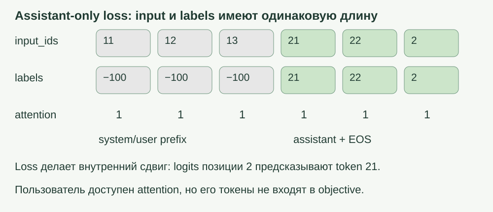

# M12-L06. Из диалога в обучающий пример: токены и маска потерь

**Результат:** подготовить настоящий диалог для causal LM и доказать, что loss считается только по ответу assistant.

**До урока:** M08-L05, M09-L01, M12-L02. Сначала завершить биграммный опыт M12-L03–L05. План: 45 минут объяснения, 90 минут токенизации и проверок, 45 минут новой задачи.

> **Версии и дата проверки:** Python 3.11.9, PyTorch 2.15.0+cpu, transformers 4.57.6; токенизатор SmolLM2-135M-Instruct (ревизия 12fd25f) · проверено 04.11.2026 · источник: [PyTorch 2.15: CrossEntropyLoss](https://docs.pytorch.org/docs/2.15/generated/torch.nn.CrossEntropyLoss.html)

## Объяснение

### Что именно обучаем

В instruction tuning мы показываем модели входную инструкцию и желательный ответ. Но оптимизировать всю последовательность как обычный текст — другое решение: тогда модель также учится предсказывать формулировку пользователя. В этом опыте задача уже: по пользовательскому ответу выдать короткое уточнение или следующий вопрос. Поэтому целевой loss включается только для assistant-части.

Веса при этом действительно изменяются: в следующем уроке обучаются маленькие адаптеры внутри существующего pretrained Transformer. В этом уроке мы сначала проверяем, **каким токенам** изменение должно помогать. Неверная разметка цели способна дать уменьшающийся loss и бессмысленный результат, поэтому нельзя начинать с долгого обучения.

Представь игрушечные ID: prefix=[11,12,13], assistant=[21,22,2], где 2 — конец ответа. Полный input_ids=[11,12,13,21,22,2]. Labels=[−100,−100,−100,21,22,2]. Значение−100 означает «игнорировать эту позицию при потере», оно не является токеном словаря и не подаётся модели как текст.

### Где происходит сдвиг

При causal LM logits позиции t предсказывают token t+1. У AutoModelForCausalLM сдвиг labels происходит внутри вычисления loss. Поэтому labels имеют ту же длину, что input_ids; вручную сдвигать их второй раз нельзя. В нашем примере logits позиции 2 должны учиться предсказывать 21 — первый ответ assistant. Маска на labels[3] разрешает этот член потери после внутреннего сдвига.

Проверка вручную: взять logits[:,:−1], labels[:,1:], развернуть и вызвать CrossEntropyLoss(ignore_index=−100). Результат должен совпасть с model(...,labels=labels).loss в eval. Если замаскировать ещё и первый токен ответа, модель не получит сигнала о том, как начинать ответ. Если забыть конец ответа, она может хуже учиться останавливаться.



### Шаблон важнее количества символов

Настоящий tokenizer добавляет границы ролей и специальные токены. Нельзя взять len(user_text) и использовать это число как длину token-prefix. Нужно применить тот же chat template к сообщениям system/user с add_generation_prompt=True, затем к полному диалогу с assistant. Начало полного списка ID должно точно совпасть с prefix. В лабораторной это явный assert: при другом tokenizer или template сначала исправляется граница, а не молча строится неверная маска.

Если последовательность слишком длинная, слепое обрезание может оставить ответ без вопроса или только начало ответа. В учебном контракте такие записи отклоняются. Это ограниченная, но понятная политика; позднее можно реализовать сокращение полных сообщений. Максимальная длина всегда измеряется токенами.

## Аналогия: snapshot-тест с игнорируемыми полями

Как похоже: snapshot-тест сравнивает тело ответа, а поля вроде эха запроса или временной метки помечает как игнорируемые — они есть в ответе, но не проверяются. Отдельно сетевой буфер помечает, какие байты настоящие, а какие — заполнение. Ответ на элемент t сверяют со следующим элементом, и индекс сдвигают ровно один раз: двойной сдвиг — классический off-by-one.

| В уроке | В аналогии |
| --- | --- |
| Labels = −100 на prefix | Игнорируемые поля snapshot-теста: запрос есть, но не сравнивается |
| Loss только на ответе assistant | Тест проверяет тело ответа, а не эхо запроса |
| attention_mask | Признак, какие байты буфера настоящие, а какие — заполнение |
| Сдвиг labels внутри модели | Ответ позиции t сверяют со следующим элементом: сдвиг один раз |
| Двойной сдвиг вручную | Off-by-one, применённый дважды: сравнение не с тем элементом |
| Prefix по chat template, а не по len(text) | Длину считают в байтах после сериализации, а не в символах исходной строки |
| Обрезка без конца ответа — отказ | Обрезанное тело — ошибка, а не «короткий ответ» |

**Где аналогия ломается:** игнорируемое поле snapshot-теста ни на что не влияет, а замаскированный prefix модель продолжает читать: causal attention использует весь контекст, маска лишь убирает эти позиции из потерь. И ошибка в тесте видна как красный прогон, а неверная маска даёт уменьшающийся loss и тихо учит не тому.

## Разобранный пример — без модели

```python
prefix = [11,12,13]
answer = [21,22,2]
ids = prefix + answer
labels = [-100]*len(prefix) + answer
supervised_pairs = [(ids[t], labels[t+1]) for t in range(len(ids)-1) if labels[t+1] != -100]
print(supervised_pairs)
assert supervised_pairs == [(13,21),(21,22),(22,2)]
```

Это не означает, что модель видит только последний input-token пары: causal attention может использовать весь доступный prefix. Пары показывают индексы целевых членов loss, а не ограничение памяти Transformer до одного символа, как в биграммном примере.

## Практика с поддержкой

**Предскажи до запуска.** Прежде чем запускать код или пересчитывать пример, запиши ожидаемый вывод: числа, формы массивов, порядок или текст. После запуска сравни с фактическим и объясни каждое расхождение.

Функция masked_example в `labs/M12/sft.py` применяет настоящий tokenizer SmolLM к авторским диалогам. После прогона следующего урока открой `mask_inspection` в отчёте: для каждого token ID сохранены его представление и label. Найди границу assistant, первый обучаемый токен и конец ответа. Затем сравни NLL, если ошибочно открыть labels пользователя. Другая величина loss не сравнивается напрямую как улучшение: изменился objective.

## Самостоятельная задача A

Выполни [контракт M12](../../exercises/M12/README.md). Для prefix=[4,5], answer=[6,7,2], max_length=7, pad_id=0 верни input_ids, attention_mask и labels с padding. Отвергни случай, когда max_length=4: не теряй конец целевого ответа молча. Объясни, сколько целевых токенов осталось и в какой позиции logits предсказывают 6.

## Критерии и типичные ошибки

Критерии: роли отделены token-prefix, padding и пользователь замаскированы, целевой EOS сохранён, двойного сдвига нет. Нулевой loss на полностью замаскированной записи не является успешным обучением; такая запись должна быть отклонена. Код, численный расчёт и объяснение сохраняются до ключа.

## Подсказки по очереди

1. Attention mask описывает существующие позиции, labels — участие в loss; это разные маски.
2. На пользовательских позициях attention_mask=1, хотя labels=−100.
3. Первый ответ начинается после двух prefix-токенов, но предсказывается предыдущей позицией.

## Новая и отложенная проверка

B: prefix длины 4, assistant только EOS. Явно опиши, допускает ли задача пустой текст. C через неделю: готовые labels уже сдвинуты вручную, а model делает сдвиг ещё раз. На IDs[1,2,3,4] покажи, какая ошибочная пара получается. Ответы в [ключах M12](../../solutions/modules/M12.md).

## Карточка урока

| Поле | Содержание |
| --- | --- |
| Правило | labels той же длины, что input_ids: −100 на prefix и padding, ID ответа assistant вместе с EOS; сдвиг на один токен модель делает внутри loss — второй раз вручную не сдвигают; prefix определяют тем же chat template с add_generation_prompt=True |
| Смысл величин | −100 — не токен словаря, а «не учитывать в loss»; attention_mask — какие позиции существуют, labels — какие участвуют в потерях; logits позиции t предсказывают токен t + 1; длину измеряют в токенах, а обрезка, теряющая конец ответа, — отказ |
| Когда применять | При подготовке диалога для causal LM. Пример: prefix [7, 8], ответ [30, 31, 2], max_length 6, pad 0 — input_ids [7, 8, 30, 31, 2, 0], attention_mask [1, 1, 1, 1, 1, 0], labels [−100, −100, 30, 31, 2, −100]; целевые пары 8→30, 30→31, 31→2 |
| Главная ошибка | Замаскировать первый токен ответа или EOS, сдвинуть labels дважды или считать длину prefix по символам |

## Источники и углубление

[Transformers chat templates](https://huggingface.co/docs/transformers/v4.57.5/en/chat_templating), [PyTorch CrossEntropyLoss](https://docs.pytorch.org/docs/2.15/generated/torch.nn.CrossEntropyLoss.html). Собственный код делает маскирование явно, чтобы не скрыть учебную цель внутри trainer/collator.
