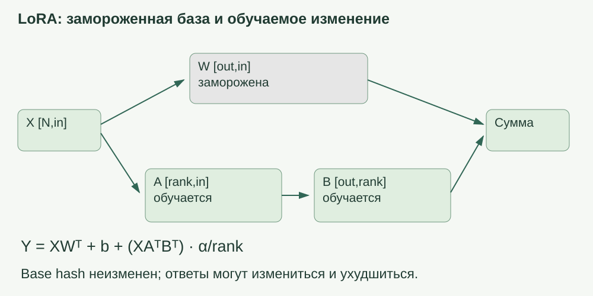

# M12-L07. Настоящий малый SFT: адаптер, checkpoint и регрессии

**Результат:** обучить небольшой адаптер pretrained Transformer, восстановить его и сравнить старые и новые случаи без подмены неудачных ответов.

**До урока:** M12-L04–L06, M09-L05. CPU, SmolLM2-135M-Instruct уже находится локально. План: 60 минут объяснения, 90–180 минут опыта и анализа, 90 минут самостоятельного варианта.

> **Версии и дата проверки:** Python 3.11.9, PyTorch 2.15.0+cpu, transformers 4.57.6; базовая модель SmolLM2-135M-Instruct (ревизия 12fd25f), адаптер rank 4 · проверено 04.11.2026 · источник: [карточка SmolLM2-135M-Instruct](https://huggingface.co/HuggingFaceTB/SmolLM2-135M-Instruct)

## Объяснение

### Почему этот опыт отличается от биграммы

Биграммная модель M12-L03 видела предыдущий символ. Здесь загружаются настоящие pretrained веса causal Transformer с tokenizer и chat template. Мы не переобучаем все 135 миллионов параметров: замораживаем их и добавляем обучаемые матрицы в проекции Q и V последних четырёх attention-блоков. Это ограниченный LoRA-подобный вариант, реализованный обычным PyTorch; библиотека PEFT для понимания механизма не обязательна.

Linear имеет вес W формы [out,in] и вычисляет xWᵀ+b. Адаптер добавляет BA, где A имеет форму [rank,in], B — [out,rank]. Поэтому forward равен base(x) + (xAᵀBᵀ)·α/rank. В опыте rank=4, α=8, множитель равен 2. У матрицы in=576,out=576 это 4·576+576·4=4608 обучаемых чисел вместо 331776. Размерность value-проекций в конкретной модели может отличаться; отчёт считает реальные формы.

A инициализируется небольшими случайными значениями, B нулями. Начальный добавочный выход равен нулю, но B получает ненулевой градиент. Если обнулить и A, и B, произведение имеет нулевые градиенты по обеим матрицам на первом шаге: обучение застрянет. Поэтому проверка числа trainable-параметров ещё не доказывает, что они меняются.



### Данные и заранее выбранное правило

В train12 английских синтетических ответов кандидата. Для расплывчатого ответа целевой текст — `CLARIFY: Name your own action.` Для ответа с действием и измерением — `NEXT: Explain one tradeoff.` Ещё четыре иных формулировки оставлены в check. Два общих вопроса, включая арифметический, образуют маленький old-набор для регрессий. Это демонстрация изменения формата поведения, а не доказательство качественного HR-анализа.

Число шагов 24, seed 41 и learning rate 0.006 фиксируются до просмотра check. Правило допустимости по потерям: check NLL должен уменьшиться, а old NLL не должен превысить исходный более чем на 20%. Даже прохождение этого правила требует отдельно прочитать свободные генерации: teacher-forced NLL и реальный диалог — разные проверки. Малые наборы не дают сильного статистического вывода.

## Разобранный пример

### Запуск полного опыта

```powershell
.\.venv\Scripts\python.exe labs\M12\sft.py
```

Результат находится в `artifacts/M12/sft`: `adapter.pt`, `config.json`, `data.json`, `report.json`. В отчёте записаны train/check/old потери, тексты до/после, mask_inspection, число обучаемых параметров, время и SHA256 замороженной базы. Код проверяет, что база не изменилась, train objective уменьшился, сохранённые адаптеры действительно меняют logits и после восстановления дают тот же результат.

Сохранённый адаптер не является самостоятельной LLM. Для применения нужны та же базовая ревизия, соответствующая архитектура, правильные target modules, rank и scale. Подключить его к другой модели по совпавшему имени файла нельзя. Конфигурация рядом с checkpoint — часть воспроизводимого артефакта.

### Как читать отрицательный результат

В авторском прогоне check NLL снизился примерно с 3.533 до 0.332, но точный требуемый ответ получился только в 2 из 4 случаев. На расплывчатые ответы модель продолжала выдавать NEXT вместо CLARIFY. Поэтому численный loss guard прошёл, а выпуск по предметному правилу запрещён. Отчёт отдельно хранит release_allowed_by_loss_guard и окончательный release_allowed: неверный тип команды является критической ошибкой данного небольшого задания.

В дополнительном варианте с третьей командой LIMIT модель начинает часто отвечать LIMIT и на старые случаи. Это наглядная регрессия поведения, хотя old NLL на двух общих вопросах не обязательно растёт. Защитный набор должен включать старые прикладные случаи, а не только общие вопросы. Сохранённые before/comparison_adapter/after позволяют увидеть этот эффект напрямую.

Если новая задача улучшилась, а старые ответы ухудшились, замороженная база не является оправданием: на выход всё равно влияет адаптер. Защитные варианты — меньший шаг, меньше адаптируемых слоёв, смесь старых примеров, изменение rank или отказ от дообучения. Выбирай одну гипотезу по development; затем проверяй её на новом независимом наборе. Не перебирай гипотезы по одному check бесконечно.

Если модель стала выдавать одинаковую команду всем, train NLL может уменьшиться на частом шаблоне. Поэтому в сохранённых случаях нужны оба класса, разные формулировки и разбор ошибок. Для русского интервью исходная английская модель и этот корпус не дают права обещать качество. Русскую адаптацию нужно рассматривать отдельным экспериментом с подходящей моделью и оцениванием.

## Практика с поддержкой

Найди в checkpoint только `.a` и `.b` tensors. Посчитай их число независимо от отчёта. Выбери один пример до/после и проверь, соответствует ли ответ правилу задачи. Сравни hash базы до и после; объясни, почему неизменный hash не гарантирует отсутствия регрессий системы.

## Самостоятельная задача A

Сделай отдельную версию опыта: добавь шесть train-примеров нового поведения «попросить объяснить ограничение измерения», а check составь из четырёх других ситуаций. Старые check/old сохрани как регрессию. До запуска выбери число шагов и критерий. Сравни базу, исходный адаптер и свой адаптер; сохрани неудачные генерации. Проверь восстановление весов и правильную loss mask. Используй [контракт подготовки примера](../../exercises/M12/README.md), но данные и решение о выпуске подготовь самостоятельно.

## Критерии и типичные ошибки

Неперекрываемые условия: полный код запуска, корректные labels, замороженная база, восстановимый адаптер, отсутствие настройки по финальному check, объяснение решения по всем трём вариантам. Высокое качество не обязательно; честно обоснованный отказ выпуска — допустимый инженерный результат.

## Новая и отложенная проверка

B: намеренно обнули обе матрицы A/B в маленьком Linear и проверь градиенты. C через 7–10 дней: checkpoint содержит rank 8, а загрузчик создал rank 4. Что должно произойти до инференса и почему нельзя молча пропустить несовпавшие веса? [Ключи](../../solutions/modules/M12.md) содержат объяснения и команды.

## Источники и углубление

[LoRA: исходная статья](https://arxiv.org/abs/2106.09685), [Hugging Face: устройство LoRA](https://huggingface.co/docs/peft/main/conceptual_guides/lora). Реализация курса намеренно ограничена одной проверенной архитектурой; это не универсальный заменитель PEFT.
