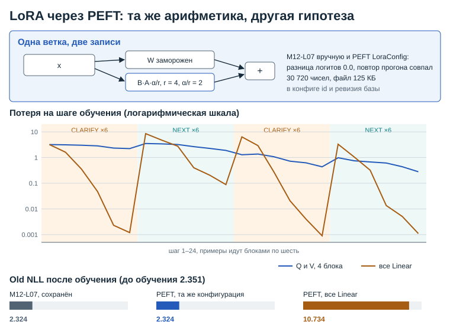
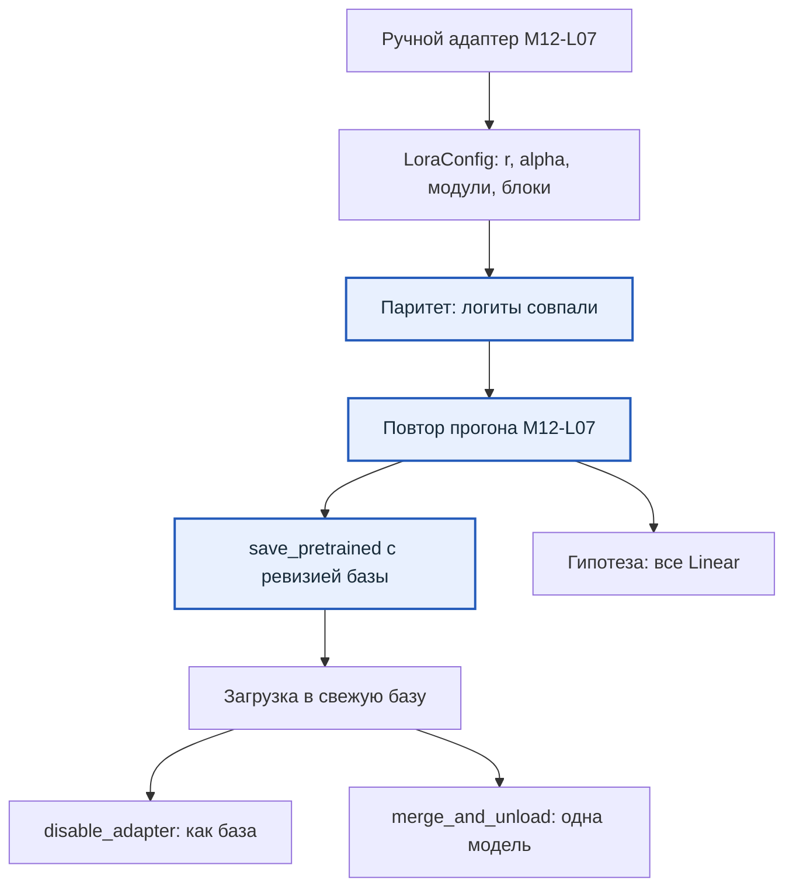

# M12-L08X. LoRA через PEFT

**Расширение 1.2.0.** Урок дополняет модуль, не входит в обязательный минимум 1.1.0.

**Результат:** перенести ручной адаптер M12-L07 на библиотеку PEFT и доказать по логитам, что это та же арифметика. Затем воспроизвести сохранённый прогон SFT, проверить одну заранее записанную гипотезу и сохранить адаптер в формате, который понимают другие инструменты.

**До урока:** M12-L04, M12-L07. Тесты и отчёт работают без модели и без PEFT. Прогон требует пакет `peft` (`requirements-optional.in`) и локальную SmolLM2-135M-Instruct из M09; на CPU он занимает около минуты. Ориентир — 150 минут чтения, прогона и задачи; это плановая гипотеза, а не измеренное время.

> **Версии и дата проверки:** Python 3.11.9, PyTorch 2.15.0+cpu, transformers 4.57.6, PEFT 0.21.2; SmolLM2-135M-Instruct (ревизия 12fd25f) · проверено 07.11.2026 · источник: [PEFT: LoRA](https://huggingface.co/docs/peft/package_reference/lora)

## Объяснение

### Ручной адаптер и его запись в PEFT

В M12-L07 адаптер написан вручную: к замороженному Linear добавлена ветка `x·Aᵀ·Bᵀ·α/r`. Ранг r = 4, α = 8, поэтому множитель α/r = 2. Ветка стоит в проекциях Q и V четырёх последних блоков SmolLM2. PEFT задаёт то же самое конфигурацией `LoraConfig`:
- `r=4` и `lora_alpha=8` — ранг и множитель;
- `target_modules=["q_proj", "v_proj"]` — какие Linear обернуть;
- `layers_to_transform=[26, 27, 28, 29]` — в каких блоках, всего их у SmolLM2 30;
- `lora_dropout=0` — без случайного выключения входов при обучении, как в M12-L07.

Число обучаемых параметров считается по формам матриц. A имеет форму [r, in], B — [out, r], поэтому на один Linear приходится r·(in + out) чисел. У q_proj вход и выход по 576: 4·(576 + 576) = 4608 чисел. У v_proj выход 192: 4·(576 + 192) = 3072. Четыре блока по два модуля дают 4·(4608 + 3072) = 30 720, то же число, что в отчёте M12-L07. Полная матрица q_proj — это 576·576 = 331 776 чисел.

Есть одно отличие по умолчанию. PEFT заполняет A равномерным распределением Kaiming, а M12-L07 — нормальным N(0; 0.02). B в обоих случаях нулевая, поэтому в начале адаптер ничего не добавляет. В лабораторной A заполняют так же, как в M12-L07: сравнивать прогоны можно только с одного старта.

### Паритет: та же арифметика

Прежде чем доверять библиотеке, проверь её на известном ответе. Лабораторная кладёт одинаковые A и одинаковую ненулевую B в ручной адаптер и в PEFT и сравнивает логиты на одном примере. Затем она обучает PEFT-адаптер на тех же данных, в том же порядке, с тем же seed, числом шагов и learning rate. Если библиотека считает то же самое, совпадут и потери, и генерации сохранённого прогона M12-L07, включая его отрицательный результат.

### Что даёт библиотека

- **`save_pretrained`** пишет два файла: `adapter_config.json` и `adapter_model.safetensors`. Веса адаптера занимают около 125 КБ, а база — около 540 МБ (135 млн чисел по 4 байта). По умолчанию в конфиг попадает локальный путь к базе. Лабораторная записывает вместо него id модели на Hugging Face и ревизию, иначе через полгода не понять, к какой базе адаптер подходит.
- **`PeftModel.from_pretrained(base, path)`** загружает адаптер в свежую базу.
- **`disable_adapter()`** временно выключает адаптер, и модель ведёт себя как база без перезагрузки. Так удобно сравнивать старые случаи, и так же TRL получает опорную модель в M12-L09X.
- **`merge_and_unload()`** прибавляет B·A·α/r к весу W и возвращает обычную модель без отдельной ветки. Задержка на генерацию не растёт, но выключить адаптер уже нельзя, поэтому отдельный артефакт адаптера храни всегда.
- **QLoRA** держит базу в 4 битах (bitsandbytes), а LoRA обучает поверх неё. Так модель на 7 млрд параметров дообучают на одной видеокарте. Обычный путь для QLoRA — видеокарта с CUDA, поэтому в курсе она не запускалась и не проверялась.

### Гипотеза, записанная до прогона

Провал M12-L07: на расплывчатые ответы модель пишет NEXT вместо CLARIFY. До запуска в коде записана одна гипотеза: адаптеру не хватает ёмкости. Вариант `wide` ставит LoRA ранга 4 на все Linear всех 30 блоков: 1 221 120 обучаемых чисел в 210 модулях, в 40 раз больше. Остальное не меняется: данные, порядок, шаги, learning rate, инициализация.



Сопоставь рисунок с таблицей авторского прогона: какой вариант сильнее всего испортил старые вопросы и что про причину говорит история потерь.

## Аналогия: официальный SDK вместо самописного клиента

Backend-разработчик заменял самописный HTTP-клиент чужого API на официальный SDK. Сначала контрактный тест проверяет, что SDK отправляет те же запросы, а потом в дело идут его удобства: сериализация, версии, флаги.

| В уроке | В аналогии |
| --- | --- |
| Ручной адаптер M12-L07 | Самописный клиент API |
| `LoraConfig` в PEFT | Официальный SDK с конфигурацией |
| Паритет логитов 0.0 | Контрактный тест: SDK шлёт те же байты |
| Повтор прогона M12-L07 | Регрессионный прогон на записанных запросах |
| Ревизия базы в `adapter_config.json` | Точная версия зависимости в lock-файле |
| `disable_adapter()` | Выключенный feature flag: старое поведение без передеплоя |
| `merge_and_unload()` | Сборка в один бинарник: быстрее, но флаг уже не выключить |

**Где аналогия ломается:** контрактный тест SDK проходит раз и навсегда, а паритет обучения держится только при тех же условиях. С `lora_dropout` больше нуля или с перемешиванием примеров та же конфигурация даст другой адаптер. И если поднять SDK-клиенту размер пула соединений, ничего не сломается, а у LoRA больше адаптированных весов при том же learning rate сломали старые ответы.

## Разобранный пример

Python-блок выполняй из корня `C:\projects\ml-llm-course` в окружении курса. Ни модель, ни PEFT для него не нужны. Пример пересчитывает число параметров по формам матриц SmolLM2, сверяет размер файла адаптера и проверяет, что PEFT повторил сохранённый прогон M12-L07.

```python
import json
from pathlib import Path

hidden, kv, inner, blocks, rank = 576, 192, 1536, 30, 4


def lora(n_in, n_out):
    return rank * (n_in + n_out)  # A: rank x in, B: out x rank


same = 4 * (lora(hidden, hidden) + lora(hidden, kv))  # q_proj and v_proj in the last four blocks
block = 2 * lora(hidden, hidden) + 2 * lora(hidden, kv) + 2 * lora(hidden, inner) + lora(inner, hidden)  # q o k v gate up down
assert same == 30_720 and blocks * block == 1_221_120

report = json.loads(Path("quality/lora/report.json").read_text(encoding="utf-8"))
artifact = report["runs"]["same"]["artifact"]
size = artifact["files"]["adapter_model.safetensors"]
assert same * 4 <= size < same * 4 + 4096  # float32 weights plus a small header
assert artifact["config"]["revision"] == report["revision"]

saved = json.loads(Path("quality/measurements-1.1.0/M12-sft-report.json").read_text(encoding="utf-8"))
after = report["runs"]["same"]["after"]
assert abs(after["check_nll"] - saved["after"]["check_nll"]) < 1e-3
assert [g["actual"] for g in after["check_generations"]] == [g["actual"] for g in saved["after"]["check_generations"]]
print(size, report["parity_max_abs_error"], artifact["merge_max_abs_error"])
```

Формула числа параметров совпала с отчётом, а файл весит ровно столько, сколько 30 720 чисел float32 плюс заголовок. PEFT повторил и цифры, и генерации M12-L07. Значит, отрицательный результат того урока не связан с ручной реализацией адаптера.

### Авторский прогон 07.11.2026

```powershell
.\.venv\Scripts\python.exe -m pip install -r requirements-optional.in
.\.venv\Scripts\python.exe labs\M12\lora_peft.py run
.\.venv\Scripts\python.exe labs\M12\lora_peft.py report
```

Те же 12 train, 4 check и 2 old примера, что в M12-L07. Неверная команда — CLARIFY вместо NEXT или наоборот, а также ответ без команды.

| Вариант | Check NLL | Old NLL | Неверных команд |
| --- | --- | --- | --- |
| M12-L07 вручную, 30 720 чисел, сохранён | 3.533 → 0.332 | 2.351 → 2.324 | 2 из 4 |
| PEFT, та же конфигурация, 30 720 чисел | 3.533 → 0.332 | 2.351 → 2.324 | 2 из 4 |
| PEFT, все Linear, 1 221 120 чисел | 3.533 → 1.593 | 2.351 → 10.734 | 2 из 4 |

Что показал прогон:
- **PEFT повторил ручной адаптер точно.** На паритете логиты совпали до последнего бита: наибольшая разница 0.0. После 24 шагов совпали потери до третьего знака и все генерации, включая «NEXT: Explain your name and your name.» на расплывчатый ответ. Обучение заняло 4.8 секунды.
- **Артефакт проходит все проверки.** Файл весов — 124 960 байт. Загрузка в свежую базу дала разницу логитов 0.0. С выключенным адаптером модель совпала с базой тоже до 0.0, а с включённым отличалась от неё на 17.7: адаптер действительно меняет выход. После слияния разница 3·10⁻⁵ — это округление float32.
- **Гипотеза о ёмкости не подтвердилась.** Вариант `wide` снизил check NLL только до 1.593 и не исправил ни одной команды: все четыре ответа check — NEXT. Старые вопросы сломались: old NLL вырос в 4.6 раза, на «What is 2 plus 2?» модель ответила «NEXT: Explain one trade:».
- **История потерь указывает на другую причину.** В train шесть примеров CLARIFY идут подряд, затем шесть NEXT, и так дважды. Внутри блока потеря `wide` падала почти до нуля (0.001), а на смене класса подскакивала до 8.5. Адаптер запоминал последний блок, а последние шесть шагов — NEXT. Эту гипотезу о порядке примеров проверяет задача A.

У автора весь прогон занял около минуты.

## Схема



Переход с ручного адаптера на PEFT. Конфигурация переводит ранг, множитель, модули и блоки в параметры библиотеки. Паритет и повтор прогона доказывают, что считается то же самое. Только после этого используются удобства библиотеки: сохранение с ревизией базы, загрузка в свежую модель, выключение адаптера и слияние. Гипотеза об улучшении проверяется отдельным вариантом, записанным до прогона. Выделены шаги, без которых результату библиотеки нельзя доверять.

## Практика с поддержкой

**Предскажи до запуска.** Запиши ожидаемый вывод до запуска кода. Совпадут ли логиты ручного адаптера и PEFT до последнего знака или только приблизительно? Сколько байт займёт файл адаптера? Что станет со старыми вопросами, если адаптировать все Linear? После запуска сравни с фактическим и объясни каждое расхождение.

1. Выполни `.\.venv\Scripts\python.exe labs\M12\lora_peft.py report` и сверь таблицу с авторским прогоном.
2. Если PEFT установлен, выполни `run`. Открой `artifacts/M12/lora/same/adapter_config.json`: найди ревизию базы, ранг, модули и блоки.
3. В `quality/lora/report.json` выпиши историю потерь `wide` по шагам 1–12 и отметь, где меняется класс примеров.
4. Объясни по коду лабораторной, почему разница после `merge_and_unload` не нулевая, а после повторной загрузки — нулевая.

## Самостоятельная задача A — M12-L08X-A

Проверь гипотезу о порядке примеров. Возьми конфигурацию `same`: Q и V четырёх последних блоков, 24 шага, тот же seed и learning rate. Измени только порядок train: CLARIFY и NEXT должны чередоваться, а не идти блоками по шесть. Запиши предсказание до запуска. Затем сравни с `same`: check NLL, тип команды на check, old NLL и ответы на старые вопросы. Реши, пропускает ли такой адаптер правило выпуска M12-L07, и объясни, почему четыре примера check не доказывают гипотезу.

## Подсказки по очереди

1. Модель с адаптером собирается вызовами `get_peft_model(base, lab.lora_config("same", 30))` и `lab.init_like_m12(model, lab.SEED)`.
2. Чередующийся порядок индексов: `[i for pair in zip(range(6), range(6, 12)) for i in pair]`.
3. Цикл обучения и замеры уже есть: `lab.train(model, rows)` и `lab.stage(sft, tokenizer, model, data)`.
4. Правило выпуска M12-L07 состоит из двух частей: check NLL снизился, old NLL вырос не больше чем на 20%, и на check нет неверной команды. Прочитай и ответы на старые вопросы.

## Критерии и типичные ошибки

**Критерии до попытки:** перед заменой реализации есть паритет на известных весах. Сравнение с прежним результатом идёт с одного старта и на тех же данных. Артефакт адаптера записывает ревизию базы и проверяется загрузкой в свежую модель. Гипотеза записана до прогона, и меняется в ней одно условие. Отрицательный результат сохранён. Для самостоятельного зачёта объясни без открытого кода, что означают `r`, `lora_alpha`, `target_modules` и `layers_to_transform`, и посчитай число обучаемых параметров для своей конфигурации.

**Типичные ошибки:** сравнивать PEFT с ручным адаптером при разной инициализации и считать разницу заслугой библиотеки; хранить в `adapter_config.json` локальный путь вместо id и ревизии базы; сливать адаптер и выбрасывать отдельный артефакт; добавлять ёмкость, не посмотрев на историю потерь; менять сразу несколько условий и называть результат проверкой одной гипотезы; считать выпуск разрешённым, не прочитав ответы на старые вопросы.

## Новая и отложенная проверка

**Повтор B:** посчитай число обучаемых параметров LoRA ранга 8 на q_proj, k_proj, v_proj и o_proj всех 30 блоков SmolLM2. Сколько займёт файл весов в float32 и какая это доля от 134.5 млн параметров базы? **Отложенная C:** ты дообучаешь адаптер для русского тренажёра на модели побольше. Перечисли, что записать вместе с адаптером, чтобы через полгода его можно было загрузить и проверить. Реши, когда сливать адаптер с базой, а когда держать несколько адаптеров на одной базе и переключать их. [Ключи](../../solutions/modules/M12.md) открывай после сохранения попытки.

## Карточка урока

| Поле | Содержание |
| --- | --- |
| Правило | Перед заменой ручной реализации библиотекой нужен паритет на известных весах и повтор прежнего прогона. Адаптер хранится с id и ревизией базы и проверяется загрузкой в свежую модель. Гипотеза об улучшении записывается до прогона и меняет одно условие |
| Смысл величин | r — ранг, lora_alpha/r — множитель ветки, target_modules и layers_to_transform — где стоит адаптер. Число обучаемых параметров — сумма r·(in + out) по адаптированным Linear |
| Когда применять | Когда дообучение нужно повторять, хранить и переключать. Пример: PEFT повторил M12-L07 точно (30 720 параметров, файл 125 КБ, паритет 0.0), а адаптер на всех Linear (1.2 млн параметров) поднял old NLL с 2.35 до 10.73 и не исправил ни одной команды |
| Главная ошибка | Добавлять ёмкость вместо разбора причины и хранить адаптер без ревизии базы |

## Источники и углубление

Статья [LoRA: Low-Rank Adaptation of Large Language Models](https://arxiv.org/abs/2106.09685) (Hu и др., 2021). Документация [PEFT: LoRA](https://huggingface.co/docs/peft/package_reference/lora) — параметры `LoraConfig`, `merge_and_unload`, `disable_adapter`. Статья [QLoRA](https://arxiv.org/abs/2305.14314) (Dettmers и др., 2023) — дообучение поверх 4-битной базы, нужна CUDA. В курсе: адаптер вручную и правило выпуска — M12-L07, маска потерь — M12-L06, DPO поверх этого адаптера — M12-L09X.
