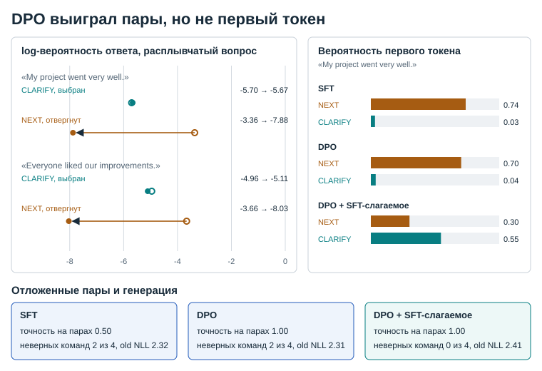
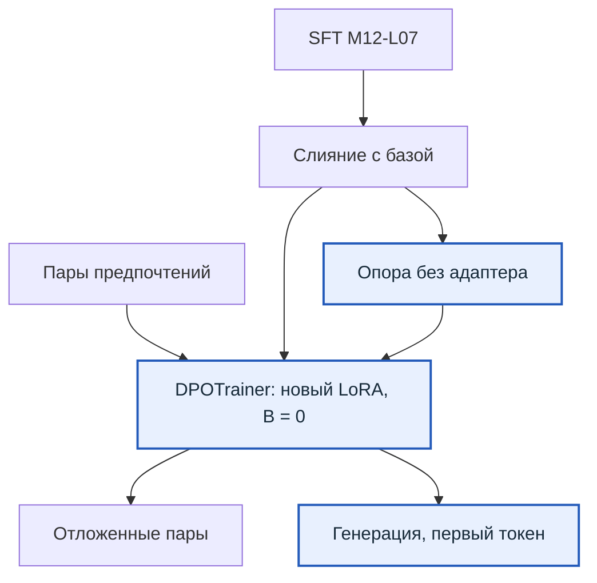

# M12-L09X. DPO через TRL: предпочтения вместо целевого ответа

**Расширение 1.2.0.** Урок дополняет модуль, не входит в обязательный минимум 1.1.0.

**Результат:** собрать пары «выбранный — отвергнутый ответ» и обучить DPO через TRL поверх SFT из M12-L07. Нужно проверить формулу потерь на первом шаге и отличить рост точности на парах от изменения того, что модель генерирует.

**До урока:** M12-L07, M12-L08X. Тесты и отчёт работают без модели и без TRL. Прогон требует пакеты `peft` и `trl` (`requirements-optional.in`) и локальную SmolLM2-135M-Instruct из M09; на CPU он занимает около полутора минут. Ориентир — 150 минут чтения, прогона и задачи; это плановая гипотеза, а не измеренное время.

> **Версии и дата проверки:** Python 3.11.9, PyTorch 2.15.0+cpu, transformers 4.57.6, PEFT 0.21.2, TRL 1.17.1, datasets 5.0.1; SmolLM2-135M-Instruct (ревизия 12fd25f) · проверено 07.11.2026 · источник: [TRL: DPO Trainer](https://huggingface.co/docs/trl/dpo_trainer)

## Объяснение

### Чем DPO отличается от SFT

SFT учит модель повышать вероятность одного целевого ответа. DPO (Direct Preference Optimization, Rafailov и др., 2023) учится на парах: для одного запроса x есть выбранный ответ y_w и отвергнутый y_l. Потеря одной пары:

L = −log σ(β·[(log π(y_w|x) − log π_ref(y_w|x)) − (log π(y_l|x) − log π_ref(y_l|x))])

Смысл величин:
- **π** — обучаемая модель, **π_ref** — замороженная опорная модель, здесь это SFT из M12-L07;
- **log π(y|x)** — сумма log-вероятностей токенов ответа, как в маске потерь M12-L06;
- **β** — насколько крепко держаться за опорную модель, в лабораторной β = 0.1;
- **неявная награда** r(x, y) = β·(log π(y|x) − log π_ref(y|x)) — на сколько модель подняла ответ относительно опоры. Выражение в скобках умножено на β — это разность наград выбранного и отвергнутого ответов, её называют отрывом (margin).

Численный пример. В начале обучения π совпадает с π_ref: отрыв равен 0, σ(0) = 0.5, потеря равна ln 2 ≈ 0.693. После обучения в паре «My project went very well.» выбранный ответ поднялся на 0.036, а отвергнутый опустился на 4.517. Отрыв 0.1·(0.036 + 4.517) = 0.455, потеря −log σ(0.455) ≈ 0.49.

### Почему опорная модель — это SFT

Без опоры модели проще всего бесконечно занижать вероятность отвергнутых ответов, и она уходит от осмысленного текста. Опора и β не дают далеко уйти от SFT. В лабораторной SFT-адаптер сливается с базой, а TRL ставит поверх новый LoRA-адаптер. С выключенным адаптером та же модель и есть опора, поэтому вторая копия в памяти не нужна. Прогон это проверяет: log-вероятности с выключенным адаптером совпадают с SFT.

### Данные пар

Двенадцать пар собраны из train M12-L07. Выбранный ответ — ожидаемая команда, отвергнутый — другая команда: на расплывчатый ответ кандидата выбран CLARIFY и отвергнут NEXT, на ответ с измерением — наоборот. Четыре пары из check отложены для проверки. Формат диалоговый: `prompt` содержит сообщения system и user, `chosen` и `rejected` — по одному сообщению assistant. TRL сам применяет chat template, а потери считает только по токенам ответа.

### Что измерять

- **Точность на парах** — доля отложенных пар, где log π(y_w|x) > log π(y_l|x). Именно это DPO и оптимизирует.
- **Отрыв неявных наград** на отложенных парах.
- **Свободная генерация** — что увидит пользователь, и прежде всего тип команды.
- **Вероятность первого токена** ответа — с чего начнёт жадный декодер.
- **Check NLL и old NLL**, как в M12-L07.



Сопоставь рисунок с таблицей авторского прогона: какой из двух ответов сдвинулся сильнее и почему генерация от этого не изменилась.

## Аналогия: попарное обучение ранжированию в поиске

Backend-инженер, который делал поиск для RAG, видел обучение ранжированию по кликам. Модель учат, что документ A выше документа B, если пользователь выбрал A.

| В уроке | В аналогии |
| --- | --- |
| Пара chosen и rejected | Клик: пользователь выбрал документ A, а не B |
| DPO-потеря | Попарная потеря learning to rank |
| Опорная модель и β | Текущий ранжировщик, от которого новый не должен далеко уходить |
| Точность на парах | Доля пар, упорядоченных верно |
| Свободная генерация | Выдача, которую видит пользователь |
| Первый токен ответа | Первая позиция выдачи |

**Где аналогия ломается:** ранжировщик в поиске упорядочивает заданный набор документов. Языковая модель генерирует, и набор кандидатов бесконечен. Опустив одну отвергнутую строку, она может выдать соседнюю, которой в парах не было. В авторском прогоне так и случилось.

## Разобранный пример

Python-блок выполняй из корня `C:\projects\ml-llm-course` в окружении курса. Ни модель, ни TRL для него не нужны. Пример по замороженным log-вероятностям пересчитывает потерю и отрыв, проверяет первый шаг и раскладывает изменение каждой отложенной пары на вклад выбранного и отвергнутого ответа.

```python
import json
import math
from pathlib import Path

report = json.loads(Path("quality/dpo/report.json").read_text(encoding="utf-8"))
beta = report["beta"]


def loss(margin):
    return math.log1p(math.exp(-margin))  # -log sigmoid(margin)


assert report["first_loss"] == round(loss(0.0), 4) == 0.6931  # policy equals reference at step 0

sft, dpo = report["stages"]["sft"]["check_pairs"], report["stages"]["dpo"]["check_pairs"]
for before, after in zip(sft, dpo):
    up_chosen = after["logp_chosen"] - before["logp_chosen"]
    up_rejected = after["logp_rejected"] - before["logp_rejected"]
    margin = beta * (up_chosen - up_rejected)
    print(f"{before['prompt'][:28]:28} chosen {up_chosen:+.2f} rejected {up_rejected:+.2f} "
          f"loss {loss(margin):.3f} first token {after['first_chosen']:.2f} vs {after['first_rejected']:.2f}")
assert [round(beta * ((a["logp_chosen"] - b["logp_chosen"]) - (a["logp_rejected"] - b["logp_rejected"])), 3)
        for a, b in zip(dpo, sft)] == report["stages"]["dpo"]["check_reward_margins"]
```

Первая строка проверяет формулу: при совпадающих моделях потеря равна ln 2, и TRL записал ровно 0.6931. Разложение показывает, как DPO выиграл пары с расплывчатым ответом: выбранный CLARIFY почти не сдвинулся, а отвергнутый NEXT упал на 4.4–4.5. Вероятность того, что ответ начнётся с NEXT, при этом осталась около 0.7 и 0.56.

### Авторский прогон 07.11.2026

```powershell
.\.venv\Scripts\python.exe -m pip install -r requirements-optional.in
.\.venv\Scripts\python.exe labs\M12\dpo_trl.py run
.\.venv\Scripts\python.exe labs\M12\dpo_trl.py report
```

DPO: β = 0.1, сигмоидная потеря, 24 шага по 2 пары, постоянный learning rate 0.001, seed 41. Всё это записано в коде до прогона. Обучаемых чисел 30 720 — новый LoRA-адаптер той же формы, что в M12-L07. Неверная команда — CLARIFY вместо NEXT или наоборот, а также ответ без команды.

| Стадия | Точность на парах | Check NLL | Old NLL | Неверных команд |
| --- | --- | --- | --- | --- |
| База | 0.50 | 3.533 | 2.351 | 4 из 4 |
| SFT M12-L07 через PEFT | 0.50 | 0.332 | 2.324 | 2 из 4 |
| SFT и DPO | 1.00 | 0.387 | 2.305 | 2 из 4 |

Что показал прогон:
- **Формула и опора проверены.** Первая записанная потеря — 0.6931, ровно ln 2. Log-вероятности с выключенным адаптером совпали с SFT, значит, опорой действительно была SFT-модель.
- **DPO выиграл пары.** К последнему шагу потеря упала до 0.594, а на отложенных парах точность выросла с 0.50 до 1.00.
- **Генерация не изменилась по типу.** На расплывчатые ответы модель по-прежнему пишет NEXT, только другими словами: «NEXT: Explain your next question.» и «NEXT: Explain your actions and your own actions.». DPO почти не поднял выбранный CLARIFY (−5.70 → −5.67 и −4.96 → −5.11), зато опустил строку «NEXT: Explain one tradeoff.» (−3.36 → −7.88 и −3.66 → −8.03). Решение принимается на первом токене, а там NEXT остался вероятнее: 0.74 → 0.70 и 0.59 → 0.56 против 0.03–0.07 у CLARIFY. Модель обошла запрет соседней формулировкой, которой не было в парах.
- **Check NLL вырос с 0.332 до 0.387.** На парах с измерением DPO опустил и выбранный NEXT: −2.80 → −3.94 и −1.59 → −2.57. Отрыв всё равно положительный, потому что отвергнутый ответ упал ещё сильнее.
- **Старые вопросы DPO не починил.** На «What is 2 plus 2?» модель после SFT отвечала «NEXT: Explain:», и после DPO ответ тот же. Пар про старые вопросы не было, поэтому и сигнала исправить их не было.

Обучение DPO заняло около минуты, весь прогон вместе с SFT — около полутора минут.

## Схема



DPO поверх SFT. SFT-адаптер сливается с базой, и эта модель становится опорной. TRL ставит новый адаптер с нулевой B, поэтому в начале обучаемая модель совпадает с опорой и потеря равна ln 2. Опора — та же слитая модель с выключенным адаптером: на каждом шаге TRL считает log-вероятности выбранного и отвергнутого ответа с адаптером и без него. Оценка идёт двумя путями: по отложенным парам и по свободной генерации. Выделены новый адаптер, опорная модель и генерация: без проверки генерации рост точности на парах легко принять за исправление.

## Практика с поддержкой

**Предскажи до запуска.** Запиши ожидаемый вывод до запуска кода. Какой будет потеря на первом шаге и почему? Вырастет ли точность на отложенных парах? Начнёт ли модель отвечать CLARIFY на расплывчатые ответы? После запуска сравни с фактическим и объясни каждое расхождение.

1. Выполни `.\.venv\Scripts\python.exe labs\M12\dpo_trl.py report` и сверь таблицу с авторским прогоном.
2. В `quality/dpo/report.json` найди журнал `log`: потерю, `rewards/accuracies` и `rewards/margins` по шагам. Найди шаг, где точность на обучающем пакете падала до 0.5.
3. Для двух пар с расплывчатым ответом выпиши `first_chosen` и `first_rejected` до и после DPO.
4. Если TRL установлен, повтори прогон: `.\.venv\Scripts\python.exe labs\M12\dpo_trl.py run`. Числа должны совпасть: seed, порядок и жадная генерация заданы.

## Самостоятельная задача A — M12-L09X-A

DPO опустил отвергнутую строку, но почти не поднял выбранную. Добавь к DPO-потере SFT-слагаемое на выбранном ответе: в TRL это `loss_type=["sigmoid", "sft"]` с равными весами. Остальное не меняй. До запуска запиши предсказание: какой станет потеря на первом шаге, изменится ли тип команды на check и что будет со старыми вопросами. Запусти `.\.venv\Scripts\python.exe labs\M12\dpo_trl.py run --loss sigmoid sft --out artifacts\M12\dpo-sft` и сравни с основным прогоном. Реши, можно ли выпускать такую модель.

## Подсказки по очереди

1. SFT-слагаемое — средняя NLL выбранного ответа. На первом шаге к ln 2 прибавится NLL опорной модели на этом пакете.
2. Сравнивай одни и те же величины: точность на парах, check NLL, old NLL, тип команды и вероятность первого токена.
3. Старые вопросы не входят в пары. Подумай, откуда у модели возьмётся сигнал их исправить.
4. Правило выпуска M12-L07 требует прочитать и ответы на старые вопросы, а не только посчитать old NLL.

## Критерии и типичные ошибки

**Критерии до попытки:** пары отражают одно различие — тип команды. Опорная модель — та, от которой начинается обучение, и это проверено. Первая потеря сверена с ln 2. Настройки DPO записаны до прогона. Точность на парах, свободная генерация и старые вопросы оцениваются отдельно. Отрицательный результат сохранён. Для самостоятельного зачёта объясни без открытого кода смысл β и неявной награды и посчитай потерю пары по двум сдвигам log-вероятностей.

**Типичные ошибки:** считать рост точности на парах исправлением поведения; не проверять, что опора — именно SFT, а не база; давать в отвергнутых ответах одну формулировку и ждать, что модель откажется от всего класса; не читать первый токен и свободную генерацию; забывать, что DPO не чинит то, чего нет в парах, например старые вопросы.

## Новая и отложенная проверка

**Повтор B:** относительно опорной модели log-вероятность выбранного ответа упала на 1.0, а отвергнутого — на 3.0. Посчитай отрыв и потерю пары при β = 0.1 и β = 0.5. Почему при малом β потеря почти не отличается от ln 2, хотя пара уже упорядочена верно? **Отложенная C:** собери план пар предпочтений для русского тренажёра. Откуда взять выбранные и отвергнутые ответы, сколько разных формулировок отвергнутого нужно на один класс, как защитить старое поведение и чем проверить результат, кроме точности на парах. [Ключи](../../solutions/modules/M12.md) открывай после сохранения попытки.

## Карточка урока

| Поле | Содержание |
| --- | --- |
| Правило | DPO учится на парах относительно опорной модели. В начале потеря равна ln 2. Точность на парах — только цель оптимизации: поведение проверяют свободной генерацией, первым токеном и старыми вопросами |
| Смысл величин | log π(y∣x) — сумма log-вероятностей токенов ответа. Неявная награда — β·(log π − log π_ref). Отрыв — разность наград выбранного и отвергнутого ответа, потеря — −log σ(отрыва) |
| Когда применять | Когда есть пары «лучше — хуже» и SFT уже дал формат. Пример: DPO поднял точность на отложенных парах с 0.50 до 1.00, а команды остались неверными в 2 случаях из 4, потому что первый токен NEXT остался вероятнее (0.70 против 0.04) |
| Главная ошибка | Принимать выигранные пары за исправленную генерацию и ждать от DPO исправления того, чего нет в парах |

## Источники и углубление

Статья [Direct Preference Optimization: Your Language Model is Secretly a Reward Model](https://arxiv.org/abs/2305.18290) (Rafailov и др., 2023). Документация [TRL: DPO Trainer](https://huggingface.co/docs/trl/dpo_trainer) — формат пар, метрики `rewards/*`, типы потерь и их комбинации. В курсе: SFT и правило выпуска — M12-L07, LoRA через PEFT — M12-L08X, маска потерь — M12-L06.
