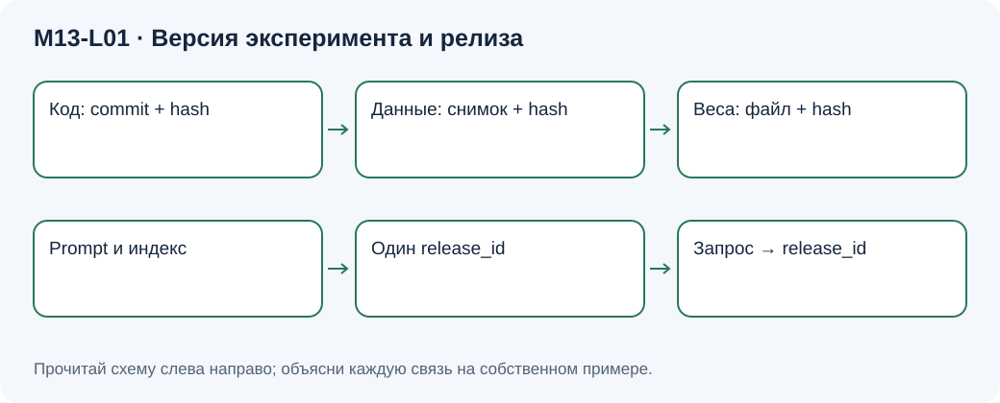

# M13-L01. Версия эксперимента и релиза

Версия материала: 1.1.0. Это самостоятельный урок: внешняя проверка наставником необязательна.

> **Версии и дата проверки:** Python 3.11.9, стандартная библиотека · проверено 04.11.2026 · источник: [Python 3.11: hashlib](https://docs.python.org/3.11/library/hashlib.html)

## Результат и входные знания

После урока ты сможешь: **Собрать идентифицируемый комплект кода, данных, модели и настроек.** Перед началом нужны M06, M09 и M11: сервис, версии моделей и проверка качества. Если термин из этого списка неясен, вернись к соответствующему уроку и воспроизведи его маленький пример. Продолжение по календарю не заменяет понимание зависимости.

## Объяснение

Версия ML-системы — больше, чем номер Python-пакета. На ответ одновременно влияют код подготовки данных, веса, токенизатор, инструкция, поисковый индекс, параметры генерации и правила оценки. Если сохранить только git commit приложения, восстановить поведение может быть невозможно. Релиз нужно рассматривать как согласованный комплект компонентов с явно зафиксированными связями.

Эксперимент отвечает на исследовательский вопрос и может содержать промежуточные настройки. Релиз задаёт конкретное поведение, которое разрешено запускать. Полезно сохранять оба идентификатора: experiment_id объясняет происхождение решения, release_id — то, что реально обслуживало запрос. Не переиспользуй имя «latest» как единственное доказательство версии: его содержимое может измениться между двумя запусками.

Контрольная сумма SHA-256 вычисляется по байтам файла. Если байты изменились, сумма почти наверняка изменится. Она помогает обнаружить случайную подмену и сопоставить артефакты, но не подтверждает качество модели или правдивость источника. Для JSON важно выбрать устойчивое представление: порядок ключей и пробелы меняют байты, хотя смысл объекта остаётся тем же. В лабораторной используется сортировка ключей и фиксированные разделители.

Манифест релиза хранит схему, версию, параметры модели и суммы исходного кода и данных. В более сложной системе добавятся токенизатор, индекс, версия рубрики, зависимости и сведения об оборудовании. Сами контрольные суммы не заменяют доступ к файлам: по хешу нельзя восстановить утраченный корпус. Поэтому файл и его идентификатор должны храниться согласованно.

Воспроизводимость имеет несколько уровней. Повторный запуск может дать битовое совпадение, близкие численные метрики либо одинаковое инженерное решение при небольшом разбросе. Сформулируй нужный уровень заранее. Для детерминированной линейной модели ожидается одинаковое предсказание; для случайной генерации естественнее фиксировать процедуру, набор запросов и распределение результатов. Слова «зафиксировали seed» недостаточно, если изменились документы или параметры декодирования.

Для голосового интервьюера полезна строка происхождения: session_id, turn_id, release_id, модель распознавания, модель диалога, инструкция, версия базы знаний и голоса. Тогда жалобу «вчера система исправляла верно, сегодня нет» можно связать с конкретным изменением. При этом журнал не обязан содержать необезличенную запись голоса. Идентификация версии и хранение пользовательского содержания — разные решения.



Сопоставь подписи с примером: объясни величины и укажи, какие отношения показаны на рисунке.

## Разобранный пример

Python-блок выполняй из корня `C:\projects\ml-llm-course` в окружении курса (например, в ячейке Jupyter).

Лабораторная M13 сохраняет release-1.0.json и release-1.1.json. Различаются version и weight:2 против 20. При x=2 первый релиз возвращает 5, второй 41. Сервис запускается в обоих случаях, поэтому номер успешного процесса не подтверждает правильность поведения.

```python
import hashlib, json
payload = json.dumps({'weight': 2, 'bias': 1},
                     sort_keys=True, separators=(',', ':')).encode()
print(hashlib.sha256(payload).hexdigest())
```

Одинаковые байты дают одинаковую сумму. Замена bias на 2 меняет сумму и предсказание. Перестановка ключей до канонизации сумму не меняет.

## Практика с поддержкой

Открой результат лабораторной и найди поле, которое позволит восстановить сами данные. Затем различи контрольную сумму и путь к содержимому. Добавь небольшую таблицу «компонент — идентификатор — способ восстановления» и проверь её, представляя запуск на новом пустом компьютере.

Для технической практики используй [лабораторную M13](../../labs/M13/README.md). Полный код находится отдельно от твоего решения. Сначала предскажи результат одного контрольного случая, затем запусти пример и объясни расхождение, если оно появилось. Запиши команду, версию окружения и фактический вывод, чтобы позже повторить опыт.

## Самостоятельная задача A

Составь манифест для тренажёра, у которого обновился только поисковый корпус. Укажи минимум восемь полей и объясни, какие файлы нужно сохранить для воспроизведения. Затем сравни два JSON с разным порядком ключей и докажи одинаковую каноническую сумму.

Сохрани первую попытку в `submissions/M13-L01.md`: исходные данные, результат и краткое обоснование.

## Подсказки по очереди

1. Перечисли компоненты, меняющие ответ без изменения кода: корпус, индекс, prompt, веса, токенизатор.
2. Для каждого хеша укажи, где лежит сам файл: по контрольной сумме содержимое восстановить нельзя.
3. Для JSON используй sort_keys=True и фиксированные separators, затем сравни сумму двух перестановок ключей.

## Критерии и типичные ошибки

За объяснение механизма, корректность проверки, воспроизводимость и ограничения поставь по 0–2 балла: 0 — отсутствует или неверно, 1 — частично с помощью, 2 — самостоятельно и обоснованно. Для перехода каждый критерий должен быть выполнен самостоятельно (2); понимание механизма и новая задача обязательны и не компенсируются другими баллами. При помощи сначала отметь «с поддержкой», затем реши вариант B без подсказки. Критических ошибок быть не должно. Критические ошибки: подмена реального измерения выдуманным, использование ответа из решения как собственной первой попытки, вывод о качестве за пределами проверенных данных, нарушение явно заданного ограничения задачи. Исправление должно сопровождаться новым примером, а не только заменой текста отчёта.

Первая самостоятельная попытка выполняется без готового решения. После неё разрешены объяснения AI, подсказки и [полный разбор](../../solutions/modules/M13.md#m13-l01). Отметь полученную помощь. Если решение стало понятно только после разбора, состояние навыка — «с поддержкой»; для самостоятельности реши новый вариант.

## Новая и отложенная проверка

B: commit=abc не менялся, corpus.txt обновился с «лимит 10» на «лимит 20». Какие версии сохранять? C через неделю: JSON {"b":2,"a":1} и {"a":1,"b":2}; что именно сравнивает канонический hash?

Сохрани новую попытку до просмотра [ключа B/C](../../solutions/modules/M13.md).

## Источники и углубление

- [Официальная документация по теме](https://docs.python.org/3/library/hashlib.html) — сверяй контракт и определения, не копируй внешний пример вместо самостоятельной работы.
- [Исполняемый пример модуля](../../labs/M13/demo.py) — авторский код курса с явно указанными ограничениями.

[Оглавление модуля](../modules/M13.md)
