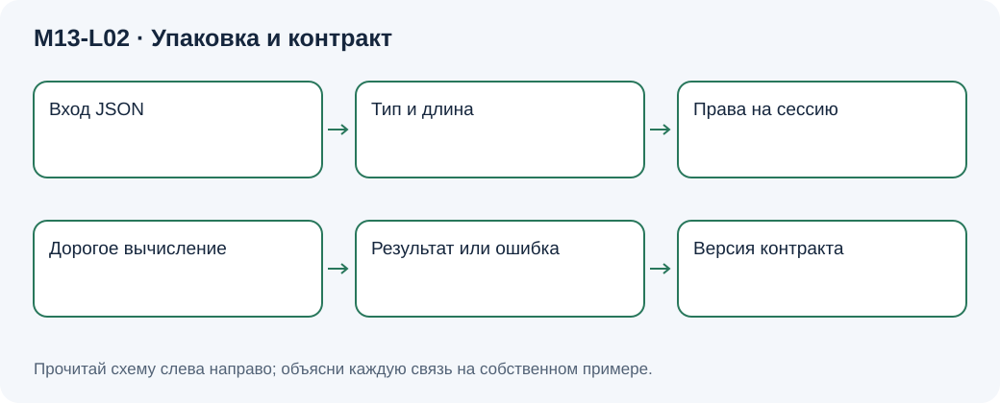

# M13-L02. Упаковка и контракт

Версия материала: 1.0.0. Это самостоятельный урок: внешняя проверка наставником необязательна.

## Результат и входные знания

После урока ты сможешь: **Описать допустимый вход и воспроизвести исполнение без скрытых настроек.** Перед началом нужны M13-L01: предыдущий шаг модуля. Если термин из этого списка неясен, вернись к соответствующему уроку и воспроизведи его маленький пример. Продолжение по календарю не заменяет понимание зависимости.

## Объяснение

Контракт описывает, что принимает и возвращает компонент, какие ошибки возможны и какие ограничения действуют. Для модели это включает не только тип JSON, но и смысл единиц измерения, допустимую длину, версию схемы и правила обработки пустых значений. Если одна сторона передаёт миллисекунды, а другая считает их секундами, синтаксически корректный запрос всё равно нарушает смысловой контракт.

В Python bool является подклассом int. Поэтому простая проверка isinstance(x, (int, float)) пропускает True как число 1. В прикладной схеме это часто неожиданно. Аналогично NaN и бесконечность имеют тип float, но могут разрушить сравнения, метрики и сериализацию. Нужны явные проверки конечности и ограничения предметной области. Обработка ошибочного входа должна завершаться понятным отказом до дорогостоящего вычисления.

Окружение задаёт исполняемый Python, версии библиотек и доступные системные компоненты. Виртуальное окружение изолирует Python-зависимости, но не устанавливает драйверы, микрофон или системный голос. Для нашего курса основной запуск выполняется через явный путь `.venv\Scripts\python.exe` из корня репозитория. Это устраняет неоднозначность между несколькими Python, установленными в Windows.

Упаковка приложения в контейнер может улучшить переносимость процесса, но не является обязательным условием понимания MLOps. Docker не делает модель точной, не добавляет отсутствующие данные и не превращает Windows SAPI в Linux-библиотеку. Обязательная лабораторная работает на CPU без Docker. Дополнительный контейнер для чистого Python-примера пригоден для изучения слоя зависимостей; полный голосовой проект имеет отдельные системные требования.

Проверка чистого запуска означает, что команды и зависимости достаточно описаны для нового окружения. Если разработчик вручную положил секретный файл в рабочую папку, а инструкция об этом молчит, воспроизводимость нарушена. Учебный репозиторий не должен требовать платный API. Модели скачиваются отдельно по зафиксированной инструкции, а обязательные тесты поясняют, какие файлы нужны.

Разделяй транспортный и модельный контракты. HTTP200 сообщает об успешно обработанном запросе, а поле prediction содержит вычисленный результат. Если модель не смогла выполнить задачу, не следует незаметно возвращать убедительный текст как успешный ответ. Ошибка должна иметь машинно различимое состояние, чтобы клиент мог предложить повтор или текстовый режим.



Схема показывает отношения между понятиями этого урока, а не измеренную производительность. Найди в объяснении смысл каждого блока. Затем закрой подписи и воспроизведи связи своими словами: что поступает на вход, что изменяется и по какому наблюдению можно проверить результат.

## Разобранный пример

Python-блок выполняй из корня `C:\projects\ml-llm-course` в окружении курса (например, в ячейке Jupyter). Для примеров M15 сначала создай `question.wav` запуском лабораторной.

Контракт лабораторной требует ровно одно поле x, конечное число и схему релиза 1. Запросы {'x':2} и {'x':−2} допустимы; {'x': True}, {'x':'2'}, {'y':2} и NaN отклоняются.

```python
import math
def validate(x):
    if isinstance(x, bool) or not isinstance(x, (int, float)):
        raise ValueError('finite number required')
    if not math.isfinite(x):
        raise ValueError('finite number required')
    return x
print(validate(2))
for invalid in [True, float('nan'), '2']:
    try:
        validate(invalid)
    except ValueError:
        print('rejected:', repr(invalid))
```

Это намеренно строгий контракт. Автоматическое преобразование строки"2" возможно в другой системе, но его следует документировать и проверять отдельно.

## Практика с поддержкой

Сначала проверь один валидный пример, затем меняй только одно поле. Составь таблицу ожидаемых отказов до запуска. Если весь набор меняется одновременно, причина ошибки теряется. Для проверки окружения используй явный путь Python и сохрани фактическую версию интерпретатора в отчёте.

Для технической практики используй [лабораторную M13](../../labs/M13/README.md). Полный код находится отдельно от твоего решения. Сначала предскажи результат одного контрольного случая, затем запусти пример и объясни расхождение, если оно появилось. Запиши команду, версию окружения и фактический вывод, чтобы позже повторить опыт.

## Самостоятельная задача

Спроектируй контракт сообщения голосового тренажёра с session_id, turn_id и text. Задай ограничения длины и типы, запрещённые лишние поля, ответ при пустом тексте и поведение неизвестной сессии. Подготовь четыре допустимых и шесть недопустимых примеров.

Сохрани собственную попытку в `submissions/M13-L02.md` и приложи код или данные, если они нужны. В отчёте должны быть исходное условие, ход проверки, результат и границы вывода. Не заменяй объяснение скриншотом успешного запуска: другой человек должен понять, почему результат отвечает на поставленный вопрос.

## Подсказки по порядку

1. Различи тип, длину и смысл: существующий session_id требует проверки сервером, а не только isinstance.
2. В Python bool проходит проверку int; запрети его отдельно для turn_id.
3. Неизвестную сессию и пустой текст отклоняй до вызова модели. Лишнее role=system не должно менять полномочия.

## Самопроверка и типичные ошибки

За объяснение механизма, корректность проверки, воспроизводимость и ограничения поставь по 0–2 балла: 0 — отсутствует или неверно, 1 — частично с помощью, 2 — самостоятельно и обоснованно. Для перехода нужны минимум 6 из 8 и отсутствие критических ошибок. Критические ошибки: подмена реального измерения выдуманным, использование ответа из решения как собственной первой попытки, вывод о качестве за пределами проверенных данных, нарушение явно заданного ограничения задачи. Исправление должно сопровождаться новым примером, а не только заменой текста отчёта.

Первая самостоятельная попытка выполняется без готового решения. После неё разрешены объяснения AI, подсказки и [полный разбор](../../solutions/modules/M13.md#m13-l02). Отметь полученную помощь. Если решение стало понятно только после разбора, состояние навыка — «с поддержкой»; для самостоятельности реши новый вариант.

## Новая и отложенная проверка

Через неделю добавь необязательное поле language. Объясни, как сохранить совместимость старого клиента и отличить отсутствие поля от неверного значения.

Запиши дату следующей проверки и конкретное условие. Состояние «подтверждено позже» появляется после её фактического выполнения, а не автоматически после чтения.

## Источники и углубление

- [Официальная документация по теме](https://json-schema.org/understanding-json-schema/reference/object) — сверяй контракт и определения, не копируй внешний пример вместо самостоятельной работы.
- [Исполняемый пример модуля](../../labs/M13/demo.py) — авторский код курса с явно указанными ограничениями.

[Оглавление модуля](../modules/M13.md)
