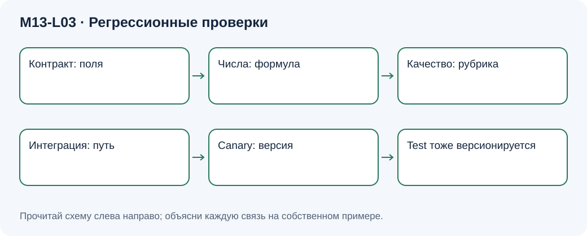

# M13-L03. Регрессионные проверки

Версия материала: 1.1.0. Это самостоятельный урок: внешняя проверка наставником необязательна.

> **Версии и дата проверки:** Python 3.11.9, стандартная библиотека · проверено 04.11.2026 · источник: [Python 3.11: unittest](https://docs.python.org/3.11/library/unittest.html)

## Результат и входные знания

После урока ты сможешь: **Разделить поломку контракта, численного расчёта и качества ответа.** Перед началом нужны M13-L02: предыдущий шаг модуля. Если термин из этого списка неясен, вернись к соответствующему уроку и воспроизведи его маленький пример. Продолжение по календарю не заменяет понимание зависимости.

## Объяснение

Регрессия — ухудшение ранее поддерживаемого поведения после изменения системы. Тесты нужны не для подтверждения, что файл существует, а для обнаружения такого ухудшения. В ML-сервисе важно различать несколько уровней. Проверка контракта ловит неправильные поля. Численный тест ловит ошибку формулы. Оценочный набор ловит нежелательное поведение модели. Интеграционный сценарий проверяет взаимодействие компонентов.

Малый детерминированный тест должен проверять конкретное свойство. Например, линейная модель с weight=2 и bias=1 обязана вернуть 5 при x=2. Если тест лишь запускает predict и проверяет наличие словаря, релиз с weight=20 пройдёт. Такой тест проверяет форму ответа, но не его смысл. Обе проверки полезны, если названы своими именами.

Для LLM точное совпадение всего текста часто слишком хрупко. Можно отдельно проверить JSON-схему, обязательные факты, отсутствие неподтверждённых утверждений и качество по рубрике. При этом расплывчатое условие «ответ выглядит хорошо» не воспроизводимо. Пример должен включать вход, ожидаемые свойства и объяснение критических ошибок. Человек или модель-судья должны видеть одну и ту же рубрику.

Canary в учебной лабораторной — небольшой фиксированный набор контрольных входов для проверки поведения релиза. Это не доказательство полного качества и не полноценный промышленный трафик. Три точки хорошо ловят ошибочный коэффициент линейной модели, но могут пропустить дефект только на больших значениях. Подбирай контрольные случаи из риска изменения: пустой ввод, граница длины, неизвестная тема, неправильная версия индекса.

Проверки следует запускать до переключения релиза и после него. Первая проверка оценивает подготовленный артефакт, вторая подтверждает, что активирован именно он и что окружение не изменило поведение. Если файл версии правильный, но процесс держит старую модель в памяти, проверка диска не обнаружит расхождение. В настоящем сервисе запрос должен возвращать идентификатор активной версии.

Тестовый набор тоже имеет версию. Изменение формулировок, источников или правил подсчёта может изменить метрику без изменения модели. Поэтому отчёт связывает release_id с evaluation_version. Если тест обновили, старый результат нельзя напрямую использовать как базовую линию, пока обе версии системы не прогнаны по одному и тому же набору.



Сопоставь подписи с примером: объясни величины и укажи, какие отношения показаны на рисунке.

## Разобранный пример

Python-блок выполняй из корня `C:\projects\ml-llm-course` в окружении курса (например, в ячейке Jupyter).

В M13 canary использует пары (0,1), (2,5), (−2,−3). Релиз 1.0 проходит три проверки, релиз 1.1 с коэффициентом 20 ошибается на двух ненулевых входах. Проверка x=0 в одиночку дефект не заметила бы: свободный член не изменился.

```python
cases = [(0, 1), (2, 5), (-2, -3)]
for weight, bias in [(2, 1), (20, 1)]:
    passed = all(weight * x + bias == y for x, y in cases)
    print(weight, passed)
```

Добавляя тест, объясни, какой неверный вариант программы он способен отличить от правильного. Это практический способ оценить содержательность проверки.

## Практика с поддержкой

**Предскажи до запуска.** Прежде чем запускать код или пересчитывать пример, запиши ожидаемый вывод: числа, формы массивов, порядок или текст. После запуска сравни с фактическим и объясни каждое расхождение.

Измени одну строку копии лабораторной: коэффициент 2 замени 20. До запуска предскажи, какие тесты должны упасть. Затем проверь наблюдение. Верни код и повтори только связанные проверки. Этот опыт не требует сложного фреймворка: важна способность теста обнаружить содержательную ошибку.

Для технической практики используй [лабораторную M13](../../labs/M13/README.md). Полный код находится отдельно от твоего решения. Сначала предскажи результат одного контрольного случая, затем запусти пример и объясни расхождение, если оно появилось. Запиши команду, версию окружения и фактический вывод, чтобы позже повторить опыт.

## Самостоятельная задача A

Для функции оценки интервью подготовь три вида тестов: структуру JSON, проверку конкретного факта и проверку рубрики. Придумай дефект, который проходит первый тест, но проваливает второй; затем дефект, который проходит первые два, но проваливает третий.

Сохрани первую попытку в `submissions/M13-L03.md`: исходные данные, результат и краткое обоснование.

## Подсказки по очереди

1. Первый тест проверяет поля и типы, второй — факт, третий — связь оценки с ответом кандидата.
2. Корректный JSON может утверждать, что commit отменяет транзакцию: это пример прохождения структуры и провала факта.
3. Верный учебный текст о транзакциях всё ещё может приписывать кандидату знание, которого он не показал.

## Критерии и типичные ошибки

За объяснение механизма, корректность проверки, воспроизводимость и ограничения поставь по 0–2 балла: 0 — отсутствует или неверно, 1 — частично с помощью, 2 — самостоятельно и обоснованно. Для перехода каждый критерий должен быть выполнен самостоятельно (2); понимание механизма и новая задача обязательны и не компенсируются другими баллами. При помощи сначала отметь «с поддержкой», затем реши вариант B без подсказки. Критических ошибок быть не должно. Критические ошибки: подмена реального измерения выдуманным, использование ответа из решения как собственной первой попытки, вывод о качестве за пределами проверенных данных, нарушение явно заданного ограничения задачи. Исправление должно сопровождаться новым примером, а не только заменой текста отчёта.

Первая самостоятельная попытка выполняется без готового решения. После неё разрешены объяснения AI, подсказки и [полный разбор](../../solutions/modules/M13.md#m13-l03). Отметь полученную помощь. Если решение стало понятно только после разбора, состояние навыка — «с поддержкой»; для самостоятельности реши новый вариант.

## Новая и отложенная проверка

B: функция верна на x=0,2,-2, но возвращает 0 при |x|>100. Добавь минимальный обнаруживающий тест. C через неделю: JSON содержит корректный факт «индекс занимает место», но оценка HR-конкретности основана на этом факте; какой уровень проверки обнаружит ошибку?

Сохрани новую попытку до просмотра [ключа B/C](../../solutions/modules/M13.md).

## Источники и углубление

- [Официальная документация по теме](https://docs.python.org/3/library/unittest.html) — сверяй контракт и определения, не копируй внешний пример вместо самостоятельной работы.
- [Исполняемый пример модуля](../../labs/M13/demo.py) — авторский код курса с явно указанными ограничениями.

[Оглавление модуля](../modules/M13.md)
