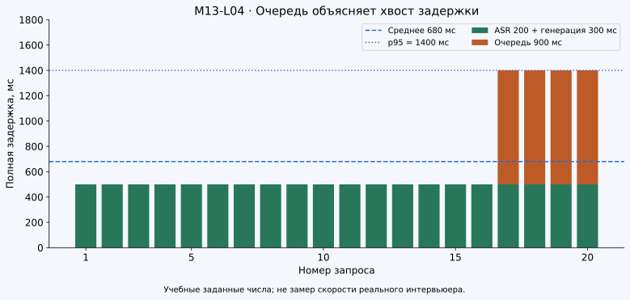

# M13-L04. Наблюдаемость и нагрузка

Версия материала: 1.1.0. Это самостоятельный урок: внешняя проверка наставником необязательна.

## Результат и входные знания

После урока ты сможешь: **Измерить задержки этапов и связать симптомы с возможным узким местом.** Перед началом нужны M13-L03: предыдущий шаг модуля. Если термин из этого списка неясен, вернись к соответствующему уроку и воспроизведи его маленький пример. Продолжение по календарю не заменяет понимание зависимости.

## Объяснение

Наблюдаемость помогает восстановить, что произошло внутри системы по внешним записям. Лог описывает отдельное событие, метрика агрегирует много событий, трассировка связывает этапы одного запроса. Для интервьюера полезно видеть распознавание, поиск, генерацию, синтез и доставку звука отдельно. Общая задержка без этапов показывает неудобство пользователя, но не объясняет причину.

Измеряй интервалы монотонными часами: они подходят для длительности даже при коррекции системного времени. Календарная метка нужна для сопоставления событий, а perf_counter — для elapsed time. Сохраняй единицы измерения в имени поля, например duration_ms. Ошибка тысячекратного масштаба встречается чаще, чем сложные статистические проблемы.

Среднее легко скрывает редкие долгие запросы. Медиана описывает центральный случай, p95 — границу, ниже которой находится примерно девяносто пять процентов наблюдений при выбранном определении квантиля. В лабораторной применяется nearest-rank: после сортировки берётся элемент ceil(0,95·n). При небольшом n высокий квантиль близок к максимуму и нестабилен. Всегда указывай число измерений.

Нагрузка состоит не только из числа запросов. Важны длина аудио, число токенов, размер контекста, конкурентность, прогрев и длительность опыта. Сто последовательных вызовов функции не показывают поведение при ста одновременных пользователях. Учебная M13 измеряет именно вызовы внутри процесса; переносить полученные микросекунды на веб-сервис нельзя.

Очередь возникает, когда запросы приходят быстрее, чем компонент успевает их обслуживать. Даже быстрый инференс может дать большую пользовательскую задержку из-за ожидания. Для голосового CPU-сервиса разумно сначала ограничить конкурентные тяжёлые задачи и явно показать занятость. Безграничное создание процессов способно ухудшить время для всех пользователей и исчерпать память.

Свяжи события через request_id и turn_id, добавь release_id и статус. Не записывай весь голосовой поток по умолчанию, если для диагностики достаточно размеров и времени. Для изучения ошибок качества сохраняй отдельно согласованные примеры. Логирование должно помогать ответить на инженерный вопрос, а не накапливать содержание без цели.



Сопоставь подписи с примером: объясни величины и укажи, какие отношения показаны на рисунке.

## Разобранный пример

Python-блок выполняй из корня `C:\projects\ml-llm-course` в окружении курса (например, в ячейке Jupyter).

Есть пять длительностей:10,10,12,14,100 мс. Среднее равно 29,2 мс, медиана 12 мс. При nearest-rank p95 равен 100 мс, поскольку ceil(0,95·5)=5. На столь малой выборке нельзя уверенно описать редкий хвост.

```python
import math
values = sorted([10, 10, 12, 14, 100])
p95 = values[math.ceil(.95 * len(values)) - 1]
```

Если общий запрос занимает 800 мс, из которых 600 мс — очередь, ускорение вычисления с 200 до 100 мс уменьшает итог лишь до 700 мс при неизменном ожидании.

## Практика с поддержкой

Открой requests.jsonl и вычисли p95 самостоятельно, не копируя итог из report.json. Найди request_id самого долгого вызова. Затем объясни, почему столь короткие вызовы функции дают шумные измерения и почему для продукта нужен отдельный тест полного пользовательского пути.

Для технической практики используй [лабораторную M13](../../labs/M13/README.md). Полный код находится отдельно от твоего решения. Сначала предскажи результат одного контрольного случая, затем запусти пример и объясни расхождение, если оно появилось. Запиши команду, версию окружения и фактический вывод, чтобы позже повторить опыт.

## Самостоятельная задача

Для двадцати запросов сохрани total_ms, queue_ms, asr_ms и generation_ms. В учебной таблице пусть у четырёх запросов очередь составляет 900 мс, у остальных 0; ASR200 мс и generation300 мс всегда. Вычисли среднее и p95 общего времени. Предложи проверку причины, которая не сводится к немедленной смене модели.

Сохрани первую попытку в `submissions/M13-L04.md`: исходные данные, результат и краткое обоснование.

## Подсказки по порядку

1. У шестнадцати запросов итог 500 мс, у четырёх 1400 мс. Не усредняй очередь отдельно от общей задержки.
2. Среднее вычисляется по всем двадцати наблюдениям; nearest-rank p95 — девятнадцатый элемент отсортированного списка.
3. Если ASR и генерация постоянны, исследуй очередь и конкурентность, сохраняя одинаковые входы.

## Самопроверка и типичные ошибки

За объяснение механизма, корректность проверки, воспроизводимость и ограничения поставь по 0–2 балла: 0 — отсутствует или неверно, 1 — частично с помощью, 2 — самостоятельно и обоснованно. Для перехода каждый критерий должен быть выполнен самостоятельно (2); понимание механизма и новая задача обязательны и не компенсируются другими баллами. При помощи сначала отметь «с поддержкой», затем реши вариант B без подсказки. Критических ошибок быть не должно. Критические ошибки: подмена реального измерения выдуманным, использование ответа из решения как собственной первой попытки, вывод о качестве за пределами проверенных данных, нарушение явно заданного ограничения задачи. Исправление должно сопровождаться новым примером, а не только заменой текста отчёта.

Первая самостоятельная попытка выполняется без готового решения. После неё разрешены объяснения AI, подсказки и [полный разбор](../../solutions/modules/M13.md#m13-l04). Отметь полученную помощь. Если решение стало понятно только после разбора, состояние навыка — «с поддержкой»; для самостоятельности реши новый вариант.

## Новая и отложенная проверка

B: сравни A=[500]*20 и B=[400]*18+[1400]*2 по среднему и nearest-rank p95. C через неделю: к каждому наблюдению B добавились 100 мс сети; пересчитай обе метрики и укажи, как не обвинить модель.

Сохрани новую попытку до просмотра [ключа B/C](../../solutions/modules/M13.md).

## Источники и углубление

- [Официальная документация по теме](https://docs.python.org/3/library/time.html#time.perf_counter) — сверяй контракт и определения, не копируй внешний пример вместо самостоятельной работы.
- [Исполняемый пример модуля](../../labs/M13/demo.py) — авторский код курса с явно указанными ограничениями.

[Оглавление модуля](../modules/M13.md)
