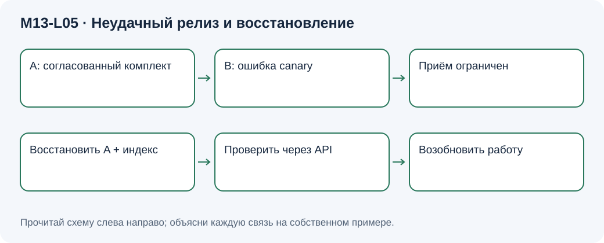

# M13-L05. Неудачный релиз и восстановление

Версия материала: 1.1.0. Это самостоятельный урок: внешняя проверка наставником необязательна.

> **Версии и дата проверки:** Python 3.11.9, стандартная библиотека; Docker — опционально, версия не проверялась · проверено 04.11.2026 · источник: [Python 3.11: hashlib](https://docs.python.org/3.11/library/hashlib.html)

## Результат и входные знания

После урока ты сможешь: **Выполнить откат и проверить восстановление поведения, а не только процесса.** Перед началом нужны M13-L04: предыдущий шаг модуля. Если термин из этого списка неясен, вернись к соответствующему уроку и воспроизведи его маленький пример. Продолжение по календарю не заменяет понимание зависимости.

## Объяснение

Откат возвращает известный согласованный комплект компонентов после обнаруженного ухудшения. Самая частая учебная ошибка — заменить файл модели и объявить систему исправленной. Если инструкция, токенизатор или индекс остались от нового релиза, старое поведение может не восстановиться. Единицей переключения должен быть совместимый комплект, описанный манифестом.

До выпуска запиши условия отказа и путь восстановления. Например, если canary не проходит либо доля ошибок превышает согласованный порог, новая версия не активируется или отключается. Порог нужен до наблюдения результата, иначе легко объяснить любой неудачный запуск как приемлемый. В малом локальном проекте можно сначала проверять кандидата вне активного сервиса и переключать указатель лишь после успеха.

Разделяй readiness и quality. Readiness показывает, что процесс загрузил необходимые ресурсы и способен принять запрос. Quality проверяет правильность ответа в заданных условиях. Процесс с коэффициентом 20 вместо 2 готов к работе технически, но выдаёт неправильные предсказания. Оба сигнала должны присутствовать в процедуре выпуска.

Побочные изменения данных могут сделать простой откат невозможным. Если новый код удалил столбец из базы или перезаписал индекс в несовместимом формате, старый бинарный файл не восстановит потерянное содержимое. Для учебного проекта сохраняй старый снимок и проверяй совместимость схемы до переключения. Не проводи эксперименты отказа на единственной копии собственных ответов или записей.

После отката повтори контрольные запросы через тот путь, которым пользуется клиент. Проверь release_id в ответе, содержание результата, доступность сохранённой сессии и отсутствие фоновой работы старой версии. Для голоса поздний звуковой фрагмент может продолжить воспроизводиться уже после переключения; поэтому управление turn_id и отменой относится и к восстановлению.

Разбор инцидента описывает наблюдаемые факты: что изменилось, чем обнаружено, какие пользователи или данные затронуты, как восстановлено и какая проверка предотвратит повтор. Не заменяй причину фразой «человеческая ошибка». Если неверная конфигурация прошла выпуск, следует понять, почему контракт и canary не остановили её до активации.



Сопоставь подписи с примером: объясни величины и укажи, какие отношения показаны на рисунке.

## Разобранный пример

Python-блок выполняй из корня `C:\projects\ml-llm-course` в окружении курса (например, в ячейке Jupyter).

Лабораторная сохраняет стабильный релиз 1.0, активирует ошибочный 1.1, обнаруживает провал canary и возвращает previous. Затем повторная проверка подтверждает x=2→5 и active_release=1.0.

```python
from labs.M13.demo import canary
active = {'schema': 1, 'version': '1.0', 'weight': 2, 'bias': 1}
candidate = dict(active, version='1.1', weight=20)
previous = active
active = candidate
if not canary(active):
    active = previous
assert canary(active)
print(active['version'])  # 1.0
```

Этот код демонстрирует поведение внутри одного процесса. В полноценном сервисе дополнительно нужны безопасное переключение ссылок, обработка текущих запросов и проверка состояния внешних хранилищ.

## Практика с поддержкой

Запусти M13, затем открой оба манифеста и отчёт. Выпиши наблюдение, которое доказывает обнаружение дефекта, и другое наблюдение, которое доказывает восстановление. Не считай отсутствие исключения достаточным: проверь ожидаемое численное поведение и идентификатор активной версии.

Для технической практики используй [лабораторную M13](../../labs/M13/README.md). Полный код находится отдельно от твоего решения. Сначала предскажи результат одного контрольного случая, затем запусти пример и объясни расхождение, если оно появилось. Запиши команду, версию окружения и фактический вывод, чтобы позже повторить опыт.

## Самостоятельная задача A

Релиз B обновил индекс до schema2, приложение откатили до A, которое читает только schema1. Составь процедуру восстановления из пяти-семи шагов и два независимых признака успеха. Укажи, как поступить с запросами, выполняющимися во время переключения.

Сохрани первую попытку в `submissions/M13-L05.md`: исходные данные, результат и краткое обоснование.

## Подсказки по очереди

1. Старый код понимает только schema1: одного возврата приложения недостаточно.
2. Нужен сохранённый совместимый индекс либо воспроизводимое построение из исходных документов.
3. Два признака успеха: правильный release_id и правильный контрольный результат через пользовательский API.

## Критерии и типичные ошибки

За объяснение механизма, корректность проверки, воспроизводимость и ограничения поставь по 0–2 балла: 0 — отсутствует или неверно, 1 — частично с помощью, 2 — самостоятельно и обоснованно. Для перехода каждый критерий должен быть выполнен самостоятельно (2); понимание механизма и новая задача обязательны и не компенсируются другими баллами. При помощи сначала отметь «с поддержкой», затем реши вариант B без подсказки. Критических ошибок быть не должно. Критические ошибки: подмена реального измерения выдуманным, использование ответа из решения как собственной первой попытки, вывод о качестве за пределами проверенных данных, нарушение явно заданного ограничения задачи. Исправление должно сопровождаться новым примером, а не только заменой текста отчёта.

Первая самостоятельная попытка выполняется без готового решения. После неё разрешены объяснения AI, подсказки и [полный разбор](../../solutions/modules/M13.md#m13-l05). Отметь полученную помощь. Если решение стало понятно только после разбора, состояние навыка — «с поддержкой»; для самостоятельности реши новый вариант.

## Новая и отложенная проверка

B: доступен код A, но удалён индекс schema1; исходные документы v1 сохранились. Возможен ли мгновенный откат? C через неделю: во время переключения уже выполняется запрос release B; какой комплект он должен использовать?

Сохрани новую попытку до просмотра [ключа B/C](../../solutions/modules/M13.md).

## Источники и углубление

- [Официальная документация по теме](https://docs.docker.com/build/building/best-practices/) — сверяй контракт и определения, не копируй внешний пример вместо самостоятельной работы.
- [Исполняемый пример модуля](../../labs/M13/demo.py) — авторский код курса с явно указанными ограничениями.

[Оглавление модуля](../modules/M13.md)
