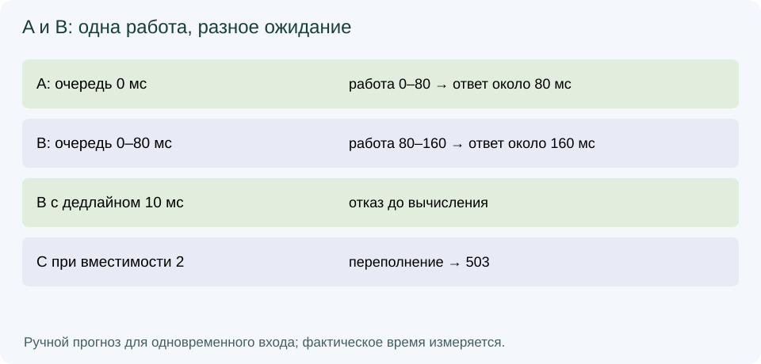
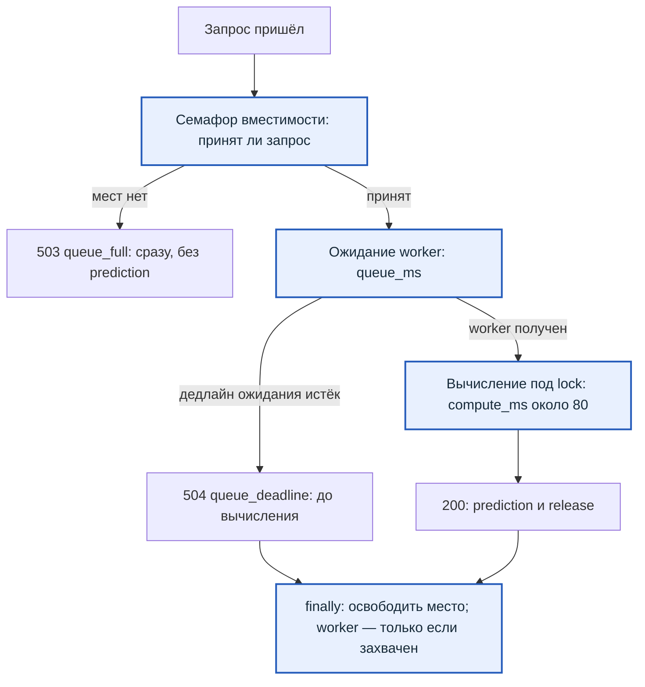

# M13-L06. Очередь, дедлайн и восстановление HTTP-сервиса

Версия 1.1.0. До урока: M13-L05. Начальный ориентир: 210 минут вместе с практикой; измеренное время записывай отдельно.


> **Версии и дата проверки:** Python 3.11.9, стандартная библиотека (http.server, urllib, concurrent.futures) · проверено 04.11.2026 · источник: [Python 3.11: http.server](https://docs.python.org/3.11/library/http.server.html)

## Результат и входные знания

Ты измеришь, где запрос ждёт и где вычисляется, а затем восстановишь сервис в новом процессе из сохранённого релиза. Это следующий шаг после отката Python-словаря: теперь есть отдельный процесс, сокет и реальные конкурентные клиенты. Модель заменена явно обозначенным ожиданием 80 мс, чтобы изучить очередь, не смешивая её с неопределённой скоростью LLM.

## Объяснение

### Три разных ограничения

У сервиса один вычислитель. Два одновременных обращения не означают два одновременно выполняющихся вычисления. Первый запрос занимает worker, второй ожидает. Если впускать сколько угодно запросов, память и задержка растут. Поэтому отдельный семафор ограничивает число **принятых** запросов: один выполняется и один ждёт. Он отвечает за вместимость, а lock worker — за исключительное использование вычислителя. Это разные роли, хотя оба механизма похожи на «замок».

Представь четыре запроса, пришедших одновременно. При вместимости 2 первые два приняты, остальные сразу получают 503 с причиной queue_full. Среди принятых второй ждёт примерно 80 мс, затем вычисляется ещё 80 мс. Клиент видит около 160 мс, но модель по-прежнему работает около 80 мс. Если подписать полное время как «модель стала вдвое медленнее», диагноз будет неверным.

Дедлайн ожидания — ещё одно ограничение. Если второй запрос готов ждать только 10 мс, он получает 504 queue_deadline до начала вычисления. После отказа его место освобождается. Времена не совпадут с идеальными числами из-за планировщика Windows; проверять нужно событие и причинную связь. Таймаут клиента не является гарантией остановки вычисления на сервере. В этой лабораторной дедлайн проверяет сам сервер перед захватом worker.

Освобождение ресурсов должно находиться в finally: исключение в обработке не должно навсегда уменьшить вместимость очереди. При этом освобождать worker можно только если текущий запрос действительно его получил. Иначе один запрос снимает чужую блокировку и допускает одновременное изменение состояния.

### Схема и ручной прогноз



Для запросов A и B, пришедших в t=0, заполни таблицу до запуска: A — ожидание 0, работа 80, ответ 80 мс; B — ожидание 80, работа 80, ответ 160 мс. При wait=10 мс B не переходит к работе. При вместимости 1 B отвергается сразу, поэтому даже не ждёт 10 мс. Различай очередь, превышение дедлайна и ошибку модели в журнале.

## Аналогия: пул соединений с базой

Как похоже: в Node.js-сервисе пул из одного соединения с PostgreSQL пропускает запросы по одному, остальные ждут. Если ожидающих больше лимита, новый запрос сразу получает отказ. Если соединения не дождались за отведённое время, ошибка возникает до выполнения SQL. А client.release() ставят в finally, иначе пул «утекает» и сервис встаёт.

| В уроке | В аналогии |
| --- | --- |
| Один worker | Пул из одного соединения с базой |
| Семафор вместимости | Лимит ожидающих в очереди пула: сверх него — сразу ошибка |
| 503 queue_full | Отказ «очередь переполнена» без попытки выполнить запрос |
| Дедлайн ожидания | Таймаут получения соединения: ошибка до выполнения запроса |
| finally: освободить место и worker | client.release() в finally, иначе пул утекает |
| Освобождать worker, только если захвачен | Нельзя вернуть в пул соединение, которое не брал |
| queue_ms и compute_ms отдельно от client_ms | Время ожидания соединения отдельно от времени SQL-запроса |
| Восстановление новым процессом из файла | Перезапуск сервиса с конфигом из репозитория, а не правка в памяти |

**Где аналогия ломается:** пул ограничивает доступ к уже работающей базе, а время самого запроса от очереди почти не зависит. Здесь вычислитель — модель: тяжёлый запрос дольше держит worker и удлиняет ожидание всех остальных. И таймаут клиента не останавливает вычисление на сервере — поэтому дедлайн проверяет сам сервер до захвата worker.

## Разобранный пример

### Проверенный локальный опыт

```powershell
.\.venv\Scripts\python.exe labs\M13\http_lab.py
```

Команда сама запускает локальный дочерний HTTP-процесс на свободном порту, отправляет серии с 1/2/4 клиентами, останавливает процесс, пробует несовместимый manifest и запускает новую копию со стабильным релизом. После команды дочерние процессы завершаются. Полные ответы находятся в artifacts/M13-http/report.json. Поля client_ms, queue_ms, compute_ms измерены в разных местах; сумма внутренних этапов может быть меньше клиентского времени.

Воспроизводимый контракт — prediction=2x+1 и release=A. При x=7 восстановленная версия должна вернуть 15. Canary проверяет поведение, а schema — совместимость устройства артефакта. Нельзя считать успешным откатом просто изменение строки version: веса, схема и версия должны восстановиться вместе. HTTPServer здесь учебный сервер на localhost, не готовый публичный сервис.

[Интерактивный опыт этого урока](../visuals/M13-L06.html): сначала предскажи результат, затем измени условие.

## Схема



Путь запроса через учебный HTTP-сервис с одним вычислителем. Семафор вместимости решает, принят ли запрос: при полной очереди клиент сразу получает 503 queue_full без prediction. Принятый запрос ждёт worker — это queue_ms; если дедлайн ожидания истёк, сервер отвечает 504 queue_deadline до начала вычисления. Вычисление идёт только после захвата worker и занимает около 80 мс, поэтому клиентские 160 мс второго запроса — это ожидание плюс работа, а не замедление модели. В finally освобождается место в очереди, а worker — только если запрос его действительно получил. Выделен путь принятого запроса.

## Практика с поддержкой

**Предскажи до запуска.** Прежде чем запускать код или пересчитывать пример, запиши ожидаемый вывод: числа, формы массивов, порядок или текст. После запуска сравни с фактическим и объясни каждое расхождение.

Посмотри сначала один ответ для 1 клиента, затем два для 2. Найди запрос с заметным ожиданием. Для 4 клиентов разложи результаты на принятые и отвергнутые. Запиши, изменилось ли compute_ms. Затем объясни, почему 503 и 504 требуют разных действий: уменьшить входной поток/увеличить ресурс либо пересмотреть допустимое ожидание.

## Самостоятельная задача A — M13-L06-A

Новая конфигурация: один worker, вместимость 3, работа 60 мс, три одновременно пришедших запроса готовы ждать не больше 90 мс. До кода укажи допустимые исходы и время начала работы каждого. Затем в собственной копии сервиса внеси эти параметры, сохрани все ответы и объясни расхождение измерений с идеальным прогнозом. Добавь четвёртый запрос. Отдельно воспроизведи несовместимый schema и восстановление нового процесса.

## Критерии и типичные ошибки

Критерии до просмотра ответа: очередь отделена от вычисления; отвергнутый запрос не получил prediction; занятое место освобождается; восстановление сделано новым процессом из файла. Самостоятельный запуск исходного demo этого задания не закрывает.

## Подсказки по очереди

1. Запиши потенциальные начала вычисления: 0, 60, 120 мс.
2. Дедлайн ограничивает начало, не время ответа уже принятой работы.
3. Вместимость 3 включает выполняющийся запрос.

## Новая и отложенная проверка

Вариант B: вместимость 1, worker=1, compute=60, wait=1000, два клиента. Вариант C через неделю: вместимость 3, compute=60, wait=150, три клиента. Для каждого покажи, какое именно ограничение стало решающим. [Отдельный разбор](../../solutions/modules/M13.md) содержит числа и ограничения интерпретации.

## Карточка урока

| Поле | Содержание |
| --- | --- |
| Правило | Семафор вместимости решает, принят ли запрос (иначе сразу 503 queue_full); принятый ждёт worker не дольше дедлайна (иначе 504 queue_deadline до вычисления); вычисление идёт под lock worker; в finally освобождают место, а worker — только если он захвачен |
| Смысл величин | Вместимость включает выполняющийся запрос; client_ms ≈ queue_ms + compute_ms плюс накладные расходы, поэтому рост клиентского времени не означает замедления модели; таймаут клиента не останавливает вычисление на сервере; восстановление — новый процесс из сохранённого релиза с проверкой schema и canary |
| Когда применять | При ограничении нагрузки на CPU-сервис. Пример: вместимость 2, compute 50 мс, дедлайн ожидания 30 мс, три одновременных запроса — третий сразу получает 503, второй ждёт worker и примерно через 30 мс получает 504 queue_deadline, первый получает 200 примерно через 50 мс |
| Главная ошибка | Считать выросшее клиентское время замедлением модели или освобождать worker, который запрос не захватил |

## Источники и углубление

[Python 3.11: HTTPServer](https://docs.python.org/3.11/library/http.server.html), [threading и семафоры](https://docs.python.org/3.11/library/threading.html). Формулы очереди здесь — расчёт для заданного детерминированного расписания, а не универсальная теория очередей.

Для углубления: [Google SRE Book: Handling Overload](https://sre.google/sre-book/handling-overload/) — отказ от лишней нагрузки, троттлинг на стороне клиента и критичность запросов; [Google SRE Book: Addressing Cascading Failures](https://sre.google/sre-book/addressing-cascading-failures/) — управление очередями, сброс нагрузки и передача дедлайнов между сервисами (обе на английском).
