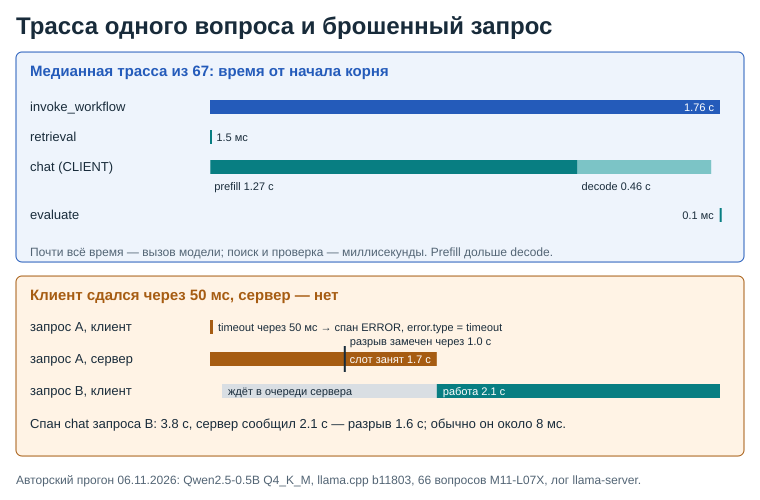
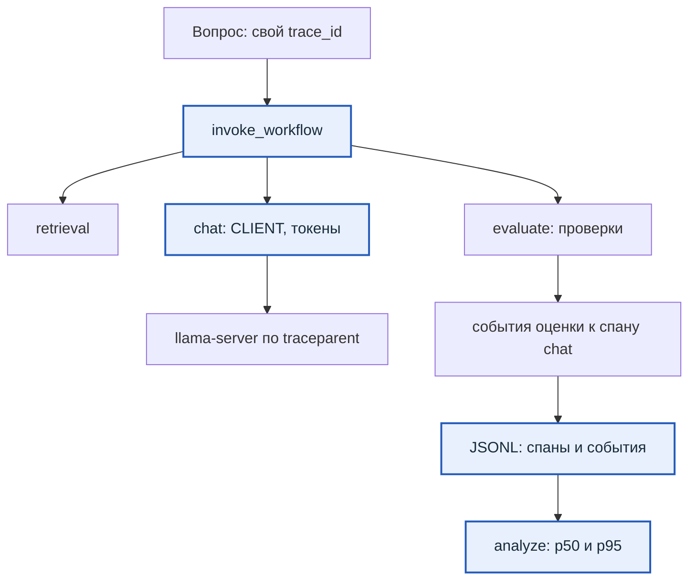

# M13-L07X. Трассировка LLM-конвейера

**Расширение 1.2.0.** Урок дополняет модуль, не входит в обязательный минимум 1.1.0.

**Результат:** записать трассы настоящего LLM-конвейера в JSONL по семантическим конвенциям OpenTelemetry GenAI, без Docker и новых пакетов. По трассам ответить на три инженерных вопроса: куда уходит время, какой вызов упал и почему, какой запрос дал плохой ответ.

**До урока:** M13-L04, M13-L06, M11-L07X, M09-L07X. Анализ читает замороженные трассы из `quality/tracing` и работает без моделей. Чтобы собрать трассы заново, нужны llama.cpp и GGUF из M09-L07X. Ориентир — 150 минут чтения, анализа и задачи; это плановая гипотеза, а не измеренное время.

> **Версии и дата проверки:** Python 3.11.9, стандартная библиотека; llama.cpp b11803, Qwen2.5-0.5B-Instruct Q4_K_M (ревизия 9217f5d); семантические конвенции OpenTelemetry GenAI, коммит e6658f1 от 06.11.2026, статус Development · проверено 06.11.2026 · источник: [OpenTelemetry GenAI semantic conventions](https://github.com/open-telemetry/semantic-conventions-genai)

## Объяснение

### Трасса, спан и контекст

M13-L04 развёл три вида наблюдений: лог описывает событие, метрика агрегирует много событий, трассировка связывает этапы одного запроса. Здесь трассировка становится конкретной.

Трасса (trace) — дерево спанов одного запроса с общим `trace_id` длиной 16 байт. Спан (span) — одна операция. У него есть имя, вид (kind), `span_id` длиной 8 байт, `parent_span_id`, начало и конец в наносекундах Unix, статус и атрибуты. У корневого спана родителя нет.

Родителя задаёт контекст, а не ручная передача id. Внутри процесса трассировщик держит текущий спан в `contextvars`. Новый спан берёт текущий родителем и на время работы сам становится текущим. Между процессами контекст передаётся в HTTP-заголовке W3C `traceparent` вида `00-{trace_id}-{span_id}-01`. Принимающий сервис продолжает ту же трассу своими спанами.

Начало спана берут по календарным часам, чтобы сопоставлять спаны разных процессов. Длительность меряют монотонными часами, как в M13-L04, а конец считают как начало плюс длительность. Тогда коррекция системного времени не даст спану отрицательной длины.

В M11-L07X словом «трасса» называлась запись для разбора: вопрос, найденные фрагменты, ответ и сигналы. Трасса OpenTelemetry — дерево операций со временем. Лабораторная связывает одно с другим: проверки M11-L07X становятся событиями внутри трассы.

### Семантические конвенции GenAI

Если каждый называет атрибуты по-своему, бэкенд не поймёт, где модель, а где токены. Семантические конвенции OpenTelemetry фиксируют имена. Для генеративного ИИ они в статусе Development, и имена ещё меняются. В 2026 году их вынесли в отдельный репозиторий `semantic-conventions-genai`, поэтому курс привязан к конкретному коммиту.

На каждый вопрос лабораторная пишет четыре спана:
- `invoke_workflow rag-answer` (INTERNAL) — корень. Порядок шагов задаёт приложение, а не модель, поэтому операция `invoke_workflow`, а не `invoke_agent`;
- `retrieval` (INTERNAL) — поиск: `gen_ai.retrieval.top_k` = 3 и id найденных фрагментов;
- `chat qwen2.5-0.5b-instruct-q4_k_m` (CLIENT) — вызов llama-server по HTTP;
- `evaluate` (INTERNAL) — шесть проверок M11-L07X.

У спана `chat` обязательны два атрибута: `gen_ai.operation.name` и `gen_ai.provider.name`. Рекомендуемые — модель, параметры запроса, `gen_ai.response.id`, причина остановки и токены `gen_ai.usage.input_tokens` и `gen_ai.usage.output_tokens`. Для llama.cpp в списке поставщиков значения нет, поэтому записано собственное `llama.cpp`. Время prefill и decode, которое сообщил сервер, лежит в атрибутах `llama_cpp.*`: это не часть конвенций, а пространство имён курса.

Вердикт проверки — не статус спана. Сервер ответил 200, вызов удался, а ответ при этом может быть плохим. Поэтому вердикты записаны событиями `gen_ai.evaluation.result`, привязанными к спану `chat` по `trace_id` и `span_id`. Статус ERROR получает только операция, которая сама не выполнилась, вместе с коротким `error.type`, например `timeout`.

Содержимое по умолчанию не пишется. Prompt, ответ модели и текст запроса к поиску — атрибуты уровня Opt-In. В тренажёре это ответы кандидатов, то есть персональные данные. Трасса хранит id вопроса, id фрагментов, число токенов и время. Флаг `--capture-content` добавляет текст; включать его стоит только на синтетических данных курса.



Сопоставь рисунок с числами: какая часть корня приходится на `chat`, что дольше — prefill или decode, и сколько ждал запрос B.

## Аналогия: request_id и Jaeger в микросервисах

Backend-разработчик уже видел это в микросервисах. Шлюз создаёт `request_id` и передаёт его в заголовке. Каждый сервис пишет его в свои логи, а Jaeger или Zipkin рисует водопад вызовов: шлюз, сервис заказов, запрос к базе. Медленный запрос ищут не по среднему времени, а открывают его водопад и смотрят, какой этап длинный.

| В уроке | В аналогии |
| --- | --- |
| `trace_id` | `request_id`, общий для всех сервисов |
| Спан | Строка в логе с началом и длительностью вызова |
| `parent_span_id` | Кто кого вызвал: шлюз → сервис заказов → база |
| Заголовок `traceparent` | Заголовок `X-Request-ID` между сервисами |
| Спан `chat` с токенами | Запрос к базе с длительностью и числом строк |
| p95 по этапу | Журнал медленных запросов (slow query log) |
| Событие `gen_ai.evaluation.result` | Проверка бизнес-правила после ответа сервиса |

**Где аналогия ломается:** стоимость SQL-запроса примерно определяет план, известный заранее. Стоимость вызова модели зависит от числа выходных токенов, которое заранее неизвестно, и от длины prompt. Плохой ответ модели — не исключение: сервер вернул 200, а ответ неверный. Поэтому вердикт качества хранят отдельно от статуса спана. И содержимое запроса к модели чаще, чем параметры SQL, оказывается персональными данными: его не пишут по умолчанию.

## Разобранный пример

Python-блок выполняй из корня `C:\projects\ml-llm-course` в окружении курса. Он пишет маленькую трассу трассировщиком лабораторной: корень, поиск и вызов модели, который падает по дедлайну. Модель не нужна.

```python
import importlib.util
import json
import tempfile
from pathlib import Path

spec = importlib.util.spec_from_file_location("tracing", "labs/M13/tracing.py")
tracing = importlib.util.module_from_spec(spec)
spec.loader.exec_module(tracing)

folder = Path(tempfile.mkdtemp())
tracer = tracing.Tracer(folder)
with tracer.span("invoke_workflow demo", attributes={"gen_ai.operation.name": "invoke_workflow"}):
    with tracer.span("retrieval", attributes={"gen_ai.operation.name": "retrieval", "gen_ai.retrieval.top_k": 3}):
        pass
    try:
        with tracer.span("chat tiny", "CLIENT", {"gen_ai.operation.name": "chat", "gen_ai.provider.name": "llama.cpp"}):
            raise TimeoutError("клиентский дедлайн 50 мс")
    except TimeoutError:
        pass  # конвейер решает, что делать дальше; спан уже записал сбой
tracer.close()

spans = {s["name"]: s for s in map(json.loads, (folder / "spans.jsonl").read_text(encoding="utf-8").splitlines())}
root, retrieval, chat = spans["invoke_workflow demo"], spans["retrieval"], spans["chat tiny"]
assert root["parent_span_id"] is None and len(root["trace_id"]) == 32 and len(root["span_id"]) == 16
assert retrieval["parent_span_id"] == chat["parent_span_id"] == root["span_id"]
assert {retrieval["trace_id"], chat["trace_id"]} == {root["trace_id"]}
assert chat["status"]["code"] == "ERROR" and chat["attributes"]["error.type"] == "timeout"
assert root["status"]["code"] == "UNSET"  # исключение обработано внутри корня
assert chat["end_time_unix_nano"] >= chat["start_time_unix_nano"]
```

Числа из медианной трассы авторского прогона дают тот же разбор вручную: доля модели, разрыв между клиентом и сервером, скорость prefill и decode.

```python
root_ms, chat_ms, prefill_ms, decode_ms = 1761.2, 1759.5, 1268.3, 461.8  # медианная трасса, вопрос check-voice
assert round(chat_ms / root_ms, 3) == 0.999                     # почти всё время — вызов модели
assert round(chat_ms - (prefill_ms + decode_ms), 1) == 29.4     # HTTP и JSON вокруг работы сервера
assert round(387 / prefill_ms * 1000) == 305                     # 387 токенов prompt в секунду вычислений
assert round(22 / decode_ms * 1000, 1) == 47.6                   # 22 токена ответа
after_chat_ms, after_server_ms = 3759.9, 2120.0                  # трасса после брошенного запроса
assert round(after_chat_ms - after_server_ms, 1) == 1639.9      # ожидание в очереди сервера, а не модель
```

### Авторский прогон 06.11.2026

```powershell
.\.venv\Scripts\python.exe labs\M13\tracing.py analyze
.\.venv\Scripts\python.exe labs\M13\tracing.py collect --out artifacts\M13\my-traces
```

Первая команда читает замороженные трассы и работает без модели. Вторая собирает свои трассы, на ноутбуке автора это заняло около 3 минут. В прогоне 66 вопросов M11-L07X, затем запрос с дедлайном 50 мс и повтор того же вопроса без дедлайна. Всего 68 трасс, 271 спан и 402 события.

| Этап | n | p50, мс | p95, мс | max, мс |
| --- | --- | --- | --- | --- |
| invoke_workflow | 67 | 1761 | 3265 | 6026 |
| retrieval | 67 | 1.7 | 2.8 | 3.1 |
| chat | 67 | 1760 | 3261 | 6023 |
| evaluate | 67 | 0.1 | 0.3 | 0.4 |

Что показали трассы:
- **Время уходит в модель.** На спан `chat` приходится 0.999 времени корня, поиск и проверки занимают миллисекунды. Ускорять поиск бессмысленно.
- **В медиане дольше prefill, а не ответ.** Prompt — 396 токенов в медиане, ответ — 16. Prefill занял 1425 мс в медиане, decode — 283 мс. На p95 decode вырастает до 1659 мс: длинные ответы, до 88 токенов.
- **Самая долгая трасса — не медленный сервер.** Вопрос p-retry шёл 6.0 с, потому что ответ упёрся в лимит 200 токенов (`finish_reasons` = `length`).
- **Быстрый ответ не значит хороший.** 7 трасс без единой сработавшей проверки шли 2.4 с в медиане при 50 токенах ответа. 43 трассы с кодом «нет ответа» — 1.7 с при 9 токенах: модель коротко выдала одни ссылки. По задержке плохой ответ не найти, нужны события с вердиктами.
- **Клиент и сервер обычно согласны.** Спан `chat` длиннее времени сервера на 8 мс в медиане и на 30 мс на p95: это HTTP и разбор JSON.

**Брошенный запрос.** Запрос с дедлайном 50 мс упал через 75 мс: трасса из трёх спанов, `chat` и корень со статусом ERROR и `error.type` = `timeout`, спана `evaluate` и событий нет. Сервер о дедлайне клиента не знает. По его логу разрыв соединения он заметил через 1.0 с, а слот освободил через 1.7 с — примерно столько занимает prefill этого prompt. Следующий запрос всё это время ждал. Его спан `chat` длился 3760 мс, а сервер сообщил 2120 мс работы: разрыв 1640 мс против обычных 8. Без времени сервера в спане эту паузу легко принять за медленную модель. Вывод для M13-L06: дедлайн клиента не освобождает сервер, отмену нужно передавать серверу явно.

**Шумный сосед.** Первый авторский прогон шёл одновременно с тестами на том же процессоре. Ответы и число токенов совпали с чистым прогоном до символа, а время — нет: decode 20 токенов в секунду в медиане против 54, p95 спана `chat` — 13.6 с против 3.3. Трасса показала причину: медленнее стали и prefill, и decode у всех запросов окна, а не у отдельных вопросов. Этот прогон сохранён в `quality/tracing-noisy` как отрицательный результат и в выводы о задержке не входит.

**Цена трассировки.** Пустой спан с записью строки в файл стоит 10.5 мкс. Четыре спана на вопрос — около 42 мкс при медиане вопроса 1.76 с, это 0.002 %.

### Langfuse через Docker Compose — по желанию

Этот путь не входит в курс и не проверен автором: Docker на учебном ноутбуке не устанавливался. Команда `otlp` переводит замороженные спаны и события в OTLP/JSON, по одной строке на трассу:

```powershell
.\.venv\Scripts\python.exe labs\M13\tracing.py otlp
```

Файлы `otlp-traces.jsonl` и `otlp-logs.jsonl` появятся в `artifacts/M13/tracing`. Их принимает OpenTelemetry Collector и любой бэкенд с OTLP по HTTP. Langfuse — открытая платформа наблюдаемости для LLM, её можно поднять у себя:
1. Установить Docker Desktop, выполнить `git clone https://github.com/langfuse/langfuse.git`, заменить в `docker-compose.yml` все строки с пометкой `# CHANGEME` на длинные случайные пароли и запустить `docker compose up`. По документации веб-контейнер готов через 2–3 минуты, интерфейс — на `http://localhost:3000`.
2. Зарегистрировать первого пользователя, создать проект и пару ключей.
3. Положить ключи в переменную окружения и отправить файлы:

```powershell
$pair = 'pk-lf-...:sk-lf-...'   # свои ключи проекта; в код и коммиты их не кладут
$env:OTEL_EXPORTER_OTLP_HEADERS = 'Authorization=Basic ' + [Convert]::ToBase64String([Text.Encoding]::UTF8.GetBytes($pair))
.\.venv\Scripts\python.exe labs\M13\tracing.py send --endpoint http://localhost:3000/api/public/otel
```

Langfuse принимает OTLP по HTTP в JSON и protobuf, gRPC не поддерживает. Последняя версия на 06.11.2026 — v4.76.0. Для собственного проекта такой стенд полезен, когда трасс становится больше, чем удобно читать в JSONL.

## Схема



Трасса одного вопроса. Корневой спан `invoke_workflow` объединяет поиск, вызов модели и проверку общим `trace_id`. Спан `chat` — клиентский: он хранит модель, токены и время сервера. В другой процесс контекст передаётся заголовком `traceparent`. Вердикты проверок записаны событиями, привязанными к спану `chat`, а не статусом ошибки. Все спаны и события ложатся в JSONL, его читает анализ: p50 и p95 по этапам, разрыв между временем клиента и сервера, разбивка по вердикту. Выделен путь от корня до анализа.

## Практика с поддержкой

**Предскажи до запуска.** Прежде чем запускать код, запиши ожидаемый вывод: какая доля времени корня приходится на `chat`, что больше — prefill или decode, и какой этап задаёт p95. После запуска сравни с фактическим и объясни каждое расхождение.

1. Выполни `.\.venv\Scripts\python.exe labs\M13\tracing.py analyze` и сверь числа с таблицей авторского прогона.
2. Найди в `quality/tracing/spans.jsonl` трассу со статусом ERROR. Перечисли её спаны и объясни, почему у неё нет спана `evaluate` и событий.
3. Найди трассу, которая шла следом. Сравни длительность её спана `chat` с суммой `llama_cpp.prompt_ms` и `llama_cpp.predicted_ms`, объясни разницу.
4. Если модель скачана, собери свои трассы: `.\.venv\Scripts\python.exe labs\M13\tracing.py collect --limit 10 --out artifacts\M13\my-traces`. Затем запусти `analyze --folder artifacts\M13\my-traces` и сравни p50 спана `chat` с авторским.

## Самостоятельная задача A — M13-L07X-A

Продолжи трассу через границу процесса. Подними локальный HTTP-сервис (`http.server` из стандартной библиотеки), который изображает модель: ждёт 20 мс и отвечает 200. Клиент открывает корневой спан и спан `chat` вида CLIENT, а в запрос кладёт заголовок `traceparent` от спана `chat`. Сервис разбирает заголовок, проверяет формат и пишет свой спан вида SERVER в отдельный файл. Докажи по двум файлам, что спан сервиса принадлежит той же трассе и его родитель — спан `chat`. Посчитай, сколько времени заняли соединение и HTTP вокруг работы сервиса. Затем убери заголовок и покажи, что сервис начал новую трассу.

## Подсказки по очереди

1. Заголовок — четыре части через дефис: версия `00`, `trace_id` из 32 шестнадцатеричных символов, `span_id` из 16 и флаги `01`.
2. Обработчик `http.server` работает в другом потоке. Новый поток начинает с пустым контекстом: `CURRENT.get()` там вернёт `None`.
3. Удалённого родителя можно поставить текущим на время обработки: `CURRENT.set(Span(trace_id, span_id, ...))`, а после — `CURRENT.reset(token)`.
4. Время вокруг работы сервиса — длительность спана `chat` минус длительность спана сервиса.

## Критерии и типичные ошибки

**Критерии до попытки:** у всех спанов одной трассы общий `trace_id`; родитель каждого спана есть в файлах; длительность меряется монотонными часами; содержимое не пишется без явного флага; вердикт качества хранится отдельно от статуса ошибки; число измерений указано рядом с p95. Для самостоятельного зачёта объясни передачу контекста без открытого кода и реши новый численный вариант без подсказки.

**Типичные ошибки:** создавать новый `trace_id` в каждом сервисе и потом склеивать трассы по времени; ставить статус ERROR плохому, но успешно полученному ответу; писать prompt и ответы кандидатов в трассу по умолчанию; считать конец спана по календарным часам; сравнивать p95 на десятке трасс как устойчивую величину.

## Новая и отложенная проверка

**Повтор B:** корень длится 6000 мс, `retrieval` — 12 мс, `chat` — 5970 мс, сервер сообщил prefill 2400 мс и decode 1500 мс. Какая доля корня приходится на `chat`, сколько времени клиент ждал сверх работы сервера и где искать это время? **Отложенная C:** спроектируй трассу одного хода голосового тренажёра M15: распознавание речи, поиск, модель, синтез речи. Назови спаны, их вид и ключевые атрибуты. Реши, что из содержимого нельзя писать по умолчанию, и как связать трассу с оценкой ответа. [Ключи](../../solutions/modules/M13.md) открывай после сохранения попытки.

## Карточка урока

| Поле | Содержание |
| --- | --- |
| Правило | Одна трасса — один запрос: общий `trace_id`, родитель из контекста, между процессами — заголовок `traceparent`. Длительность меряют монотонными часами. Атрибуты — по конвенциям GenAI: у вызова модели обязательны `gen_ai.operation.name` и `gen_ai.provider.name`. Вердикт качества — событие, ERROR — только для несостоявшейся операции. Содержимое пишут только по явному согласию |
| Смысл величин | Длительность спана, p50 и p95 по этапу вместе с числом измерений. Prefill — вычисление prompt, decode — генерация ответа, оба сообщает сервер. Разрыв «клиент минус сервер» — сеть, HTTP и очередь. Токены входа и выхода задают цену вызова |
| Когда применять | Чтобы найти, куда уходит время и почему упал вызов. Пример: медианная трасса — 1761 мс, из них `chat` — 1759.5; сервер сообщил prefill 1268 и decode 462, разрыв 29 мс. После брошенного запроса разрыв 1640 мс — это очередь, а не модель |
| Главная ошибка | Склеивать трассы по времени вместо `traceparent`, ставить ERROR плохому ответу, писать персональные данные по умолчанию или мерить на машине, занятой другой работой |

## Источники и углубление

Семантические конвенции OpenTelemetry GenAI, коммит e6658f1: [вызов модели](https://github.com/open-telemetry/semantic-conventions-genai/blob/e6658f14c9d9ea0760825f029cb82e7673f48fab/docs/gen-ai/client-inference.md), [события и оценки](https://github.com/open-telemetry/semantic-conventions-genai/blob/e6658f14c9d9ea0760825f029cb82e7673f48fab/docs/gen-ai/gen-ai-events.md). Статус Development: перед новым проектом сверь имена с актуальной веткой. Передача контекста между процессами — [W3C Trace Context](https://www.w3.org/TR/trace-context/). Формат OTLP/JSON — [спецификация OTLP](https://opentelemetry.io/docs/specs/otlp/). Контекст внутри процесса — [contextvars](https://docs.python.org/3.11/library/contextvars.html). По желанию: [Langfuse и OpenTelemetry](https://langfuse.com/integrations/native/opentelemetry), [Langfuse через Docker Compose](https://langfuse.com/self-hosting/deployment/docker-compose).
