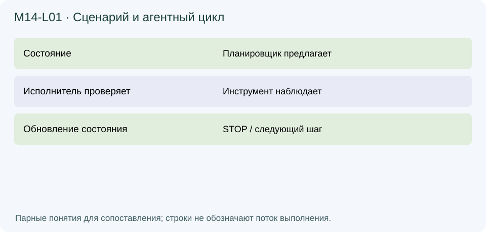

# M14-L01. Сценарий и агентный цикл

Версия материала: 1.1.0. Это самостоятельный урок: внешняя проверка наставником необязательна.

> **Версии и дата проверки:** Python 3.11.9, стандартная библиотека; внешние модели не используются · проверено 04.11.2026 · источник: [Python 3.11: json](https://docs.python.org/3.11/library/json.html)

## Результат и входные знания

После урока ты сможешь: **Обосновать, где достаточно сценария, а где полезен выбор следующего действия моделью.** Перед началом нужны M10, M11 и M13: поиск, оценивание и эксплуатация. Если термин из этого списка неясен, вернись к соответствующему уроку и воспроизведи его маленький пример. Продолжение по календарю не заменяет понимание зависимости.

## Объяснение

Сценарий задаёт заранее известный порядок действий: задать вопрос, получить ответ, уточнить, оценить, перейти дальше. Агентный цикл позволяет системе выбирать следующее действие по текущему состоянию и результатам предыдущих действий. Различие находится в способе управления, а не в наличии красивого чата. Обычный сценарий может использовать LLM для формулировок, а агент может вызывать совсем простые инструменты.

Типичный цикл выглядит так: состояние передаётся планировщику, планировщик предлагает действие, исполнитель проверяет предложение, запускает разрешённый инструмент и возвращает наблюдение. Затем состояние обновляется, и цикл повторяется до завершения или ограничения бюджета. Модель предлагает действие, но право выполнять его принадлежит приложению. Это разделение сохраняется даже тогда, когда модель уверенно описывает инструмент как безопасный.

Для интервьюера фиксированный сценарий часто является хорошей исходной архитектурой. Этапы беседы и правила завершения известны заранее, а предсказуемость облегчает проверку. Агент полезен, когда требуется выбрать источник, уточняющий вопрос или диагностический инструмент в зависимости от ответа. Но дополнительная свобода создаёт больше возможных траекторий, которые нужно тестировать.

В лабораторной используется детерминированный сценарный планировщик: список готовых JSON-действий. Это не LLM и не демонстрация качества рассуждения. Такой тестовый стенд изолирует исполнитель, чтобы проверить права, бюджет, повторные вызовы и остановку. Позже вместо списка можно подключить модель, сохранив те же защитные свойства. Если смешать тест исполнителя и оценку модели, трудно понять, где возник дефект.

Состояние включает цель, историю действий, доступные наблюдения, идентификатор сессии, бюджет и причину завершения. Необязательно пересылать модели всё внутреннее состояние. Например, секреты и серверные права остаются вне её контекста. Наблюдение инструмента — данные, а не новая инструкция высшего уровня. Найденная страница может содержать слова «игнорируй правила»; это не даёт ей полномочий менять контракт.

Выбирая архитектуру, оцени полезность адаптивности. Если три заранее известные ветки покрывают задачу, обычные условные переходы проще объяснить и воспроизвести. Если число возможных действий зависит от непредвиденных результатов поиска, планировщик может сократить ручное перечисление ветвей. В обоих случаях успех определяется выполнением задачи при соблюдении ограничений, а не количеством выполненных шагов.



Сопоставь подписи с примером: объясни величины и укажи, какие отношения показаны на рисунке.

## Разобранный пример

Python-блок выполняй из корня `C:\projects\ml-llm-course` в окружении курса (например, в ячейке Jupyter).

Учебный план состоит из двух действий: read_document(d1), затем finish(answer). Исполнитель сохраняет одно наблюдение и завершает цикл с причиной finished. Если план содержит только чтение, результат no_final_action: полезный документ получен, но задача ещё не завершена.

```python
from labs.M14.demo import execute
actions = [
    {'tool': 'read_document', 'args': {'document_id': 'd1'}},
    {'tool': 'finish', 'args': {'answer': 'Краткий вывод'}},
]
result = execute(actions)
print(result['stop'], len(result['observations']))
assert result['stop'] == 'finished'
```

Таким способом можно отдельно проверить управление. Содержательную правильность вывода ещё предстоит оценить по исходному документу.

## Практика с поддержкой

Выпиши путь happy из отчёта M14 и отметь, какие решения уже зафиксированы в списке actions. Затем отдельно обозначь действия исполнителя, которые не зависят от интеллекта планировщика: проверка имени, аргументов, прав и бюджета. Это помогает не приписывать тестовому стенду возможности языковой модели.

Для технической практики используй [лабораторную M14](../../labs/M14/README.md). Полный код находится отдельно от твоего решения. Сначала предскажи результат одного контрольного случая, затем запусти пример и объясни расхождение, если оно появилось. Запиши команду, версию окружения и фактический вывод, чтобы позже повторить опыт.

## Самостоятельная задача

Спроектируй два варианта уточнения ответа кандидата: фиксированный сценарий и агент с поиском источника. Для каждого перечисли состояния, условие завершения и наблюдаемый выигрыш. Выбери вариант для трёх заранее известных вопросов про SQL и объясни, что должно измениться в требованиях, чтобы выбор пересмотреть.

Сохрани первую попытку в `submissions/M14-L01.md`: исходные данные, результат и краткое обоснование.

## Подсказки по порядку

1. Отдели известный порядок интервью от выбора формулировки вопроса: LLM не делает каждый сценарий агентом.
2. Для трёх известных тем перечисли ветви обычной машины состояний и условие завершения.
3. Агентная сложность оправдана, если новый источник или действие нельзя заранее определить и это даёт измеримый выигрыш.

## Самопроверка и типичные ошибки

За объяснение механизма, корректность проверки, воспроизводимость и ограничения поставь по 0–2 балла: 0 — отсутствует или неверно, 1 — частично с помощью, 2 — самостоятельно и обоснованно. Для перехода каждый критерий должен быть выполнен самостоятельно (2); понимание механизма и новая задача обязательны и не компенсируются другими баллами. При помощи сначала отметь «с поддержкой», затем реши вариант B без подсказки. Критических ошибок быть не должно. Критические ошибки: подмена реального измерения выдуманным, использование ответа из решения как собственной первой попытки, вывод о качестве за пределами проверенных данных, нарушение явно заданного ограничения задачи. Исправление должно сопровождаться новым примером, а не только заменой текста отчёта.

Первая самостоятельная попытка выполняется без готового решения. После неё разрешены объяснения AI, подсказки и [полный разбор](../../solutions/modules/M14.md#m14-l01). Отметь полученную помощь. Если решение стало понятно только после разбора, состояние навыка — «с поддержкой»; для самостоятельности реши новый вариант.

## Новая и отложенная проверка

B: три известных SQL-вопроса и фиксированный список уточнений. Нужен ли свободный agent loop? C через неделю: пользователь выбирает неизвестную тему, нужно искать источник и решать, достаточно ли его; что меняется?

Сохрани новую попытку до просмотра [ключа B/C](../../solutions/modules/M14.md).

## Источники и углубление

- [Официальная документация по теме](https://json-schema.org/understanding-json-schema/reference/object) — сверяй контракт и определения, не копируй внешний пример вместо самостоятельной работы.
- [Исполняемый пример модуля](../../labs/M14/demo.py) — авторский код курса с явно указанными ограничениями.

[Оглавление модуля](../modules/M14.md)
