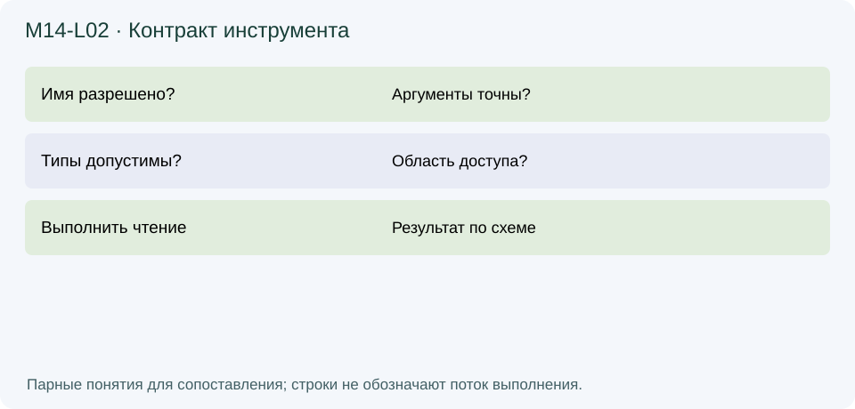

# M14-L02. Контракт инструмента

Версия материала: 1.1.0. Это самостоятельный урок: внешняя проверка наставником необязательна.

> **Версии и дата проверки:** Python 3.11.9, стандартная библиотека; внешние модели не используются · проверено 04.11.2026 · источник: [Python 3.11: json](https://docs.python.org/3.11/library/json.html)

## Результат и входные знания

После урока ты сможешь: **Проверить имя, аргументы, права и результат до использования инструмента.** Перед началом нужны M14-L01: предыдущий шаг модуля. Если термин из этого списка неясен, вернись к соответствующему уроку и воспроизведи его маленький пример. Продолжение по календарю не заменяет понимание зависимости.

## Объяснение

Инструмент — программная функция с явным контрактом, которую система может вызвать по предложению планировщика. Для чтения документа достаточно имени read_document и аргумента document_id. Исполнитель должен знать допустимые типы, обязательные поля, ограничения длины и возможные ошибки. Подробное текстовое описание инструмента помогает модели выбрать действие, но не заменяет проверку на стороне программы.

Синтаксически корректный JSON не гарантирует корректное действие. Объект может содержать неизвестное имя, неверный тип аргумента или дополнительные поля, меняющие область доступа. Поэтому последовательность проверки начинается с формы объекта, затем имени, схемы аргументов и полномочий. Только после этого можно обращаться к данным или выполнять побочный эффект.

Лабораторный инструмент принимает ровно одно поле document_id строкового типа. Сессия не передаётся моделью; её определяет сервер. Если модель добавит session='s2', действие отклоняется. Такой выбор специально показывает, что не все параметры операции должны быть доступны планировщику. Чем меньше лишних полномочий передано модели, тем проще проверить допустимое поведение.

Результат инструмента также имеет контракт. Полезно различать успешное чтение, отсутствие документа, запрещённый доступ, временную ошибку и внутренний дефект. Если все случаи превращаются в пустую строку, модель может принять отсутствие данных за доказательство отсутствия факта. Структурированное состояние позволяет выбрать корректный следующий шаг: уточнить запрос, остановиться или предложить повтор.

Для инструментов с побочными эффектами нужны дополнительные правила. Повторная отправка уведомления или изменение записи не эквивалентны повторному чтению. Идемпотентный ключ связывает повторную попытку с уже обработанной операцией, чтобы не выполнить её дважды. В обязательном учебном цикле инструменты только читают данные, поэтому риск проще; это не означает, что тот же исполнитель готов к произвольным действиям в реальном сервисе.

Описание контракта должно оставаться коротким и однозначным. Если инструкция разрешает модели указывать произвольный путь файловой системы, сложность контроля резко возрастает. Для тренажёра предпочтительнее идентификатор разрешённого документа, чем путь C:\... или команда shell. Это практическое ограничение области задачи, а не предположение о злонамеренности каждого входа.



Сопоставь подписи с примером: объясни величины и укажи, какие отношения показаны на рисунке.

## Аналогия: userId из токена, а не из тела запроса

Как похоже: в правильно написанном API идентификатор пользователя берут из JWT, а не из поля в теле запроса — иначе любой прочитает чужие данные, подставив другой id (IDOR). DTO со строгой схемой отвергает лишние поля, а ответы различают 404, 403 и 503 вместо пустого 200. Для записи платёжный API требует Idempotency-Key, чтобы повтор не списал деньги дважды.

| В уроке | В аналогии |
| --- | --- |
| Имя инструмента | Маршрут API |
| Ровно одно поле document_id типа str | DTO со строгой схемой: лишние поля отвергаются |
| session задаёт сервер, а не модель | userId из JWT, а не из тела запроса |
| Лишнее поле session='s2' | userId в теле, которым пытаются прочитать чужое (IDOR) |
| ok, not_found, forbidden, timeout | 200, 404, 403 и 503 вместо пустого ответа |
| Идемпотентный ключ для записи | Idempotency-Key в платёжном API |
| ID документа вместо пути файла | Параметр id вместо произвольного пути: обход каталогов невозможен по построению |

**Где аналогия ломается:** клиент API — программа, которая шлёт ровно то, что написал разработчик. Модель генерирует аргументы вероятностно и в любой момент может уверенно предложить несуществующий инструмент или лишнее поле, поэтому строгая проверка нужна на каждом вызове. И описание инструмента для модели — подсказка, а не схема: проверяет код, а не текст описания.

## Разобранный пример

Python-блок выполняй из корня `C:\projects\ml-llm-course` в окружении курса (например, в ячейке Jupyter).

В M14 корректный аргумент {'document_id':'d1'} даёт документ. Число 1 вместо строки, лишний session и неизвестный tool завершаются denied до чтения. Проверка строгости выглядит так:

```python
def validate(args):
    allowed = isinstance(args, dict) and set(args) == {'document_id'}
    typed = allowed and isinstance(args.get('document_id'), str)
    return bool(allowed and typed)
print(validate({'document_id': 'd1'}))
print(validate({'document_id': 1}))
print(validate({'document_id': 'd1', 'session': 's2'}))
assert not validate({'document_id': 1})
```

Следующий слой проверяет доступ к документу в текущей сессии. Успешная проверка типа не даёт автоматического права читать содержимое.

## Практика с поддержкой

**Предскажи до запуска.** Прежде чем запускать код или пересчитывать пример, запиши ожидаемый вывод: числа, формы массивов, порядок или текст. После запуска сравни с фактическим и объясни каждое расхождение.

Начни с корректного действия и по одному изменяй tool, тип document_id и набор полей. До запуска запиши ожидаемую причину остановки. После запуска сравни не только stop, но и observations: отклонённое действие не должно успеть прочитать документ.

Для технической практики используй [лабораторную M14](../../labs/M14/README.md). Полный код находится отдельно от твоего решения. Сначала предскажи результат одного контрольного случая, затем запусти пример и объясни расхождение, если оно появилось. Запиши команду, версию окружения и фактический вывод, чтобы позже повторить опыт.

## Самостоятельная задача A

Опиши инструмент get_feedback(session, answer_id), но исключи session из аргументов модели. Подготовь шесть запросов, включая неизвестное имя, лишнее поле, неверный тип, отсутствующий ответ и ответ чужой сессии. Для каждого укажи результат и должен ли инструмент реально читать данные.

Сохрани первую попытку в `submissions/M14-L02.md`: исходные данные, результат и краткое обоснование.

## Подсказки по очереди

1. Модель передаёт только answer_id, а session берётся из серверного контекста.
2. Неизвестное имя, лишнее поле и неправильный тип отвергаются до чтения данных.
3. Проверь не только stop, но и пустые observations для чужого ответа.

## Критерии и типичные ошибки

За объяснение механизма, корректность проверки, воспроизводимость и ограничения поставь по 0–2 балла: 0 — отсутствует или неверно, 1 — частично с помощью, 2 — самостоятельно и обоснованно. Для перехода каждый критерий должен быть выполнен самостоятельно (2); понимание механизма и новая задача обязательны и не компенсируются другими баллами. При помощи сначала отметь «с поддержкой», затем реши вариант B без подсказки. Критических ошибок быть не должно. Критические ошибки: подмена реального измерения выдуманным, использование ответа из решения как собственной первой попытки, вывод о качестве за пределами проверенных данных, нарушение явно заданного ограничения задачи. Исправление должно сопровождаться новым примером, а не только заменой текста отчёта.

Первая самостоятельная попытка выполняется без готового решения. После неё разрешены объяснения AI, подсказки и [полный разбор](../../solutions/modules/M14.md#m14-l02). Отметь полученную помощь. Если решение стало понятно только после разбора, состояние навыка — «с поддержкой»; для самостоятельности реши новый вариант.

## Новая и отложенная проверка

B: действие read_document получает {document_id:"d1",session:"s2"}, server session=s1. Что произойдёт до чтения? C через неделю: запись списала счёт, но ответ потерялся; достаточно ли запрета повторного чтения?

Сохрани новую попытку до просмотра [ключа B/C](../../solutions/modules/M14.md).

## Карточка урока

| Поле | Содержание |
| --- | --- |
| Правило | Порядок проверки: форма объекта → имя из allow-list → точная схема аргументов и типы → полномочия → только потом данные или побочный эффект; параметры области доступа (сессию, владельца) задаёт сервер, а не модель |
| Смысл величин | Описание инструмента помогает модели выбрать действие, но не заменяет проверку в коде; результат тоже имеет контракт — ok, not_found, forbidden, timeout и internal_error различимы; повтор записи не эквивалентен повтору чтения и требует идемпотентного ключа; ID ресурса вместо пути файла или команды shell |
| Когда применять | При добавлении инструмента. Пример: lookup_term с {"term": "индекс"} проходит проверки; {"term": ["индекс"]} — неверный тип; {"term": "индекс", "scope": "all"} — лишнее поле, отказ до выполнения; неизвестный термин — структурированный not_found, а не пустая строка |
| Главная ошибка | Принять синтаксически верный JSON за допустимое действие или разрешить модели передавать сессию и путь файла |

## Источники и углубление

- [JSON Schema: object — properties, required и additionalProperties](https://json-schema.org/understanding-json-schema/reference/object) — сверяй контракт и определения, не копируй внешний пример вместо самостоятельной работы.
- [Model Context Protocol: Tools](https://modelcontextprotocol.io/specification/2025-06-18/server/tools) — описание инструмента с inputSchema и требование к серверу проверять все входы инструмента (на английском)
- [OWASP LLM06:2025 Excessive Agency](https://genai.owasp.org/llmrisk/llm062025-excessive-agency/) — лишние функции, права и автономия LLM-приложения и способы их ограничить (на английском)
- [Исполняемый пример модуля](../../labs/M14/demo.py) — авторский код курса с явно указанными ограничениями.

[Оглавление модуля](../modules/M14.md)
