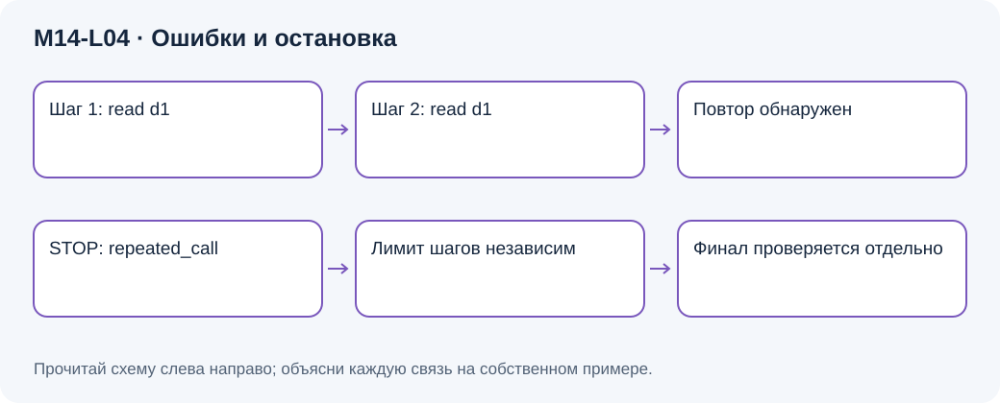

# M14-L04. Ошибки и остановка

Версия материала: 1.1.0. Это самостоятельный урок: внешняя проверка наставником необязательна.

> **Версии и дата проверки:** Python 3.11.9, стандартная библиотека; внешние модели не используются · проверено 04.11.2026 · источник: [Python 3.11: json](https://docs.python.org/3.11/library/json.html)

## Результат и входные знания

После урока ты сможешь: **Гарантировать завершение цикла при повторах, ошибках и исчерпании бюджета.** Перед началом нужны M14-L03: предыдущий шаг модуля. Если термин из этого списка неясен, вернись к соответствующему уроку и воспроизведи его маленький пример. Продолжение по календарю не заменяет понимание зависимости.

## Объяснение

Цикл должен завершаться не только после удачного ответа. Планировщик может повторять одинаковое действие, получать бесполезный результат, выдавать неправильный формат или не предлагать finish. Поэтому исполнитель задаёт пределы независимо от модели. Минимальные ограничения — число шагов, доступное время и число повторов конкретной операции. В больших системах добавляются токены, денежная стоимость и объём данных.

Лимит шагов ограничивает количество принятых итераций. Важно определить, входит ли finish в бюджет. В нашей лабораторной входит: при budget=1 после одного чтения следующий finish уже не выполняется, результат budget. Это простое и явное правило. Если продукт использует другое правило, оно должно быть отражено в тестах, иначе возникают ошибки на границе.

Повтор одинаковой операции не всегда плох. Повторное чтение после обновления документа может быть полезным, а временная сеть иногда требует retry. Но бесконечное повторение неизменного запроса при неизменном состоянии не даёт новой информации. Учебный исполнитель хранит пары tool+document_id и останавливает дубликат. Для реального сервиса политика должна учитывать тип ошибки и возможное изменение версии данных.

Различай восстановимые и постоянные ошибки. Временныйтайм-аут можно повторить ограниченное число раз с задержкой. Неизвестный инструмент или неправильный тип аргумента не исправятся от простого повторения того же вызова. Если модель получает структурированную ошибку, ей можно разрешить одну исправленную попытку, но общий бюджет всё равно уменьшается. Автоматические повторы не должны скрывать отказ от пользователя бесконечным индикатором ожидания.

Завершение имеет причину: finished, budget, denied, repeated_call, not_available или invalid_action. Причина полезна для интерфейса и диагностики. Только finished говорит о полученном финальном ответе, но даже он ещё не доказывает содержательную правильность. Безопасная остановка по лимиту — отдельный корректный исход, который продукт должен уметь объяснить.

Остановка вычисления и отмена побочного эффекта различаются. Если запрос к внешней системе уже изменил данные, прекращение ожидания не возвращает состояние назад. Поэтому для действий записи нужны идемпотентность, подтверждённый результат и иногда компенсация. В голосовом контуре отмена должна дополнительно запретить проигрывание позднего аудиофрагмента: завершившаяся позже задача не должна оживить отменённую реплику.



Сопоставь подписи с примером: объясни величины и укажи, какие отношения показаны на рисунке.

## Аналогия: политика повторов HTTP-клиента

Как похоже: HTTP-клиент повторяет запрос после 503 или таймаута с задержкой и ограниченным числом попыток, но не повторяет 400 Bad Request — тот же запрос снова получит ту же ошибку. Общий таймаут ограничивает всю операцию. Отменённый запрос мог уже списать деньги, поэтому запись защищают идемпотентностью. А ответ устаревшего fetch отбрасывают по id запроса.

| В уроке | В аналогии |
| --- | --- |
| Лимит шагов | Общий таймаут и лимит попыток на операцию |
| Повтор той же пары tool + document_id | Тот же запрос при неизменном состоянии: новой информации нет |
| timeout — восстановимая ошибка | 503 или таймаут: можно повторить с задержкой |
| invalid_arguments — постоянная ошибка | 400 Bad Request: повтор того же запроса не поможет |
| Причина остановки | Статус задачи в очереди: done, timeout, rejected |
| Остановка не отменяет запись | Отменённый запрос мог уже списать деньги: нужна идемпотентность |
| Поздний аудиофрагмент после отмены | Ответ устаревшего fetch, отброшенный по id запроса |

**Где аналогия ломается:** политика повторов HTTP-клиента работает с ошибками, у которых известные коды и предсказуемое поведение. Планировщик-LLM может каждый раз предлагать разные неверные действия, и «повтор» не обязательно буквально тот же, поэтому общий бюджет шагов ограничивает цикл независимо от того, что именно предлагает модель.

## Разобранный пример

Python-блок выполняй из корня `C:\projects\ml-llm-course` в окружении курса (например, в ячейке Jupyter).

При плане read(d1), read(d1), finish второй шаг заканчивается repeated_call; трасса содержит одно успешное чтение. При read(d1), finish и budget=1 причина budget. План из одного read заканчивается no_final_action.

```python
from labs.M14.demo import execute
read = {'tool': 'read_document', 'args': {'document_id': 'd1'}}
finish = {'tool': 'finish', 'args': {'answer': 'Done'}}
print(execute([read, read, finish])['stop'])
print(execute([read, finish], budget=1)['stop'])
assert execute([read, read])['stop'] == 'repeated_call'
```

Порядок проверок является частью наблюдаемого поведения. Для теста на повтор дай достаточный бюджет, иначе первым сработает ограничение шагов.

## Практика с поддержкой

**Предскажи до запуска.** Прежде чем запускать код или пересчитывать пример, запиши ожидаемый вывод: числа, формы массивов, порядок или текст. После запуска сравни с фактическим и объясни каждое расхождение.

Прогони три коротких плана вручную и для каждого заполни step, seen, observations, stop. Затем сравни с лабораторной. Если причина остановки отличается, проверь порядок условий. Для собственной реализации заранее реши, считается ли finish шагом и как учитываются неуспешные попытки.

Для технической практики используй [лабораторную M14](../../labs/M14/README.md). Полный код находится отдельно от твоего решения. Сначала предскажи результат одного контрольного случая, затем запусти пример и объясни расхождение, если оно появилось. Запиши команду, версию окружения и фактический вывод, чтобы позже повторить опыт.

## Самостоятельная задача A

Опиши политику для инструмента поиска, который иногда возвращает timeout. Разреши максимум две повторные попытки, общий лимит пять шагов и запрети повтор при invalid_arguments. Проследи последовательность timeout, timeout, success, finish и случай трёх timeout. Не путай количество попыток и повторов.

Сохрани первую попытку в `submissions/M14-L04.md`: исходные данные, результат и краткое обоснование.

## Подсказки по очереди

1. Два повтора означают три попытки: исходную и две дополнительные.
2. Считай каждый вызов шагом; timeout, timeout, success, finish использует четыре шага.
3. Третий timeout исчерпывает локальный бюджет раньше глобального. Добавь deadline, иначе один зависший вызов может длиться бесконечно.

## Критерии и типичные ошибки

За объяснение механизма, корректность проверки, воспроизводимость и ограничения поставь по 0–2 балла: 0 — отсутствует или неверно, 1 — частично с помощью, 2 — самостоятельно и обоснованно. Для перехода каждый критерий должен быть выполнен самостоятельно (2); понимание механизма и новая задача обязательны и не компенсируются другими баллами. При помощи сначала отметь «с поддержкой», затем реши вариант B без подсказки. Критических ошибок быть не должно. Критические ошибки: подмена реального измерения выдуманным, использование ответа из решения как собственной первой попытки, вывод о качестве за пределами проверенных данных, нарушение явно заданного ограничения задачи. Исправление должно сопровождаться новым примером, а не только заменой текста отчёта.

Первая самостоятельная попытка выполняется без готового решения. После неё разрешены объяснения AI, подсказки и [полный разбор](../../solutions/modules/M14.md#m14-l04). Отметь полученную помощь. Если решение стало понятно только после разбора, состояние навыка — «с поддержкой»; для самостоятельности реши новый вариант.

## Новая и отложенная проверка

B: максимум 2 повтора после исходной попытки; последовательность timeout,timeout,success,finish. Сколько вызовов? C через неделю: первая попытка invalid_arguments; сколько повторов допустимо?

Сохрани новую попытку до просмотра [ключа B/C](../../solutions/modules/M14.md).

## Источники и углубление

- [Официальная документация по теме](https://docs.python.org/3/library/time.html#time.monotonic) — сверяй контракт и определения, не копируй внешний пример вместо самостоятельной работы.
- [Исполняемый пример модуля](../../labs/M14/demo.py) — авторский код курса с явно указанными ограничениями.

[Оглавление модуля](../modules/M14.md)
