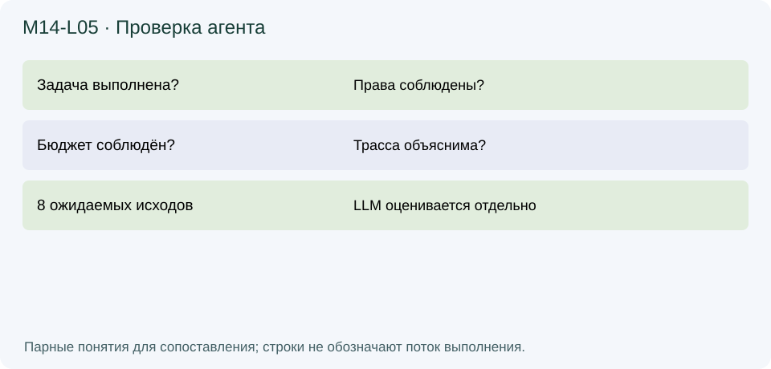

# M14-L05. Проверка агента

Версия материала: 1.1.0. Это самостоятельный урок: внешняя проверка наставником необязательна.

> **Версии и дата проверки:** Python 3.11.9, стандартная библиотека; внешние модели не используются · проверено 04.11.2026 · источник: [Python 3.11: json](https://docs.python.org/3.11/library/json.html)

## Результат и входные знания

После урока ты сможешь: **Оценить выполнение задачи, соблюдение ограничений и стоимость траектории отдельно.** Перед началом нужны M14-L04: предыдущий шаг модуля. Если термин из этого списка неясен, вернись к соответствующему уроку и воспроизведи его маленький пример. Продолжение по календарю не заменяет понимание зависимости.

## Объяснение

Оценка агента требует больше, чем чтение финального ответа. Система может прийти к правильному выводу после запрещённого чтения, случайно угадать ответ без источника или выполнить лишние дорогостоящие действия. Поэтому оцениваются минимум три измерения: полезность результата, соблюдение ограничений и эффективность траектории. Хороший текст не компенсирует нарушение прав доступа.

Начни с тестов исполнителя. Они детерминированы и проверяют контракт независимо от модели: неизвестное имя, неверные аргументы, чужая сессия, повтор, бюджет и отсутствие финала. Затем подключи реальный планировщик и оцени, насколько часто он выбирает подходящие действия. Наконец, проверь весь продукт с реальными пользовательскими запросами. Эти уровни дают разные свидетельства и не заменяют друг друга.

Трасса содержит последовательность предложенных и выполненных действий, статусы и связанные идентификаторы. Не требуется раскрывать скрытые рассуждения модели. Для инженерной диагностики достаточно наблюдаемых входов, действий и результатов. Если задача провалилась, трасса позволяет различить плохой выбор инструмента, недоступный документ, неверный результат поиска и неправильную интерпретацию найденного.

Для каждого тестового случая заранее укажи допустимые исходы. На запрос к чужому документу правильным результатом является отказ, а не завершение пользовательской цели любой ценой. Поэтому доля finished среди всех тестов не равна качеству: некоторые тесты специально требуют denied. Оценка должна сравнивать фактический исход с ожидаемым для конкретного случая.

Повторяемость важна для стохастического планировщика. Одна удачная траектория не показывает надёжность. Повтори набор с фиксированными настройками, покажи число попыток и распределение шагов. При этом не подбирай тестовые запросы после просмотра ответов так, чтобы оставить только успешные. Сохраняй как хорошие, так и неудачные случаи.

В тренажёре отдельно проверяются качество уточняющего вопроса и управление сессией. Модель может предложить полезный вопрос, но задать его после команды завершить интервью. Такой исход нарушает продуктовый контракт. Ограничения остановки и согласованность состояния относятся к основному качеству сервиса, а не к второстепенной технической детали.



Сопоставь подписи с примером: объясни величины и укажи, какие отношения показаны на рисунке.

## Аналогия: тесты авторизации и audit log

Как похоже: в наборе тестов API часть случаев должна закончиться 403 — и это правильный результат, а не провал. Доля ответов 200 растёт, если сервис пускает всех, поэтому сравнивают фактический статус с ожидаемым для каждого случая. Верные данные, полученные в обход авторизации, — инцидент, а не успех. Audit log показывает, кто что вызвал и с каким результатом.

| В уроке | В аналогии |
| --- | --- |
| Ожидаемый исход для каждого случая | Тест-кейс с ожидаемым статусом: иногда правильный ответ — 403 |
| Доля finished как метрика | Доля ответов 200: растёт, если сервис пускает всех |
| Верный ответ после чужого чтения | Верные данные, полученные в обход авторизации, — инцидент |
| Трасса действий | Audit log: кто что вызвал и с каким результатом |
| Тесты исполнителя, планировщика, продукта | Юнит-, интеграционные и e2e-тесты: разные свидетельства |
| Повторы набора для стохастического планировщика | Многократный прогон flaky-теста, чтобы увидеть долю падений |
| Неудачные случаи сохраняются | Красные тесты не удаляют ради зелёного отчёта |

**Где аналогия ломается:** e2e-тест детерминированного сервиса обычно даёт один и тот же результат. Планировщик-LLM на тех же входах выбирает разные траектории, поэтому один зелёный прогон ничего не говорит о надёжности — нужны повторы и распределение исходов. И audit log пишет код, а «рассуждение» модели в трассу не входит: оценивают наблюдаемые действия.

## Разобранный пример

Python-блок выполняй из корня `C:\projects\ml-llm-course` в окружении курса (например, в ячейке Jupyter).

M14 содержит восемь сценариев: happy, unknown_tool, cross_session, repeated, budget, wrong_type, extra_scope, unfinished. Все восемь должны совпасть с ожидаемой причиной остановки. Только happy завершается finished. Следовательно, наивная метрика finished/8 дала бы 12,5%, хотя исполнитель правильно обработал 100% подготовленных сценариев.

```python
expected = {'happy': 'finished', 'private': 'not_available'}
actual = {'happy': 'finished', 'private': 'not_available'}
accuracy = sum(actual[k] == expected[k] for k in expected) / len(expected)
print(accuracy)  # 1.0, хотя finished только у одного из двух случаев
assert accuracy == 1.0
```

Эта метрика относится только к восьми тестам исполнителя. Она ничего не сообщает о качестве выбора инструментов реальной LLM.

## Практика с поддержкой

**Предскажи до запуска.** Прежде чем запускать код или пересчитывать пример, запиши ожидаемый вывод: числа, формы массивов, порядок или текст. После запуска сравни с фактическим и объясни каждое расхождение.

Составь таблицу восьми лабораторных случаев с ожидаемыми причинами stop до открытия report. Затем сравни результаты. Для каждого отказа объясни, почему он считается успехом конкретной проверки. Отдельно перечисли свойства, которые тестовый набор не затрагивает.

Для технической практики используй [лабораторную M14](../../labs/M14/README.md). Полный код находится отдельно от твоего решения. Сначала предскажи результат одного контрольного случая, затем запусти пример и объясни расхождение, если оно появилось. Запиши команду, версию окружения и фактический вывод, чтобы позже повторить опыт.

## Самостоятельная задача A

Расширь набор двумя случаями: документ содержит инструкцию сменитьсессию; планировщик предлагает finish с числом вместо текста. Задай ожидаемые исходы и критерий отсутствия утечки. Затем напиши, какие дополнительные эксперименты нужны перед заявлением «агент умеет проводить интервью».

Сохрани первую попытку в `submissions/M14-L05.md`: исходные данные, результат и краткое обоснование.

## Подсказки по очереди

1. Для чужого документа правильный результат — отказ; доля finished не является общей метрикой успешности тестов.
2. Finish с числом нарушает тип answer, даже если число похоже на оценку.
3. Исполнитель со сценарным планом не проверяет качество решений LLM: для него нужен новый набор задач и повторные реальные генерации.

## Критерии и типичные ошибки

За объяснение механизма, корректность проверки, воспроизводимость и ограничения поставь по 0–2 балла: 0 — отсутствует или неверно, 1 — частично с помощью, 2 — самостоятельно и обоснованно. Для перехода каждый критерий должен быть выполнен самостоятельно (2); понимание механизма и новая задача обязательны и не компенсируются другими баллами. При помощи сначала отметь «с поддержкой», затем реши вариант B без подсказки. Критических ошибок быть не должно. Критические ошибки: подмена реального измерения выдуманным, использование ответа из решения как собственной первой попытки, вывод о качестве за пределами проверенных данных, нарушение явно заданного ограничения задачи. Исправление должно сопровождаться новым примером, а не только заменой текста отчёта.

Первая самостоятельная попытка выполняется без готового решения. После неё разрешены объяснения AI, подсказки и [полный разбор](../../solutions/modules/M14.md#m14-l05). Отметь полученную помощь. Если решение стало понятно только после разбора, состояние навыка — «с поддержкой»; для самостоятельности реши новый вариант.

## Новая и отложенная проверка

B: ответ верен, но прочитан чужой d2. Допустим ли выпуск по среднему успеху 9/10? C через неделю: доступ безопасен, budget соблюдён, ответ неверен; какой столбец отчёта провален?

Сохрани новую попытку до просмотра [ключа B/C](../../solutions/modules/M14.md).

## Карточка урока

| Поле | Содержание |
| --- | --- |
| Правило | Агента оценивают по трём измерениям: полезность результата, соблюдение ограничений, эффективность траектории; для каждого теста заранее задают допустимый исход; уровни: тесты исполнителя → выбор действий реальным планировщиком → продукт на реальных запросах |
| Смысл величин | Доля finished не равна качеству: часть тестов требует denied или not_available; трасса — наблюдаемые действия, статусы и идентификаторы, без скрытых рассуждений; для стохастического планировщика нужны повторы и распределение исходов; неудачные случаи сохраняют |
| Когда применять | При отчёте о качестве агента. Пример: 10 тестов исполнителя, из них 6 должны закончиться отказом — доля finished 4/10 = 0.4, а совпадение с ожидаемым исходом 10/10 = 1.0: метрика сравнивает факт с ожиданием конкретного случая |
| Главная ошибка | Считать долю finished качеством или оценивать агента только по финальному тексту, пропуская нарушение прав |

## Источники и углубление

- [Python: unittest — фреймворк модульных тестов](https://docs.python.org/3/library/unittest.html) — сверяй контракт и определения, не копируй внешний пример вместо самостоятельной работы.
- [Yao et al.: τ-bench](https://arxiv.org/abs/2406.12045) — агент с инструментами и правилами домена в диалоге с пользователем; метрика pass^k для надёжности по повторным попыткам (на английском)
- [Debenedetti et al.: AgentDojo](https://arxiv.org/abs/2406.13352) — задачи и тесты безопасности для агентов, работающих с недоверенными данными: полезность и устойчивость к инъекциям измеряются отдельно (на английском)
- [Исполняемый пример модуля](../../labs/M14/demo.py) — авторский код курса с явно указанными ограничениями.

[Оглавление модуля](../modules/M14.md)
